# Air pollution module

## Executive summary

Policies aimed to reduce GHG emissions, such as carbon pricing, can lead to a reduction in ambient air pollution, a major health risk[^6_1], due to the co-emission of GHGs and local pollutants when burning fossil fuels. Local pollutants, such as BC, OC, NH3, SO2 and NMVOC are responsible for the formation of fine particulate matter (PM2.5) and ozone (O3) pollution, with known health impacts. CPAT quantifies reductions in mortality and morbidity from improved air quality as part of the co-benefits of carbon pricing.

<!-- PS: 
- Maybe in the first sentence below we could add in bracket the name of the models. 
- Are "regression analysis, machine leaning models" inputs? -->
The air pollution module in CPAT is mostly based on models developed by
external institutions and researchers, but also includes modeling
developed specifically for CPAT. The main inputs are: (1) energy consumption in time and scenario by fuel type and sector from the Mitigation module, (2) emission factors net of projected average use of
pollution control equipment, fuel processing and combustion method from
GAINS model[^6_2], (3) concentrations of PM2.5 and ozone for
the baseline year, (4) emissions-to-concentrations relationships based
on source receptor matrices (TM5-FASST), regression analysis, machine
learning models, source apportionment studies and intake fractions, (5)
relative risk functions[^6_3] for exposure to PM2.5 and
O3, and (6) population projections in time.

The main results from the air pollution module are mortality and
disability adjusted life-years (DALYs) attributed to air pollution
(ambient and household) under the baseline and the carbon price
scenario. Other outputs include: (1) the economic valuation of averted deaths
(using a transferred value of the statistical life), (2) health expenditure,
(3) working days lost due to pollution, and (4) market output losses due to
morbidity and mortality.

Reduced-form approximations are used to estimate emissions,
concentration of pollutants and health effects. We use and adapt the
results of more complex models into simplified relationships. For
instance, in the case of the relationship between emissions of
pollutants and ambient concentrations of PM2.5 and ozone,
CPAT includes the option to use the results from a linear emulator of a
complex global chemical transport model. The results of the air
pollution module are in line with other more complex models (see
@sec-validation), although both CPAT and the models to which we
compare to are subject to uncertainty and the results may be sensitive
to the assumptions used. We address this issue in CPAT by allowing the
user to input local information, if available, and to switch among
methodological options (with the best options possibly dependent on the
country chosen).

<!-- PS: 
- What is the caveat linked to "country level" - I guess this is linked to the lack of local data  -->
Caveats in the air pollution module include the use of
international databases, the country level (instead of sub national) and annual resolution of the
analysis and the uncertainty on estimations. @sec-caveats provides some insights on how the user can tackle these caveats.

## List of Acronyms

**Institutions**

IHME Institute for Health Metrics and Evaluation

IIASA International Institute for Applied Systems Analysis

ILO International Labour Organization

IMF International Monetary Fund

IPCC The Intergovernmental Panel on Climate Change

OECD Organization for Economic Co-operation and Development

WHO World Health Organization

**Abbreviations**

BoD Burden of Disease

CPAT Climate Policy Assessment Tool

CLE Current Legislation Scenario

CPI Consumer Price Index

DALY Disability-adjusted life year

EDGAR Emissions Database for Global Atmospheric Research

EF Emission Factor

FASST Fast Scenario Screening Tool

GAINS Greenhouse Gas - Air Pollution Interactions and Synergies

GBD Global Burden of Disease

GDP Gross Domestic Product

GEPR Getting Energy Prices Right

GHED Global Health Expenditure Database, WHO

GTP Global Temperature Potential

GWP Global Warming Potential

HAP Household air pollution

IER Integrated Exposure Response

LPG Liquified Petroleum Gas

OAP Outdoors air pollution

PAF Population Attributable Fraction

PPP Purchasing Power Parity

PTB Preterm birth

RR Relative Risk

SLCF Short-lived climate forcers

THE Total Health Expenditure

TMREL Theoretical minimum risk exposure level

UNFCCC United Nations Framework Convention on Climate Change

VSL Value of the statistical life

YLL Years of life lost

**Pollutants and substances**

BC Black Carbon

CH4 Methane

CO Carbon monoxide

HFCs Hydrofluorocarbons

NF3 Nitrogen triflouride

NMVOC Non methanic volatile organic compounds

NOx Nitrogen oxides

O3 Ozone

OC Organic Carbon

PFCs Perfluorocarbons

PM2.5 Particulate matter (PM) that have a diameter of less than 2.5
micrometers

POM Primary Organic Matter

SF6 Sulphur hexafluoride

SO2 Sulfur dioxide

**Units**

6mDMA8h Six-month period with the highest mean, 8-h daily maximum
concentration metric

GJ Giga Jules (1 GJ =10^9 jules)

µg/m3 Micrograms per cubic meter

ktoe kilotons of oil equivalent

PJ Peta Jules (10^15 Jules)

ppb parts per billion

## Introduction

<!-- PS: 
- I suggest we remove the description of CPAT and start with "The present document focuses on the methodology..." because we already present CPAT earlier  -->

<!-- The Climate Policy Assessment Tool, CPAT, is a spreadsheet-based tool -->
<!-- aimed to be used by economists in finance ministries and international -->
<!-- financial institutions. CPAT can help policymakers in the design and -->
<!-- comparison of carbon pricing reforms, to help them achieve their climate -->
<!-- mitigation goals (Paris Agreement NDCs) and development objectives -->
<!-- (SDGs) jointly. -->

<!-- CPAT allows a rapid estimation of the potential effects of carbon -->
<!-- pricing reforms in terms of: -->

<!--   - Macroeconomic effects, such as GDP impacts, employment, fiscal -->
<!--     revenues, and tax evasion. -->

<!--   - Energy price changes, including distributional impacts among -->
<!--     households and profits from the oil and gas sector. -->

<!--   - Energy use and its impacts on emissions of local pollutants and -->
<!--     CO2. -->

<!--   - Development co-benefits, including reductions in mortality and -->
<!--     morbidity due to local air pollution and road accidents, traffic -->
<!--     congestion and reductions in the shadow economy. -->

The present Chapter focuses on the methodology followed in CPAT to
assess the air pollution development co-benefits of carbon pricing. 

@fig-methodo shows an overview of the methodology, where the red box
highlights the topics covered in this document. As presented in the
figure, the air pollution tab receives as an input the energy
consumption for the different sectors and fuels from the Mitigation
tab. Emissions (of local and global pollutants) are calculated in the
Mitigation tab of CPAT, but the data sources and methodology used is
covered in this Chapter. Based on emissions estimates, the Air Pollution tab
calculates for each year the concentration of PM2.5 and
O3, the health impacts attributed to pollution (deaths and
DALYs) and economic impacts of pollution.

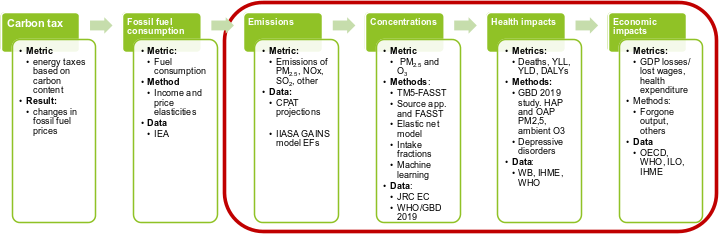{#fig-methodo}

The health impacts attributable to air pollution methodology is
presented in @fig-methodohealth. As shown in the figure, the total health burden
of pollution is estimated for the baseline scenario and for the carbon
price scenario. The impact of the carbon price is then estimated as the
difference between the total burden under both scenarios.

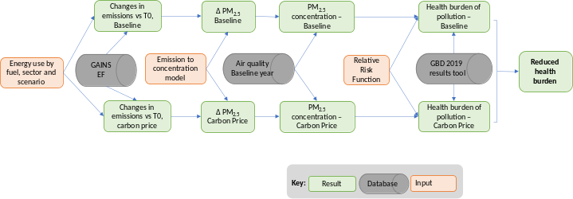{#fig-methodohealth}

The methodological steps presented in @fig-methodo and @fig-methodohealth are
described in the following sections. @sec-calc_em presents the sources and
methods for estimating emissions. @sec-em_ap explains the relationship
between emissions and ambient pollution. @sec-health_ap introduces the
quantification of the health burden of air pollution and @sec-eco_ap
presents the quantification of the economic impacts of pollution. This Chapter presents additional sections to validate findings (@sec-validation) and make the user aware of the limits (@sec-caveats) of the air pollution module. 

## Methods for calculating emissions {#sec-calc_em}

In this section we explain how we calculate emissions in CPAT
(Mitigation tab), using as input the fuel consumption by sector and over
time, and emission factors (@fig-highem). Emissions will be used to calculate
concentrations of PM2.5 and O3.

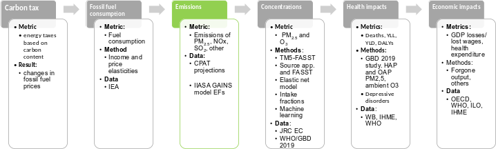{#fig-highem}

### Data sources for emissions

| Input                                         | Source                                                                                                        |
| --------------------------------------------- | ------------------------------------------------------------------------------------------------------------- |
| Energy consumption by fuel and sector in time | CPAT mitigation module. Based in IEA energy balances (IEA 2019) and others. See Mitigation tab documentation. |
| Emission Factors                              | GAINS model, IIASA (@wagner2020implied)                                                                       |
| Radiative coefficients                        | GAINS model, IIASA (@wagner2020implied)                                                                       |

### Emission factors from GAINS

Emissions for the baseline scenario are taken from the Greenhouse Gas -
Air Pollution Interactions and Synergies (GAINS) Global Model, from the
International Institute for Applied Systems Analysis (IIASA). The GAINS
scenario selected as baseline is the ECLIPSE\_V5a\_CLE\_base. This
dataset was created in June 2015 and it covers emissions from 1990 to
2050 in five-year intervals. This baseline scenario considers current
legislation (CLE) and committed legislation. The emission factors were
grouped to reflect CPAT sectors and fuels, as described in @wagner2020implied.

The basic principle to estimate emissions in GAINS is presented in
expression (@eq-gainsem). Emissions are driven by activity levels (such as
energy consumption), emissions factors that depend on the process and
fuel type utilized (if any) and technology implementations that account
for possible pollution control technologies (such as particulate
filters, electrostatic precipitators, among many others). The emission
factors used in CPAT include country specific technology
implementations, according to the Current Legislation Scenario.

 $$Emissions = FuelConsumption*Emission\ Factors$$ {#eq-gainsem}

In CPAT, the pollutants included are PM2.5, NOx,
SO2, CO2, NMVOC, BC, OC, CH4, CO, while
the sectors and fuels for which we have emissions factors are presented
in @tbl-ef [^6_4].

| **Sector**             | **Subsector**  | **Biomass** | **Coal** | **Diesel** | **Gasoline** | **Jet fuel** | **Kerosene** | **LPG** | **Natural Gas** | **Other oil products** |
|------------------------|----------------|-------------|----------|------------|--------------|--------------|--------------|---------|-----------------|------------------------|
| Power                  |               | X           | X        | X          | X            |             |             |        | X               | X                      |
| Residential            |               | X           | X        | X          | X            |             | X            | X       | X               | X                      |
| Transport              | Road transport |            |         | X          | X            |             | X            | X       | X               |                       |
| | Aviation               |               |            |         |           | X            |             |          | |        |                |
| | Rail                   |               |            | X        |           |             |             |             |        |                |
| Industries             | Construction   |            |         | X          | X            |             | X            | X       | X               |                       |
| | Food and Forestry      | X              | X           | X        | X          |             | X            | X            | X       | X               |
| | Mining &amp; Chemicals |               |            | X        | X          |             |             |             | X       |                |
| | Manufacturing          | X              | X           | X        | X          |             | X            | X            | X       | X               |
| | Other Manufacturing    | X              | X           | X        | X          |             | X            | X            | X       | X               |
| | Services               | X              | X           | X        | X          |             | X            | X            | X       | X               |

: Emission factor sectors and fuels {#tbl-ef}

*Source: Own elaboration based on @wagner2020implied*

<!-- PS: Something is missing in the sentence below 'select the X to" -->
The EF from the current legislation scenario will change in time, as
shown in @fig-exem. In CPAT, the user can select the to use EFs that
are variable in time or a constant value, from year 2015.

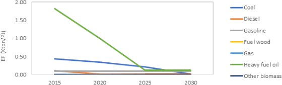{#fig-exem}

*Source: Own elaboration based on @wagner2020implied*

The EF from GAINS are country specific for 89 countries.
For countries not included in that group, we consider regional averages.

@fig-quality shows data quality categories for countries included in the
GAINS model. In green is Category 1, for which there is high confidence
in the data. In yellow is category 2, for which there is medium
confidence and in red, is category 3, for which the level of confidence
is low.

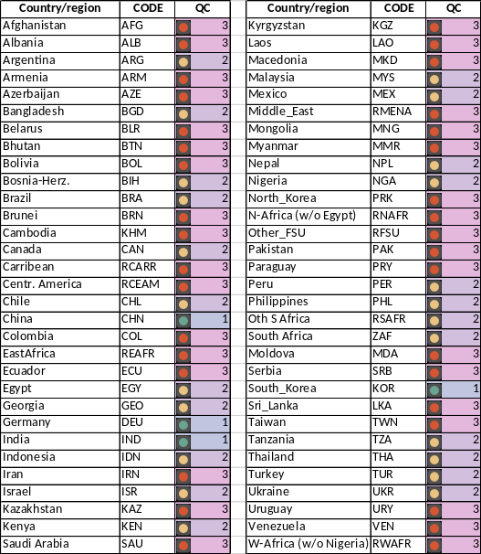{#fig-quality}

*Source: Personal communication with Fabian Wagner. Category 1: High confidence, Category 2: Medium confidence Category 3: Low confidence.*

### Radiative forcing coefficients

Reducing local air pollutants will result in positive health impacts.
However, the reduction of local pollutants can imply an increase in
global warming, because of the cooling effect of some of these
pollutants. Some local pollutants behave asymmetrically compared to GHGs: the more they are emitted, the more they cool the earth. @fig-pollcont presents a diagram of the cooling and warming
effects of reducing pollutants.

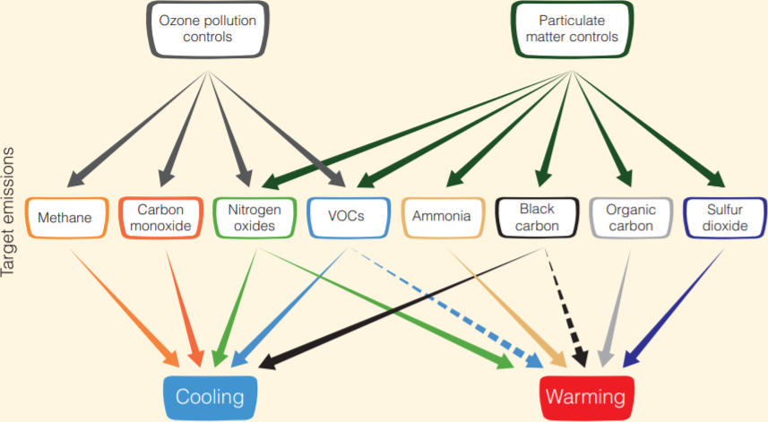{#fig-pollcont}

*Source: @myhre2014anthropogenic[^6_5]. Solid lines indicate known impact; dashed lines indicate uncertain impact.*

CPAT will consider the net warming effects of reducing local pollutants,
according to their Global Warming Potential in a hundred years (GWP100),
using the regional values presented in @tbl-gwp.

| Region         | CO    | NH3      | NOx     | PM\_BC  | PM\_OC    | SO2      | VOC   |
| -------------- | ----- | -------- | ------- | ------- | --------- | -------- | ----- |
| Africa         | 1.989 | \-13.332 | \-7.058 | 356.463 | \-121.075 | \-85.172 | 6.154 |
| Asia & Oceania | 1.989 | \-13.332 | \-7.058 | 356.463 | \-121.075 | \-85.172 | 6.154 |
| Eurasia        | 3.246 | \-18.162 | \-9.501 | 407.156 | \-138.559 | \-109.67 | 7.303 |
| Europe         | 3.246 | \-18.162 | \-9.501 | 407.156 | \-138.559 | \-109.67 | 7.303 |
| Middle East    | 1.989 | \-13.332 | \-7.058 | 356.463 | \-121.075 | \-85.172 | 6.154 |
| North America  | 1.989 | \-13.332 | \-7.058 | 356.463 | \-121.075 | \-85.172 | 6.154 |

: GWP100 coefficients used in CPAT {#tbl-gwp}

*Source: GAINS model, IIASA.*

Besides CO2 emissions, CPAT will consider the Global Warming
Potential of methane, using the GWP100 indicated in @tbl-methane.

| Substance | GWP100 | Source                                |
| --------- | ------ | ------------------------------------- |
| CH4       | 28.0   | IPCC 5th assessment report |

: GWP100 coefficients for CH4 used in CPAT {#tbl-methane}

*Source: @ipcc2014climate.*

A list of substances with radioactive forcing impacts is presented in
@tbl-substance. The table indicates which substances are included in CPAT and
in the UNFCCC framework.

| Substance type                     | Substance         | UNFCCC | CPAT |
| ---------------------------------- | ----------------- | ------ | ---- |
| Greenhouse gases                   | CO2               | ✓      | ✓    |
|                                    | CH4               | ✓      | ✓    |
|                                    | N2O               | ✓      | ✕    |
|                                    | HFCs              | ✓      | ✕    |
|                                    | PFCs              | ✓      | ✕    |
|                                    | SF6               | ✓      | ✕    |
|                                    | NF3               | ✓      | ✕    |
| Short-lived climate forcers (SLCF) | BC                | ✕      | ✓    |
|                                    | O3 (tropospheric) | ✕      | ✕\*  |
|                                    | CH4               | ✓      | ✓    |
|                                    | HFCs              | ✓      | ✕    |
|                                    | SO2               | ✕      | ✓    |
|                                    | NOx               | ✕      | ✓    |
| Precursors of SLCF                 | CO                | ✕      | ✓    |
|                                    | NMVOC             | ✕      | ✓    |
|                                    | SO2               | ✕      | ✓    |
|                                    | NOx               | ✕      | ✓    |
|                                    | NH3               | ✕      | ✕    |
|                                    | OC                | ✕      | ✓    |

: Substances with climate/radiative forcing impacts under UNFCCC and CPAT {#tbl-substance} 

*Source: Own elaboration. (\*) CPAT includes the health effects of
ambient ozone, but not emissions of ozone.*

## Methods to relate emissions and ambient pollution {#sec-em_ap}

This chapter describes the options implemented in CPAT to link emissions
and ambient pollution: i) TM5-FASST model, ii) Source apportionment
information combined with FASST, iii) Elastic Net model, iv) Intake
fractions, and v) Machine learning (see @fig-concentration).

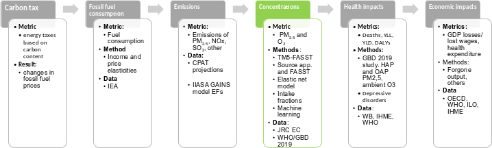{#fig-concentration}

@tbl-aggsec describes the aggregation of sectors done in the air pollution
tab, which in some cases differs from the sector used in the Mitigation
tab.

| Air pollution aggrupation              | Air pollution Subsector code | Manufacturing sub sectors | Mitigation sub sectors                 | Fuel used |
| -------------------------------------- | ---------------------------- | ------------------------- | -------------------------------------- | --------- |
| Coal Power Plants                      | pow                          |                           | Power                                  | coa       |
| Gas Power Plants                       |                              |                           |                                        | nga       |
| Other Power Plants                     |                              |                           |                                        | oop       |
|                                        |                              |                           |                                        | bio       |
| Road transport                         | rod                          |                           | Road                                   | multiple  |
| Residential, services and construction | res                          |                           | Residential                            | multiple  |
|                                        | cst                          |                           | Construction                           | multiple  |
|                                        | srv                          |                           | Services                               | multiple  |
| Industries and other energy            | mnf                          | irn                       | Iron and steel                         | multiple  |
|                                        |                              | nfm                       | Non-ferrous metals                     | multiple  |
|                                        |                              | mac                       | Machinery                              | multiple  |
|                                        |                              | cem                       | Cement                                 | multiple  |
|                                        |                              | ftr                       | Fuel transformation & transportation   | multiple  |
|                                        | mch                          |                           | Mining & Chemicals                     | coa       |
|                                        | omn                          |                           | Other manufacturing                    | coa       |
|                                        | oen                          |                           | Other - energy use                     | multiple  |
|                                        | ral                          |                           | Rail                                   | die       |
|                                        | avi                          |                           | Domestic Aviation\*                    | jfu       |
| Food & forestry                        | foo                          |                           | Food & forestry (includes agriculture) | multiple  |

: Source types in the Air pollution and Mitigation modules {#tbl-aggsec} 

*Source: Own elaboration. (\*) considers emissions from departing and landing only.*

### Data sources to relate emissions and ambient concentrations

| Input                                                               | Source                                                                                                    |
| ------------------------------------------------------------------- | --------------------------------------------------------------------------------------------------------- |
| TM5-FASST model, from the European Commission Joint Research Center | @van2018tm5                                                                                |
| TM5-FASST mode, downscaled at a country level                       | @aleluia                                                                                       |
| Elastic Net Model \& Machine learning models                        | @renna  |                                                                         |
| WHO source apportionment database                                   | @who15                                                                                               |
| Other source apportionment studies                                  | @world2020regional; @world2019air @lelieveld2015contribution; @almeida2020ambient; @acp-14-9977-2014 |
| Intake fractions                                                    | @zhou2006influence; @apte2012global

: Summary of data sources to relate emissions to ambient pollution {#tbl-datasource} 

### Option 1: TM5-FASST {#sec-tmfasst}

The Fast Scenario Screening Tool (FASST) is an emulator of the full
TM5-CTM global chemical transport model. FASST is a source-receptor
model with linearized relations between emissions and concentrations.
This tool allows the modeling of ambient PM2.5 and
O3 concentrations.

FASST includes 56 source-receptor regions (see @fig-56cont) and the
pollutants considered (as emissions) are SO2, NOx,
NH3, OC, NMVOC, Elemental Carbon, Primary Organic
Matter[^6_6], PM2.5[^6_7] and CH4.

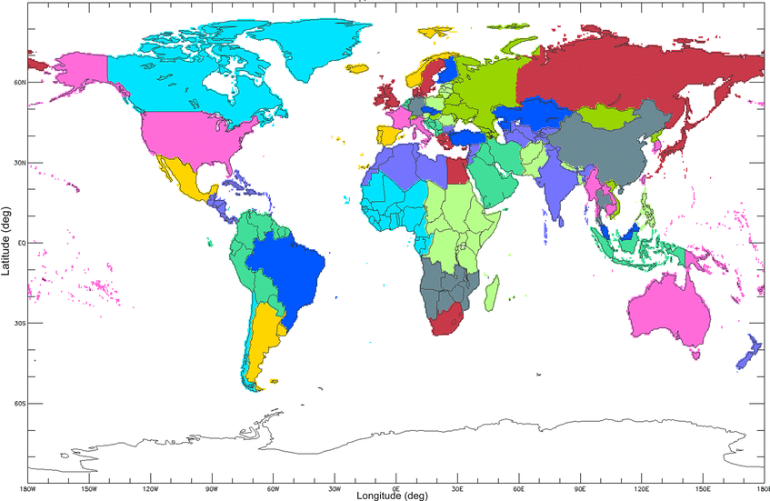{#fig-56cont}

*Source: @van2018tm5*

<!-- PS: I am not sure of this sentence - it is not in the word document. I don't know what is Table S2.2. -->

<!-- *Note: See Table S2.2 for the mapping between regions and countries.* -->

The coefficients from the source-receptor matrices are given by
@eq-sourcerecep and the concentration in receptor $y$ from component
$j$ are presented in @eq-deltae - see @van2018tm5.

$$A_{\text{ij}}\left\lbrack x,\ y \right\rbrack = \frac{\mathrm{\Delta}C_{j}(y)}{\mathrm{\Delta}E_{i}\left( x \right)}$$ {#eq-sourcerecep} 

With $\mathrm{\Delta}E_{i}\left( x \right) = 0.2E_{i,base}\left( x \right)$

Where: 

$A_{\text{ij}}$: source-receptor matrix coefficient (annual mean responses) in $\mu$g/m3

$x$: source region

$y$: receptor point

$j$: component (PM2.5 and O3)

$i$: precursor of j (BC, POM, SO2, NOx and OPM for j = PM2.5; and
NOx, NMVOC, SO2 and CH4 for j= O3)

Ambient concentration in receptor $y$ from component $j$ is
calculated using expression (@eq-deltae).

$$C_{j}\left( y \right) = C_{j,\ base}\left( y \right) + \sum_{k = 1}^{n_{x}}{\sum_{i = 1}^{n_{i}}{A_{\text{ij}}\left\lbrack x_{k},\ y \right\rbrack*\left\lbrack E_{i}\left( x_{k} \right) - E_{i,\ base}\left( x_{k} \right) \right\rbrack*UrbanIncFactor}}$$ {#eq-deltae}

Where:

$A_{\text{ij}}$: source-receptor matrix coefficient (annual mean
responses)

$n_{i}$: number of precursors $i$

$n_{x}$: number of source regions $x$

$E_{i}(x)$: emission rate (kg/yr) of precursor I at source x

$C_{j,\ base}\left( y \right)$: constant for pollutant $j$ and location $y$

$k$: pollutant

The precursors for PM2.5 included are BC, POM, SO2, NOx and
OPM (other particulate matter). Notice that NH3 emissions are not
included in the analysis and are assumed to be constant over time.

The precursors of ozone considered are NOx, NMVOC, SO2 and CH4.

As mentioned, FASST contains results for 56 regions only. To produce
source-receptor coefficients for every country inside those regions, we
applied a down-scaling of FASST to produce country level coefficients.
The methods are described in @aleluia.

In addition to the country down-scaling from @aleluia, we
produced a downscale based in the population in the FASST regions and in
the countries inside those regions, as presented in expression @eq-downscale.
In some cases, we applied the population downscale, when the performance
of the method described in  @aleluia is low.

$$A_{i,j,country} = A_{i,j,region}*\frac{\text{Population}_{\text{region}}}{\text{Population}_{\text{country}}}$$ {#eq-downscale}

If we multiply the emissions $j$ from the modeled sectors by the
corresponding $A_{i,j}$ coefficients, we obtain the `modeled'
contribution to $i$(where $i$ is PM2.5 or O3)
in CPAT, using expression @eq-modeled.

$$\text{Modeled\ }i_{t,s} = \sum_{j}^{}{\sum_{s}^{}{A_{i,j}*Emissions_{j,s,t}}}$$ {#eq-modeled} 

#### From FASST spreadsheet to CPAT

In the spreadsheet version of FASST (provided by Rita Van Dingenen),
there are two emission scenarios and each of them is compared to FASST
baseline scenario (there are three scenarios in total). In CPAT, we do not
use the FASST baseline scenario, but only two scenarios: baseline (as in
CPAT) and carbon price (as in CPAT). We do not need to include the FASST
baseline scenario in CPAT because to quantify the changes in PM2.5 (or
in O3), attributed to the carbon tax, we subtract the results from the
baseline and the carbon tax. In that operation, FASST baseline would be
eliminated anyways and because of that is not needed.

@tbl-tmffasst presents the operations in FASST spreadsheet and
CPAT adaptations. In the last column of the table, I mention the 'transformations' to the SR coefficients used in CPAT, so the operations are simplified. These transformations yield the same changes
in PM2.5 that we would obtain using the original steps
performed in the spreadsheet of FASST, because all operations are
linear.

| **Emissions**                          | **FASST spreadsheet calculation (*USER\_CALC\_1*)**                                                                      | **CPAT adaptations**                                                                                                                                      |
| -------------------------------------- | ------------------------------------------------------------------------------------------------------------------------ | --------------------------------------------------------------------------------------------------------------------------------------------------------- |
| Uses BC emissions                      | $\text{delta}_{BC - > BC,1} = \left( Em_{BC,1} - EmFASST_{\text{BC}} \right)*SR_{BC - > BC}$                           | In CPAT I multiply BC emissions by $SR_{BC - > BC}*urbanIncfactor = \mathbf{S}\mathbf{R}_{\mathbf{BC,\ CPAT}}$                                          |
| Uses POM emissions= 1.3\*OC            | $\text{delta}_{POM - > POM} = \left( Em_{POM,1} - EmFASST_{\text{POM}} \right)*SR_{POM - > POM}$                       | In CPAT I multiply POM emissions by $SR_{POM - > POM}*urbanIncfactor = \mathbf{S}\mathbf{R}_{\mathbf{POM,\ CPAT}}$                                      |
| Uses Other PM emissions = PM2.5-BC-POM | $\text{delta}_{OPrPM2.5 - > OPrPM2.5,1} = \left( Em_{OPrPM2.5,1} - EmFASST_{OPrPM2.5} \right)*SR_{\mathbf{BC - > BC}}$ | In CPAT I multiply Other PM2.5 emissions by $SR_{BC - > BC}*urbanIncfactor = \mathbf{S}\mathbf{R}_{\mathbf{BC,\ CPAT}}$                                 |
| Uses SO2 emissions                     | $\text{delta}_{SO2 - > SO4,1} = \left( Em_{SO2,1} - EmFASST_{SO2} \right)*SR_{SO2 - > SO4}$                            | In CPAT, I multiply the emissions of SO2 by $SR_{SO2 - > SO4} + \ SR_{SO2 - > NO3} + \ SR_{SO2 - > NH4} = \mathbf{S}\mathbf{R}_{\mathbf{SO2,\ CPAT}}$ |
|                                        | $\text{delta}_{SO2 - > NO3,1} = \left( Em_{SO2,1} - EmFASST_{SO2} \right)*SR_{SO2 - > NO3}$                            |                                                                                                                                                           |
|                                        | $\text{delta}_{SO2 - > NH4,1} = \left( Em_{SO2,1} - EmFASST_{SO2} \right)*SR_{SO2 - > NH4}$                            |                                                                                                                                                           |
| Uses NOx emissions                     | $\text{delta}_{NOx - > SO4,1} = \left( Em_{NOx,1} - EmFASST_{\text{NOx}} \right)*SR_{NOx - > SO4}$                     | In CPAT, I multiply the emissions of NOx by $SR_{NOx - > SO4} + \ SR_{NOx - > NO3} + \ SR_{NOx - > NH4} = \mathbf{S}\mathbf{R}_{\mathbf{NOx,\ CPAT}}$ |
|                                        | $\text{delta}_{NOx - > NO3,1} = \left( Em_{NOx,1} - EmFASST_{\text{NOx}} \right)*SR_{NOx - > NO3}$                     |                                                                                                                                                           |
|                                        | $\text{delta}_{NOx - > NH4,1} = \left( Em_{NOx,1} - EmFASST_{\text{NOx}} \right)*SR_{NOx - > NH4}$                     |                                                                                                                                                           |
| Uses NH3 emissions                     | $\text{delta}_{NH3 - SO4,1} = \left( Em_{NH3,1} - EmFASST_{NH3} \right)*SR_{NH3 - SO4}$                                | In CPAT, we do not have NH3 emissions                                                                                                                     |
|                                        | $\text{delta}_{NH3 - > NO3,1} = \left( Em_{NH3,1} - EmFASST_{NH3} \right)*SR_{NH3 - > NO3}$                            |                                                                                                                                                           |
|                                        | $\text{delta}_{NH3 - > NH4,1} = \left( Em_{NH3,1} - EmFASST_{NH3} \right)*SR_{NH3 - > NH4}$                            |                                                                                                                                                           |

: CPAT adaptations of TM5-FASST, spreadsheet version {#tbl-tmffasst} 

Where $\text{EmFASST}$ are FASST base emissions and $Em_{p,1}$ are
emissions from pollutant $p$ in scenario 1.

In the tab ***USER\_CALC\_1,*** $\text{delta}_{\text{BC}}$ and
$\text{delta}_{\text{POM}}$ are then multiplied by the urban
incremental factor.

$$d_{BC,1} = delta_{BC,1}*urbIncfactor$$ {#eq-bcincfactor}

$$d_{POM,2} = delta_{POM,1}*urbIncfactor$$ {#eq-pomincfactor}

And the following aggregations among deltas are made:

$$d_{SO4,1} = delta_{SO2 \rightarrow SO4,1} + delta_{NOx - > SO4,1} + delta_{NH3 - SO4,1}$$ {#eq-so4agg} 
$$d_{NO3,1} = delta_{SO2 - > NO3,1} + delta_{NOX - > NO3,1} + delta_{NH3 - > NO3,1}$$ {#eq-no3agg}  
$$d_{NH4,1} = delta_{SO2 - > NH4,1} + delta_{NOx - > NH4,1} + delta_{NH3 - > NH4,1}$$ {#eq-nh4agg}  
$$d_{OPrPM2.5,1} = delta_{OPrPM2.5 - > OPrPM2.5,1}$$ {#eq-opragg}   

Finally, the total change in PM2.5 concentrations in scenario 1 is:

$$\text{TOTdP}M_{1} = d_{BC,\ 1} + d_{POM,\ 1\ } + d_{SO4,1} + d_{NO3,1} + d_{NH4,1} + d_{OPrPM2.5,1}$$ {#eq-totdp} 

Where $\text{TOTdP}M_{1}$ is the change in concentration with respect
to FASST Baseline.

The same procedure is applied to calculate $\text{TOTdP}M_{2}$, using
the emissions of the scenario 2. $\text{TOTdP}M_{2}\ $ is the change
in PM2.5 form scenario 2 versus FASST baseline scenario.

Then, in tab **RESULTS**, the change in PM2.5 among
scenario 2 and scenario 1 is equal to $\text{TOTdP}M_{2} - TOTdP1.\ $
Because all equations are linear, we do not need to use FASST baseline
emissions when we want to calculate changes in PM2.5 from two
scenarios in CPAT.

### Option 2: Source apportionment information {#sec-apportinfo}

An alternative to the previous approach is to use source apportionment
information, either from the WHO Source Apportionment (@who15)
database or from another source. The user might have access to local
studies regarding the contribution to ambient PM2.5 from different
emission sources and that information could be manually entered into
CPAT.

The WHO database contains source apportionment information for 317
locations in 46 countries. @fig-whodata presents the average contributions
by sector in the regions of the world covered by the database.

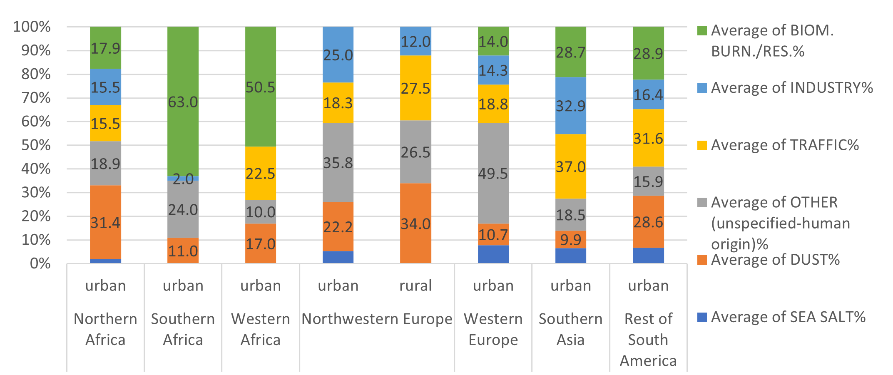{#fig-whodata}

*Source: WHO database on local source apportionment studies*

CPAT can combine the information from source apportionment studies with
the source apportionment result from applying the TM5-FASST
coefficients. For each sector, we estimate an adjustment factor,
$\text{AF}_{s},$ to TM5-FASST coefficients, such that the external
source contribution by sector will be met in the baseline year
$\text{to}$. The adjustment factor for each sector $s$ is calculated
as:

$$\text{AF}_{s} = \frac{\text{ShareFASST}_{s,to}}{\text{ShareExterna}l_{s}}$$ {#eq-afs}

Where:

$\text{AF}_{s}$: Adjustment factor for sector $s$ ($s$= coal power
plants, gas power plants, other power plants, ground level road,
residential-construction-services, agriculture, other sectors).

$\text{ShareFASS}T_{s}$: % Contribution to ambient PM2.5
from sector $s$, calculated using FASST coefficients

$\text{ShareExterna}l_{s}$: % Contribution to ambient
PM2.5 from sector $s$, according to user’s input or to WHO
database.

The modeled ambient PM2.5 under this option in CPAT is calculated as
follows.

$$\text{Modeled~PM}{2.5}_{t} = \sum_{p}^{}{\sum_{s}^{}{AF_{s}*\text{FASST}_{p,s}*Emissions_{p,s,t}}}$$ {#eq-modpm} 

In CPAT, we have uploaded the source apportionment information for the
46 countries included in the WHO database, as well as additional studies
covering additional countries (see @tbl-countrycov for the country coverage of
each study). The correspondence between the sectors in the WHO database
and CPAT air pollution sectors is presented in @tbl-whodata.

| **WHO database sectors**            | **CPAT AP sectors**                             |
| ----------------------------------- | ----------------------------------------------- |
| Industry                            | Coal Power Plants                               |
| Industry                            | Gas Power Plants                                |
| Industry                            | Other Power Plants                              |
| Traffic                              | Road transport                                  |
| Industry / Domestic fuel burning    | Residential, services and construction          |
| Industry                            | Industries and other energy                     |
| Unspecified source of human origin   | Food & forestry (includes agriculture)          |
| Natural sources (dust and sea salt) | Unknown (not modeled, natural, outside borders) |

: Matching from WHO database sectors and CPAT air pollution tab sectors {#tbl-whodata}

*Source: Own elaboration. The WHO sector “Unspecified source of human origin” includes secondary formation of PM2.5 and it’s distributed among all CPAT sectors, including the “unknown” category in the proportions of each sector calculated using FASST coefficients.*

CPAT allows the user to input other source apportionment distribution
(manual input) and also includes a default distribution for most
countries, based in the WHO database. The default source apportionment
distribution is equal to the regional average, that can be used if the
country is not covered in the WHO database. The information source used
is indicated in the Air pollution module, under the section “Calibration
options from the Dashboard/MSTInputs tab”.

@tbl-countrycov presents the country coverage of each of the studies preloaded
in CPAT.

| **Study**               | **Countries covered**                                                                                                                                                  |
| ----------------------- | ----------------------------------------------------------------------------------------------------------------------------------------------------------------------------------------------------------------------------------------------------------------------------------------------------------------------------------------------------------------------------------------------------------------------------------------------------------------- |
| @who15            | Argentina, Australia, Bangladesh, Belgium, Brazil, Canada, Chile, China, Costa Rica, Denmark, Egypt, Estonia, Finland, France, Germany, Ghana, Greece, India, Indonesia, Ireland, Italy, Japan, Korea, Kuwait, Macedonia, FYR, Malaysia, Mexico, Mongolia, Netherlands, New Zealand, Norway, Pakistan, Philippines, Poland, Portugal, Saudi Arabia, South Africa, Spain, Sri Lanka, Sweden, Switzerland, Thailand, Turkey, United Kingdom, United States, Vietnam |
| @world2020regional       | Bosnia and Herzegovina                                                                                                                                                                                                                                                                                                                                                                                                                                            |
| @almeida2020ambient   | Greece, Kazakhstan, Hungary, Moldova, Croatia, Serbia, Albania, Bosnia and Herzegovina, Poland, Macedonia, FYR, Tajikistan                                                                                                                                                                                                                                                                                                                                        |
| @lelieveld2015contribution | China, Tukey                                                                                                                                                                                                                                                                                                                                                                                                                                                      |
| @world2019air       | Macedonia                                                                                                                                                                                                                                                                                                                                                                                                                                                         |
| @acp-14-9977-2014    | Kenya (assumed same results for Rwanda)                                                                                                                                                                                                                                                                                                                                                                                                                           |

: Countries covered by source apportionment studies in CPAT {#tbl-countrycov}

### Option 3: Elastic Net model and OLS model

CPAT also offers the option to apply the results of an elastic net
regularization method to link emissions by sector to ambient
concentrations of PM2.5 and O3 (@renna). The ambient concentrations predicted represent population weighted averages per country. At the moment CPAT offers the
elastic net model option only for PM2.5.

The results of the elastic net model are combined with an OLS model. The
results of the OLS model are used only to distribute the contribution of
modeled PM2.5 among CPAT sectors, while the elastic net model is used to
predict total ambient concentrations of PM2.5.

The following table summarizes the data sources used to develop the
elastic net and OLS models.

<!-- PS: I cannot find the reference CIESIN 2020 in the table below. I left it like that. -->

<table>
<thead>
<tr class="header">
<th><strong>Variable</strong></th>
<th><strong>Data source</strong></th>
</tr>
</thead>
<tbody>
<tr class="odd">
<td>Emissions</td>
<td>CAMS Global Anthropogenic v4.2, 2000-2020, monthly, 0.1°</td>
</tr>
<tr class="even">
<td>Concentrations</td>
<td>CAMS Global Reanalysis (EAC4) monthly averaged fields (@inness2019cams), for 2003-2019, PM2.5 and Ozone</td>
</tr>
<tr class="odd">
<td>Population</td>
<td>
2020 UN WPP-Adjusted Population Count, v4.11, from the NASA Socioeconomic Data and Applications Center (SEDAC) (CIESIN 2020).
</td>
</tr>
<tr class="even">
<td>Climate variables</td>
<td>
Monthly data, 0.1 degrees resolution from TerraClimate. Variables used: precipitation, maximum temperature, minimum temperature, wind speed, vapor pressure deficit in kPa.

Wind direction from ERA-5 Reanalysis Monthly Means
</td>
</tr>
</tbody>
</table>

*Source: Based on @renna*

The model considers the emissions of BC, OC, NH3, SO2 and NMVOC. The
sectoral aggregation of the models is the following:

  - AGR (Agriculture)
    
      - Agricultural waste burning
    
      - Agriculture livestock
    
      - Agriculture soils

  - ROA (Road transportation)
    
      - Road transportation

  - INX (industry)
    
      - Industrial process

  - POW (Energy Power generation)
    
      - Power generation
    
      - Fugitives

  - SER (Buildings including residential, commercial and services)
    
      - Residential and other sectors

  - OTR (Off-road transportation)
    
      - Off Road transportation

  - OTH (Others, including the emissions not considered in the sectors
    above)
    
      - Solid waste and wastewater
    
      - Solvents

The data sources and methods are described in more detail in @renna. In the next subsections we describe
the implementation of the elastic net and OLS models in CPAT.

#### Elastic net model

As mentioned above, the elastic net model is used to predict total
ambient PM2.5 in CPAT. The functional form and the adaptations made to
the original coefficients of the model is detailed in the following
paragraphs.

**Monthly concentrations of PM2.5**

The linear regressions developed to predict monthly levels of PM2.5
takes the form indicated in expression @eq-monthconc for each country.

$$P{M2.5}_{m} = \alpha + \sum_{s,p}^{}{\beta_{s,p}*E_{s,p,m}} + \gamma_{1}*PPT_{m} + \gamma_{2}*TMIN_{m} + \gamma_{3}*TMAX_{m} + \gamma_{4}*\text{VPD}_{m} + \gamma_{5}*\text{WS}_{m} + \gamma_{6}*\text{WD}_{m} + \sum_{s}^{}{{\delta_{s}*T}_{s,m} + \sum_{p}^{}{\lambda_{p}*T_{p,m}}} + \mu*T_{nox,m}*T_{NH3,m} + \nu*T_{SO2,m}*T_{NH3,m} + \xi*T_{SO2,m}*T_{NOx,m} + {\sum_{s}^{}{{\theta_{s}*T_{s,m}*WS}_{m}*WD_{m}} + \phi}_{m} + \varepsilon_{m}$$ {#eq-monthconc} 

Where:

$m$ = Months of the year, from 1 to 12

$s\  \in \{ agr,\ roa,\ pow,\ inx,\ otr,\ oth,\ ser\}$

$p\  \in \left\{ BC,\ OC,\ NH_{3},\ NO_{x},\ NMVOC,\ SO_{2} \right\}$

$P{M2.5}_{m}$ = Concentration of PM2.5 in month $m$, in $\mu g/m^{3}$

${O3}_{m}$ = Concentration of $O_{3}$ in month $m$, in $6mDMA8h$[^6_8]

$E_{s,p,m}$ = Emissions of sector $s$ and pollutant $p$ in month $m$, in $Tg$

$\text{PP}T_{m}$ = Accumulated precipitation in mm, month $m$

$\text{TMI}N_{m}$ = Minimum temperature in $\deg{C}$ month $m$

$\text{VP}D_{m}$ = Mean vapor pressure deficit in kPa, month $m$

$WS_{m}$ = wind speed in $\frac{m}{s}$, month $m$

$WD_{m}$ = Wind direction in degrees, month $m$

$T_{p,m}$ = composite index from the sum of total emissions of pollutant $p$, in month $m$

$T_{s,m}$ = composite index from the sum of total emissions of sector $s$, in month $m$

$\phi_{m}$ = Monthly fixed effects

$\varepsilon$ = Error term

**Annual concentrations of PM2.5**

In CPAT, we work on an annual basis, while the elastic net model was
developed to predict PM2.5 in a monthly basis. Thus, we adapt the
elastic net model results to predict annual concentration of PM2.5, as
explain below.

Each month of the year will have a weight according to its number of
days, equal to $\varphi_{m}$. For instance, for February, it’s weight
in the annual average is $\varphi_{2} = 28/365$.

The weighted average PM2.5 will be calculated according to expression .

$$PM2.5 = \sum_{m}^{}{\varphi_{m}*PM{2.5}_{m}}$$ {#eq-pm} 

Which can be written as expression @eq-pm2.

$$PM2.5 = \alpha + \sum_{s,p}^{}{\beta_{s,p}*\overline{E_{s,p}}} + \gamma_{1}*\overline{\text{PPT}} + \gamma_{2}*\overline{\text{TMIN}} + \gamma_{3}*\overline{\text{TMAX}} + \gamma_{4}*\overline{\text{VPD}} + \gamma_{5}*\overline{\text{WS}} + \gamma_{6}*\overline{\text{WD}} + \sum_{s}^{}{{\delta_{s}*T}_{s}*\sum_{m}^{}{\varphi_{m}*w_{s,m}} + \sum_{p}^{}{\lambda_{p}*T_{p}}}*\sum_{m}^{}{\varphi_{m}*w_{p,m}} + \mu*T_{\text{NOx}}*T_{NH3}*\sum_{m}^{}{\varphi_{m}*w_{NOx,m}*w_{NH3,m}} + \nu*T_{SO2}*T_{NH3}*\sum_{m}^{}{\varphi_{m}*w_{SO2,m}*w_{NH3,m}} + \xi*T_{SO2}*T_{\text{NOx}}*\sum_{m}^{}{\varphi_{m}*w_{SO2,m}*w_{NOx,m}} + \sum_{s}^{}{\theta_{s}*T_{s}*\sum_{m}^{}{\varphi_{m}*w_{s,m}*WS_{m}*WD_{m}}} + \overline{\phi} + \varepsilon_{m}$$ {#eq-pm2}

Where:

$\overline{E_{s,p}}$ = average (simple) monthly emissions of sector $s$ and pollutant $p$

$\overline{\text{PPT}}$ = average (weighted) monthly precipitations

$\overline{\text{TMIN}}$ = average (weighted) $TMIN$

$\overline{\text{TMAX}}$ = average (weighted) $TMAX$

$\overline{\text{VPD}}$ = average (weighted) vapor pressure deficit

$\overline{\text{WS}}$ = average (weighted) wins speed

$\overline{\text{WD}}$ = average (weighted) wind direction

$\overline{\phi}$ = average (weighted) monthly fixed effect

$T_{p}$ = composite index from the sum of total emissions of pollutant p in all the months of the year$

$w_{p,m}$ = share of emissions of pollutant $p$ in month $m$, $T_{p,m}$, such that $sum_{m = 1}^{12}{w_{p,m} = 1}$.

$T_{s}$ = composite index from the sum of total emissions of sector $s$ in all the months of the year

$w_{s,m}$ = share of emissions of sector $s$ in month $m$, $T_{s,m}$, such that $sum_{m = 1}^{12}{w_{s,m} = 1}$.

**Annual concentration of PM2.5 in CPAT**

In CPAT, we group and consider constant all the weather variables,
together with the intercept of the model and monthly fixed effects.

For each country, we define a weather constant equal to:

$${Weather = \gamma}_{1}*\overline{\text{PPT}} + \gamma_{2}*\overline{\text{TMIN}} + \gamma_{3}*\overline{\text{TMAX}} + \gamma_{4}*\overline{\text{VPD}} + \gamma_{5}*\overline{\text{WS}} + \gamma_{6}*\overline{\text{WD}}$$ {#eq-weather}

Where
$\overline{\text{VAR}} = \sum_{m}^{}{\varphi_{m}*\text{VAR}_{m}}$

We define new constants, according to expressions @eq-deltas to @eq-beta2.

$$\delta_{s}^{'} = \delta_{s}*\sum_{m}^{}{\varphi_{m}*w_{s,m}}$${#eq-deltas}
$$\lambda_{p}^{'} = \lambda_{p}*\sum_{m}^{}{\varphi_{m}*w_{p,m}}$${#eq-lamdap}
$$\mu' = \mu*\sum_{m}^{}{\varphi_{m}*w_{NOx,m}*w_{NH3,m}}$${#eq-mua}
$$\nu' = \nu*\sum_{m}^{}{\varphi_{m}*w_{SO2,m}*w_{NH3,m}}$${#eq-nua}
$$\xi' = \xi*\sum_{m}^{}{\varphi_{m}*w_{SO2,m}*w_{NOx,m}}$${#eq-xia}
$${{\theta^{'}}_{s} = \theta}_{s}*\sum_{m}^{}{\varphi_{m}*w_{s,m}*WS_{m}*WD_{m}}$${#eq-thetas}
$${\beta'}_{s,p} = \beta_{s,p}/12$${#eq-beta1}
$${\beta''}_{s,p} = {(\beta'}_{s,p}{+ \lambda'}_{p})$${#eq-beta2}

And we estimate annual PM2.5 using expression @eq-pmbis.

$$PM2.5 = \alpha + Weather + \overline{\phi} + \sum_{s,p}^{}{\beta_{s,p}*\overline{E_{s,p}}} + \sum_{s}^{}{{{\delta'}_{s}*T}_{s} + \sum_{p}^{}{{\lambda'}_{p}*T_{p}}} + \mu'*T_{\text{NOx}}*T_{NH3} + \nu'*T_{SO2}*T_{NH3} + \xi'*T_{SO2}*T_{\text{NOx}} + \sum_{s}^{}{{\theta'}_{s}*T_{s}} + \varepsilon_{m}$${#eq-pmbis}

The contribution of each sector to PM2.5 will be calculated according to
expression @eq-pms.

$$\text{PM}{2.5}_{s} = \sum_{p}^{}{{\beta'}_{s,p}*T_{p,s}} + {{\delta'}_{s}*T}_{s} + \sum_{p}^{}{{\lambda'}_{p}*T_{p,s}} + \mu'*T_{NOx,s}*T_{NH3,s} + \nu'*T_{SO2,s}*T_{NH3,s} + \xi'*T_{SO2,s}*T_{NOx,s} + {\theta'}_{s}*T_{s}$${#eq-pms}

Grouping terms, we can write the contribution to PM2.5 by sector as
indicated in expression @eq-pmsbis.

$$\text{PM}{2.5}_{s} = \sum_{p}^{}{{(\beta'}_{s,p}{+ \lambda'}_{p})*T_{p,s}} + {({\delta^{'}}_{s} + {\theta^{'}}_{s})*T}_{s} + \mu'*T_{NOx,s}*T_{NH3,s} + \nu'*T_{SO2,s}*T_{NH3,s} + \xi'*T_{SO2,s}*T_{NOx,s}$${#eq-pmsbis}

Let’s call ${\beta''}_{s,p} = {(\beta'}_{s,p}{+ \lambda'}_{p})$ and
${\delta^{''}}_{s} = ({\delta^{'}}_{s} + {\theta^{'}}_{s})$ and write
$\text{PM}{2.5}_{s}$ as in expression @eq-pmsagain.

$$\text{PM}{2.5}_{s} = \sum_{p}^{}{{\beta''}_{s,p}*T_{p,s}} + {{\delta''}_{s}*T}_{s} + \mu'*T_{NOx,s}*T_{NH3,s} + \nu'*T_{SO2,s}*T_{NH3,s} + \xi'*T_{SO2,s}*T_{NOx,s}$${#eq-pmsagain} 

Where:

$T_{p,s}$ = composite index from the sum of total emissions of pollutant $p$ in sector $s$, including all the months of the year

The term $\alpha + Weather + \overline{\phi} + \varepsilon_{m}$ is
not sector specific and it is considered a constant in CPAT.

The term @eq-term is also non-sector specific and is relating the
interactions across emissions of the different sectors.

$$\mu'*(T_{\text{NOx}}*T_{NH3} - \sum_{s}^{}{T_{NOx,s}*T_{NH3,s}}) + \nu'*{(T}_{SO2}*T_{NH3} - \sum_{s}^{}{T_{SO2,s}*T_{NH3,s}}) + \xi'*(T_{SO2}*T_{\text{NOx}} - \sum_{s}^{}{T_{SO2,s}*T_{NOx,s}})$${#eq-term}

#### OLS model

As mentioned before, in CPAT we apply the results of an OLS model to
quantify the percent contribution of each sector to ambient PM2.5, while
we use the elastic net model to predict total concentrations.

The OLS model has the functional form in expression @eq-pmm.

$$P{M2.5}_{m} = \alpha + \sum_{s}^{}{\delta_{s}*\widehat{T_{s,m}}} + \gamma_{1}*PPT_{m} + \gamma_{2}*TMIN_{m} + \gamma_{3}*TMAX_{m} + \gamma_{4}*\text{VPD}_{m} + \gamma_{5}*\text{WS}_{m} + \gamma_{6}*\text{WD}_{m} + \varepsilon_{m}$${#eq-pmm}

Where $\widehat{T_{s,m}}$ is a composite index of total normalized
emissions in month $m$ and sector $s$. The procedure to normalize
emissions is explained below.

**Normalization of emissions for OLS
model**

For each country, let’s call normalized emissions by sector and
pollutant and month, $\widehat{E_{s,p,m}}$, that is calculated using
expression @eq-espm.

$$\widehat{E_{s,p,m}} = \frac{E_{s,p,m} - \text{Min}_{s,p}}{\text{Max}_{s,p} - \text{Min}_{s,p}}$${#eq-espm}

Where:

$E_{s,p,m}$: emissions in month $m$ per pollutant $p$ and sector $s$

$\text{Min}_{s,p}$: Min emission across months for
pollutant $p$ and sector $s$

$\text{Max}_{s,p}$: Max emission across months for
pollutant $p$ and sector $s$

Then, the index $\widehat{T_{s,m}}$ is calculated using expression @eq-tsm.

$$\widehat{T_{s,m}} = \sum_{p}^{}\widehat{E_{s,p,m}}$${#eq-tsm}

In CPAT, we do not calculate monthly emissions, but annual emissions,
thus, the normalization of emissions and the index of total normalized
emissions by sector considers annual emissions by sector and pollutant.

### Option 4: Intake fractions {#sec-if}

Another option in CPAT to relate emissions to ambient concentration of
PM2.5 is using intake fractions. Intake fractions were defined in @bennett2002defining as the integrated incremental intake of a pollutant,
summed over all exposed individuals, and occurring over a given exposure
time, released from a specified source or source class, per unit of
pollutant emitted. Intake fractions measure the change in
population-weighted ambient concentrations of a pollutant
(PM2.5 in this case) per unit of pollutant emitted @cropper2012health. @zhou2006influence defined intake fractions as the
fraction of material or its precursors released from a source that is
eventually inhaled or ingested by a population. Intake fractions are
defined by @eq-if.

$$iF = \frac{\sum_{i = 1}^{N}{P_{i}*\mathrm{\Delta}C_{i}*BR}}{Q}$$ {#eq-if}

Where:

$\text{iF}$: Intake Fraction, inhaled grams of PM2.5 per ton (ppm) of emissions

$P_{i}$: population residing in a region located at a distance $i$ from the emission source

$\text{ΔC}_{i}$: change in ambient concentration of PM2.5 g/m3

$\text{BR}$: Average breathing rate in cubic meters per day m3/day

$Q$: Emissions rate tonne/day

From  @eq-if, rearranging the terms, we can express changes
in concentration weighted average as shown in  @eq-sumi.

$$\sum_{i = 1}^{N}{P_{i}*\mathrm{\Delta}C_{i}} = \frac{iF*Q}{\text{BR}}$${#eq-sumi}

Intake fractions are influenced by the emissions height, as illustrated
in @fig-if. Ground level emissions are usually inhaled in a major
proportion, compared with emissions from a high stack.

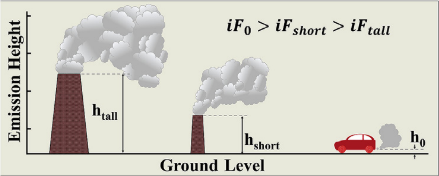{#fig-if}

*Source: @parvez2017primary*

At the same time, intake fractions depend on the population density at
different distances from the emission source. As illustrated in @fig-ifvar, higher population concentrations will increase the intake
fraction value, since more people is inhaling pollution.

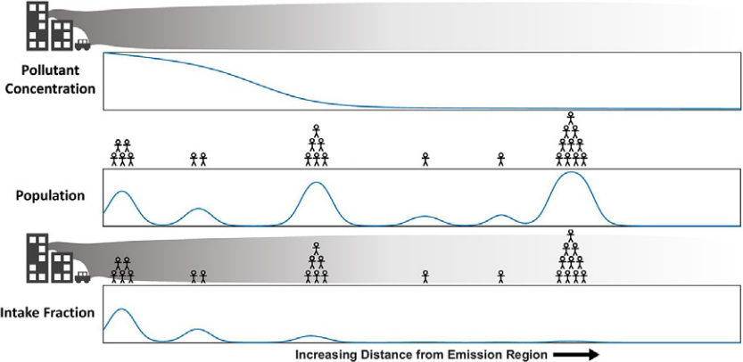{#fig-ifvar}

*Source: @lamancusa2017spatially*

#### Intake fractions for ground level, low and high stack emission sources

In CPAT, for sources different than power plants, we use the results
from @apte2012global. The study estimates intake fractions for more
than 3,600 cities, for ground level sources and for direct emissions of
PM2.5.

In the case of secondary pollutants, we will scale up the ground-level
secondary intake fractions from @humbert2011intake, presented in @tbl-ifglev, using the ratio between primary PM2.5 intake fractions
from @apte2012global and @humbert2011intake, as indicated in
 @eq-ifsec.

$$\text{iF}_{\text{secondary\ pollutant}} = \frac{\text{iF}_{PM2.5,\ Apte}}{\text{iF}_{PM2.5,\ Humbert}}*\text{iF}_{\text{secondary\ Humbert}}\ $$ {#eq-ifsec}

| **Pollutants**                 |                                   | **Urban** | **Rural** | **Remote** |
| ------------------------------ | --------------------------------- | --------- | --------- | ---------- |
| **Primary PM2.5**   | **Ground-level PM2.5** | 44        | 3.8       | 0.1        |
|                                | high-stack                        | 11        | 1.6       | 0.1        |
|                                | low-stack                         | 15        | 2.0       | 0.1        |
| **Secondary PM2.5** | **SO2**                | 0.99      | 0.79      | 0.05       |
|                                | **NOx**                           | 0.2       | 0.17      | 0.01       |
|                                | **NH3**                | 1.7       | 1.7       | 0.1        |

: Intake fractions (ppm) for ground level PM2.5 {#tbl-ifglev}

*Source: @humbert2011intake*

For non-ground level sources, in which emissions take place trough
high or low stacks, the $iF$ is estimated according to
 @eq-ifhl.

$$\text{iF}_{high/low} = \text{iF}_{PM2.5,\ Fantke}*\frac{\text{iF}_{PM2.5,\ \ Humbert,\ high/low}}{\text{iF}_{PM2.5,\ Humbert,\ \ groundlevel}}$${#eq-ifhl}

#### Intake fractions from power plants

Power plants emissions are released from tall smokestacks and
consequently are likely to be transported long distances. In order to
include the geographically extended effect of power plants emissions
into the analysis, we will use intake fractions that were developed
specifically for this sector, following @zhou2006influence.

@zhou2006influence estimates intake fractions for 29 power plants in
China and proposes a methodology to calculate intake fractions in other
regions of the world using population and precipitation data. The
authors extrapolated the intake fraction results to other sites using
regression analysis (see @tbl-coefzhou). This methodology (@zhou2006influence) was applied by on the spreadsheet model developed by @parry2014getting and subsequent IMF iterations.

CPAT intake fractions use updated data regarding power plant’s location
and population distribution around them, together with differentiating
exposed population inside country borders and outside countries. The
methodology is illustrated in @fig-ifpp. 

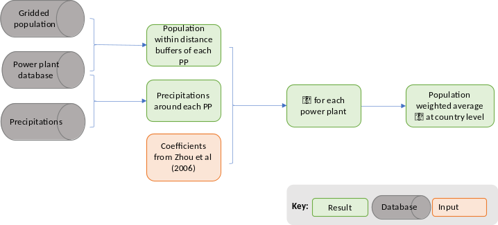{#fig-ifpp}

*Source: Own elaboration*

The following table provides a comparison between the approach implemented by
@parry2014getting and CPAT.

<table>
<thead>
<tr class="header">
<th></th>
<th><strong>Parry 2014</strong></th>
<th><strong>CPAT</strong></th>
</tr>
</thead>
<tbody>
<tr class="odd">
<td>Methodology</td>
<td>
Coefficients from @zhou2006influence (Table 4)
</td>
<td>
Coefficients from @zhou2006influence (Table 6)
</td>
</tr>
<tr class="even">
<td>Power plants data</td>
<td>
CARMA

<ul>
<li>
2009 data.
</li>
<li>
110 countries
</li>
<li>
2,400 coal plants
</li>
<li>
2,000 natural gas plants
</li>
</ul></td>
<td>
Global Power Plant Database[^6_9] (@globalenergy).

<ul>
<li>
Updated in 2019
</li>
<li>
164 countries
</li>
<li>
2,390 coal plants
</li>
<li>
3,922 gas power plants
</li>
<li>
2,290 oil power plants
</li>
</ul></td>
</tr>
<tr class="odd">
<td>Gridded population</td>
<td>LandScan- 2010 Population</td>
<td>Earth Data[^6_10], 2020 pop (Center for International Earth Science Information Network (CIESIN) Columbia University 2018b)</td>
</tr>
<tr class="even">
<td>Exposed population</td>
<td>Population within 2000 km (above 25). No distinction between inside and outside the country</td>
<td>Population within 2000 km (distributed in age ranges). <strong>Distinction between inside and outside</strong> (relevant for country analysis).</td>
</tr>
<tr class="odd">
<td>Precipitations</td>
<td>-</td>
<td>Precipitations</td>
</tr>
<tr class="even">
<td>Breathing rate</td>
<td>20 m3/day (from @zhou2006influence)</td>
<td>20 m3/day</td>
</tr>
<tr class="odd">
<td>Weight for averages at country level</td>
<td>Coal used (based on CO2 emissions)</td>
<td>Power generation (average years available or estimated generation). If no value for generation, then we assigned a simple average.</td>
</tr>
</tbody>
</table>

As indicated in the previous table, CPAT will use the Global Power Plant
Database (@globalenergy), which includes
approximately 28,700 geolocated power plants in 164 countries,
accounting for 80% of global installed capacity (@byers2018global). The
database contains 2,390 coal plants, 3,922 gas power plants and 2,290
oil power plants.

The team decided to use this database, since CARMA database has not been
updated since 2012 (@byers2018global). @fig-loccoal shows, as an
example, the location of the coal power plants included in the database.

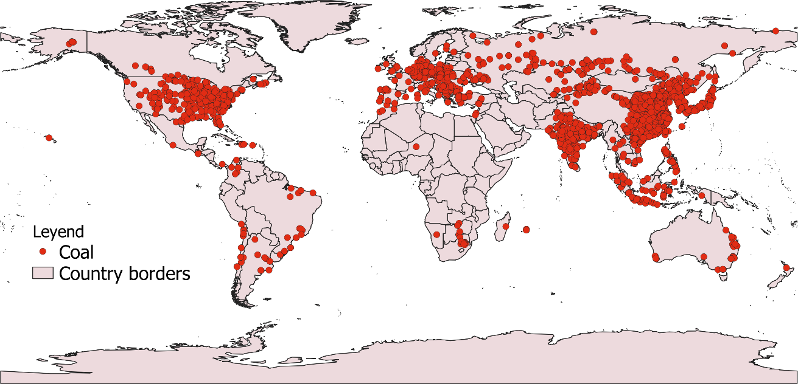{#fig-loccoal}

*Source: Based on @globalenergy [^6_11]*

@zhou2006influence requires estimating population around different
distances of each power plant. To estimate population inside different
distance buffers, gridded population data was obtained from the Center
for International Earth Science Information Network (CIESIN), from
Columbia university. The population-count raster file used consists of
estimates of human population (number of persons per pixel), consistent
with national censuses and population registers, for the years 2000,
2005, 2010, 2015, and 2020 (CPAT analysis is based on 2020). The data
set consists of global raster files at 30 arc-second horizontal
resolution (approximately 1 km at the equator). The 30 arc-second[^6_12]
data were aggregated to 2.5 arc-minute, 15 arc-minute, 30 arc-minute and
1 degree resolutions (@CIESIN1). The team decided to use
this dataset, instead of Landscan 2017, since the former is available
free of charge, and both sources provide equivalent quality and
resolution.

The methodology in @zhou2006influence allows the inclusion of the
variable precipitations. Precipitations data[^6_13] was obtained from The
Millennium Ecosystem Assessment (MA) Climate and Land Cover, v1
(1901 – 2000)[^6_14] (@reid2005millenium). This dataset contains raster grids for monthly
average precipitations.

For each power plant, we built a distance buffer of 40 kilometers and we
compute the average precipitation inside that buffer. That variable is
then used to predict intake fractions for each power plant, according to
in @zhou2006influence.

The regression coefficients from @zhou2006influence, presented in @tbl-coefzhou, will be used to estimate an intake fraction for each power plant in each country.

| Pollutant $\mathbf{j}$ | R2 | $\mathbf{\beta}_{\mathbf{1}}$ - Population within 100 km | $\mathbf{\beta}_{\mathbf{2}}$ - Population between 100 and 500 km | $\mathbf{\beta}_{\mathbf{3}}$ - Population between 500 and 1000 km | $\mathbf{\beta}_{\mathbf{4}}$ - Population beyond 1000 km | $\mathbf{\beta}_{\mathbf{5}}$ - Precipitation |      |          |      |            |      |
| ------------------------ | ------------- | ---------------------------------------------------------- | ------------------------------------------------------------------- | -------------------------------------------------------------------- | ----------------------------------------------------------- | ----------------------------------------------- | ---- | -------- | ---- | ---------- | ---- |
| SO2           | 0.96          | 9.90E-08                                                   | \*\*                                                                | 1.30E-08                                                             | \*\*                                                        | 3.00E-09                                        |      | 1.80E-09 | \*\* | \-6.30E-10 |      |
| PM1           | 0.96          | 1.50E-07                                                   | \*                                                                  | 2.30E-08                                                             | \*\*                                                        | 1.10E-08                                        | \*\* | 3.90E-09 | \*\* | \-1.70E-09 | \*\* |
| PM3           | 0.92          | 1.40E-07                                                   | \*                                                                  | 1.70E-08                                                             | \*\*                                                        | 6.40E-09                                        |      | 3.00E-09 | \*\* | \-2.40E-09 | \*\* |
| PM7           | 0.91          | 9.90E-08                                                   | \*\*                                                                | 8.90E-09                                                             | \*                                                          | 3.10E-09                                        |      | 1.50E-09 | \*   | \-1.20E-09 | \*   |
| PM13          | 0.89          | 6.70E-08                                                   | \*\*                                                                | 4.30E-09                                                             |                                                             | 9.40E-10                                        |      | 7.30E-10 |      | \-4.60E-10 |      |
| SO4           | 0.95          | 2.40E-08                                                   |                                                                     | 7.90E-09                                                             | \*                                                          | 6.90E-09                                        | \*\* | 2.60E-09 | \*\* | \-1.20E-09 | \*\* |
| NO3           | 0.93          | 4.30E-08                                                   |                                                                     | 1.30E-08                                                             | \*\*                                                        | 3.50E-09                                        |      | 2.50E-09 | \*\* | \-1.90E-09 | \*\* |

: Coefficients for intake fractions from @zhou2006influence, Table 6 {#tbl-coefzhou} 

*Source: @zhou2006influence.*

*Notes: Estimate significant at 0.05 level. Estimate significant at 0.10 level. Population variables in millions; precipitation in mm/yr*

The intake fraction for each power plant is calculated according to @eq-ifeach, using the coefficients from @tbl-coefzhou.

$${iF}_{p,\ j,\ l} = \sum_{i = 1}^{4}{\beta_{i,j}*{P\text{op}}_{i,\ l} + \beta_{5,\ j}*{P\text{recipitation}}_{p}}$$ {#eq-ifeach}

Where:

${iF}_{p,\ j,\ c}$: Intake fraction for power plant $p$, pollutant
$j$, location $l$

${P\text{op}}_{i,\ l}$: Population at distance $i$, location $l$

${P\text{recipitation}}_{p}$: Precipitations around plant $p$

$\beta_{i,j}$: Regression coefficients for pollutant $j$, location
$l$

$$i = \left\{ \begin{matrix}
\ \ \ \ 1,\ \ Population\ within\ 100\ km\ \ \ \ \ \ \ \ \ \ \ \ \ \ \ \ \ \ \ \ \ \ \ \  \\
2,\ \ Population\ between\ 100\ and\ 500\ km\ \ \  \\
3,\ \ Population\ between\ 500\ and\ 1000\ km \\
4,\ \ Population\ within\ 1000\ and\ 2000\ km\  \\
\end{matrix} \right.\ $$

$j$= SO2, PM1, PM3, PM7,
PM13, SO4, NO3

$l$ = inside country, outside country

Then, country level averages will be computed as the weighted average of
the $\text{iF}$ of each plant located inside the country, using as the
weight the power generation[^6_15] of each power plant.

Finally, we calculate the changes in PM2.5 concentrations
rearranging the terms in @eq-if, assuming that the entire
population is exposed to the weighted average concentration. We also
adjust the units to obtain changes in concentration in µg/m3.
$\text{CM}$ corresponds to the implied “concentration matrix” that
relates changes in concentration derived from 1 ton of emissions per
year.

$$CM = \frac{\Delta C\lbrack\frac{\text{μg}}{m3}\rbrack}{1\ \lbrack tonne/year\rbrack} = \frac{iF\ (ppm)}{\text{BR}\left( \frac{m3}{d} \right)*365\left( \frac{d}{\text{year}} \right)*Pop\ (capita)}*10^6$$ {#eq-cm}

Where $\text{ΔC}$ is the change in ambient concentration of
PM2.5, $\text{iF}$ is a national level average intake
fraction, $\text{BR}$ is an average breathing rate and $\text{Pop}$
is the country’s population.

### Option 5: Machine learning {#sec-machlearn}

The user can also choose to use the results of a machine learning
approach, developed for CPAT @renna.
The results of the model have been approximated using a discrete
function, that relates emissions perturbations to total ambient
concentrations of PM2.5 and O3.

$P_{s,p,t}$ is the perturbation compared to emissions in the baseline
year, $t_{0}$, in percentage. We use 2019 as the baseline year and all
the perturbations are compared to that year, as presented in @eq-pspt.

$$P_{s,p,t} = \ \left( \frac{\text{Emission}s_{s,p,t}}{\text{Emissions}_{s,p,t0}} - 1 \right)*100$$ {#eq-pspt}

Total ambient concentration is a function of $P_{s,p,t}$, composed
of a set of linear relationships, according to the level of the
perturbation, as presented in @eq-cpspt.

$$
C\ (P_{s,p,t}) = 
\left\{\begin{matrix} \\\\
\text{if } P_{s,p,t} < -100, \ a_{-100} \\
\text{if } -100 \le P_{s,p,t} < -80,\ \ \ a_{- 100} + b_{- 100}*(P_{s,p,t} - ( - 100)) \\
\text{if } - 80 \leq P_{s,p,t} < - 60,\ \ \ a_{- 80} + b_{- 80}*(P_{s,p,t} - ( - 80)) \\
\text{if } - 60 \leq P_{s,p,t} < - 40,\ \ \ a_{- 60} + b_{- 60}*(P_{s,p,t} - ( - 60)) \\
\text{if } - 40 \leq P_{s,p,t} < - 20,\ \ \ a_{- 40} + b_{- 40}*(P_{s,p,t} - \left( - 40 \right)) \\
\text{if } - 20 \leq P_{s,p,t} < 0,\ \ \ a_{- 20} + b_{- 20}*(P_{s,p,t} - \left( - 20 \right)) \\
\text{if }\ 0 \leq P_{s,p,t} < 20,\ \ \ a_{0} + b_{0}*(P_{s,p,t} - 0) \\
\text{if }\ 20 \leq P_{s,p,t} < 40,\ \ \ a_{20} + b_{20}*(P_{s,p,t} - 20) \\
\text{if }\ 40 \leq P_{s,p,t} < 60,\ \ \ a_{40} + b_{40}*(P_{s,p,t} - 40) \\
\text{if }\ 60 \leq P_{s,p,t} < 80,\ \ \ a_{60} + b_{60}*(P_{s,p,t} - 60) \\
\text{if }\ 80 \leq P_{s,p,t} < 100,\ \ \ a_{80} + b_{80}*(P_{s,p,t} - 80) \\
\text{if }P_{s,p,t} > 100,\ \ \ a_{100} + b_{100}*(P_{s,p,t} - 100) \\
\end{matrix} \right.
$${#eq-cpspt}

For the baseline year $t_0$, the contribution of sector $s$
and pollutant $p$ to ambient PM2.5 is presented in @eq-cspto.
The mentioned contribution is equivalent to the change in ambient PM2.5
when the emissions are reduced to zero (a -100% perturbation).

$$C_{s,p,t_0} = {- C}_{s,p,t}(P_{s,p,t} = - 100)$$ {#eq-cspto}

Then, the contribution in each year $t$ of sector $s$ and pollutant
$p$ to ambient PM2.5 is presented in @eq-cspt2.

$$C_{s,p,t} = C_{s,p,t}\left( P_{s,p,t} \right) - BaselineConcentration + C_{s,p,t_0}$$ {#eq-cspt2} 

The change in contribution to ambient PM2.5 or Ozone is
calculated by subtracting the contribution in the baseline and the
contribution under the carbon policy scenario.

### Option 6: Average between two methods

In addition to the options to relate emissions and concentrations
described above, the user can select the average among two of the
methods described: intake fractions (@sec-if) and source-apportionment
information combined with TM5-FASST method (@sec-apportinfo). We added this
option since every method used is subject to uncertainty and using more
than one estimate will provide results in the middle range of different
model estimates.

### Modeled and total ambient pollution

In CPAT, we estimate emissions from the sectors and fuels presented in
@tbl-ef according to the methodology described in @sec-calc_em. Then,
using one of the six options described in @sec-em_ap, we determine the
“modeled” ambient PM2.5 (or O3). The modeled concentration accounts
only for fuel burning activities, but not for all ambient pollution.

Other sources of pollution (not fuel burning) include resuspended dust,
sea salt, forest fires, or other transboundary sources that contribute
to observed PM2.5. We assume that the sources not modeled in CPAT
contribute a $C_{0}$ level to ambient pollution. We calculate the
value $C_{0}$ for a baseline year, using @eq-obsc, and we
assume it to remain constant across time.

$$\text{Observed}C_{t_0} = Modeled\ C_{t_0} + C_{0}$${#eq-obsc}

Total ambient concentration each year $t$ is modeled in CPAT using
expression @eq-ambientc.

$$\text{Ambient}C_{t} = Modeled\ C_{t} + C_{0}$${#eq-ambientc}

@fig-projambient presents graphically the methodology applied: a constant
$C_{0}$ and a modeled concentration that varies in time.

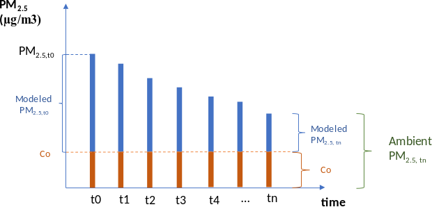{#fig-projambient}

*Source: Own elaboration*

## Methods to calculate the health burden of air pollution {#sec-health_ap}

This chapter describes the methodologies and data sources used to
quantify the health impacts attributed to air pollution in CPAT. The
health metrics described in this section, such as mortality, are the
main result from the air pollution tab.

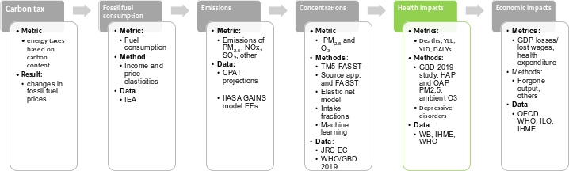{#fig-healtheff}

*Source: Own elaboration*

The health burden of air pollution is quantified using the methodology
illustrated in @fig-healthburden. The health outcomes included in CPAT are
premature mortality and disability-adjusted life years (DALYs),
explained in the following sections.

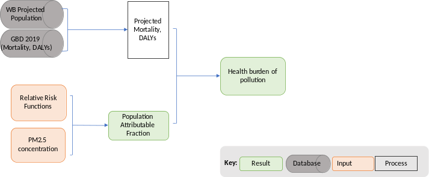{#fig-healthburden}

*Source: Own elaboration*

### Data sources to estimate health impacts

<table>
<thead>
<tr class="header">
<th>Input</th>
<th>Source</th>
</tr>
</thead>
<tbody>
<tr class="odd">
<td>Relative Risk estimates (by cause, age and exposure level)</td>
<td>@murray2020global</td>
</tr>
<tr class="even">
<td>Population projections by age group and country</td>
<td>WB Population Estimates and Projections[^6_16]. The database includes population projections by country, sex and age range by country up to 2050. It also includes the share or urban and rural populations.</td>
</tr>
<tr class="odd">
<td>Urban population fraction by country</td>
<td>World Bank Group</td>
</tr>
<tr class="even">
<td>Mortality and DALYs</td>
<td>
 @murray2020global Mortality and DALYs for:

<blockquote>

Ischemic heart disease

Chronic obstructive pulmonary disease

Lower respiratory infections

Stroke

Tracheal, bronchus, and lung cancer

Diabetes mellitus type II

Neonatal diseases: Sudden infant death syndrome, Diarrheal diseases, Lower respiratory infections, Upper respiratory infections, Otitis media, Meningitis, Neonatal disorders, Encephalitis

</blockquote></td>
</tr>
<tr class="odd">
<td>Exposure to ambient PM2.5</td>
<td>WHO Country average exposure (@world2018exposure)[^6_17] and @murray2020global ambient concentrations.</td>
</tr>
<tr class="even">
<td>Exposure to indoors PM2.5</td>
<td>Data from the @murray2020global study, provided by Michael Brauer</td>
</tr>
<tr class="odd">
<td>Exposure to ozone pollution</td>
<td>Data from the @murray2020global study, provided by Michael Brauer</td>
</tr>
</tbody>
</table>

### Definitions of key technical terms

**Relative Risk** (RR) is a measure of the change in risk of an adverse
health effect associated with an increase in air pollution levels. RR
indicates the likelihood of developing the disease of effect in the
exposed group, relative to those who are not exposed.

$$\text{RR} = \frac{y_{0}}{y_{c}}$${#eq-rr}

Where:

$y_{0}$: the risk (or probability) that people with baseline pollutant
exposure will be adversely affected

$y_{c}$: the risk (or probability) that people with control pollutant exposure will be negatively affected.

For example, a RR for all-cause mortality equal to 1.03 per 10 µg/m3
increase in annual PM2.5 means that a 10 µg/m3 increase in
PM2.5 is associated with a 3% increase in deaths from all
causes.

**Hazard** represents an instantaneous event rate or the probability
that an individual would experience an event at a given point in time.

**Hazard Ratio** is defined as the baseline hazard ($H_{0}$) divided
by hazard in the control group ($H_{c}$).

$$\text{HR} = \frac{H_{0}}{H_{c}}$$

Hazard ratio is often interpreted as relative risk, but they are not
technically the same. The main difference is that relative risk does not
consider the timing of the event but only the occurrence of the event by
the end of the observation period. The hazard ratio considers both.

**Incidence** corresponds to the number of new cases of a given disease
during a given period in a specified population. It also is used for the
rate at which new events occur in a defined population. It is
differentiated from prevalence, which refers to all cases, new or old,
in the population at a given time[^6_18].

$$\text{Incidence}\ \text{proportion} = \ \frac{\text{number}\ \text{of}\ \text{new}\ \text{cases}\ \text{in}\ \text{period}}{\text{population}\ \text{at the start of the}\ \text{period}}*10^5$$

**Prevalence** is the total number of cases of a given disease in a
specified population at a designated time. It is differentiated from
incidence, which refers to the number of new cases in the population at
a given time[^6_19].

$$\text{Period}\ \text{Prevalence} = \ \frac{\text{number}\ \text{of}\ \text{prevalent}\ \text{cases}\ \text{in}\ \text{period}}{\text{number}\ \text{of}\ \text{individuals}\ \text{in}\ \text{period}}*10^5$$

**The population attributable fraction (PAF)** is the reduction in
incidence that would be observed if the population were entirely
unexposed, compared with its current exposure pattern. In other words,
PAF is the portion of the incidence that could be reduced if causative
exposure were eliminated

### The health burden of pollution {#sec-healthburdenpoll}

The burden of disease associated with air pollution estimates the
reduction in specific causes of death that would occur if the exposure
were reduced to an alternative level (in general, the theoretical
minimum risk level is used). The methodology combines information
regarding population exposure to ambient air pollution and an
exposure-response relationship.

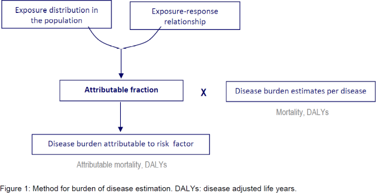{#fig-burdendisease}

*Source: @world2018burden*

In CPAT, we implemented a method to assess jointly indoors and outdoors
pollution as described in @sec-ambexp. CPAT also calculates the
impacts of ozone pollution, as described in @sec-ozexp.

#### Joint ambient and household air pollution (@murray2020global)

In CPAT, we quantify the effects of air pollution following the
methodology of the Global Burden of disease study for 2019 (@murray2020global). The methodology uses and Integrated Exposure Response (IER) approach, basing its estimates in studies for
ambient pollution, second-hand smoking and household pollution. This
methodology represents and upgrade from the previous version of the
study and the main differences with the previous methodology are the
following:

  - @murray2020global no longer uses active smoking data in the risk curves. This
    removes an important source of uncertainty

  - New studies in China and other high-exposure settings are now
    used[^6_20]

  - No fixed functional form. Splines generated using MR-BRT
    (meta-regression boosted regression trees)

The methodology implemented in CPAT assess jointly the effects of
ambient and household pollution. This feature is important because it
allows the quantification of a possible increase in the use of solid
fuels for cooking (leakage effects) and because household pollution is a
major health problem in many countries of the world.

The relative risks used in CPAT from @murray2020global are presented in @fig-rrintexp. In the case of ischemic heart disease and stroke, the RR
presented is an average across all the age groups, which are defined in
buckets of 5 years[^6_21]. In CPAT, we work with the following age
groups: neonates, post neonates, under 15, 15 to 64 and 65 years and
above. We use the average relative risk withing each group.

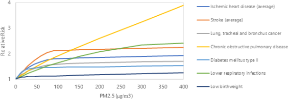{#fig-rrintexp}

Notice that the relative risk takes as a reference the minimum risk
level for PM2.5, TMREL, defined as uniform distribution between 2.4 and
5.9 µg/m3. In CPAT, we use as the TMREL the average between
2.4 and 5.9, equal to 4.15 µg/m3 of PM2.5. When pollution is
below that level, we would obtain cero health effects attributed to
pollution.

The diseases and age groups covered by the methodology in CPAT are
presented in @tbl-intexp.

| Cause                                                                        | Age Group                | RR                         |
| ---------------------------------------------------------------------------- | ------------------------ | -------------------------- |
| Chronic obstructive pulmonary disease                                        | All ages                 | Constant across age groups |
| Diabetes mellitus type 2                                                     | All ages                 |                            |
| Lower respiratory infections                                                 | All ages                 |                            |
| Tracheal, bronchus, and lung cancer                                          | All ages                 |                            |
| Ischemic heart disease                                                       | Above 25                 | Changes with age           |
| Stroke                                                                       | Above 25                 |                            |
| Low birthweight diseases[^6_22],[^6_23], excluding lower respiratory infections | Neonatal (under 28 days) | Constant   |

: Integrated Exposure Response function diseases from GBD 2019 implemented in CPAT {#tbl-intexp}

*Source: Own elaboration. Note: GBD2019 also quantifies preterm birth[^6_24] effects attributed to pollution. We do not quantify this in CPAT, to avoid double counting of effects, when aggregating the total impacts of pollution.*

The joint methodology requires the fraction of the population that it is
exposed to solid fuels for cooking, $p_{\text{HAP}}$, and the level of
exposure to household air pollution (HAP), as the additional exposure
over and above ambient exposure to PM2.5 (OAP).

For the proportion of the population
**not** exposed to HAP, the relative risk
is presented in @eq-rroap.

$$\text{RR}_{\text{OAP}} = MRBRT(z = \text{Exp}_{\text{OAP}})/MRBRT(z = TMREL)$${#eq-rroap}

For the proportion of the population exposed to HAP, the relative risk
is given by @eq-rrhap.

$$\text{RR}_{\text{HAP}} = MRBRT(z = \text{Exp}_{\text{OAP}} + \text{Exp}_{\text{HAP}})/\ MRBRT(z = TMREL)$${#eq-rrhap}

The population level relative risk $RR_{\text{PM}}$ and population
attributable fraction, $\text{PA}F_{\text{PM}}$, are calculated
according to @eq-rrpm and @eq-pafpm.

$$RR_{\text{PM}} = RR_{\text{OAP}}*\left( 1 - p_{\text{HAP}} \right) + RR_{\text{HAP}}*p_{\text{HAP}}$${#eq-rrpm} 

$${PAF}_{\text{PM}} = 1 - 1/RR_{\text{PM}}$${#eq-pafpm}

Finally, PAFs are split based on the exposure to OAP and HAP, as
presented in @eq-pafoap and @eq-pafhap.

$$\text{PA}F_{\text{OAP}} = \frac{\text{Exp}_{\text{OAP}}}{\text{Exp}_{\text{OAP}} + p_{\text{HAP}}*\text{Exp}_{\text{HAP}}}*\text{PAF}_{\text{PM}}$${#eq-pafoap}

$$\text{PA}F_{\text{HAP}} = \frac{{p_{\text{HAP}}*Exp}_{\text{HAP}}}{\text{Exp}_{\text{OAP}} + {p_{\text{HAP}}*Exp}_{\text{HAP}}}*\text{PAF}_{\text{PM}}$${#eq-pafhap}

Notice that under this strategy $\text{PAF}_{\text{PM}} = \text{PAF}_{\text{HAP}} + \text{PAF}_{\text{OAP}}$.

Where:

$\text{Exp}_{\text{OAP}}$: Ambient PM2.5 exposure level
 
$\text{Exp}_{\text{HAP}}$: Excess exposure to PM2.5 for those who use solid fuel for cooking.

$p_{\text{HAP}}$: proportion of the population using solid fuel for cooking

$\text{RR}_{\text{OAP}}$: Relative risk for the proportion of the population **not** exposed to HAP
 
$\text{RR}_{\text{HAP}}$: Relative risk for the proportion of the population exposed to HAP

$RR_{\text{PM}}$: Population level relative risk
 
$\text{PA}F_{\text{PM}}$: Population level PAF

@fig-diagrisk presents a diagram of the exposure to PM2.5,
$\text{Exp}_{\text{OAP}}$ and $\text{Exp}_{\text{HAP}}$, and their
associated relative risks levels.

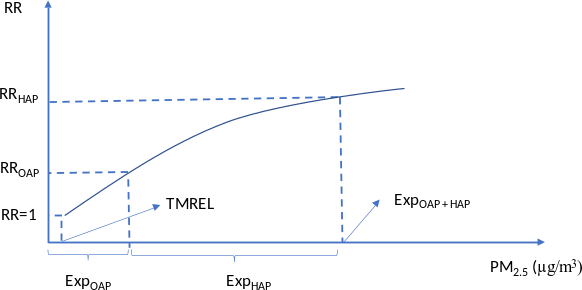{#fig-diagrisk}

*Source: Own elaboration*

The Attributable burden ($\text{AB}$) corresponds to the number of
cases attributed to the exposure in the population. The AB is calculated
by multiplying PAF by the baseline number of health outcomes, for each
outcome, sex and age group.

$AB = PAF*Health\ Outcome$

The strategy to quantify health effects in CPAT is presented in @sec-quanthealtheff.

#### Health outcomes in CPAT {#sec-healthout}

In CPAT, we quantify the health effects of pollution as mortality, years
of life lost, years lived with disability and disability-adjusted life
years (DALYs).

DALY is a summary measure which combines time lost through premature
death and time lived in states of less-than-optimal health or
“disability”. @fig-dalydis presents an infographic about the DALY
metric.

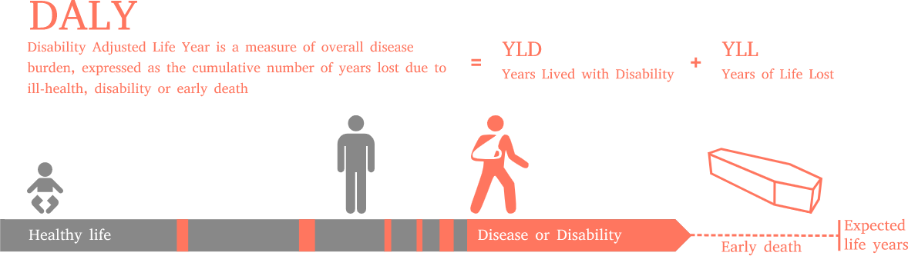{#fig-dalydis}

*Source: @wikimedia*

DALY, for a specific cause $c$, sex $s$, age $a$ and year $t$ is
defined as indicated in @eq-daly.

$$\text{DALY}_{c,s,a,t} = \text{YLL}_{c,s,\ a,t} + \text{YLD}_{c,s,a,t}$${#eq-daly}

The years of life lost (YLL) are calculated in @eq-yll as the number of deaths
multiplied by a loss function specifying the years lost for deaths as a
function of the age at which death occurs.

$$\text{YLL}_{c,s,\ a,t} = {\text{Number}\ \text{of}\ \text{deaths}}_{c,s,a,t}*L_{s,a}$${#eq-yll}

Where $L_{s,a}$ is a standard loss function specifying years of life
lost for a death at age $a$ for sex $s$.

The years lived with disease (YLD) are measured by the multiplication of
the prevalence of the condition[^6_25] and a weight factor that reflects
the severity of the condition on a scale from 0 (perfect health) to 1
(death) as expressed in @eq-yld.

$$\text{YLD}_{c,s,a,t} = P_{c,s,a,t}*\text{DW}_{c,s,a}$${#eq-yld}

Where,

$P_{c,s,a,t}$: Prevalent sequelae for cause $c$, sex $s$, age $a$ and year $t$

$\text{DW}_{c,s,a}$: Disability weight for sequelae for cause $c$, sex $s$ and age $a$

CPAT uses incidence at a country level for DALYs, YLL and YLD from @murray2020global.

#### Ozone air pollution

For ozone health effects, CPAT follows the methodology applied in @murray2020global, which is
based on @turner2016long. The health impacts are quantified for
chronic obstructive pulmonary disease, with a RR of 1.06 (1.02, 1.10)
per 10 ppb of ozone, in the seasonal (six-month period with the highest
mean) 8-h daily maximum concentration metric (6mDMA8h). The TMREL for
ozone is defined as \~ U (29.1, 35.7).

The relative risk is represented by expression @eq-relrisk and PAF is
calculated using expression @eq-pafbis.

$$RR = e^{\beta*{\mathrm{\Delta}C}_{O3}}$${#eq-relrisk}

$$PAF = 1 - e^{- \beta*{\mathrm{\Delta}C}_{O3}}$${#eq-pafbis}

The change in ozone concentration ${\mathrm{\Delta}C}_{O3}$ is
obtained using the diagonal source-receptor coefficients from TM5-FASST,
adjusted from region level to countries using @eq-deltae, from
@sec-tmfasst; or the “machine learning” model for ozone from @sec-machlearn.

Precursors of ozone considered in CPAT are NOx , NMVOC, SO2 and CH4.

#### Multiple risks factors

When multiple risks affect the same outcome, we need to apply a
multiplicative aggregation of each individual risk, according to @eq-pafsum.

$$\text{PA}F_{1..i} = 1 - \prod_{i = 1}^{n}{(1 - PAF_{i})}$$ {#eq-pafsum}

Where $i$ corresponds to each individual risk factor.

In CPAT, COPD is the only health outcome associated to two different
risks (O3 and PM2.5 pollution). @eq-pafmp presents the
“corrected” PAF to consider the two risks factors, when aggregating
the individual risks.

$$\text{PA}F_{MP2.5 - O3 - COPD\ } = 1 - \left( 1 - PAF_{PM2.5} \right)*(1 - PAF_{O3})$$ {#eq-pafmp}

We apply the correction for multiple risks only when we need to add up
the effects of PM2.5 and O3. In CPAT, this is done only when valuing
(using VSL) total averted mortality.

The correction factor is calculated using @eq-corr.

$$\text{Cor}r_{\text{factor}} = \frac{\text{PA}F_{MP2.5 - O3 - COPD\ }}{\text{PA}F_{PM2.5} + PAF_{O3}}$${#eq-corr}

Adjusted total deaths attributed to PM2.5 and Ozone are calculated by
multiplying the $\text{cor}r_{\text{fact}}$ by the unadjusted O3 and
PM2.5 attributed deaths.

### Baseline exposure to air pollution data

#### Ambient PM2.5 Exposure data {#sec-ambexp}

CPAT will use population weighted average PM2.5
concentrations. In WHO databases, average concentrations are available
for rural and urban areas for each country. In most countries, urban
populations, in average, are exposed to higher levels of ambient PM2.5.
@fig-exurbrur presents an example of urban and rural PM2.5 for a group of
countries.

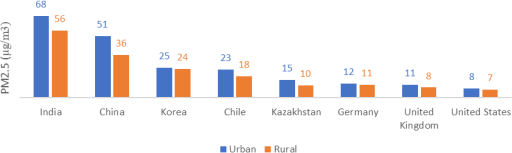{#fig-exurbrur}

*Source: @world2018burden*

In CPAT, we also use the estimations of ambient PM2.5 from the @murray2020global
study. We assume the same ratio between urban and rural concentrations
levels from  @world2018exposure and the overall concentrations from @murray2020global.
@fig-gridmpm presents the gridded values for ambient PM2.5 in 2019.

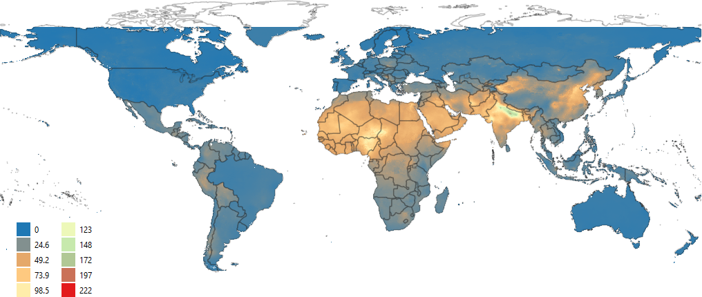{#fig-gridmpm}

*Source: Own elaboration, based on @ihme data*

#### Household PM2.5 Exposure data

As we mentioned before, in CPAT we estimate jointly the impacts of
ambient and household pollution. To do so, we need to know the share of
the population exposed to household pollution and the exposure level to
household PM2.5. We again draw upon data from the @murray2020global study.

The left panel in @fig-expoap shows the estimated evolution in the share of the
population exposed to household pollution in time, while the right panel
presents the exposure level, in addition to the OAP exposure, for the
World Bank regions. For the baseline scenario, we assume that the share
of the population exposed, and the exposure level will be constant in
time, and equal to the estimated value for 2019.

{#fig-expoap}

*Source: IHME/GBD, provided by Michel Brauer*

#### Ozone Exposure data {#sec-ozexp}

As mentioned before, we use the seasonal 8 hours maximum daily value to
estimate the health effects of ambient ozone pollution. @fig-gridconc
presents the gridded concentrations estimated for 2019.

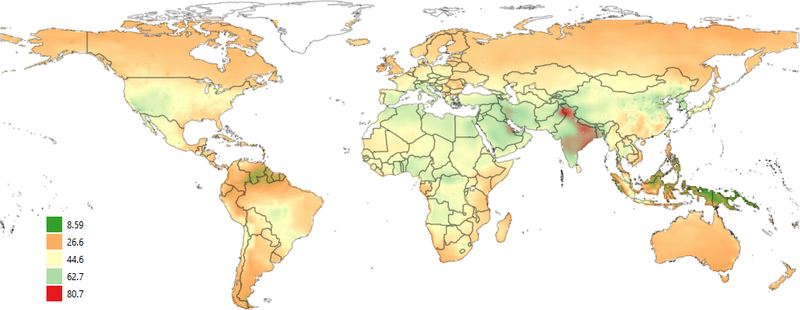{#fig-gridconc}

*Source: Own elaboration, based on data provided by Michael Brauer*

### Leakage to biomass

Carbon pricing to formal fuels could potentially lead to an increase in
the use of solid fuels[^6_26] for cooking. This is called a “leakage”
effect and could increase both household and ambient pollution. @fig-impcarbpri illustrates the carbon pricing effects on fuels consumption.

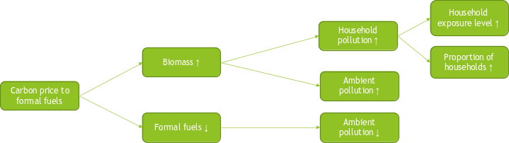{#fig-impcarbpri}

*Source: Own elaboration*

The demand for fuels, including the demand for biomass for cooking is
calculated in the Mitigation tab in CPAT. For details on energy demand
calculations, please refer to the Mitigation tab documentation.

As illustrated in @fig-impcarbpri, the leakage into informal fuels could
increase the proportion of households exposed to HAP, the level of
exposure to HAP and OAP. The assumption for OAP is that 100% of indoor
emissions are eventually incorporated into ambient air (@chafe2014household). These ambient emissions are converted into ambient pollution using the methodology selected by the user, as described in @sec-em_ap.

Regarding the indoors effect of solid fuel use, the total leakage is
divided in a fraction that increases the proportion of households and a
fraction that increases the level of household pollution.

In CPAT, the defaults assumptions are that 50% of the increase in
informal fuels consumption goes to additional household consuming solid
fuels and 50% to increased consumption within households that were
already using solid fuels.

In many countries is estimated that 90% of households or more use solid
fuels for cooking. To make sure that the final proportion of households
that uses solid fuels for cooking, after leakage is considered, is less
than 100% (or another maximum value defined by the user), we adjust the
fraction of the leakage that goes into the proportion of households.
@eq-prophh corresponds to the final proportion of households
that uses solid fuels for cooking before adjustments. @eq-prophhadj
is the adjusted fraction in case the new share of households using solid
fuels is higher than the maximum defined. @eq-prophhif is the
final proportion of households using solid fuels for cooking.

$$\text{ProportionHH}_{\text{carbon\ price}} = \text{ProportionHH}_{\text{baseline}}*(1 + Leakage*F_{\text{pro}p_{\text{HH}}})$${#eq-prophh}

$${F\_ prop\_ HH}_{\text{adjusted}} = \left( \frac{\text{MaxPropHH}}{\text{ProportionHH}_{\text{baseline}}} - 1 \right)*\frac{1}{\text{Leakage}}$${#eq-prophhadj}                                                                              

$$F\_ prop\_ HH = \left\{ \begin{matrix}
\text{if }\text{ProportionHH}_{\text{carbon price}} > Max\ then{\ F\_ prop\_ HH}_{\text{adjusted}} \\
\text{else }\text{ProportionHH}_{\text{carbon price}} \\
\end{matrix} \right.\ $${#eq-prophhif} 

### Other health effects in CPAT

#### Post neonatal mortality (@woodruff2006fine)

In CPAT, it is possible to quantify post neonatal mortality (deaths after
the first month and up to 1 year of life) using @woodruff2006fine. This logistic function is presented in @eq-logfunc, its applied to ambient PM2.5, to all-cause mortality and its
parameters are $\beta=0.006765865$, with $\sigma=0.007338828$.

$$\left( 1 - \left( \frac{1}{\left( 1 - Incidence \right)*EXP\left( \beta*DeltaQ \right) + Incidence} \right) \right)*Incidence*POP$${#eq-logfunc}

#### Depressive disorders

Another effect of ambient air pollution included in CPAT is depressive
disorders. @braithwaite2019air develops a metanalysis of studies
linking long-term PM exposure and depression. The author develops a
log-linear exposure-response function and uses a counterfactual value of
10 µg/m3 for the UK and of 25 µg/m3 for global scenario. In the
meta-analysis, the pooled odds ratio for the association between
long-term PM2.5 exposure and depression prevalence obtained was 1.102
per 10 µg/m3 (95% CI: 1.023, 1.189; p=0:011), indicating that higher
PM2.5 exposure is associated with higher odds of depression.

They treat pooled ORs as equivalent to RRs. The relative risk can be
calculated according to @eq-rrappro.

$$RR \approx \text{OR}_{10}*\frac{{PM2.5}_{\text{current}} - {PM2.5}_{\text{counterfactual}}}{10}$${#eq-rrappro}

Where $OR_{10}$ denotes the OR per 10 µg/m3 increment in PM2.5
exposure.

In CPAT, the counterfactual level, ${PM2.5}_{\text{counterfactual}}$
used is 25 µg/m3.

## Methods to quantify the economic impacts of air pollution {#sec-eco_ap}

In this section we describe the economic impacts of pollution included
in CPAT. The metrics included are working days lost due to pollution,
output losses due to mortality and morbidity, and health expenditure. We
also explain how we value averted mortality, using a transferred VSL,
the time structure of averted deaths and the valuation of travel time
saved (used in CPAT Transport tab).

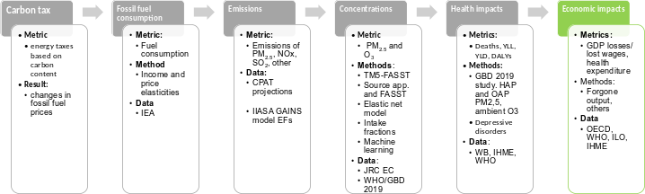{#fig-ecomethodo}

### Data sources used to quantify economic impacts

| Input                                                                              | Source                                                                       |
| ---------------------------------------------------------------------------------- | ---------------------------------------------------------------------------- |
| Absenteeism from work                                                              | @oecd21, @world2019pop                                                      |
| Methodology for working days lost                                                  | @ostro1987air, @holland2014cost, @iiasa1                                   |
| Methodology for productivity losses                                                | Personal communications with Maureen Cropper                                 |
| Labor’s share of GDP                                                               | @guerriero2019labor                                                             |
| Employment to population ratio, unemployment, wages, growth rate of GDP per worker | ILOs indicators                                                              |
| Real interest rate[^6_27]                                                          | World Development Indicators, World Bank                                     |
| Health expenditure methodology                                                     | @preker2016health                                                        |
| Data on health expenditure                                                         | @global2019burden                           |
| VSL                                                                                | @oecd12, @narain2016methodology, @oecd2021 and @oecd21             |
| Time structure of averted deaths                                                   | @usepa                                                                |
| Travel time saved                                                                  | @irf, @robinson2019valuing, Tomtom’s data. |

: Summary of data sources used to quantify economic impacts of pollution {#tbl-summdata}

### Working days lost

Work absenteeism has direct costs because of wage losses and replacement
costs, and indirect costs in productivity, due to delayed work and
possible interference with the work performed by co-workers and
supervisors.

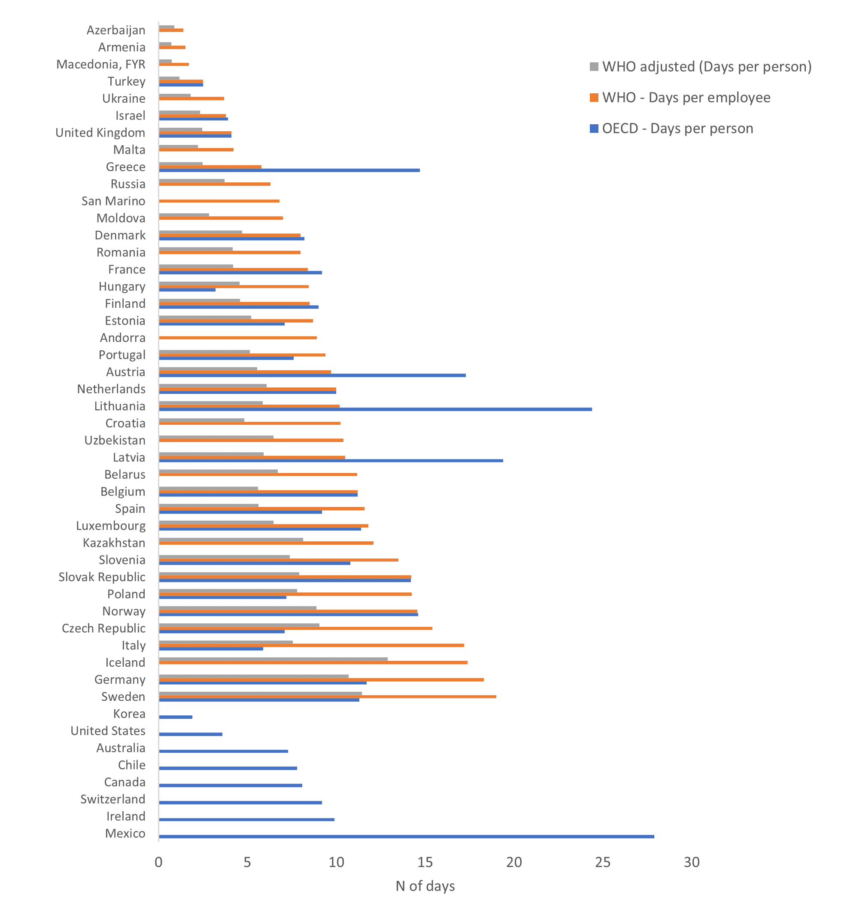{#fig-absworkill}

*Source: @oecd20 and WHO (2019)*

<!-- PS: I cannot find this reference above WHO 2019 -->

In CPAT, we quantify working days lost attributed to pollution following
@ostro1987air. This methodology has been implemented in more recent
literature, such as @holland2014cost and @amann2017costs. OECD research @oecd16 and @oecd19 has also been based indirectly in @ostro1987air but referencing the work from @holland2014cost.

The baseline absenteeism from work due to illness data used are the OECD
database “Absence from work due to illness” (@oecd20) that covers 46
countries[^6_28] and “Absenteeism from work due to illness”[^6_29] from
the WHO (2019). @fig-absworkill presents the data from the observed
databases.

Since not every country is covered in the databases, we adopt the
following assumptions for obtaining baseline absenteeism at a country
level:

  - If the country in included in the OECD database, we use OECD data.

  - If no OECD data is available, but WHO data includes the country, we
    use WHO adjusted by “employment to total population ratio, 15+” (ILO
    n.d.).

  - If no country specific data is available, we use the average value
    among countries with the same income level.

  - For low-income countries (that are not represented in either
    database), we use the average from lower middle-income countries.

To calculate the share of work absenteeism due to illness that can be
attributed to ambient PM2.5 pollution, we use the methodology from @ostro1987air. The study developed a log-linear function with
$\beta = 0.0046$ and $\sigma_{\beta} = 0.00036$. The attributable
fraction of working days lost due to pollution is calculated using
@eq-pafe and the total number of days lost due to pollution is
given by @eq-totnblost.

$$PAF = 1 - e^{- \beta*\mathrm{\Delta}C}$${#eq-pafe}

$$\text{WDL}_{\text{pollution}} = \text{Pop}_{15\ to\ 64}*\text{Per\ person\ WDL}_{\text{baseline}}*(1 - e^{- \beta*C\ baseline})$${#eq-totnblost}

Where $\Delta C$ is the current level of PM2.5 minus a reference
level for PM2.5, that is assumed to be 0 in this case.

To value the days of work lost due to pollution, we use mean monthly
earnings of employees, ILOSTAT Labor statistics.

If no wage is available, the default value used is:
$$Daily\ wage = \frac{GDP*\alpha}{N{^\circ}\ of\ persons\ employed}*\frac{1}{N{^\circ}\ of\ days}$${#eq-dailywage}

Where $N{^\circ}\ of\ days\ = 12*20$.

We consider working population from 15 to 64 years old, as in @amann2017costs.

### Market output losses {#sec-marketoutputlosses}

In CPAT, we quantify market output losses using mortality and years
lived with disability (YLD) attributed to pollution, following the
methodology in @pandey2021health. The methodology followed is
presented in the following paragraphs.

**Average GDP contribution by worker**

@eq-wij presents the expected value of GDP per worker
in a given year, that we will use to quantify GDP losses due to
pollution.

$$W_{\text{ij}} = \left( \frac{L_{\text{ij}}}{N_{\text{ij}}} \right)\left( \frac{\text{αY}_{i}}{L_{i}} \right)$${#eq-wij}

Where:

$W_{ij}$: the expected value of GDP per worker for a person of
age $j$ in state $i$.

$\alpha$: Labor’s share of GDP

$Y_i$: GDP

$L_i$: number of persons who are employed

$N_{\text{ij}}$: Population of age$\text{\ j}$ in state $i$

Due to data limitations, in CPAT will compute a value $W$ for every
worker above 15+, without differentiating by age or by urban and rural
areas.

For each period (year) $p$, the expected GDP from labor per person is
calculated using @eq-wpshare.

$$W_{p} = \left( \frac{L_{p}}{N_{p}} \right)\left( \frac{\text{αY}_{p}}{L_{p}} \right) = \ \frac{\text{αY}_{p}}{N_{p}}$${#eq-wpshare}

**Loss in market and non-market output due to
air pollution mortality**

Losses in market and non-market output due to air pollution mortality
can be estimated according to @eq-wif17.

$${W'}_{ij2017} = \left( \frac{L_{\text{ij}}}{N_{\text{ij}}} \right)\left( \frac{\text{αY}_{i}}{L_{i}} \right) + hp\left( 1 - \frac{L_{\text{ij}}}{N_{\text{ij}}} \right)\left( \frac{\text{αY}_{i}}{L_{i}} \right)$${#eq-wif17}

Where $hp$ represents household production. In CPAT, due to
data limitations, we will only include losses in market output.

The present value of the forgone output associated to a premature death
is calculated according to @eq-pvij.

$$\text{PV}_{\text{ij}} = \sum_{a = j}^{84}\pi_{ij,t}\left\lbrack \left( \frac{L_{\text{it}}}{N_{\text{it}}} \right)\left( \frac{\text{αY}_{i}}{L_{i}} \right) + hp\left( 1 - \frac{L_{\text{it}}}{N_{\text{it}}} \right)\left( \frac{\text{αY}_{i}}{L_{i}} \right) \right\rbrack\left( \frac{1 + g}{1 + r} \right)^{t - j}$${#eq-pvij}

Where:

$\text{PV}_{\text{ij}}$: present discounted value of lost market
and non-market output for a person of age $j$ in state $i$ who dies in
a certain year
 
$g$: growth rate of GDP per worker
 
$\Pi_{ij,t}$ is the probability that a person of age $j$ in
state $i$ survives to age $t$
 
$r$: discount rate

In CPAT, $W_{ij,t} = W_{p}$ (does not change by age or within
countries). We will also consider only deaths up to 64, neglecting work
force above 65. These assumptions, together with assuming
$\text{hp}=0$, allow us to rewrite @eq-pvij as @eq-pvj.

$$\text{PV}_{j} = W*\sum_{t = j}^{64}\pi_{j,t}*\left( \frac{1 + g}{1 + r} \right)^{t - j}$${#eq-pvj}

Rewriting @eq-pvj, we obtain:

$$\text{PV}_{j}/W = \sum_{t = j}^{64}\pi_{j,t}*\left( \frac{1 + g}{1 + r} \right)^{t - j}$${#eq-pvjw}

The total output lost due to air pollution attributed mortality is
obtained using @eq-totoutplost.

$$TotalOutputLost = \sum_{j}^{}{\text{PV}_{\text{ij}}D_{\text{ij}}}$${#eq-totoutplost}

With $D_{\text{ij}}$ the number of deaths attributed to air pollution
in state $i$ of age $j$.

**GDP loss due to air pollution
morbidity**

In CPAT, we estimate the years lived with disability due to pollution
(see @sec-healthout). We value those years, in which people in
working age are not able to work, or the output loss associated with
morbidity using @eq-mij.

$$M\text{ij}\  = \ \ Wij*\text{YLD}\text{ij}$${#eq-mij}

@tbl-parampdty presents the data sources used for the different productivity parameters needed to
quantify output losses.

|Parameter||Data sources|
|--- |--- |--- |
|$\alpha$|Labor’s share of GDP|@guerriero2019labor, includes 117 countries. If there isn’t data available for a country, we use the world’s average labor share of GDP, of 65%.|
|$Y_i$|GDP|World Bank national accounts data, and OECD National Accounts data files|
|$\frac{L_{\text{it}}}{N_{\text{it}}}$|Labour to population|Employment to population ratio, 15+, total (%) (modeled ILO estimate), International Labour Organization, ILOSTAT database. Data retrieved in April 2019|
|$L_{it}$|Number or persons that are employed|$$L=LaborForcetotal*(1 − unemployment)$$ Labor force[^6_30] derived using data from International Labour Organization, ILOSTAT database and World Bank population estimates. Labor data retrieved in April 2019. Unemployment from International Labour Organization, ILOSTAT database. Data retrieved in April 2019.|
|$hp$|Household production|Not included in CPAT|
|$\Pi_{it,t}$|Probability of survival|The probability of survival is the probability that an individual would have survived to each future year of his working life. The probability of death[^6_31] is obtained from @global2018global for every country and age group. The probability of survival up to 64 years is calculated as follows: $$\pi_{j} = \prod_{j}^{64}{(1 - \text{Prob\ of\ death}_{j})}$$|
|$g$|growth rate of GDP per worker|ILO indicators[^6_32], up to 2023: - SDG indicator 8.2.1 - Annual growth rate of output per worker (GDP constant 2010 USD) (%). After 2023, we assume a growth rate equal to the rate in 2023.|
|$r$|Discount rate|CPAT allows the user to select among 3 options: i) Use the real interest rate for the country, ii) Using a 3% discount rate, as recommended in @robinson2019valuing, iii) Input manually a discount rate. In case the user selects the first option, r will be the real interest rate[^6_33] (%) from the International Monetary Fund, International Financial Statistics and data files using World Bank data on the GDP deflator[^6_34]. That data covers 127 countries. Data is available up to 2018. After 2018, it’s assumed an interest rate equal to the average of the rates between 2014 and 2018.|

: Parameters for productivity {#tbl-parampdty}

#### CPAT operationalization

From the GBD Results Tool, we obtained deaths probabilities for
five-years buckets. For instance, we know the probability of dying
between 25 to 29 years old ($d_{25,29}$). The probability
$d_{25,29}$ is equal to the sum of the probability of dying at 25, at
26, at 27, at 28 and at 29 years old, as shown in @eq-dprob.

$$d_{25,29} = d_{25} + d_{26} + d_{27} + d_{28} + d_{29}$${#eq-dprob}

For simplicity and to keep the file size at a reasonable level, we will
assume that the probability of dying at every age contained in each
bucket is the same, and equal to the bucket dying probability divided by
5, as presented in @eq-dsimple.

$$d_{25} = d_{26} = d_{27} = d_{28} = d_{29} = \frac{d_{25,29}}{5}$${#eq-dsimple}

The survival probability for each age inside each age-bucket is
presented in @eq-survprob.

$$\pi_{25,29} = \left( 1 - \frac{d_{25,29}}{5} \right) = \pi_{25} = \pi_{26} = \pi_{27} = \pi_{28} = \pi_{29}$${#eq-survprob}

To implement @eq-pvjw, let’s do $\left( \frac{1 + g}{1 + r} \right) = a$. Then, @eq-pvjw operationalized for 5 years bucket in CPAT is presented in @eq-pvw.

$$\frac{\text{PV}_{25 - 29}}{W} = \pi_{25,29}*\sum_{k = 0}^{2}a^{k} + \pi_{25,34}*\sum_{k = 3}^{7}{a^{k} + \ldots + \pi_{25,64}*\sum_{k = 43}^{47}a^{k}}$${#eq-pvw}

Where $k = t - j$

To solve the sums inside @eq-pvw, we can apply the following
formula:

$$\sum_{k = 0}^{n}{a^{k} = \frac{1 - a^{n + 1}}{1 - a}}$${#eq-sumk}

@eq-sumk can be used to solve the sum terms that start in $k≠0$,
as shown in @eq-sumkm.

$$\sum_{k = m}^{n}{a^{k} = \sum_{k = 0}^{n}a^{k} - \sum_{k = 0}^{m}a^{k} = \frac{1 - a^{n + 1}}{1 - a} - \frac{1 - a^{m + 1}}{1 - a}}$${#eq-sumkm}

### Health expenditure

In CPAT, we use total expected health expenditure from 2017 to 2050 from
the IHME (@global2019a).

We follow @preker2016health to estimate the share of total health
expenditure than can be attributed to pollution. The assumption is a
constant expenditure per DALY (Disability adjusted life years).

In CPAT, we calculate the share of the total burden of disease that’s
attributed to the 6 main causes related to pollution, using data from
the GBD Results Tool (@ihme). The share of the burden of disease for
disease $d$, country $c$ and year $t$, $\% BoD_{d,c,t}$,
is calculated according to @eq-bod.

$$\% BoD_{d,c,t} = \frac{\text{DALY}s_{d,c,t}}{\text{TotalDALY}s_{c,t}}$${#eq-bod}

The total health expenditure attributed to pollution $\text{HEAP}$ can
be calculated using @eq-heap.

$$\text{HEAP}_{c,t} = \sum_{d}^{}{\% BoD_{d,c,t}*PAF_{d,t}*THE_{c,t}}$${#eq-heap}

Where:

$\text{PAF}_{d,t}$: population attributable fraction for disease
$d$ in year $t$
 
$\text{THE}_{c,t}$: Total health expenditure for country $t$ in year $t$

$\text{DALY}s_{d,c,t}$: Disability adjusted life years, for disease $d$, country $c$ and year $t$

In CPAT, we distribute health expenditure between government, prepaid
private, out-of-pocket and development assistance for health using IHME
estimations for 2019 (@global2019a).

### Value of the statistical life

In CPAT, we value averted mortality using the value of the statistical
life or VSL. It’s important to notice that the VSL does not represent
the value of individual lives. Rather, the VSL is a measure of the rate
at which individuals are willing to exchange money to reduce small risks
of death within a certain period of time. This concept is used in
benefit-cost analyses, and we include it in CPAT to assign a monetary
value to averted mortality due to a carbon price policy.

The VSL can be transferred following the methodology from @oecd12 and
@narain2016methodology, according to @eq-vslc.

$$VSL_{c} = VSL_{OECD,2005}*\left( \frac{Y_{c}}{Y_{OECD,2005}} \right)^{b}*\left( 1 + \%\mathrm{\Delta}P + \%\mathrm{\Delta}Y \right)^{b}$${#eq-vslc}

Where:

$c$: Country to which VSL in being transferred to.

$\text{VSL}_{OECD,2005}$: Median VSL in OECD countries in 2005, in 2005 $USD PPP

$Y$: GDP per capita in PPP

$b$: Income elasticity for VSL in country $c$

$\%\mathrm{\Delta}Y$: Income growth after 2005

$\%\mathrm{\Delta}P$: inflation according to consumer price index
 
In CPAT, we first transform OECD VSL from 2005 USD PPP to 2011 PPP,
using @eq-vsloecd.

$$VSL_{OECD,\ t,2011PPP} = VSL_{OECD,2005}*\left( \frac{Y_{OECD,t}}{Y_{OECD,2005}} \right)^{0.8}*\left( 1 + \%\mathrm{\Delta}P_{2005,2011} \right)^{0.8}$${#eq-vsloecd}

Secondly, we transfer the OECD VSL from 2014 (in 2011 USD PPP) to the
destiny country, according to @eq-vsloecdbis.

$$VSL_{OECD,\ 2014} = VSL_{OECD,\ 2014}*\left( \frac{Y_{c,2014}}{Y_{OECD,2014}} \right)^{b}$${#eq-vsloecdbis}

Thirdly, we project VSL in time using projected GDP per capita for
country $c$, according to @eq-vslct.

$$VSL_{c,\ t} = VSL_{c,2014}*\left( \frac{Y_{c,t}}{Y_{c,\ 2014}} \right)^{b}$${#eq-vslct}

Finally, we convert the VSL from 2011 dollars to dollars in the “Results
Year” (equal to 2019), using the 2019 price deflator for the country of
destiny.

In CPAT, income elasticity is assumed equal to 0.8 for high-income
countries and 1.2 for middle and low-income countries. The user can also
input manually a different elasticity and a different VSL value in the
Advanced tab of CPAT.

@tbl-assumpvsl and @tbl-cpigdp present the values assumed to transfer the VSL
from OECD countries.

|Variable|Assumption|Source|
|--- |--- |--- |
|$VSL_{OECD, 2005}$|3 million USD in 2005, in 2005 PPP dollars|@oecd12, Table 6.1|
|$b$|0.8 for high income countries and 1.2 for middle and low-income countries|@narain2016methodology|

: Assumptions and data sources for VSL transfer {#tbl-assumpvsl}

| Year     | CPI OECD | GDP per head of population OECD (2011 $US PPP) |
| -------- | -------- | ---------------------------------------------- |
| **2005** | 82.0     | 35,407.8                                       |
| **2006** | 84.1     | 36,248.1                                       |
| **2007** | 86.2     | 36,921.0                                       |
| **2008** | 89.4     | 36,738.5                                       |
| **2009** | 89.9     | 35,198.6                                       |
| **2010** | 91.5     | 36,011.9                                       |
| **2011** | 94.1     | 36,554.1                                       |
| **2012** | 96.2     | 36,813.9                                       |
| **2013** | 97.7     | 37,130.2                                       |
| **2014** | 99.4     | 37,696.5                                       |
| **2015** | 100.0    | 38,413.8                                       |
| **2016** | 101.1    | 38,859.1                                       |
| **2017** | 103.4    | 39,589.2                                       |

: Consumer price index and GDP per capita, OECD countries {#tbl-cpigdp}

*Source: @oecd2021 and @oecd21*

### Time Structure of averted deaths 

When quantifying and valuing premature mortality, it is often assumed
that there is a “cessation lag,” or time distribution of averted
mortality after a reduction in exposure (@usepa). The time
structure we selected assumes that 30% of mortality reductions occur
during the first year, 50% occurs over years 2 to 5 and 20% over years 6
to 20, after the PM2.5 reduction takes place.

When valuing averted mortality using the value of statistical life
(VSL), it is possible to calculate the present value of the benefit from
reduced premature deaths by applying the discount rate to the number of
deaths themselves and then multiplying by the VSL. In CPAT, the user can
select the discount rate among 3 options: i) a discount rate of 3%,
consistent with the recommendation in @robinson2019reference; ii) a discount rate that represent the interest rate paid by the country’s government and iii) a manual input of discount rate. When
using a 3% discount rate, the present value of premature deaths reduced
is 0.906 times the number of undiscounted premature averted deaths. When
using a higher discount rate, for example a rate of 8%, the factor is
reduced to 0.798 (see @tbl-premdeaths).

|                      |                                 | **3% discount rate**     | **8% discount rate**                      |                          |                                           |
| -------------------- | ------------------------------- | ------------------------ | ----------------------------------------- | ------------------------ | ----------------------------------------- |
|               | **Deaths distribution in time** | **Time discount factor** | **Fraction deaths\*time discount factor** | **Time discount factor** | **Fraction deaths\*time discount factor** |
| Year 0               | 30.0%                           | 1.00                     | 0.300                                     | 1.00                     | 0.300                                     |
| Year 1               | 12.5%                           | 0.97                     | 0.121                                     | 0.93                     | 0.116                                     |
| Year 2               | 12.5%                           | 0.94                     | 0.118                                     | 0.86                     | 0.107                                     |
| Year 3               | 12.5%                           | 0.92                     | 0.114                                     | 0.79                     | 0.099                                     |
| Year 4               | 12.5%                           | 0.89                     | 0.111                                     | 0.74                     | 0.092                                     |
| Year 5               | 1.3%                            | 0.86                     | 0.012                                     | 0.68                     | 0.009                                     |
| Year 6               | 1.3%                            | 0.84                     | 0.011                                     | 0.63                     | 0.008                                     |
| Year 7               | 1.3%                            | 0.81                     | 0.011                                     | 0.58                     | 0.008                                     |
| Year 8               | 1.3%                            | 0.79                     | 0.011                                     | 0.54                     | 0.007                                     |
| Year 9               | 1.3%                            | 0.77                     | 0.010                                     | 0.50                     | 0.007                                     |
| Year 10              | 1.3%                            | 0.74                     | 0.010                                     | 0.46                     | 0.006                                     |
| Year 11              | 1.3%                            | 0.72                     | 0.010                                     | 0.43                     | 0.006                                     |
| Year 12              | 1.3%                            | 0.70                     | 0.009                                     | 0.40                     | 0.005                                     |
| Year 13              | 1.3%                            | 0.68                     | 0.009                                     | 0.37                     | 0.005                                     |
| Year 14              | 1.3%                            | 0.66                     | 0.009                                     | 0.34                     | 0.005                                     |
| Year 15              | 1.3%                            | 0.64                     | 0.009                                     | 0.32                     | 0.004                                     |
| Year 16              | 1.3%                            | 0.62                     | 0.008                                     | 0.29                     | 0.004                                     |
| Year 17              | 1.3%                            | 0.61                     | 0.008                                     | 0.27                     | 0.004                                     |
| Year 18              | 1.3%                            | 0.59                     | 0.008                                     | 0.25                     | 0.003                                     |
| Year 19              | 1.3%                            | 0.57                     | 0.008                                     | 0.23                     | 0.003                                     |
| **Total Lag factor** | **0.906**                       |                          | **0.798**                                 |                          |                                           |

: Time distribution of averted premature deaths {#tbl-premdeaths}

*Source: Own elaboration* Note: $Time\ discount\ factor\ = 1/(1 + r)^{(t - t0)}$

### Travel time saved

Excess travel time is one of the consequences of road congestion. In
CPAT, we estimate excess travel time, increased road damage, increased
injuries, and additional vehicle operating costs attributable to
congestion. The methodology used is described in the document Road
Transport documentation. Here we only describe the methodology used to
quantify changes in travel time, in time units, with respect to free a
flow condition.

We estimate travel time per vehicle-kilometer in free flow and in
congested conditions for 416 cities in 57 countries, using TomTom data
(see @eq-freeflow and @eq-congvkm). The time domain used is “All Days
Full Day”.

Congestion travel time per vehicle-kilometer, $CongestionTT$, is
calculated using @eq-congvkm.

$$\text{CongestionT}T_{2019}\lbrack min/vehkm\rbrack = \frac{\text{AccumulatedTravelTim}e_{2019}\ \lbrack min\rbrack}{\text{TotalVeh}\text{KM}_{2019}\lbrack vehkm\rbrack}$${#eq-congvkm}

$\text{TotalVehicleKM}$ corresponds to the multiplication of the
number of vehicles and the average distance traveled and is reported in
the TomTom database.

The travel time per vehicle-kilometer under free flow conditions is
calculated using @eq-freeflow.

$$FreeFlowTT\lbrack\frac{\min}{\text{vehkm}}\rbrack = \frac{\text{CongestionT}T_{2019}\ \lbrack\frac{\min}{\text{vehkm}}\rbrack}{(1 + \frac{CI_{2019}}{100})}$${#eq-freeflow}

Where $\text{CI}$ is the average congestion index in 2019.

We estimate vehicle-kilometers traveled per capita using total
vehicle-kilometers from the World Road Statistics data (@irf) and countries total population (@world2019pop). For those countries not included in the WRS database, we assume
the average vehicle-kilometers traveled per capita between the regional
mean and the income level mean.

Using vehicle-kilometers traveled per capita, together with the
congestion index $CI$ and the free flow travel time, we can
estimate total travel time each year $t$, in time units, using
@eq-travtime.

$$\text{Travel time}_{t} = \left( 1 + \frac{CI_{t}}{100} \right)*FreeFlowTT\left\lbrack \frac{\min}{\text{vehkm}} \right\rbrack*VehKm\ per\ capita\left\lbrack \frac{\text{vehkm}}{\text{year}} \right\rbrack*UrbanPopulation_{15 + ,t}$${#eq-travtime}

In CPAT, there are estimations for the congestion index for each year,
under the baseline scenario and a carbon price scenario. Using the
@eq-travtime, we can quantify travel time for each year under each
scenario. Time savings attributed to a carbon price are equal travel
time in the baseline minus travel time in the carbon price scenario.

We value those time savings following @robinson2019reference. We value
travel time at a rate of 50% the after-tax wage rate. We use gross
earnings[^6_35] data from ILO and then we apply a factor to estimate
after-tax wages. The factor used for OECD countries is the “average
income tax rate as % of gross wage earnings”. For other countries, we
use the average factor from OECD countries, equal to 16%. When we value
travel time savings, we do so by considering only the population above
15 years old, since younger population does not participate in the labor
market.

**Some implied assumptions:** We assume that free flow travel time and
vehicle-kilometers traveled per capita are constant in time.
Vehicle-kilometers traveled are the same across the population,
regardless of age or other considerations. Tomtom’s data is
representative of vehicles not using their devices.

### Value of morbidity using years lived with disabilities (YLDs) {#sec-valuemorbidity}

Another approach to value morbidity in CPAT in based on a method
proposed in @world2022global. Under this method, we convert YLDs
to ‘annual disease days’ $M$ and we value them using a fraction of a
country’s daily wage.

First, annual disease days are calculated from YLDs, for each country
as:

$$M = \ \sum_{c = 1}^{n}{YLD_{c}*\frac{365}{DW_{c}}}$${#eq-msum}

Where:

$YLD_{c}$: years lost to disease $c$

$DW_{c}$ : Average disability weight of disease $c$ attributed to
PM2.5

The cost of a day lived with a disease $c$, $c_{c}$, is calculated a
fraction of the daily wage $w$ (in each country), as presented in
@eq-cc. The term D corresponds is set at 0.4, and is associated to
the disability weight of a severe condition, with severely restricted
work and leisure activity and a substantial medical cost.

$$c_{c} = w*\frac{DW_{c}}{D}$${#eq-cc}

The average daily wage, $w$, was calculated using the methodology
explained in @sec-marketoutputlosses.

Finally, the cost of morbidity is calculated as the multiplication of
annual disease days and the cost of each day lived with disease.

$$Cost\ of\ Morbidity = \ \sum_{i = 1}^{n}{c_{c}*M}$${#eq-costmorbidity}

Using this method to value morbidity attributed to air pollution, we
calculate the share of morbidity costs as a share of mortality costs.

### Air pollution externalities per unit of fuel

The health impacts attributed to air pollution are calculated jointly
for ambient and household pollution (see @sec-healthburdenpoll), following the
methodology from @murray2020global. Although the health impacts are estimated jointly, we compute an
average externally cost per unit of fossil fuel burnt, which affects
only ambient pollution.

After the health impacts have already been quantified, the air pollution
externality computation is made as follows:

1.  We compute the average ambient air pollution attributed mortality
    per µg/m3 of PM2.5 as total mortality attributed to
    ambient PM2.5 in a certain year (referred to as
    “attributable burden” in previous chapters) divided by the total
    ambient PM2.5 that year.

2.  Using the emission factor (for each fuel and sector, for each
    country) and the emissions-to-concentrations model selected, we
    compute the ambient PM2.5 contributed by one unit of fuel
    used (in µg/m3 of PM2.5 per ktoe).

3.  We multiply the average ambient air pollution attributed mortality
    per µg/m3 (step 1) with the ambient PM2.5 contributed by
    one unit of fuel used (step 2), obtaining the number of attributed
    deaths by unit of fuel used (deaths/ktoe).

4.  We multiply the metric calculated in step 3 with the VSL for the
    corresponding year and country, obtaining the externality value in
    dollars per ktoe. We add to this number morbidity costs (for ambient
    air pollution), according to the methodology described in @sec-valuemorbidity.

5.  We convert energy units to express the externality in a commonly
    used metric for each fuel, considering the relevant calorific values
    in each country and fuels densities when needed. For instance, for
    gasoline, the externality is expressed as US$ per liter, while, for
    coal, the externality is expressed as US$ per GJ.

## Validation: comparison with other models {#sec-validation}

### Health impacts of pollution

In the following figures, we compare CPAT results with external models.
Green dots represent CPAT results, and the blue line represents the
results from the external model. When the green dots are above the blue
line (45 degrees line), CPAT estimates are higher, and when the green
dots are below the line, CPAT estimates are lower.

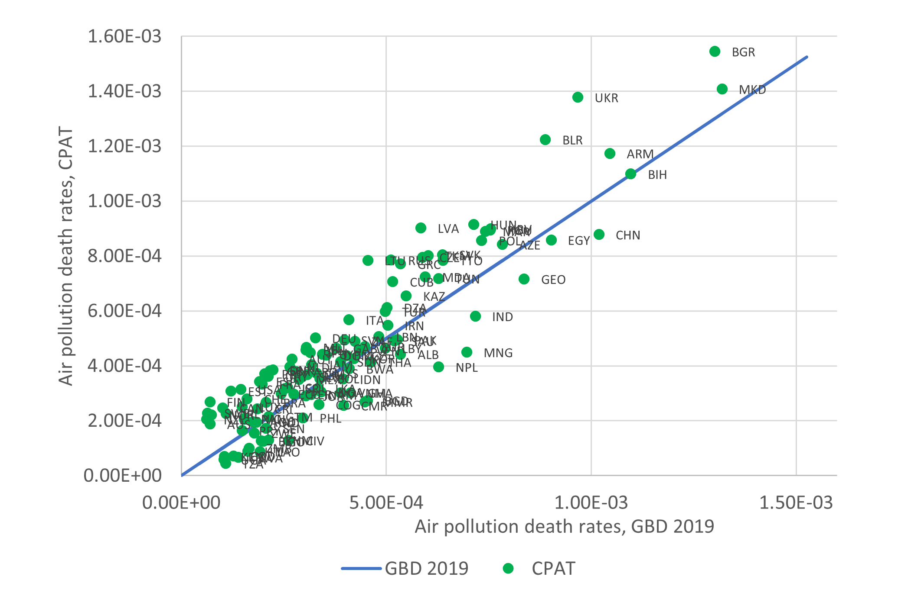{#fig-cpatvsgbd}

*Source: CPAT results and @murray2020global*

### Emissions

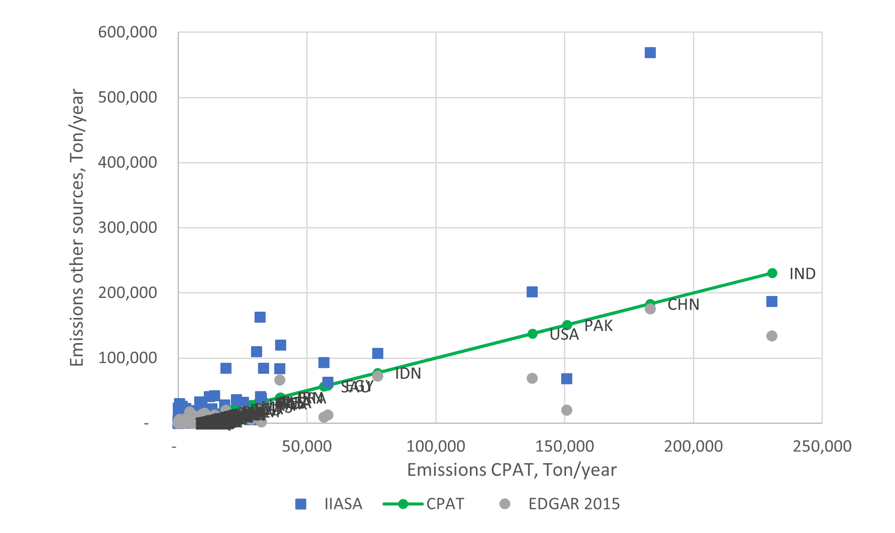{#fig-cpatvsiiasatra}

*Source: CPAT results, @eea and @iiasa1*

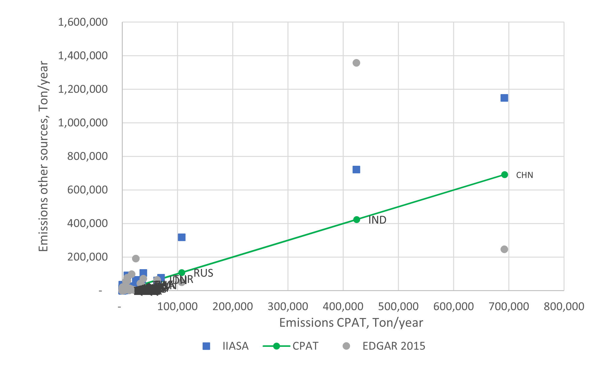{#fig-cpatvsiiasapow}

*Source: CPAT results, @eea and @iiasa1*

### Concentrations: share of fossil fuels on ambient PM2.5

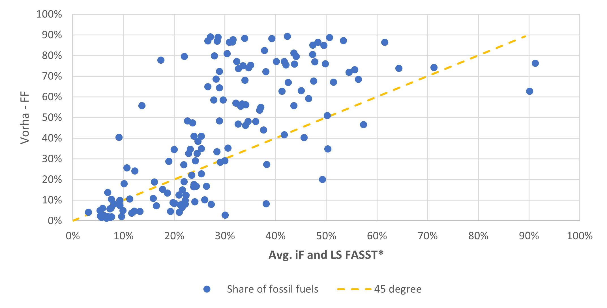{#fig-cpatvsvohra}

*Source: Own elaboration. Note: @vohra2021global share of FF contribution to ambient PM2.5 if higher than in CPAT for 61% of countries*

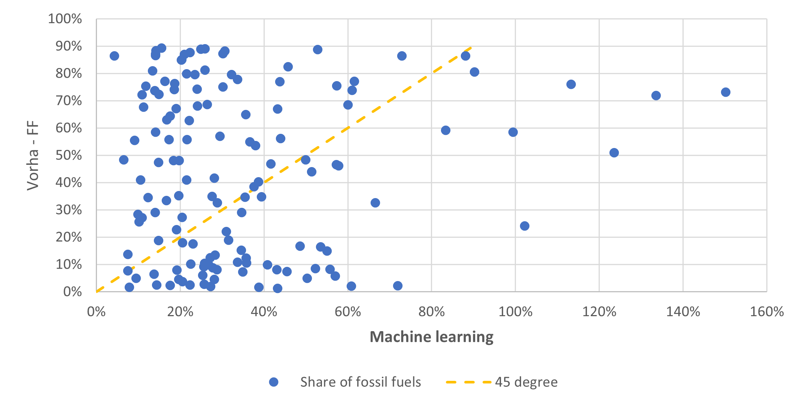{#fig-cpatvsvohra2}

*Source: Own elaboration. Note: @vohra2021global share of FF contribution to ambient PM2.5 if higher than in CPAT for 55% of countries*

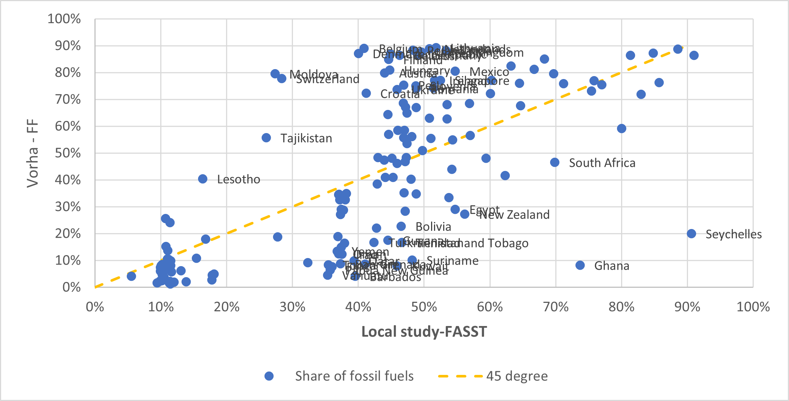{#fig-cpatvsvohra3}

*Source: Own elaboration. Note: @vohra2021global share of FF contribution to ambient PM2.5 if higher than in CPAT for 44% of countries*

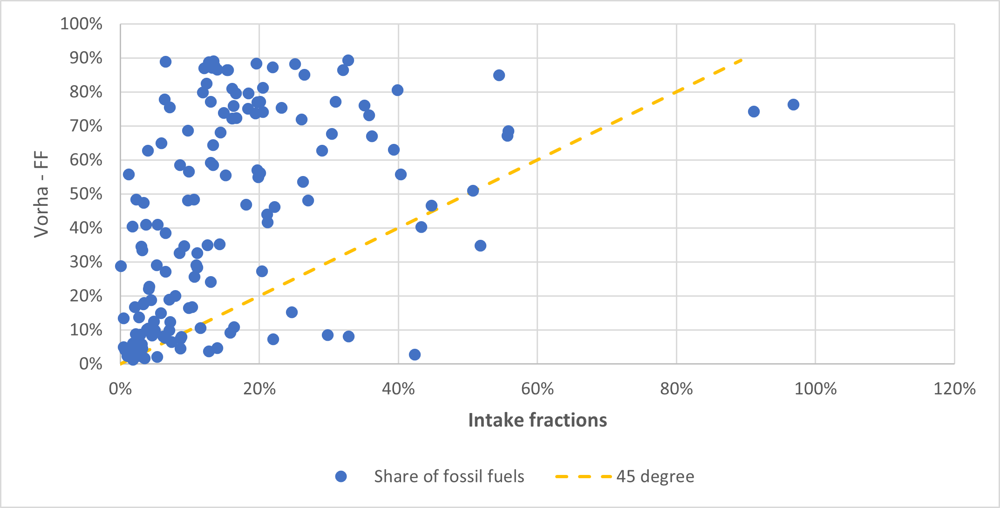{#fig-cpatvsvohra4}

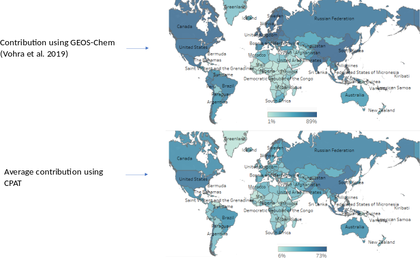{#fig-cpatvsvohra5}

### Externalities from pollution

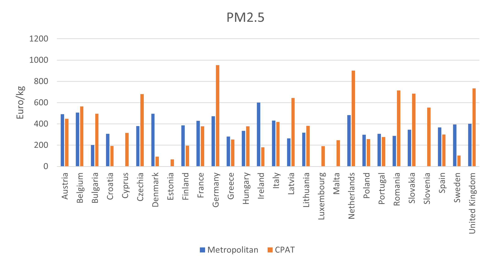{#fig-cpatvsdelft}

## Caveats {#sec-caveats}

The health impacts are calculated using global relative risk functions
and global data bases regarding exposure to pollution, baseline
incidence and others. Global databases are constructed using country
level databases, but in many cases, they are adjusted and standardized.
This may lead to differences among the data used in CPAT and local
databases. If differences among CPAT and local data is an issue, an
advanced Excel user could modify any inputs in CPAT, since the
spreadsheet is open, but this would require a deep understanding of the
tool.

Another issue to be aware of is the national and yearly scope of CPAT.
This can be a limitation of CPAT analysis because the dynamics of air
pollution can vary widely inside countries and throughout the year. CPAT
intends to represent population weighted average air pollution for
average pollution during a calendar year.

Another caveat is the uncertainty on the calculation of emissions, the
relationship between emissions and ambient concentration, the health
impacts and the economic values used to monetize the impacts of
pollution. CPAT at the time is providing a central estimate for all
calculations, without indicating uncertainty on estimations. This caveat
could be partially addressed by using the “MT tool” (described in the
user guide) to do a sensitivity analysis on the assumptions used.

It is important to consider that, even though CPAT performs well when
compared to other more complex models, this does not guarantee that CPAT
results will always be consistent with other more advance models. We
have compared baseline estimates with external global sources, to make
sure that we represent the baseline properly. Many checks have been
performed in the Mitigation module too, which results drive the air
pollution results. These checks do not guarantee that the policy impacts
obtained using CPAT will be similar to those obtained from other more
complex models. Further checks will need to be performed in a
policy/country-specific context. CPAT allows the user to change
assumptions and inputs, such that the tool can be adjusted properly when
needed.

Overall, the results from the air pollution in CPAT are conservative in
the sense the results are likely underestimating the health impacts of a
climate policy. This is the case in big part because the default
configuration of the air pollution variables yields conservative
contribution from fossil fuels to air pollution. The user can change the
predefined options and calibrate the tool to make the results consistent
with other sources of information available.

## Appendices

### CPAT codes, Air Pollution tab.

Air pollution tab codes:

| Variables  | Code                   | Description                                                                                                                                                                                     |
| ---------- | ---------------------- | ----------------------------------------------------------------------------------------------------------------------------------------------------------------------------------------------- |
| Series     | paf                    | Population attributable fraction                                                                                                                                                                |
|            | rr                     | Relative risk                                                                                                                                                                                   |
|            | em                     | Emission                                                                                                                                                                                        |
|            | con                    | Concentration                                                                                                                                                                                   |
|            | pop                    | Population                                                                                                                                                                                      |
|            | ph                     | Proportion of population using solid fuels for cooking and thus exposed to household pollution                                                                                                  |
|            | inc                    | Incidence proportion                                                                                                                                                                            |
|            | dth                    | Deaths                                                                                                                                                                                          |
|            | Yll                    | Years of life lost                                                                                                                                                                              |
|            | Yld                    | Years lived with disabilities                                                                                                                                                                   |
|            | daly                   | Disability-adjusted life years                                                                                                                                                                  |
|            | mrf                    | Multiple risk factor (for COPD)                                                                                                                                                                 |
|            | src                    | Source-receptor coefficients from FASST                                                                                                                                                         |
| Pollutants | Pm2                    | PM2.5 (concentration)                                                                                                                                                                           |
|            | O3                     | Ozone (concentration)                                                                                                                                                                           |
| Risks      | Oap                    | Ambient or outdoors pollution                                                                                                                                                                   |
|            | Hap                    | Household air pollution                                                                                                                                                                         |
|            | Hop                    | Ambient + household pollution                                                                                                                                                                   |
|            | bur                    | Ambient pollution, using Burnett et al 2018                                                                                                                                                     |
| Diseases   | Lri                    | Lower respiratory diseases                                                                                                                                                                      |
|            | Lun                    | Tracheal and lung cancer                                                                                                                                                                        |
|            | Cop                    | Chronic obstructive pulmonary disease                                                                                                                                                           |
|            | Dme                    | Diabetes mellitus type II                                                                                                                                                                       |
|            | Str                    | Stroke                                                                                                                                                                                          |
|            | Ihd                    | Ischemic heart disease                                                                                                                                                                          |
|            | dep                    | Depressive disorders                                                                                                                                                                            |
|            | dne                    | Diseases for neonates: Sudden infant death syndrome, Diarrheal diseases, Lower respiratory infections, Upper respiratory infections, Otitis media, Meningitis, Neonatal disorders, Encephalitis |
| Age        | All                    |                                                                                                                                                                                                 |
|            | 25 to 64               |                                                                                                                                                                                                 |
|            | 65+                    |                                                                                                                                                                                                 |
| Area       | Urb                    | Urban areas                                                                                                                                                                                     |
|            | rur                    | Rural areas                                                                                                                                                                                     |
|            | all                    | Urban and rural areas                                                                                                                                                                           |
| Others     | Conc. pm2.**fas.usr.** | Concentration by sector according to user’s information, with precursors weight calculated using FASST                                                                                          |
|            | conc.pm2.**fas.lst**   | Concentration by sector according to local study, with precursors weight calculated using FASST                                                                                                 |
|            | Conc.pm2.**cm.lst**    | Concentration by sector according to local study, with precursors weight calculated using CM (from Apte or Fantke)                                                                              |
|            | eln                    | Elastic net model to relate emissions and concentrations                                                                                                                                        |

### Relative Risk IER GBD 2019

| *PM2.5 (µg/m³)* | Tracheal, bronchus, and lung cancer | Chronic obstructive pulmonary disease | Diabetes mellitus type 2 | Lower respiratory infections | Low birthweight | preterm birth |
| --------------- | ----------------------------------- | ------------------------------------- | ------------------------ | ---------------------------- | --------------- | ------------- |
| *600*           | 1.76                                | 5.19                                  | 1.56                     | 2.48                         | 1.3281          | 1.6024        |
| *500*           | 1.73                                | 4.54                                  | 1.54                     | 2.44                         | 1.2870          | 1.5498        |
| *400*           | 1.70                                | 3.89                                  | 1.52                     | 2.40                         | 1.2459          | 1.4973        |
| *300*           | 1.67                                | 3.24                                  | 1.50                     | 2.34                         | 1.2049          | 1.4448        |
| *200*           | 1.64                                | 2.59                                  | 1.48                     | 2.07                         | 1.1638          | 1.3922        |
| *150*           | 1.62                                | 2.27                                  | 1.47                     | 1.88                         | 1.1432          | 1.3659        |
| *120*           | 1.61                                | 2.05                                  | 1.46                     | 1.74                         | 1.1309          | 1.3502        |
| *90*            | 1.57                                | 1.83                                  | 1.46                     | 1.59                         | 1.1186          | 1.3336        |
| *75*            | 1.54                                | 1.71                                  | 1.45                     | 1.51                         | 1.1124          | 1.3120        |
| *60*            | 1.49                                | 1.58                                  | 1.45                     | 1.42                         | 1.1062          | 1.2722        |
| *45*            | 1.42                                | 1.45                                  | 1.44                     | 1.33                         | 1.1001          | 1.2201        |
| *30*            | 1.32                                | 1.31                                  | 1.40                     | 1.22                         | 1.0922          | 1.1603        |
| *25*            | 1.28                                | 1.26                                  | 1.37                     | 1.19                         | 1.0875          | 1.1388        |
| *20*            | 1.24                                | 1.21                                  | 1.33                     | 1.15                         | 1.0809          | 1.1161        |
| *15*            | 1.19                                | 1.16                                  | 1.28                     | 1.12                         | 1.0721          | 1.0916        |
| *10*            | 1.13                                | 1.11                                  | 1.21                     | 1.08                         | 1.0603          | 1.0645        |
| *5*             | 1.07                                | 1.06                                  | 1.11                     | 1.04                         | 1.0404          | 1.0342        |
| *0*             | 1.00                                | 1.00                                  | 1.00                     | 1.00                         | 1.0000          | 1.0000        |

: IER GBD 2019 for lung cancer, COPD, diabetes mellitus type II, LRI, low birthweight and pre-term birth {#tbl-lungcanceretc}

*Source: Own elaboration based on @murray2020global*

||PM2.5 (µg/m³)|25-29|30-34|35-39|40-44|45-49|50-54|55-59|60-64|65-69|70-74|75-79|80-84|85-89|90-94|95+|
|--- |--- |--- |--- |--- |--- |--- |--- |--- |--- |--- |--- |--- |--- |--- |--- |--- |
|Ischemic heart disease|600|2.83|2.69|2.53|2.41|2.29|2.14|2.06|1.93|1.83|1.76|1.64|1.53|1.47|1.36|1.27|
||500|2.79|2.65|2.49|2.37|2.25|2.11|2.02|1.89|1.79|1.72|1.61|1.50|1.44|1.34|1.25|
||400|2.75|2.61|2.45|2.33|2.20|2.07|1.98|1.86|1.76|1.68|1.57|1.48|1.41|1.32|1.24|
||300|2.71|2.57|2.41|2.29|2.16|2.03|1.93|1.82|1.72|1.64|1.54|1.45|1.38|1.29|1.22|
||200|2.67|2.52|2.37|2.24|2.12|1.99|1.89|1.78|1.68|1.60|1.50|1.42|1.35|1.27|1.20|
||150|2.65|2.50|2.35|2.22|2.10|1.97|1.87|1.76|1.66|1.58|1.49|1.40|1.33|1.26|1.19|
||120|2.64|2.49|2.34|2.21|2.08|1.96|1.86|1.75|1.65|1.57|1.48|1.40|1.32|1.25|1.18|
||90|2.61|2.47|2.31|2.19|2.06|1.94|1.84|1.73|1.64|1.55|1.46|1.38|1.31|1.24|1.18|
||75|2.53|2.39|2.24|2.13|2.01|1.90|1.80|1.69|1.61|1.52|1.44|1.37|1.30|1.23|1.17|
||60|2.37|2.24|2.12|2.01|1.91|1.81|1.73|1.63|1.55|1.48|1.41|1.34|1.27|1.21|1.16|
||45|2.16|2.05|1.95|1.86|1.78|1.70|1.62|1.54|1.48|1.41|1.35|1.29|1.24|1.19|1.14|
||30|1.88|1.80|1.72|1.66|1.60|1.54|1.48|1.42|1.37|1.32|1.28|1.23|1.19|1.15|1.11|
||25|1.76|1.69|1.63|1.58|1.52|1.47|1.42|1.36|1.33|1.28|1.24|1.20|1.17|1.13|1.10|
||20|1.64|1.58|1.53|1.49|1.44|1.40|1.36|1.31|1.27|1.24|1.20|1.17|1.14|1.11|1.08|
||15|1.50|1.46|1.42|1.38|1.35|1.32|1.28|1.24|1.22|1.19|1.16|1.14|1.11|1.09|1.07|
||10|1.35|1.32|1.29|1.27|1.24|1.22|1.20|1.17|1.15|1.13|1.11|1.10|1.08|1.06|1.05|
||5|1.18|1.17|1.15|1.14|1.13|1.12|1.11|1.09|1.08|1.07|1.06|1.05|1.04|1.03|1.02|
||0|1.00|1.00|1.00|1.00|1.00|1.00|1.00|1.00|1.00|1.00|1.00|1.00|1.00|1.00|1.00|
|Stroke|600|3.53|3.31|3.08|2.88|2.73|2.52|2.37|2.21|2.09|1.94|1.82|1.73|1.63|1.54|1.43|
||500|3.49|3.27|3.04|2.84|2.69|2.48|2.33|2.17|2.05|1.90|1.78|1.69|1.59|1.49|1.39|
||400|3.44|3.23|3.00|2.80|2.65|2.44|2.29|2.13|2.01|1.87|1.74|1.65|1.55|1.45|1.35|
||300|3.40|3.19|2.96|2.76|2.61|2.41|2.25|2.09|1.97|1.83|1.71|1.61|1.50|1.41|1.31|
||200|3.36|3.15|2.92|2.72|2.56|2.37|2.21|2.06|1.93|1.79|1.67|1.57|1.46|1.37|1.27|
||150|3.33|3.13|2.90|2.70|2.54|2.35|2.19|2.04|1.91|1.78|1.65|1.54|1.44|1.34|1.25|
||120|3.32|3.12|2.89|2.68|2.53|2.33|2.18|2.03|1.90|1.76|1.64|1.53|1.43|1.33|1.24|
||90|3.28|3.08|2.85|2.66|2.50|2.31|2.16|2.01|1.88|1.75|1.63|1.52|1.41|1.32|1.23|
||75|3.13|2.93|2.72|2.55|2.39|2.21|2.08|1.94|1.83|1.71|1.59|1.50|1.40|1.31|1.22|
||60|2.84|2.67|2.49|2.34|2.21|2.06|1.95|1.83|1.73|1.62|1.53|1.44|1.36|1.28|1.20|
||45|2.47|2.33|2.20|2.07|1.97|1.85|1.77|1.67|1.59|1.51|1.43|1.36|1.30|1.23|1.17|
||30|2.03|1.94|1.85|1.76|1.69|1.61|1.55|1.48|1.43|1.37|1.31|1.27|1.22|1.17|1.12|
||25|1.88|1.80|1.72|1.65|1.59|1.52|1.47|1.41|1.37|1.32|1.27|1.23|1.19|1.14|1.11|
||20|1.72|1.65|1.59|1.53|1.48|1.43|1.39|1.34|1.30|1.26|1.22|1.19|1.15|1.12|1.09|
||15|1.55|1.50|1.45|1.41|1.37|1.33|1.30|1.26|1.24|1.20|1.17|1.15|1.12|1.09|1.07|
||10|1.38|1.34|1.31|1.28|1.26|1.23|1.20|1.18|1.16|1.14|1.12|1.10|1.08|1.06|1.05|
||5|1.19|1.18|1.16|1.14|1.13|1.12|1.11|1.09|1.08|1.07|1.06|1.05|1.04|1.03|1.02|
||0|1.00|1.00|1.00|1.00|1.00|1.00|1.00|1.00|1.00|1.00|1.00|1.00|1.00|1.00|1.00|

: IER GBD 2019 for Ischemic heart disease and stroke {#tbl-heartdiseasestroke}

*Source: Own elaboration based on @murray2020global*

In CPAT, we use the RR values from @tbl-lungcanceretc and @tbl-heartdiseasestroke. Since the
tables do not include every possible value for PM2.5, we interpolate
interpolating between the closest higher and lower values, using @eq-rractual.

$$\text{RR}_{\text{actual}} = \text{RR}_{\text{high}} - \frac{\text{RR}_{\text{high}} - \text{RR}_{\text{low}}}{\text{PM}_{\text{high}} - \text{PM}_{\text{low}}}*(\text{PM}_{\text{high}} - \text{PM}_{\text{actual}})$${#eq-rractual}

### Quantification of health effects in CPAT {#sec-quanthealtheff}

The RR associated with exposure to household (and ambient) pollution in
the baseline, $\text{RR}_{\text{HAP}}^{0}$, can be expressed as the
baseline mortality rate for those exposed to HAP (and OAP) ,
$\lambda_{\text{HAP}}^{0}$, divided by the mortality rate that would
be observed in the absence of pollution, $\lambda_{\text{TMREL}}$.
This relationship is presented in @eq-rrhap0.

$$\text{RR}_{\text{HAP}}^{0} = \frac{\lambda_{\text{HAP}}^{0}}{\lambda_{\text{TMREL}}}$${#eq-rrhap0}

In the same way, the RR associated with exposure to ambient pollution in
the baseline, $\text{RR}_{\text{OAP}}^{0}$, can be expressed as the
baseline mortality rate for those exposed to OAP,
$\lambda_{\text{OAP}}^{0}$, divided by the mortality rate that would
be observed in the absence of pollution, $\lambda_{\text{TMREL}}$.
This relationship is presented in @eq-rraop0.

$$\text{RR}_{\text{OAP}}^{0} = \frac{\lambda_{\text{OAP}}^{0}}{\lambda_{\text{TMREL}}}$${#eq-rraop0}

Baseline mortality $M_{0}$ is observable and can be expressed as
presented in @eq-mpop.

$$M_{0} = Population*p_{H}*\lambda_{\text{HAP}}^{0} + Population*{(1 - p}_{H})*\lambda_{\text{OAP}}^{0}$${#eq-mpop}

Using @eq-rrhap0 and @eq-rraop0, we can rewrite baseline mortality in @eq-mpop as @eq-mpop0.

$$M_{0} = Population*p_{H}*\text{RR}_{\text{HAP}}^{0}*\lambda_{\text{TMREL}} + Population*{(1 - p}_{H})*\text{RR}_{\text{OAP}}^{0}*\lambda_{\text{TMREL}}$${#eq-mpop0}

Using @eq-mpop0, we can solve for $\lambda_{\text{TMREL}}$. The result
for $\lambda_{\text{TMREL}},\ $the mortality rate in the absence of
PM2.5 pollution risk, is presented in @eq-lambdasolve.

$$\lambda_{\text{TMREL}} = \frac{M_{0}}{\text{Population}}*\left( \frac{1}{p_{H}*\text{RR}_{\text{HAP}}^{0} + {(1 - p}_{H})*\text{RR}_{\text{OAP}}^{0}} \right)$${#eq-lambdasolve}

For each age group and condition, there is a $\lambda_{\text{TMREL}}$,
defined in @eq-lambdasolve. The total changes in mortality are
presented in @eq-deltamm:

$$
\mathrm{\Delta}M = M_{0}*\left\{ 1 - \left( \frac{p_{H}^{1}*\text{RR}_{\text{HAP}}^{1} + {(1 - p}_{H}^{1})*\text{RR}_{\text{OAP}}^{1}}{p_{H}^{0}*\text{RR}_{\text{HAP}}^{0} + {(1 - p}_{H}^{0})*\text{RR}_{\text{OAP}}^{0}} \right) \right\}
$${#eq-deltamm}

Where $\mathrm{\Delta}M = M_{0} - M_{1}$

$\lambda_{\text{TMREL}}$: Mortality incidence proportion if pollution
was a the TMREL level

$M_{0}$: Baseline mortality

$M_{1}$: Mortality under policy scenario

$p_{H}^{0}$: Proportion of households using solid fuels for cooking in the baseline scenario

$p_{H}^{1}$: Proportion of households using solid fuels for cooking in the carbon price scenario
 
$\text{RR}_{\text{HAP}}^{1}$: RR associated with exposure to ambient and household pollution in the carbon price scenario.

$\text{RR}_{\text{OAP}}^{0}$: RR associated to ambient pollution in the baseline scenario

$\text{RR}_{\text{OAP}}^{1}$: RR associated to ambient pollution in the carbon price scenario

In summary, the deaths are calculated as follows:

|                        | **Baseline air pollution deaths**                                                                   | **Policy air pollution deaths**                                                                     |
| -------------------------- | --------------------------------------------------------------------------------------------------- | --------------------------------------------------------------------------------------------------- |
| **Exposed to HAP and OAP** | $\left( \text{RR}_{\text{HAP}}^{0} - 1 \right)*\text{pop}*p_{H}^{0}*\lambda_{\text{TMREL}}$       | $\left( \text{RR}_{\text{HAP}}^{1} - 1 \right)*\text{pop}*p_{H}^{1}*\lambda_{\text{TMREL}}$       |
| **Exposed to OAP**         | $\left( \text{RR}_{\text{OAP}}^{0} - 1 \right)*\text{pop}*(1 - p_{H}^{0})*\lambda_{\text{TMREL}}$ | $\left( \text{RR}_{\text{OAP}}^{1} - 1 \right)*\text{pop}*(1 - p_{H}^{1})*\lambda_{\text{TMREL}}$ |

### Some unit conversions

  - Emission factors. The “original” unit from GAINS EF is $kton/PJ$.
    Since energy balances in CPAT are expressed in $\text{ktoe}$, we
    apply a unit conversion for emission factors, form $kton/PJ$ to
    $ton/ktoe$

$$\text{EF }\left\lbrack \frac{\text{ton}}{\text{ktoe}} \right\rbrack = EF\ \left\lbrack \frac{\text{kton}}{\text{PJ}} \right\rbrack*\frac{1\ PJ}{10^{6}\text{GJ}}*\frac{10^{3}\text{ton }}{1\ kton}*\frac{41868\ GJ}{1\ ktoe}$${#eq-eftonktoe}

  - From ktoe to volume of m3:

$$1\ ktoe = 1\ ktoe*\frac{1\ Kcal}{1*10^{- 10}\text{ktoe}}*\frac{1}{\text{CalVal}\left\lbrack \frac{\text{kcal}}{\text{kg}} \right\rbrack}*\frac{1}{\text{Dens}\left\lbrack \frac{\text{ton}}{m3} \right\rbrack}*\frac{1\ ton}{10^{3}\text{kg}}$${#eq-convertktoevol}

  - To convert from ktoe to m3, multiply ktoe by the following factor:

$$Conv\_ ktoe\_ to\_ liter = \frac{1}{\text{CalVal}\left\lbrack \frac{\text{kcal}}{\text{kg}} \right\rbrack*Dens\left\lbrack \frac{\text{ton}}{m3} \right\rbrack}*10^{7}$${#eq-convertktoem3}

  - To convert from ktoe to liters, multiply ktoe by the following
    factor:

$$Conv\_ ktoe\_ to\_ liter = \frac{1}{\text{CalVal}\left\lbrack \frac{\text{kcal}}{\text{kg}} \right\rbrack*Dens\left\lbrack \frac{\text{ton}}{m3} \right\rbrack}*10^{10}$${#eq-convertktoelit}

  - 1 kcal= 1e-10 ktoe

  - To convert from kton/PJ (emission factors unit) to ton/liter, when calorific value is in PJ/ton:

$$\frac{1\ kton}{\text{PJ}}*\frac{1000\ ton}{1\ kton}*\ \text{CalVal}\left\lbrack \frac{\text{PJ}}{\text{ton}} \right\rbrack*dens\left\lbrack \frac{\text{ton}}{m3} \right\rbrack*\frac{1m3}{1000L}$${#eq-convertktontonlit}

  - To convert from kton/PJ (emission factors unit) to ton/liter, when calorific value is in Kcal/kg:

$$\frac{1\ kton}{\text{PJ}}*\frac{1000\ ton}{1\ kton}*\ \text{CalVal}\left\lbrack \frac{\text{Kcal}}{\text{kg}} \right\rbrack*1000\frac{\text{kg}}{\text{ton}}*dens\left\lbrack \frac{\text{ton}}{m3} \right\rbrack*\frac{1m3}{1000L}*\frac{1\ PJ}{2.39*10^{11}\text{Kcal}}$${#eq-convertktontonlitbis}

  - To convert from ktoe to liter:

$$1\ ktoe*\frac{1}{\text{CalVal}\left\lbrack \frac{\text{Kcal}}{\text{kg}} \right\rbrack}*\frac{1\ Kcal}{1*10^{- 10}\text{ktoe}}*\frac{1}{\text{dens}\left\lbrack \frac{\text{ton}}{m3} \right\rbrack*1000\frac{\text{kg}}{\text{ton}}*\frac{1m3}{1000\ liter}}$${#eq-convertktoetoliter}

Note: Calorific values and densities are from @iea2.

### Comments from 2021 review and summary of changes

Below are the comments from the original review in 2021, and then our
further comments in 2022. The comments in the table do not include those
where reviewers were already in agreement with CPAT. Most comments and
answers are a summary of the original version.

<table>
<thead>
<tr class="header">
<th>Comment</th>
<th>Response 2021</th>
<th>Response 2022</th>
</tr>
</thead>
<tbody>
<tr class="odd">
<td>
Incidence rate vs. incidence proportion

The methodology document provided the definitions for key technical terms, including that for the incidence rate, which forms part of the overall method used in calculating the burden of disease. However, the definition presented in the document seems to be referring to the incidence proportion and not the rate. In epidemiological terms, there is a distinction between the two measures
</td>
<td>Thanks for the precisions made on the definitions for incidence proportion and rate. We did use the correct measures, following the GBD study. We will correct the documentation.</td>
<td>The comment was incorporated into CPAT documentation.</td>
</tr>
<tr class="even">
<td>
Age-group considerations for lower respiratory tract infections (LRTI)

The methodology currently considers all age groups combined for LRTI estimates and relies on the same Integrated Exposure Response (IER) function across the board for this outcome. Exposure to household air pollution almost doubles the risk for childhood pneumonia and is responsible for 45 percent of all pneumonia deaths in children less than 5 years of age. Household air pollution is also a risk for pneumonia in adults, and contributes to nearly 28 percent of all adult pneumonia-related deaths. Given implications from the application of carbon pricing, especially in relation to leakage to biomass, and households opting to use solid fuels for cooking and heating as a result, mortality estimates among those in the under 5 years old age-group is likely to increase. Therefore, stratifying LRTI cause-specific mortality by age-group to capture this specific age-group would be of extremely high relevance – even more so from an operational perspective.
</td>
<td>We fully agree that a disaggregated analysis by age group, in buckets of five years would be the best approach, and even more disaggregated to include neonatal effects. Unfortunately, in CPAT we are working with more aggregated age groups: Under 15, 15 to 24, 25 to 64, above 65, and neonatal. We did this aggregation due to limited file size in the tool. Because of this, we cannot differentiate the effects among children under 5, but hopefully we will use a more disaggregated analysis in the CPAT version outside Excel.</td>
<td>
As before, more detailed disaggregation is not feasible in the Excel version of the tool. But the aggregates estimate of CPAT replicate well the results obtained with more disaggregated data.

In countries with high household pollution, after a carbon price we generally obtain a net reduction in health effects, despite increase household health effects.
</td>
</tr>
<tr class="odd">
<td>Considering methodology applied in the Household Air Pollution Intervention Tool (HAPIT) to estimate health benefits</td>
<td>The team provided a comparison between HAPIT and CPAT, concluding that CPAT is based on more recent methodologies, but HAPIT does a better job differentiating exposure among women, children and men. This element could be added in a future CPAT version, developed outside Excel.</td>
<td>As before, regarding household pollution (not the focus of CPAT), no additional disaggregation is possible, to consider different exposure patterns among women, children and men. Regrettably we are already at the limit of Excel capabilities.</td>
</tr>
<tr class="even">
<td>The CPAT dashboard is user-friendly and is easy to navigate. It is unclear, however, where and how to update certain parameters should the need arise (e.g. changes in IER functions, or in VSL estimates) or to allow for country-specific inputs. To this end, a more detailed user manual would be extremely valuable to have.</td>
<td>We hope that a few months of testing (with the team involved in each study) would give us a good idea of whether the tool can be roll out to other teams (and what type of training and support may be needed).</td>
<td>Now we have produced a user’s guide, that intends to guide the user about policies configuration and parameters settings. This guide corresponds to Chapter 1 of CPAT documentation.</td>
</tr>
<tr class="odd">
<td>
(Emissions – concentrations – health outcomes:

Of course, and the team is keenly aware of this, CPAT has to rely on simplified ways of modelling the complex relationships (such as for example using intake fractions instead of using chemical transportation modelling of relating emissions to concentrations), but for a policy tool, this in my view is certainly more than good enough. That said, I wonder if in the future we can experiment with going beyond intake fractions
</td>
<td>Besides intake fractions, we have included other options to relate emissions and concentrations: i) TM5-FASST model, ii) Source apportionment information, in combination with TM5-FASST results and iii) Elastic Net and OLS model. We are also in the process of implementing in CPAT the results of a machine learning modeling to related emissions and concentrations, by emitting source type.</td>
<td>
In addition to the models indicated during the previous review, we have added the following models to relate emissions to concentration: i) a machine learning methodology (simplified) and ii) Average of intake fractions and source apportionment in combination with TM5-FASST.

We have also expanded the source apportionment studies available in CPAT.
</td>
</tr>
<tr class="even">
<td>I appreciate the effort made to show how CPAT’s figures correspond to IIASA’s, EDGAR’s and GBD’s, and think those are useful symmetries to show. That said, I do want to point out that this does not imply that the impact of a certain EFR on air pollution and health outcome would deliver the same results whether it’s impact is modelled with CPAT or the more complex models. </td>
<td>We have compared the air pollution module baseline estimates with external global sources, to make sure that we represent the baseline within the results from other more complex models. You are right that these checks do not guarantee that the policy impacts modeled in CPAT will be similar to the policy impacts obtained from other more complex models. Further checks will need to be performed in a policy/country-specific context and we have made sure that the tool allows the user to change assumptions and inputs, such the tool can be adjusted properly when needed.</td>
<td>We added a section of “caveats” to the documentation that includes this point.</td>
</tr>
<tr class="odd">
<td>I am currently looking at the relationships between air pollution and infant mortality, globally, as part of an ASA activity. We will be producing a concentration-response curve for this relationship, which you may choose to include into CPAT as an alternative to the GBD function.</td>
<td>Sure, we can add this new concentration-response curve for infant mortality in CPAT.</td>
<td>
The paper is currently in the process of being published and the focus was on the impact of PM2.5 on increased pregnancy stunting (rather than infant mortality). This outcome can negatively affect children even after they recover from stunting.

At this stage, we cannot include this effect in CPAT, but we already have children and neonatal health effects in the tool.
</td>
</tr>
<tr class="even">
<td>
The pollution model includes plenty of interesting information. The direct economic link is via the reduction in labor supply and deaths related to pollution. However, there are in effect two mechanisms at play - which could be added. The first is associated with the extensive margin - i.e. the number of employed individuals not going to work due to illness. The second is related to the intensive margin - the reduction in the number of productive hours worked. This is important in a country context where affected laborers tend to be low-skilled and where laborers can be drawn from an unemployed pool and put to work immediately (the case where employing the services of an unemployed worker to replace the affected worker is costless). If this is the case, then the direct pollution effect on labor could be negligible.

However, if all workers are exposed to pollution, then what matters is the intensive margin - i.e. the work effort. Reducing pollution will have an extra benefit to society - increased labor effort and more efficient means of production regardless of the substitutability of labor.

At the moment the CPAT tool describes the economic benefit or reducing pollution in terms of disability adjusted life years. This is an extensive margin concept where labor rotation rates are not accounted for (i.e. the probability of drawing an unskilled worker from the unemployment pool to replace the sick worker). Accounting for these rotation rates complicates the modeling but adds another element of realism. The economic cost will no longer be associated with DALY’s multiplied by income, but with DALY’s adjusted for labor replacement effects, multiplied by incomes.
</td>
<td>
Thanks for your comments and suggestions. We agree that the “intensive margin” effect can be more relevant, due to a generalized drop in labor effort when workers are exposed to pollution. There is evidence that, besides working days lost and DALYs (both included in CPAT), productivity may decrease among workers that do attend to work. The drop in productivity has been studied in different working settings and locations of the world (see table below). We have not yet incorporated the results from the different studies into CPAT. The results of the last paper in the table (Fu, Viard, and Zhang 2017) could be implemented, if we believe that country specific results could be extrapolated and used in other countries.

Moreover, there is growing evidence on cognitive effects of air pollution in adults (Allen et al. 2017; Zhang, Chen, and Zhang 2018) and neurodevelopment issues children (WHO 2018), affecting human capital formation. This implies that air pollution has both short term and long-term effects in productivity, but so far, we have not been able to incorporate them in CPAT.
</td>
<td>As before, although the literature on productivity effects of pollution is growing, we still face the issue of location and setting specific studies, that cannot confidently be extrapolated to a global setting, for broad sectors of the economy.</td>
</tr>
<tr class="odd">
<td>When cooking fuels are exempt, the spill-over effects on consumption of various fuels particularly biomass, and the resulting health (and other development) effects should be accounted for if possible.</td>
<td>Thanks for this comment. Exactly, we allow the user to exempt, or rather rebate, cooking fuels in order to alleviate concerns of spill-over effects into increased biomass use. For the proportion of the consumption for which no exemption is chosen, at present we model explicit substitution into biofuels with carbon pricing (not modelled when these fuels are exempt). So, we are able to see the modelled differences in health effects between carbon price and non-carbon price (with and without exemptions).</td>
<td>This point was clarified during the previous review</td>
</tr>
</tbody>
</table>

Below is a list of the changes made in CPAT, between the 2021 review (in March) and August 2022.

| Type          | Description                                                                                                                                                          |
| ------------- | -------------------------------------------------------------------------------------------------------------------------------------------------------------------- |
| Developments  | Additional summary metrics of externalities (per unit of fuel burned), for additional fuels and sectors                                                              |
|               | Additional indicators of externalities related to years of life lost (YLL), years lived with disabilities (YLD)                                                      |
|               | Additional indicators of externalities differentiating for population in working age                                                                                 |
|               | Inclusion of the marginal impact on global temperature, compared to emissions level of the baseline year                                                             |
|               | New source apportionment studies were added                                                                                                                          |
|               | New average method to relate emissions to concentrations: average of intake fractions and local-study/TM5-FASST                                                      |
|               | New metrics about the total damage of pollution as share of GDP, using VSL and forgone output                                                                        |
|               | New option to adjust baseline year results (2019) to GBD 2019 study                                                                                                  |
|               | Additional VSL options                                                                                                                                               |
|               | Implementation of the results from machine learning method, for PM2.5 and ozone to relate emissions to concentrations in the different sectors.                      |
|               | For household pollution, we added a projected HAP level and exposure, based in historical trends                                                                     |
|               | The relative risk functions were extended to up to 2000 ug/m3                                                                                                        |
| Other changes | Emissions of local pollutants were moved to the mitigation module                                                                                                    |
|               | New emission factors for CO2, other GHGs and local pollutants                                                                                                        |
|               | Changes in graphs with results                                                                                                                                       |
|               | Dashboard results now include in their title a link to the results in the air pollution tab                                                                          |
|               | Change to a different baseline year                                                                                                                                  |
|               | Many modifications to run CPAT using the Multi Scenario tool                                                                                                         |
|               | Definition of default options to configure the air pollution tab                                                                                                     |
|               | Corrections in case modeled concentrations are above observed ones (issue arising from emissions to concentration models being calibrated with different data bases) |
|               | Changes to more efficient (faster) formulas                                                                                                                          |
|               | Standardization of codes (for diseases, risks, etc.)                                                                                                                 |
| Fixes         | Many small fixes in formulas                                                                                                                                         |
|               | Runs to check errors that arises for particular countries                                                                                                            |
|               | Corrections to the calculation of GWP100, affected by corrections in emission for biofuels and methane.                                                              |
|               | Correction of the average emission factors option, to calculate emissions for local air pollution health effects                                                     |
|               | Correction of the externality of LPG. It had problems for certain emissions to concentration models.                                                                 |

[^6_1]:  Air pollution contributed to 6.67 million deaths and 213 million
    DALYs in 2019 ([Institute for Health Metrics and
    Evaluation](http://www.healthdata.org/results/gbd_summaries/2019/air-pollution-level-2-risk))

[^6_2]:  Wagner, Fabian, J Borken-Kleefeld, G Kiesewetter, Z Klimont, W
    Schoepp, and Marcus Amann. 2020. “Implied Emission Factors in the
    World Bank’s Carbon Pricing Assessment Tool (CPAT).” 2020.
    <http://dare.iiasa.ac.at/87/>

[^6_3]:  Relative risks functions from (GBD 2019 Risk Factors Collaborators
    2020)

[^6_4]:  For “Other energy use”, we assume an EF equal to the maximum among
    the EFs of the rest of the subsectors.

[^6_5]:  Report available in
    <https://www.ipcc.ch/site/assets/uploads/2018/02/WG1AR5_Chapter08_FINAL.pdf>,
    visited on April 2020.

[^6_6]:  POM is assumed to be equal to 1.3\*OC

[^6_7]:  Total PM2.5= BC + POM + Other primary PM2.5

[^6_8]:  6mDMA8h corresponds to the seasonal (six-month period with the
    highest mean) 8-h daily maximum concentration metric

[^6_9]:  Data available at
    <http://datasets.wri.org/dataset/globalpowerplantdatabase>

[^6_10]: Data available in
    <https://sedac.ciesin.columbia.edu/data/set/gpw-v4-population-count-rev11/data-download>

[^6_11]: Country borders from Columbia National Administrative Boundaries, v3
    (2000), available in
    <https://sedac.ciesin.columbia.edu/data/set/gpw-v3-national-admin-boundaries/data-download>

[^6_12]: A 30 arc-second resolution is equivalent to 1x1 km in the equator.

[^6_13]: https://www.esrl.noaa.gov/psd/data/gridded/tables/precipitation.html

[^6_14]: Data available in
    <https://sedac.ciesin.columbia.edu/data/set/ma-climate-land-cover/metadata>

[^6_15]: Using the average generation of each plant, the estimated generation
    according to (World Resources Institute 2018), or a simple average
    among plants when no generation data is available.

[^6_16]: Data available in
    https://datacatalog.worldbank.org/dataset/population-estimates-and-projections

[^6_17]: Data available in
    <http://apps.who.int/gho/data/node.main.152?lang=en>

[^6_18]: Reference from <https://www.healthdata.org/terms-defined>

[^6_19]: Reference from <https://www.healthdata.org/terms-defined>

[^6_20]: The new studies for China are (Yin et al. 2017) and (Li et al.
    2018).

[^6_21]: The age groups with different RR for Stroke and Ischemic heart
    disease are: *25 to 29, 30 to 34, 35 to 39, 40 to 44, 45 to 49, 50
    to 54, 55 to 59, 60 to 64, 65 to 69, 70 to 74, 75 to 79, 80 to 84,
    85 to 89, 90 to 94, 95+.*

[^6_22]: Low birthweight is been historically referred to any birthweight
    less than 2500 grams. TMREL $3500, 4000) g.

[^6_23]: Low birthweight is a risk. The causes associated with this risk are
    Diarrheal diseases, Lower respiratory infections, Upper respiratory
    infections, Otitis media, Pneumococcal meningitis, H influenzae type
    B meningitis, Meningococcal meningitis, Other meningitis, Encephalitis, Neonatal
    preterm birth complications, Neonatal encephalopathy due to birth
    asphyxia and trauma, Neonatal sepsis and other neonatal infections,
    Haemolytic disease and other neonatal jaundice, Other neonatal
    disorders and Sudden infant death syndrome.

[^6_24]: Preterm birth refers to newborn babies born less than 37 completed
    weeks of gestation. In the GBD context, “short gestation” is used to
    refer to all gestational ages below the gestational age TMREL. TMREL
    is $38, 40) weeks.

[^6_25]: The WHO considers sequelae associated to different diseases or
    conditions.

[^6_26]: Solid fuels include coal, wood, charcoal, dung, and agricultural
    residues.

[^6_27]: Real interest rate is the lending interest rate adjusted for
    inflation as measured by the GDP deflator.

[^6_28]: Data available in <https://stats.oecd.org/index.aspx?queryid=30123>

[^6_29]: Data available in
    <https://gateway.euro.who.int/en/indicators/hfa_411-2700-absenteeism-from-work-due-to-illness-days-per-employee-per-year/>

[^6_30]: Labor force comprises people ages 15 and older who supply labor to
    produce goods and services during a specified period. It includes
    people who are currently employed and people who are unemployed but
    seeking work as well as first-time jobseekers. Not everyone who
    works is included, however. Unpaid workers, family workers, and
    students are often omitted, and some countries do not count members
    of the armed forces. Labor force size tends to vary during the year
    as seasonal workers enter and leave.

[^6_31]: The probability that a person dies during an interval of two ages
    (e.g., between birth and age 5), if the rates of all-cause mortality
    in a specified year of interest would remain constant into the
    future.

[^6_32]: Data available in
    [https://www.ilo.org/ilostat-files/Documents/Bulk\_ilostat\_en.html\#](https://www.ilo.org/ilostat-files/Documents/Bulk_ilostat_en.html),
    accessed in December 2019

[^6_33]: Real interest rate is the lending interest rate adjusted for
    inflation as measured by the GDP deflator. The terms and conditions
    attached to lending rates differ by country, however, limiting their
    comparability.

[^6_34]: Data available in
    <https://data.worldbank.org/indicator/FR.INR.RINR>, accessed in
    December 2019.

[^6_35]: Glossary of terms here:
    https://dev-ilostat.pantheonsite.io/resources/concepts-and-definitions/description-earnings-and-labour-cost/
