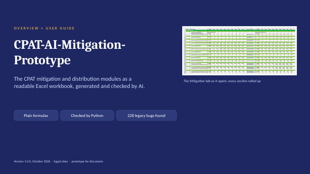

<!-- Generated by make_qmd.py from excel_ai/mitigation/docs/Documentation.md, excel_ai/mitigation/docs/methods/Macro_and_results.md, excel_ai/mitigation/docs/methods/Data_tabs.md: edit the sources, then run python make_qmd.py -->

# The mitigation module {#sec-mitigation}

```{=html}
<div class="decks">
<a class="deck-card" href="../presentations/01_CPAT-AI_Overview_latest.pptx" style="display:flex;gap:14px;align-items:center;text-decoration:none;border:1px solid #dee2e6;border-radius:6px;padding:10px;margin:0 0 12px;max-width:640px;color:inherit"><span><b style="color:#2780e3">CPAT-AI overview: the mitigation prototype</b><br><span style="font-size:.9em;color:#6c757d">Status, user guide, results · PowerPoint, latest version</span></span></a>
</div>
```

::: {.callout-tip appearance="simple"}
The method of every block, with its equations and pseudocode, is in the **CPAT-AI Model** tab ([open it](../CPAT_model_documentation_html/index.html)), shared by Excel-AI and CPAT Python. This chapter is the workbook: how to open and use it, its sections, many scenarios, and its data tabs.
:::

*Source: [`excel_ai/mitigation/docs/Documentation.md`](https://github.com/cpmodelai/cpat_ai/blob/main/excel_ai/mitigation/docs/Documentation.md).*

*The short guide. Details of every block: the Methods volume. Every legacy bug and issue: the bug-fix register.*

## What it is

The mitigation module of the IMF/World Bank **Climate Policy Assessment Tool (CPAT)**, rebuilt as one readable Excel workbook for one country at a time.

It answers: **what do carbon pricing and related policies do to energy prices, energy use, emissions, government revenue and GDP, year by year to 2041?**

- **Policies in:** carbon tax, a new emissions trading system (ETS) with a cap, feebates, fuel excises, fuel subsidy reform, a methane fee, existing carbon pricing, power-sector policies.
- **Results out:** retail energy prices, fuel use in 16 sectors and 8 fuels, electricity generation and prices, revenue, CO₂ and other greenhouse gases, local air pollutants, GDP effects, the gap to the country's NDC, and and the exports the other modules read (section 19; household effects by decile are the separate Distribution module).
- **One country, any country:** formulas contain no country numbers. Every country value comes from the data tabs, looked up by the country code on `Scenarios` (MTInputs, Model settings). The shipped data are complete for Egypt.
- **Same as legacy, minus its bugs:** it follows legacy CPAT except where legacy has a bug (all fixed) or an open question that we track (issues). See section 5.
- **Readable and checked:** every formula is short (target 90 characters, at most 115) and one formula serves a whole block of cells. An independent Python recomputation checks every number.

## Quick start

Since 1.2.0 the module workbooks have **no macros**. Every macro is in the **Master workbook**, `excel_ai/active_workbooks/CPAT-AI-Master_UserGuide.xlsm`, which is also the user guide. The mitigation module ships as `excel_ai/mitigation/CPAT-AI-Mitigation_latest.xlsx` (every version in `excel_ai/mitigation/releases/`) with formulas to 2035, so it is small and quick to open; the Master **activates** it into the workbook you work in, `excel_ai/active_workbooks/CPAT-AI-Mitigation_latest.xlsb`, with formulas to 2041.

1. **Get the files.** Keep the repository clone up to date (git, or the SyncRepo script). The Master finds the modules in the clone (else it downloads them from GitHub, the links of its module table).
2. **Open the Master** (`active_workbooks/CPAT-AI-Master_UserGuide.xlsm`) in Excel 365 and enable macros (if the file was downloaded, unblock it first: file Properties > Unblock). Its tab `UserGuide` lists each module (latest version, the `.xlsx`, its GitHub link, the `.xlsb` it writes, when it was last activated) and has the buttons.
3. **Activate:** click *Activate Mitigation* (or *Activate all modules*). The Master opens the `.xlsx`, copies the 2035 column of each scenario group of `Mitigation` and `Outputs` across to 2041, records the activation on the module's tab `FromMaster`, recalculates fully and saves `CPAT-AI-Mitigation_latest.xlsb` next to itself. The workbook stays open. Activate again whenever a new `.xlsx` arrives; the `.xlsb` is a generated file (never merge it on a git conflict: take either side and activate again).
4. **Work in the `.xlsb`.** It is in manual calculation: **press F9 after any change** (Ctrl+Alt+F9 for a full recalculation).
5. **Change a policy** on `Scenarios` (the legacy MTInputs rows). Column G is the baseline, column H the live policy scenario: for example change `CPLevelTarget` (the carbon price in the target year), then F9. Columns L onwards are scenario definitions for the batch run.
6. **Read the results** on `Outputs` (every scenario group side by side, by output code) and `ScenarioCompare` (the dashboard: choose the year; key table and time-series charts of the live scenarios against the baseline).
7. **Store and compare scenarios** in the Master: *Store live scenarios* copies the scenario groups of `Outputs` into its `StoredScenarios` (values, ten slots); *Run stored scenarios* runs every definition with Run? = Yes through the live column K (ETS goal seek where needed) and stores each; `CompareStored` compares them. *Clear stored scenarios* empties every slot but the baseline.
8. **Update the data** in the Master: choose the data source and the rows (one country or all countries) on its tab `Settings`, then *Update data tables* (Power Query). The mitigation workbook records the source on `FromMaster`; the status is on its `Cover`.
9. **Distribution:** activate the distribution module too, then *Update Distribution from Mitigation* copies section 19a of the activated mitigation workbook into it, recalculates and saves it.

Run a module for a particular country on your local drive; a workbook holding real data is never committed.

The tabs, left to right: `Cover`, `Scenarios`, `Mitigation`, `Outputs`, `ScenarioCompare` (no divider tabs before them), `INPUTS->>` (`Manual inputs`, `Constants`, `Mappings`), `OTHER MODULES->>` (`FromMaster`, `FromAirPollution`, `FromTransportCB`), the data tabs (`DATA_MITIGATION->>`, `DATA_TRAN->>`, `DATA_OUTPUT->>`, `DATA_OTHER->>`: legacy tables, unchanged) and `REF->>` (version log, differences with legacy, variable dictionary and LAMBDAs).

## How it works

The `Mitigation` tab runs top to bottom, one section per step, with the section numbers of legacy CPAT. The method of each block, with its equations and pseudocode, is in the website's CPAT-AI Model tab (<https://cpmodelai.github.io/cpat_ai/#model>; sources `docs/CPAT_model_documentation_qmd/`), shared with CPAT Python; the Word Methods volume (`docs/methods/`) is the compact version. Each scenario is a group of columns: group 1 is the baseline, group 2 the live scenario (further groups: copy group 2 to the right; Outputs has room for four). Years run across, 2022 to 2041.

| Section | Step | Methods chapter |
|---|---|---|
| 1 | Policies: the price signals of each policy | Prices |
| 2 | Retail energy prices before and after policies | Prices |
| 3 | Power: demand, dispatch, investment, electricity prices | Power |
| 5, 5b | Transport, and the optional road engineer model | Transport |
| 6, 6b, 7, 8 | Buildings, residential leakage to biomass, industry, other energy use | Appendix A |
| 11 | Energy consumption totals | - |
| 12 | Revenues | Macro and results |
| 13, 14, 15 | CO₂, other greenhouse gases, local air pollutants | Emissions |
| 16, 17, 18 | GDP effects, carbon pricing indicators, welfare | Macro and results |

### Policies (section 1)

Each policy is a path from a start year to a target year, set per scenario on `Scenarios`. The carbon price follows that path:

```
τ(t) = path(t; start year, target year, start level, target level) · (CPI index if the inputs are nominal)
```

A new ETS starts at a price estimate and is checked against its cap (the goal seek refines it). Feebates act through a shadow price, which changes efficiency but raises no revenue. Existing carbon taxes and ETS prices come from the World Bank Carbon Pricing Dashboard data.

*Details: Methods, chapter Prices; chapter ETS.*

### Energy prices (section 2)

For each fuel and sector, the retail price builds up from the international price:

```
supply cost  C(t) = fixed part + (C(t−1) − fixed part) · international price(t) / international price(t−1)
retail price R    = (C + excise and other taxes) · (1 + VAT)
after policy P    = R + new carbon tax + ETS price + new excise, each with VAT
```

Subsidies are negative taxes. Historical prices come from the IMF price data up to the last historical year (2022, as legacy); later years are projected.

*Details: Methods, chapter Prices.*

### Energy demand (sections 5-8, 11)

Fuel use in each sector changes each year with income, its own price and efficiency:

```
Q(t) = Q(t−1) · (efficiency gain) · (1 + GDP growth)^(income elasticity) · (P(t)/P(t−1))^(price elasticity) · (efficiency response to prices)
```

The elasticities are legacy CPAT's. Section 11 adds up fuel use by sector and fuel, including the fuel burnt in power plants.

*Details: Methods, appendix A (equations, section 4); chapter Transport for road.*

### Power (section 3)

Electricity demand comes from the sectors. The power model, as legacy's engineer model, decides each year:

- **Dispatch:** which plants run, by their variable cost (fuel, carbon price, operation).
- **Investment:** new capacity by technology, chosen by levelised cost with a logit share, within scale-up limits.
- **Prices:** electricity prices from the cost of generation, with taxes, subsidies and price controls.

Power-sector policies (no new coal, nuclear from a year, renewable subsidies, PPAs, rebating revenue, an electricity excise) are set per scenario.

*Details: Methods, chapter Power.*

### Road transport (sections 5, 5b)

By default road fuel use follows the demand elasticities, as every other sector. With `TrModel` = Engineer, the road engineer model replaces it: vehicle stocks by class, cost of ownership, the choice between combustion and electric vehicles, and vehicle policies (feebates, EV subsidies, purchase taxes, distance tax).

*Details: Methods, chapter Transport.*

### Revenues (section 12)

Revenue is fuel use times the tax per unit, by fuel and sector, for existing taxes, existing subsidies (negative) and new policies:

```
revenue from new policies = fuel use · (carbon tax + excise + auctioned share · ETS price + VAT on them)
total revenue             = existing taxes + subsidies + new policies + methane fee
```

The power sector adds its own revenue and subsidies. Feebates are revenue neutral.

*Details: Methods, chapter Macro and results.*

### Emissions (sections 13-15)

```
CO₂ = fuel use · emission factor        (factors optionally calibrated to the GHG inventory)
```

Other greenhouse gases (methane, nitrous oxide, F-gases) follow their drivers; methane from fuel supply responds to the methane fee. Local air pollutants (fine particles, sulphur and nitrogen oxides, and others) are fuel use times pollutant factors.

*Details: Methods, chapter Emissions.*

### GDP, carbon pricing indicators, welfare (sections 16-18)

New revenue is fiscal space. How it is used (tax cuts, investment, transfers) moves GDP through fiscal multipliers, one year later:

```
fiscal space fs(t)  = (new revenue in the scenario − in the baseline) / GDP
GDP effect          = Σ over uses: share of the use · Σ over lags (change in fs · multiplier of the use)
```

Section 17 reports carbon prices and coverage; section 18 the welfare effects and the gap to the NDC.

*Details: Methods, chapter Macro and results.*

### Exports to the other modules (section 19)

Section 19 holds what the other modules read, by code: section 19a (defined name `ExportDistn`) is the input of the Distribution module (household effects by decile in one analysis year: price changes reach households directly and indirectly, revenue recycling offsets them). The Master copies it into the distribution workbook (*Update Distribution from Mitigation*).

*Details: CPAT-AI Model, chapter Distribution; `excel_ai/distribution/README.md`.*

## Results and the dashboard

- **Outputs** shows the key results of every live scenario side by side, in the columns of the scenario groups of `Mitigation` (row 5: the scenario number; rows as legacy MTOutputs, then the outputs legacy does not list, by topic). Every row carries a code (for example `egy.mit.co2.tot.tot.2`: country, module, variable, sector, fuel, scenario), the same codes as the Python model.
- **ScenarioCompare** (the dashboard) reads Outputs only (live results): one slot per scenario group, the year, a key table (energy CO₂, GHGs, revenue, GDP effect and welfare: level, difference and % difference from the baseline) and four time series with their line charts; the title of each is a dropdown of indicators.
- **Stored results** are in the Master: `StoredScenarios` (values, Outputs' rows, ten slots) and `CompareStored` (the stored scenarios against the baseline, for a chosen year).

## Limits and differences from legacy

The rule: never replicate a legacy bug; always replicate a legacy issue, and track it. A **bug** (L) is legacy computing what it does not intend; the prototype fixes it. An **issue** (I) is legacy doing what it means to, where the choice is open to question; the prototype does the same. Problems of the input data are issues too (area Data): where legacy reads the data wrongly, the formula fix is a bug with a cell plan and the issue is Very high; where no cell plan is possible, the prototype does exactly what legacy does and the issue is Extremely high (Appendix B). Every item has a code; the codes are explained in Appendix A.

- **Legacy bugs:** the prototype fixes every one, in every module (mitigation, distribution, the inputs). The bugs, with the cell-level fix for legacy CPAT and the status of each in the latest legacy file `CPAT 1.0pre_465`, are in `excel_ai/bugs_and_legacy/Legacy_CPAT_Bugs_v<version>.docx`; the master list of bugs and issues is the tracker `excel_ai/bugs_and_legacy/Tracking_Legacy_Bugs_v<version>.xlsx`.
- **Issues (data problems first), departures, prototype bugs and upgrades:** the appendices below (and the tracker, tab Issues).
- **Legacy row numbers in the Methods volume** are rows of `CPAT 1.0pre_456_NoPropData.xlsb`, the file the prototype was built and checked against (its data extracts read that file). In `CPAT 1.0pre_465` Mitigation rows from 5667 on sit 11 to 15 rows higher. The input sheet Scenarios has the rows of the 465 MTInputs.
- **Not built:** a few legacy features (upgrades, Appendix E), and the air-pollution co-benefits and transport externalities modules.
- **Data:** the shipped data are Egypt's; proprietary tables for other countries must be pasted in or linked (issue I90).

## Running many scenarios {#sec-many-scenarios}

*Source: [`excel_ai/mitigation/docs/methods/Macro_and_results.md`](https://github.com/cpmodelai/cpat_ai/blob/main/excel_ai/mitigation/docs/methods/Macro_and_results.md).*

Equations: `Equations.md`; workbook formulas: `Formulas.md`.

The model calculates a few scenarios at a time: the baseline and the live policy scenario (and any scenario group added by copy-paste). Since 1.2.0 the macros and the stored results are in the **Master workbook** (`excel_ai/active_workbooks/CPAT-AI-Master_UserGuide.xlsm`; the mitigation workbook has no macros). Its batch run copies each scenario definition into the live scenario of the activated mitigation workbook, calculates it and stores its results as values, which are compared afterwards. This follows legacy CPAT, where a macro copies each scenario column into the column used for calculation and stores the outputs.

### Where things are

| Place | What it holds |
|---|---|
| Scenarios, column G (scenario 1) | The **baseline**. |
| Scenarios, column H (scenario 2) | The **live policy scenario**. The batch run overwrites it with each definition and restores it at the end. |
| Scenarios, columns I onwards | **Scenario definitions**, one full column each: short name (row 2, the legend in the charts), Run? (Yes/No), number, name, then the inputs. Red cells differ from the template. To add one, copy the last definition one column to the right and edit it. |
| Mitigation | Scenario groups: 1 = the baseline (plain formulas), 2 = the live scenario (every calculated cell calls its named LAMBDA). More live scenarios: copy group 2 to the right and set its scenario number. |
| Outputs | The key results of every scenario group **side by side**, in the columns of Mitigation's groups (room for four): columns A:J code stem, module, legacy code, indicator, unit, Mitigation row; row 5 the scenario number of each group; rows as legacy MTOutputs, then the outputs legacy does not list, by topic. Each cell is Mitigation's cell of its row in the same column. |
| ScenarioCompare | The **dashboard**, live results only (from Outputs): one slot per scenario group, the year, a key table and four time series with their line charts. |
| FromMaster | What the Master wrote here (values): activation, the data source of the linked tables, the rows loaded. |
| Master: StoredScenarios | Results as **values only**: Outputs' rows at the same row numbers, ten slots (slot 1 the baseline), each with its scenario ID, name and when and from which file it was stored. |
| Master: CompareStored | The stored scenarios against the first slot (the baseline), for a chosen year. |
| Master: VBA module CPATMaster | Every macro (source `excel_ai/master/CPATMaster.bas`). |

### Shipped definitions

| No. | Name | Inputs changed from the template |
|---|---|---|
| 3 | Carbon price \$20/tCO2 from 2027 | The live scenario's settings |
| 4 | Package A: carbon tax to \$50 by 2030 + feebates (transport, industry) | Carbon tax \$10 (2027) to \$50 (2030). Feebates 2027-2030: transport \$10 → \$50, industry \$5 → \$25. Feebate coverage adds road, mining & chemicals, and iron & steel |
| 5 | Package B: ETS on power and industry + carbon tax \$25 elsewhere | Carbon tax \$25 from 2027. New ETS from 2027: cap −5% (2027) to −20% (2035) of baseline covered emissions, constant afterwards. Template ETS coverage (power, mining & chemicals, iron & steel, non-ferrous metals, cement), default benchmarks and volatility |
| 6 | Carbon price \$50/tCO2 from 2027 | The carbon price of definition 3 at \$50 |

Paths continue after their target year as set in the model: the carbon price follows its Scenarios switch, and feebates continue linearly.

### Main scenario choice and regulations as shadow prices (v0.4.16, LD9)

Scenarios row 13 (`ScenarioSelected`, " - Carbon tax" in every shipped scenario) picks a row of the legacy scenario table (legacy Mitigation rows 222-262, columns N:AC; sheet Mapping, block "Main scenarios"): whether the scenario prices carbon explicitly (legacy row 259), its efficiency adjustment (Scenarios rows 247-251) and the sectors its shadow price covers (rows 240-257).

- Explicit scenarios (carbon tax, total carbon price, coal excise, road fuel tax, electricity emissions tax and excise): the carbon price path of Scenarios rows 18-21 is the carbon tax (`cpx` = `cptraj`), as before.
- Shadow-pricing scenarios (feebates, power supply feebates, energy efficiency regulations, power feebate, vehicle fuel economy, residential and industrial efficiency regulations; and "Baseline"): no explicit carbon tax (`cpx` = 0); the carbon price path becomes a shadow price on the efficiency margin, `reg.<sector>` = `cp.shd` x the scenario's adjustment (energy efficiency 247, vehicle fuel economy 248, residential 249, industrial 250, feebates 251; Egypt 0.7, feebates 1) x 1 if the scenario covers the sector. It enters `shpx` (with the feebate part, now x row 251, and the ETS benchmark part), so fuel use responds through efficiency only, and power through `shk` (legacy bugs L87, L88 fixed: legacy's regulation share is 0 and never reaches power).
- The road vehicle feebate of the engineer road model adds `reg.rod` (the road regulation shadow price) instead of the carbon price, which is in the fuel price already (prototype bug M13).
- A text that is not in the table counts as explicit pricing (as the shipped " - Carbon tax").

### Main scenario choice and regulations as shadow prices (v0.4.16, LD9)

Scenarios row 13 (`ScenarioSelected`, " - Carbon tax" in every shipped scenario) picks a row of the legacy scenario table (legacy Mitigation rows 222-262, columns N:AC; sheet Mapping, block "Main scenarios"): whether the scenario prices carbon explicitly (legacy row 259), its efficiency adjustment (Scenarios rows 247-251) and the sectors its shadow price covers (rows 240-257).

- Explicit scenarios (carbon tax, total carbon price, coal excise, road fuel tax, electricity emissions tax and excise): the carbon price path of Scenarios rows 18-21 is the carbon tax (`cpx` = `cptraj`), as before.
- Shadow-pricing scenarios (feebates, power supply feebates, energy efficiency regulations, power feebate, vehicle fuel economy, residential and industrial efficiency regulations; and "Baseline"): no explicit carbon tax (`cpx` = 0); the carbon price path becomes a shadow price on the efficiency margin, `reg.<sector>` = `cp.shd` x the scenario's adjustment (energy efficiency 247, vehicle fuel economy 248, residential 249, industrial 250, feebates 251; Egypt 0.7, feebates 1) x 1 if the scenario covers the sector. It enters `shpx` (with the feebate part, now x row 251, and the ETS benchmark part), so fuel use responds through efficiency only, and power through `shk` (legacy bugs L87, L88 fixed: legacy's regulation share is 0 and never reaches power).
- The road vehicle feebate of the engineer road model adds `reg.rod` (the road regulation shadow price) instead of the carbon price, which is in the fuel price already (prototype bug M13).
- A text that is not in the table counts as explicit pricing (as the shipped " - Carbon tax").

### Macros (in the Master)

Buttons on the Master's tab `UserGuide` (green); also Alt+F8.

- **ActivateAll / ActivateMitigation / ActivateDistribution / ActivateAirPollution**: open the module's latest `.xlsx` (the local repository copy, else its GitHub link), copy the 2035 column across to 2041 on the sheets listed in the module table (Mitigation and Outputs), write `FromMaster`, recalculate fully (twice) and save `<Name>_latest.xlsb` next to the Master. The workbook stays open.
- **RunStoredScenarios** (button Run stored scenarios): stores the baseline if none is stored yet. Then, for every definition with Run? = Yes, it copies the definition's inputs and name into the live column K of the activated mitigation workbook, recalculates, runs the ETS goal seek if the definition applies a new ETS without "Override ETS price" = Yes, and stores the live scenario's Outputs group as values under the definition's number (replacing that ID's slot, else the next free one). At the end it restores the live column; the mitigation workbook is not saved.
- **StoreLiveScenarios**: stores every scenario group of Outputs as it stands (after a recalculation) in the next free slots.
- **ClearStoredScenarios**: empties every slot but the first (the baseline), after a confirmation.
- **UpdateDataTables**: refreshes the linked data tabs of the activated mitigation workbook from the source chosen on the Master's tab `Settings` (Power Query; the rows of the country, or every country), writes the choice on `FromMaster` and saves it.
- **UpdateDistributionFromMitigation**: copies section 19a (`ExportDistn`) of the activated mitigation workbook into `FromMitigation` of the activated distribution workbook, by code (it stops if the rows do not match), recalculates and saves it.

The ETS goal seek is legacy's damped log-space iteration, as in `ets_goalseek.py`. It starts from the override prices, or from the fast estimate if there are none. Each step is p × (proposed price / p) ^ alpha, mixed 0.3 with the previous iterate, with 5% smoothing. Alpha halves when the error grows (minimum 0.0625) and rises ×1.2 when the error more than halves (maximum 1). It stops when the worst |covered / cap − 1| is below 0.5%, or after 20 iterations.

### First run in Excel

The Master and its VBA were built without Excel; the build checks that the VBA compiles in LibreOffice, and the checks emulate the activation in Python (identical to the full build, every formula). Activation of Mitigation has passed its first run in Excel (2026-10-31: the activated workbook equals the release values to 2035). The other macros are still to be run in Excel (`excel_ai/core/USER_TASKS.md` 17-18):

1. If the Master was downloaded, unblock it first (file Properties > Unblock), or Excel opens it with macros disabled.
2. Open it, choose Enable Content, and run Debug > Compile VBAProject (Alt+F11).
3. Activate the modules, then try Update data tables, Update Distribution from Mitigation, Store live scenarios and Run stored scenarios; report anything odd, with a screenshot.

### Comparing and keeping results

- **Live** (in the mitigation workbook): ScenarioCompare reads Outputs. Choose the year, then F9. Each value is the Outputs row of its code stem, in the column of its scenario group plus the year, so the order of the rows never matters. A scenario group without results is left out of the charts.
- **Key table.** Energy CO2 emissions, GHG emissions excluding LULUCF, revenue as a share of GDP, the GDP effect of the revenue use and the net welfare effect: level, difference from the baseline, and % difference for the two emission levels.
- **Time series.** Four tables (default: energy CO2, GHGs, revenue, GDP effect), scenarios down and years across, each with its line chart beside it. The title of each table is a dropdown of the indicator list: every Outputs indicator except the price and Kaya indices.
- **Stored** (in the Master): StoredScenarios keeps up to ten scenarios as values, so results of other runs (another country, another version) can sit side by side, as long as the rows are those of the same Outputs version (the store macros check the code stems). CompareStored compares them with slot 1.

### Limits

- The batch run calculates one policy scenario at a time, through the live column H. Further scenario groups of Mitigation (copies of group 2) show on Outputs and ScenarioCompare, and Store live scenarios stores them.
- Outputs defines what is stored: its rows, each code once. To store more, add rows to Outputs first (in the builder).

## The data tabs {#sec-data-tabs}

*Source: [`excel_ai/mitigation/docs/methods/Data_tabs.md`](https://github.com/cpmodelai/cpat_ai/blob/main/excel_ai/mitigation/docs/methods/Data_tabs.md).*

User request (2026-10-17): align the data tabs with legacy CPAT (grouped by module, legacy order, legacy names and
content where possible, without undoing principled decisions); check that the model would work with the full
all-country data; put every Egypt-only table alone on its tab or at the bottom; check how far the legacy data tables
can be copied in. Then (same day): align more fully, going with the recommendations. The norm is NORMS.md 1.5.

### Summary

- **Order.** The data tabs sit under the legacy dividers in legacy order: `DATA_MITIGATION->>`, `DATA_DISTN->>`,
  `DATA_TRAN->>`, `DATA_OUTPUT->>`; tabs without a legacy data tab come last under `DATA_OTHER->>` (BaselineCO2 only).
- **Copy-in rules (NORMS 1.5).**
  - **L, a single legacy table:** the table itself, unchanged (same columns, column letters and codes; header row 3,
    data from A4; a key formula column right of the table where legacy has no unique key). Paste the legacy data rows
    at A4. 17 tabs: Balances, EnergyCons, CH4Inputs, UNPop, OilProductShares (v0.4.12), WEO, EF_GHG, SCC, EF_PM,
    IO_GTAP, HHSurvey, HH_Elast, ASPIRE, WHOCooking, GDPRatios, Transport1, Transport2.
  - **A, a legacy tab with several tables:** kept at its legacy cell addresses from row 3 (rows 1-2: source line and
    title bar). Paste the legacy tab from row 3. 10 tabs: Countries, Elasticities, ETS+LTS, Multipliers, Prices_int,
    ECP, Transport3 (stored results, rows 5+) and, since v0.4.7, Power, CoC and GHGs (the inventory and, rows
    1201-1388, the 2023-2024 emission shocks of the power model).
  - **L*, Prices_dom:** legacy header rows and codes; paste legacy rows 4 onwards at A1.
- **Country selection is a data step (NORMS 1.5, rule 2c).** What legacy Mitigation computes from these tabs for the
  selected country sits in blocks of the Inputs tab, by formula, under the keys the model already used:
  - Inputs_ela: elasticities (the country's column of Elasticities, as legacy column G);
  - Inputs_mult: multipliers (median ± standard deviation by group, instrument and lag);
  - Inputs_macro: GDP growth and levels, deflators, exchange rate (WEO series with legacy's extension past the last data
    year, rows 417-467) and the energy trade balance and share traded (rows 741-743, from Balances);
  - Inputs_pint: international price series by source (rows 633-695);
  - Inputs_ecp: existing carbon pricing (rows 1675-1764; v0.4.12: carbon tax with single and fuel rates, national ETS and
    EU ETS, each code looked up in its own legacy block of ECP, coverage by data year, and two tables by ECP sector and
    fuel: carbon tax and ETS in \$/tCO2);
  - Inputs_ef: CO2 emission factors (rows 980-1011);
  - Inputs_nc (v0.9.0): non-CO2 combustion emission factors of local pollutants and CH4 by legacy EF code (rows
    1052-1663: country, else World Bank region, else world, from the all-country EF_PM; other energy the maximum
    across the other subsectors);
  - v0.4.7, power (legacy section 4, rows 2954-4300): Inputs_pset (the power settings of Scenarios scenario 1 and derived
    values, each a defined name Ps...), Inputs_ptech (one row per generation type, the former PowerTech: country, else
    world parameters, efficiency and generation from Balances, WACC from CoC, capacity factors), Inputs_ppath (year
    paths, the former PowerPaths: capex time factors, storage, income factor, fuel price shocks, prices) and
    Inputs_ppar (parameters, the former PowerParams). The chains are mapped in chapter Power.
  The Egypt values reproduce legacy's cached values (macro series to 1e-15; power data to 1e-12), apart from one legacy
  bug fixed (L51: the coal trade balance was valued at the oil price) and one stale value in legacy's stored run (I38:
  the wind and solar capex time factors for 2039-2041 differ from the legacy Power cells they reference; the prototype
  follows the Power tab).
- **Proprietary tables.** The public legacy file (`CPAT 1.0pre_456_NoPropData.xlsb`) holds Egypt only in Balances,
  EnergyCons (empty), Prices_dom, EF_PM, IO_GTAP, HHSurvey, ASPIRE, WHOCooking, CalVal and Tran_Scatter. The model
  uses the first eight; all eight paste in directly.
- **All-country test: PASS.** `check_allcountry.py` clones every Egypt row of every single-table tab under a dummy
  country (XEG) at the bottom of its table, renames Egypt's codes to XEG in place on the tabs kept at legacy addresses,
  selects XEG and recalculates: no error values, every output of Mitigation and Distribution identical to Egypt's.
- **No table from legacy's cached Egypt run is left (v0.4.7).** The former PowerTech, PowerPaths and PowerParams are
  computed from the legacy tabs on Inputs. BaselineCO2 (the scenario-1 CO2 the calibration uses) is derived by the
  build.
- **Legacy bugs in the power data: all fixed (v0.4.10, NORMS 0; v0.4.7 still copied them):** L52 every generation type
  takes the country parameters where they exist (Egypt: solar fixed O&M 11.831 instead of 15 \$/kW/y); L53 the actual
  capacity factor of the base year (installed capacity, Power rows 358-1635) is used inside the CFOverride bounds (Egypt:
  gas 0.385, wind 0.436, solar 0.347, hydro 0.592; base-year gas capacity 52 GW instead of 35); L54 hydro invests from
  the base year only when its generation share is above 50% (Egypt: from 2030); L55 the country rows are looked up in
  the country block first (China, Japan, Korea); L56 countries without CoC risk data take the default WACC, flagged.
- Balances, EnergyCons, EF_PM, IO_GTAP, HHSurvey, HH_Elast, ASPIRE, WHOCooking and GDPRatios became legacy tables
  (v0.4.5). Then GHGs, CH4Inputs, UNPop, EF_GHG, SCC, Transport1 and Transport2 followed. The tables come
  from `extract_legacy_tables.py`, which writes `legacy_<Tab>.csv` verbatim from the legacy file (today into the legacy-form cache
  `.buildcache/legacy_csv/<edition>/`, saved to `data/<edition>/tidy/` by `data/scripts/legacy_csv.py`).
- Base-year fuel use and power demand now come from Balances through legacy's flow mapping (Mapping columns J-M), as
  legacy does with BalancesOrConsumption = Balances; the old PowerDemand tab was dropped.
- CO2 emission factors: the legacy EF_GHG table replaces the Egypt factors copied from legacy's run. The selection of
  legacy Mitigation rows 980-1011 is now a data step on Inputs, and it reproduces the Egypt factors exactly:
  - the country's code, else its World Bank region, else the world;
  - LPG and kerosene in power, and coal, LPG, kerosene and other oil products in road, take the row legacy points to;
  - jet fuel uses the IEA factor (EFJetIEA);
  - biomass is zero.
- GHGs: the legacy table adds Zimbabwe 2021 (legacy row 947). The previous extract stopped at row 946.
- All named ranges over data tables reach the capacity of the full legacy tables, with margin.
- v0.4.6: Countries, Elasticities, ETS+LTS, Multipliers, Prices_int, ECP and Transport3 became legacy tabs at legacy
  addresses (`legacy_<Tab>_cells.csv` in the legacy-form cache), WEO the legacy table; the selections legacy makes for the country became
  the Inputs blocks above; the GHG inventory year and every other lookup are unchanged.
- v0.4.6 results against v0.4.5: unchanged except the coal trade balance (L51 fixed; external balance rows xtb, about
  0.6 bn USD a year for Egypt) and the base-year lagged GDP growth of the road model (trgdl, 2022: the WEO 2021 growth
  3.25 % instead of 0, transport bug B2 now fixed, as the builder intended; the old WEO copy had no 2021 growth).
- v0.4.7: Power, CoC and GHGs became legacy tabs at legacy addresses; the power data of the country (the former tabs
  PowerTech, PowerPaths and PowerParams, copied from legacy's Egypt run) became the Inputs power blocks, formulas only
  (country, else world parameters; efficiency and generation from Balances; WACC from CoC; capex time factors, storage,
  income factor, emission shocks; settings from Scenarios scenario 1). The values reproduce the former tables, except
  the wind and solar capex time factors for 2039-2041 (I94). Effect on Egypt's results: none before 2039; from 2039
  new capacity and investment of solar, wind and gas, then power fuel use and emissions (525 output codes; largest:
  new solar investment in the baseline, by up to 149 MW a year).
- Dropped in v0.4.7: PowerTech, PowerPaths, PowerParams (now Inputs blocks from Power, CoC, Balances, WEO, GHGs).
- v0.4.12: OilProductShares (legacy table, all countries; household share of diesel, kerosene, LPG and gasoline, and
  their road shares) after UNPop, as legacy. Inputs_prices multiplies the VAT rate of gasoline, diesel, LPG and
  kerosene by the household share, as legacy rows 797-816 (LD5, issue I39). Settings rows 46-51: the methane fee
  switches per source of legacy Manual inputs J196-J200 (LD46; since v0.5.2 on sheet Manual inputs, shown on Settings). Inputs columns efxs:eff (v0.9.0: removed, legacy 465 factors; nearest GAINS factors, bug
  L59) and ecpk, xcp0 (existing carbon pricing), which replace ctc and etc.

### Manual inputs: the second input source, at the legacy addresses

Sheet `Manual inputs` (tab group INPUTS->>, after Scenarios) is the whole legacy tab of that name, rows 3-378 at their
legacy cell addresses (rows 1-2: source line and title bar), so the legacy tab pasted from row 3 replaces it. The cells
come from `legacy_ManualInputs_cells.csv` in the legacy-form cache (`extract_legacy_tables.py manual`): legacy values typed, light
green on the input cells. Legacy formulas within the sheet are kept (unit labels, the SCC path, the memo rows, the
residual of the PM2.5 apportionment); formulas that read other legacy tabs are replaced by the prototype equivalent (country
name and code, Scenarios scenario 1, the Elasticities tab) or typed as their legacy default value, and the note on the
block's title row (column J) says which. Scenarios stays the main input sheet (NORMS 4).

| Rows | Block | Read by the prototype |
|---|---|---|
| 5-15 | ETS: advanced parameters, sector inclusion, override price | E10:E12, the goal-seek settings (names ETSMaxIterations, ETSStartFreshContinue, ETSErrorTolerance; prototype values 20, Continue, 0.005; legacy 30, Continue, 0.001): macro SolveETS and `ets_goalseek.py`. Not read: E7:E9, the inclusion rows and the override row, which the prototype holds per scenario (Scenarios rows 95-97, 99-115; row ets.ovr of each scenario group) |
| 18-47 | Process emissions (CBAM goods): coverage, emission factors, half elasticities | No: feature not built |
| 49-54 | Feebates: sector flags | No: Scenarios rows 66-82 per scenario |
| 57-146 | Domestic energy prices and taxes (manual) | No: feature not built (prices: Prices_dom) |
| 148-163 | Excise reform (additional excise) | No: feature not built |
| 165-180 | Domestic energy price controls | J167:J180 by code (names PCtrlKey, PCtrlVal): Inputs_prices column pcm, the pass-through when GovPriceControls = Manual (blank = 1, as legacy); electricity rows not read |
| 183-200 | Methane fee | J196:J200, the fee scope by source (names MFeeBio, MFeeDG, MFeeFF, MFeeAgr, MFeeWst; shown on Settings rows 47-51). Not read: J185:J194 (not built) |
| 202-215 | Imperfect pass-through (Distribution) | No: not built (legacy does not wire it either) |
| 218-225 | International energy price forecasts (manual) | J221:AF225 by label and year (names PIntManVal, PIntManLab, PIntManYear): Inputs_pint rows Manual from 2026, when IntEnerPricForeSource = Manual |
| 228-231 | GDP forecasts (manual) | No: feature not built |
| 234-240 | Social cost of carbon | Yes since v0.5.2: row 237 is the Manual option of NSCCSource / GSCCSource (legacy bug L103: legacy reads the path typed on Mitigation row 17683 and leaves this block dead) |
| 243-254 | PM2.5 source apportionment | No: feature not built |
| 257-269 | Fiscal multipliers | J261:U268 (names MultMan, MultManKey): Inputs_mult, when MultipliersSource = Manual |
| 271-327 | Elasticities and efficiency improvements | K326:M327, the non-energy GHG elasticities (names GhgElCat, GhgElPop, GhgElInc): section 14 rows ghg.dr and ch4.act. Not read: the manual energy elasticities (not built) |
| 330-340 | Additional mitigation effort (non-energy) | No: feature not built |
| 342-372 | New investments in power (manual capacity) | No: built later with the power features |
| 373-378 | Transport: fuel economy of new EVs | J375:AC377 by label (D375:D377) and year (names BEVFEVal, BEVFELab, BEVFEYr): section 5b rows trfen |
