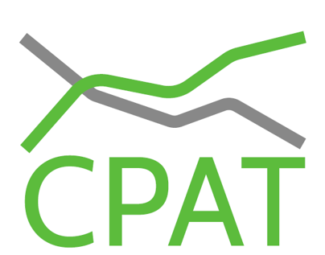

{fig-align="center" width="40%"}

# **Cover** {.unnumbered}

## **Foreword** {.unnumbered}

### **Why CPAT-AI?** {.unnumbered}

The Climate Policy Assessment Tool (CPAT), developed jointly by the World Bank and the IMF, gives governments a rapid assessment of climate mitigation policies: their effects on energy prices and use, emissions, government revenue, GDP, air pollution and health, transport and households, for more than 180 countries. Its methodology is set out in the *CPAT Documentation*, the companion volume on this site.

CPAT is a large spreadsheet model. It has grown over many versions and many hands, and like any model of its size it contains formulas that do not compute what they were meant to, and modelling choices that are open to question. Both are hard to find in a workbook of tens of thousands of rows.

**CPAT-AI** is the project that rebuilds CPAT so that every number can be traced, checked and explained. It replicates the legacy model module by module, finds and documents its bugs with cell-level fix plans the CPAT team can apply to legacy CPAT, tracks every open modelling question, and extends the model where the team decides to. The work is done with AI coding agents under explicit written norms, and every step is checked by independent recomputation.

### **What is in CPAT-AI** {.unnumbered}

The project has two models that share the same inputs, codes and data:

- **Excel-AI**: Excel prototypes generated by Python builders. The mitigation prototype is the integrated model; the distribution module and the air-pollution module are standalone workbooks linked to it.
- **Coded CPAT**: a component-based Python reimplementation of CPAT, with a Shiny application. Validated Excel prototypes are ported to it once checked.

Legacy CPAT is the reference for both. Every difference from it is either a fixed bug, a replicated and tracked issue, or a departure the team decided on.

## **How to read this documentation** {.unnumbered}

- @sec-overview describes the project, its two models and how they relate to legacy CPAT.
- @sec-bugs sets out the rule that governs every model: bugs are never replicated, issues are always replicated and tracked.
- Part *Excel-AI: the mitigation prototype* is the guide to the integrated prototype followed by its methods, one chapter per block.
- Part *Excel-AI: other modules* covers the distribution and air-pollution workbooks.
- Part *Coded CPAT* covers the Python model and its developer guide.
- Part *Data and working practice* covers the data, the release layout and the norms the project works under.

The chapters on the mitigation prototype and the Coded CPAT developer guide are generated from the documents kept beside the code (`excel_ai/mitigation/docs/` and `coded/cpat_documentation/developer/`), so they stay in step with the models.
