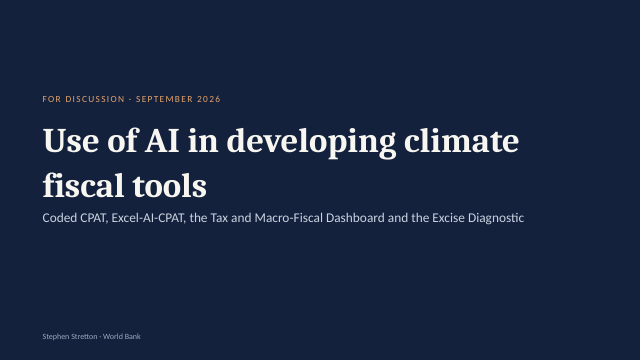

# CPAT Excel-AI {.unnumbered #book-home}

<style>#book-home > h1 { display: none; }</style>

```{=html}
<div class="decks">
<a class="deck-card" href="../presentations/01_CPAT-AI_Overview_latest.pptx" style="display:flex;gap:14px;align-items:center;text-decoration:none;border:1px solid #dee2e6;border-radius:6px;padding:10px;margin:0 0 12px;max-width:640px;color:inherit"><span><b style="color:#2780e3">CPAT-AI overview: the mitigation prototype</b><br><span style="font-size:.9em;color:#6c757d">Status, user guide, results · PowerPoint, latest version</span></span></a>
<a class="deck-card" href="../presentations/02_AI_Climate_Fiscal_Tools_latest.pptx" style="display:flex;gap:14px;align-items:center;text-decoration:none;border:1px solid #dee2e6;border-radius:6px;padding:10px;margin:0 0 12px;max-width:640px;color:inherit"><span><b style="color:#2780e3">Use of AI in climate fiscal tools</b><br><span style="font-size:.9em;color:#6c757d">The project: Excel-AI, Coded CPAT, other AI tools, timelines · PowerPoint, latest version</span></span></a>
</div>
```

Excel-AI is CPAT rebuilt as readable Excel workbooks, generated and checked by AI. The mitigation prototype covers the CPAT mitigation and distribution chain with plain formulas (one formula per block, none over 100 characters), recalculates in about half the time of legacy CPAT, and is checked number for number by independent Python recomputation. Rebuilding it found 228 bugs in legacy CPAT, each fixed in the prototype and written up with a cell-level fix plan; every open modelling question is replicated and tracked.

| Chapter | What it covers |
|---|---|
| [1 Overview](01_Overview.qmd) | Excel-AI, legacy CPAT as the reference, status, and the rule on bugs and issues |
| [2 The mitigation prototype](02_Mitigation_Prototype.qmd) | The workbook: opening, the blocks in brief, results, limits, many scenarios, the data tabs |
| [3 Other modules](03_Other_Modules.qmd) | The standalone distribution and air-pollution workbooks |
| [4 Data and working practice](04_Data_and_Working.qmd) | The data editions, files and releases, checks, the repository |

The method of every block (prices, demand, power, road transport, emissions and the ETS, revenues and GDP, distribution), with its equations and pseudocode, is in the **CPAT-AI Model** tab, shared with CPAT Python: [open it](../CPAT_model_documentation_html/index.html).

*Chapter 2 is generated from the documents kept beside the code (`excel_ai/mitigation/docs/`) by `make_qmd.py`.*
