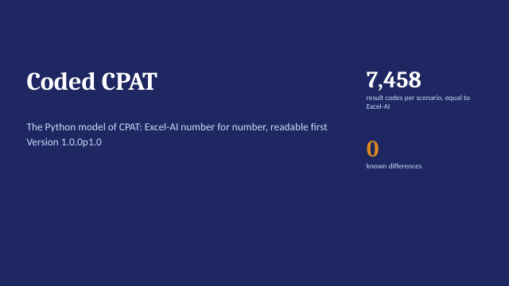

# CPAT Python {.unnumbered #book-home}

<style>#book-home > h1 { display: none; }</style>

```{=html}
<div class="decks">
<a class="deck-card" href="../presentations/03_Coded-CPAT_Overview_latest.pptx" style="display:flex;gap:14px;align-items:center;text-decoration:none;border:1px solid #dee2e6;border-radius:6px;padding:10px;margin:0 0 12px;max-width:640px;color:inherit"><span><b style="color:#2780e3">Coded CPAT overview</b><br><span style="font-size:.9em;color:#6c757d">Status, how a run works, testing, ways in · PowerPoint, latest version</span></span></a>
</div>
```

CPAT Python (Coded CPAT) is the Python model of CPAT. It reproduces the Excel-AI prototypes number for number (every result code within 1e-9), runs one country and two scenarios in under a second, and is written to be read: one small function per equation, named with the codes of the Excel models. It runs from the command line, from Python or in a Shiny app.

| If you want to | Read |
|---|---|
| Run the model | [Quick start](01_Using_the_model.qmd#sec-quick-start) |
| Know where the data are | [The database](01_Using_the_model.qmd#sec-database) |
| Define scenarios, read results | [Scenarios](01_Using_the_model.qmd#sec-scenarios), [Results](01_Using_the_model.qmd#sec-results) |
| Change or test the model | [Editing](01_Using_the_model.qmd#sec-editing), [Testing](01_Using_the_model.qmd#sec-testing), [How it works](02_How_it_works.qmd) |
| Understand the method of a block, with its equations | The [CPAT-AI Model](../CPAT_model_documentation_html/index.html) tab, shared with Excel-AI |
| Look up a table, input or variable | [Appendix A](A_Reference.qmd) |

*Version `1.1.0p1.3` (replicates Excel-AI 1.1.0 and Distribution 1.1.0; data edition Public01). Chapters 1-2 and the glossary are written in `docs/CPAT_coded_documentation_qmd/`; appendices A-B are generated from the code and data by `make_qmd.py`.*
