# Road transport {#sec-RoadTransport}

Road transport appears twice in CPAT. In the **mitigation module** (@sec-RoadMitigation) road fuel use is projected
either by the fuel-use elasticities of every other sector (@sec-FuelConsumptionDynamics) or by an engineer road model of
the vehicle fleet. The **transport co-benefits module** (@sec-RoadCobenefits) then estimates what the change in fuel
prices does to distance driven, congestion, road accidents and road damage, for the co-benefits of the welfare results.

## Road transport in the mitigation module {#sec-RoadMitigation}

Road transport is the largest user of oil products in most countries, and the place where carbon pricing meets a
slow-moving capital stock: cars, trucks and motorcycles last ten or twenty years, and the choice between a petrol car
and an electric one is made once, at purchase. The mitigation module offers two ways to project road fuel use.

- **The elasticity model** (the default). Road gasoline, diesel, LPG and natural gas follow the same constant-elasticity
  fuel-use equation as every other sector and fuel (@sec-FuelConsumptionDynamics).
- **The engineer road model** (switched on per scenario with `TrModel`). It projects the vehicle fleet itself:
  how many vehicles people own, how many they buy and scrap, whether they buy electric, how efficient the new vehicles
  are and how far they are driven. Fuel use follows from vehicles, distance and fuel economy.

This section gives the mathematics of the engineer model: the switch (@sec-tr-what), its data (@sec-tr-data), how it
computes one year (@sec-tr-ownership to @sec-tr-results) and its caveats (@sec-tr-caveats). Its source is the legacy
CPAT workbook and its methodology note (`Transportation_methodology.docx`), with the legacy bugs fixed. The pseudocode of
every step, its implementation in CPAT-AI (Excel-AI and CPAT Python) and the comparison with legacy CPAT are in the
CPAT-AI Model tab, [chapter Road transport](../CPAT_model_documentation_html/05_Road_transport.html).

### Two road models and the switch {#sec-tr-what}

The two road models are computed side by side in every scenario. The switch only decides which one the rest of the
model reads.

| | Elasticity model (default) | Engineer road model |
|---|---|---|
| Unit of analysis | Fuel use by fuel | Vehicles by class and powertrain |
| Behaviour | Income, price and efficiency elasticities, autonomous efficiency gain | Ownership in income, total cost of ownership (TCO), logit choice of EVs, fuel economy, distance driven |
| Electric vehicles | Road electricity grows with the transport demand multiple of the power model | Explicit: BEV and PHEV stocks, their electricity use |
| Policies that act | Carbon tax, excise, fuel price reform, regulations (through prices and shadow prices) | The same through fuel prices, plus feebates, distance tax, EV subsidy, purchase taxes, VAT and customs on BEVs, charging-station subsidy |
| Section | @sec-FuelConsumptionDynamics | This section |

**The switch.** The input `TrModel` (one value per scenario, default `Elasticity`). The flag

$$
sw^{T} = \begin{cases} 1 & \text{TrModel starts with "Engineer"} \\ 0 & \text{otherwise} \end{cases}
$$ {#eq-tr-switch}

decides, in every year, which fuel use the rest of the model reads ([M3.2](../CPAT_model_documentation_html/A_Equations.html#eqlist-M3-2)):

$$
F_{rod,f,t} = \begin{cases} F^{T}_{f,t} & sw^T = 1 \text{ and } f \in \{\text{gasoline, diesel, LPG, natural gas, biofuels}\} \\ F^{e}_{rod,f,t} & \text{otherwise} \end{cases}
$$ {#eq-tr-fuelswitch}

where

- $F^{T}_{f,t}$ is road fuel use of the engineer model (ktoe, @eq-tr-ktoe and @eq-tr-bio);
- $F^{e}_{rod,f,t}$ is road fuel use of the elasticity model (ktoe);
- $F_{rod,f,t}$ is the road fuel use used everywhere else.

Road electricity enters power demand ([M4.1](../CPAT_model_documentation_html/A_Equations.html#eqlist-M4-1), @sec-PowerPrices) the same way:

$$
E_{rod,t} = \begin{cases} E^{T}_{t} & sw^T = 1,\ t > t_0 \\ E_{rod,t-1}\, m_{tra,t} & \text{otherwise} \end{cases}
$$ {#eq-tr-elswitch}

where $E^{T}_{t}$ is road electricity of the engineer model (ktoe, @eq-tr-ktoe-el), $m_{tra,t}$ the growth
multiple of the transport demand group in the power model, and $t_0$ the base year (2022). In the base year road
electricity is the data under both models.

With the engineer model on, CO2, methane, local air pollutants, revenues and all totals follow the engineer road fuel
use, because they are computed from $F_{rod,f,t}$. With the default, every result is exactly the elasticity model's.

**What the engineer model covers.** Road gasoline, diesel, LPG, natural gas (CNG and LNG) and electricity, and the road
biofuels, which follow gasoline and diesel (@eq-tr-bio). Coal, kerosene and other oil products in road, and rail,
aviation and navigation, stay on the elasticity model whatever the switch says.

**No circular reference.** The engineer model reads last year's power price, last year's GDP growth and this year's
GDP level after the GDP feedback (which uses last year's effect); fuel prices do not depend on fuel use. So switching it
on adds no loop to the year.

```{mermaid}
flowchart LR
  P[Fuel prices and taxes] --> E[Engineer road model]
  W[Last year's power price] --> E
  G[GDP per capita, population] --> E
  E -->|TrModel = Engineer| F[Road fuel use]
  L[Elasticity model] -->|TrModel = Elasticity| F
  E -->|TrModel = Engineer, t > base year| D[Road electricity demand<br/>power model]
  E --> C[Transport co-benefits<br/>always]
  F --> R[CO2, pollutants, revenues, totals]
```

### The engineer model at a glance {#sec-tr-glance}

The engineer model is the "technoeconomic" road model of legacy CPAT. It works in vehicles per thousand people, one
year at a time, for four vehicle classes and two powertrain families.

| Class | Powertrains | Notes |
|---|---|---|
| Passenger and light vehicles, bought new | Gasoline, diesel, LPG, CNG ICEVs; PHEVs; BEVs | Cars and light vehicles blended by their ownership shares |
| Passenger and light vehicles, bought used | ICEV, BEV | Imported or second-hand; their own TCO and choice |
| Freight vehicles | Diesel, LPG, LNG trucks; BEV trucks | No VAT on the purchase price (as legacy) |
| 2-3 wheelers | Gasoline; BEV | Ownership follows a hump in income |
| Buses | Diesel, LPG, gas; electricity | Fuel use only: scaled with passenger fuel use |

**One year of the model** runs in this order. Each step has its section below.

```{mermaid}
flowchart TD
  A[Prices, income, discount rate] --> B[Opening stock, retirements]
  B --> C[Charging stations, mark-up, range anxiety]
  C --> D[Fuel economy of new vehicles, feebate per liter]
  D --> E[Distance for the purchase decision]
  E --> F[Total cost of ownership per km]
  F --> G[Ownership demand, purchases]
  G --> H[EV choice logit, ICE fuel split]
  H --> I[Closing stock, vehicles by fuel]
  I --> J[Stock fuel economy, distance, fuel use]
  J --> K[Calibration to the energy balance, buses]
  K --> L[Road fuel and electricity use, results]
```

**Notation.** The symbols of the road model are those of the CPAT-AI equation list
([M5](../CPAT_model_documentation_html/A_Equations.html#eqlist-M5-1)). Every equation holds for each scenario and country; the
indices $o$ and $c$ are omitted. Vehicle class is $k$, ICE fuel $f$, year $t$, base year $t_0$.

| Symbol | Meaning | Unit |
|---|---|---|
| $y_t$ | GDP per capita (real GDP after the GDP feedback / population) | USD |
| $N_t$ | Population | million |
| $O_{k,t}$ | Vehicle ownership | per 1,000 people |
| $S^{o}, S^{a}, S^{cl}$ | Opening stock, stock after retirement, closing stock | per 1,000 people |
| $u_t$ | Share of used vehicles in passenger purchases | share |
| $L_k$ | Useful life: passenger 20, freight 10, 2-3 wheeler 7 | years |
| $n$ | Years a new passenger vehicle is owned before resale (7) | years |
| $fe$ | Fuel economy | km per liter (BEV: km per kWh) |
| $v$ | Distance per vehicle | km a year |
| $p_f$ | Fuel price incl. all taxes and new policies | USD per liter |
| $r_t$ | Consumer discount rate | share |
| $K$ | Discounted distance over the ownership period | km |
| $TCO$, $c$ | Total cost of ownership; TCO per km | USD; USD per km |
| $s^{EV}$ | EV share of purchases | share |
| $B$ | Distance driven | billion km |
| $F$ | Fuel use | billion liters (results: ktoe) |

### Data {#sec-tr-data}

The engineer model needs much more data than the elasticity model: the size and make-up of the fleet, the fuel
economy and distance of each vehicle type, vehicle prices and taxes. All of it is held for every country and looked up
by the country code, so changing the country changes the whole road model.

| Data | Content | Source |
|---|---|---|
| Transport data by country | 220 countries, data years 2022-2025: shares of road fuel use by vehicle type, fuel economy, ownership, EV shares of purchases and of the stock, distance per vehicle, used-vehicle share, import duties and shares, charging stations, ownership saturation | Legacy CPAT, tab Transport1 |
| Vehicle prices | Purchase prices of ICEVs and EVs (passenger, freight, 2-3 wheeler), 2022-2040; a year without a price holds the last one | Legacy CPAT, tab Transport2 |
| Range anxiety | Range anxiety by class, the start value of @eq-tr-ra (fitted, @sec-tr-charging), with the actual and calculated EV shares of the fit year; 194 countries; the average where a country has no value | Legacy CPAT, tab Transport3; fitted values |
| Parameters | Lifetimes, depreciation, insurance, maintenance, elasticities, logit $k$, ownership (Gompertz, adjustment, limits), charging, discount rate, data years (@sec-tr-params) | Legacy CPAT side tables and Dashboard |
| Paths | BEV fuel economy of the stock (light, freight, 2-3 wheeler), charging cost per port, 2022-2041 | Legacy CPAT Mitigation sheet |
| BEV fuel economy of new vehicles | km per kWh; passenger and light, freight, 2-3 wheeler; 2022-2041 | Legacy CPAT Manual inputs |
| Fuels | GJ per liter, CO2 per GJ, road usage and efficiency elasticities, autonomous efficiency gain, base-year road fuel use, road biofuels and electricity | Energy balance and the fuel-use parameters (@sec-FuelConsumptionDynamics) |

**Data years.** A year is a *data year* when Transport1 has it (2022-2025). In data years the model takes the data
(ownership, stocks, EV shares, fuel economy, distance) wherever legacy has `IF(ISNUMBER(data), data, model)`; from
2026 it projects. A blank Transport1 cell counts as no data.

**Base-year split of road fuel.** Transport1 gives, for each fuel, the share used by each vehicle type in the first
data year. Light vehicles take the rest
([A3.5](../CPAT_model_documentation_html/A_Equations.html#eqlist-A3-5)):

$$
Q_{k,f} = sh_{k,f}\, F^{bal}_{f,t_0}, \qquad L_{k,f} = Q_{k,f}\, \lambda_f / 10^{9}, \qquad sh_{lgt,f} = 1 - \sum_{k \ne lgt} sh_{k,f}
$$ {#eq-tr-split}

where

- $sh_{k,f}$ is the share of fuel $f$ used by vehicle type $k$ (passenger, 2-3 wheeler, bus, freight);
- $F^{bal}_{f,t_0}$ is base-year road use of the fuel in the energy balance (ktoe);
- $\lambda_f$ is liters per ktoe (natural gas counted in liters of gasoline equivalent, as legacy);
- $Q_{k,f}$ and $L_{k,f}$ are the base-year fuel use of the type in ktoe and billion liters.

Gasoline is split between passenger vehicles, 2-3 wheelers and light vehicles; diesel, LPG and gas between passenger,
bus, freight and light vehicles.

**Purchase taxes from the data.** VAT on vehicles is the general VAT rate of the customs data year (`VAT_WEO`, from
the domestic price data); freight vehicles pay no VAT, as legacy. Import duties on ICEVs and BEVs are those of the
customs data year (2024), import shares those of the import data year (2022); 2-3 wheelers use the passenger import
share. **Bus electricity** in the base year is the passenger EV stock share of 2024 times base-year bus fuel.

#### Inputs from the rest of the model {#sec-tr-inputs}

The engineer model reads prices and income from the other blocks.

| Input | Definition |
|---|---|
| Road fuel price | After-tax road price incl. new policies (USD per GJ, @sec-PricesAndTaxes) × GJ per liter |
| Road gas price | After-tax road gas price per GJ / 26 liters per GJ (USD per liter equivalent) |
| PHEV price | $\phi\, p_{gso} + (1 - \phi)\, p^{EV}_{res} \times 9$ kWh per liter, $\phi$ the gasoline share of PHEV distance |
| Industrial gas (LNG trucks) | Industrial gas price before new policies + the road new policies × (1 + VAT), at least the price floor (USD per GJ) |
| Freight fuel prices | Road prices net of VAT (LNG: industrial gas net of VAT / 26) |
| GDP per capita | Real GDP after the GDP feedback ([Multipliers chapter](04_Multipliers.qmd)) / population |
| Lagged GDP growth | GDP growth of the previous year (base year: WEO growth of the year before) |
| Electricity price | End-user price of the previous year, residential and industrial (@sec-PowerPrices) |
| Regulation shadow price | Road regulation shadow price (USD per tCO2) |

The **consumer discount rate** falls linearly with income between two thresholds:

$$
r_t = \min\!\left(r^{max},\ \max\!\left(r^{min},\ r^{max} - \frac{y_t - y^{lo}}{y^{hi} - y^{lo}}\,(r^{max} - r^{min})\right)\right)
$$ {#eq-tr-disc}

where $r^{max} = 15\%$ at $y^{lo} = 1{,}000$ USD and $r^{min} = 5\%$ at $y^{hi} = 50{,}000$ USD. It discounts passenger, freight and 2-3 wheeler costs alike.

#### Parameters {#sec-tr-params}

Defaults are the legacy CPAT values.

| Parameter | Passenger | Freight | 2-3 wheeler |
|---|---:|---:|---:|
| Useful life (years) | 20 | 10 | 7 |
| Years owned when bought new | 7 | | |
| First-year depreciation | 0.30 | 0.30 | 0.30 |
| Insurance (share of value a year) | 0.015 | 0.015 | 0.015 |
| Insurance factor | 0.5 | 0.5 | 0.5 |
| ICEV maintenance (USD per km) | 0.0709 | 0.09 | 0.025 |
| EV maintenance (USD per km; ICEV × 2/3) | 0.0473 | 0.06 | 0.0167 |
| Income elasticity of distance | 0.1 | 0.1 | −0.4 |
| New fuel economy above the stock average (data years) | 0.05 | 0.05 | 0.05 |
| Logit $k$ of the EV choice | 3 | 2 | 4 |
| Ownership adjustment speed | 0.09 | 0.09 | (none) |
| Gompertz income coefficient $b$ (per 1,000 USD) | −0.23 | −0.23 | |
| Gompertz constant $a$ | −5.897 | −5.897 | |
| Maximum ownership growth a year | 0.075 | 0.075 | 0.075 |
| Maximum ownership decline a year | 0.10 | 0.10 | 0.10 |
| Cap on BEV / ICEV distance (data years) | 1.2 | 1.0 | 1.0 |

| Parameter | Value |
|---|---:|
| Freight distance in the TCO, minimum and maximum (km) | 50,000; 120,000 |
| TCO distance of new vehicles responds to prices | No |
| Charging stations: elasticity to the BEV stock; to their cost | 0.3; −0.67 |
| Charging mark-up: maximum, minimum (USD per kWh); EV share at the minimum; public share | 0.3; 0.02; 0.5; 0.2 |
| Range anxiety: elasticity to stations; annual decline | −0.5; 0 |
| Range anxiety held at its start value (years from the base year) | 3 |
| Feebate pivot blank (years from the base year) | 2 |
| ICE fuel split: own-TCO elasticity; cross-TCO elasticity | −1.265; 0.5725 |
| Gas liters per GJ; PHEV kWh per liter | 26; 9 |
| 2-3 wheeler hump: peak income (USD); scale | 7,000; 0.737 |
| Freight share of ownership: target; income at the target (USD) | 0.0236; 87,398 |
| Data years: customs, import shares, bus electricity | 2024; 2022; 2024 |
| Reconcile road electricity with the energy balance | No |

The own- and cross-TCO elasticities are legacy literals: the averages of (−1.72, −1.27, −1.08, −0.99) and
(0.71, 0.43, 0.51, 0.64). The distance (usage) and new-fuel-economy (efficiency) elasticities, and the autonomous
efficiency gain, are the road gasoline and diesel values of the fuel table (@sec-FuelConsumptionDynamics): passenger vehicles and
2-3 wheelers use gasoline's, freight diesel's.

**The methodology note's alternatives** are stored with the parameters but not used; they are candidates for a later
review.

| Parameter | Legacy (used) | Methodology note |
|---|---|---|
| Consumer discount rate, low / high income | 15% / 5% | 30% / 10% |
| Income elasticity of distance | 0.1 (2-3 wheeler −0.4) | 0.05 |
| Driving elasticity, light vehicles and 2-3 wheelers | −0.4 (road gasoline) | −0.3 |
| Driving elasticity, heavy vehicles | −0.3 (road diesel) | −0.2 |
| EV maintenance | ICEV × 2/3 | ICEV × 1/3 |
| BEV / ICEV distance in the TCO | cap 1.2 | identical |
| Maximum charging mark-up | 0.3 USD per kWh | 0.10 USD per kWh |
| Maintenance cost | fixed USD per km | rises with wages |
| ICEV prices | Transport2 path | rise with income |

#### Data-year quantities {#sec-tr-datayears}

In the data years the model turns the Transport1 data into the quantities it needs. Passenger cars and light vehicles
are blended by the passenger share of their ownership,

$$
\sigma = \frac{O^{data}_{pas}}{O^{data}_{pas} + O^{data}_{lgt}}, \qquad x_{mix} = \sigma\, x_{pas} + (1 - \sigma)\, x_{lgt}
$$ {#eq-tr-blend}

which gives the blended fuel economy (LPG and CNG light vehicles scaled by $fe_{pas,f}/fe_{pas,gso}$), BEV fuel
economy, distance, and EV shares of the stock and of purchases. From them:

- **PHEV distance share** $\phi = fe_{gso}/fe_{phv}$, the share of PHEV distance on gasoline; PHEV share of distance
  = (EV − BEV stock share) × $\phi$ × $\sigma$.
- **Distance by fuel** = fuel economy × base-year fuel (billion liters, @eq-tr-split), held from the base year; the
  **vehicle shares by fuel** are this distance split × (1 − EV stock share). The base-year split is used in every
  data year.
- **BEV distance**: ICEV distance × $\min\!\big(cap, (c^{BEV}/c^{ICE})^{\epsilon_U}\big)$, the cost-per-km ratio of a
  BEV to a gasoline car (prices before new policies; last year's residential power price) raised to the usage
  elasticity, capped.
- **Freight distance per vehicle** in the base year = diesel freight distance / (diesel vehicle share × freight
  ownership × population); in later data years it moves with the passenger distance ratio.
- **Stocks** by class and powertrain = ownership × (1 − BEV stock share) for ICEVs, the rest for BEVs.
- **Ownership years** of a passenger vehicle $= u\,L_{pas} + (1-u)\,n$, with $u$ the used share (data,
  then held).

The **freight share of ownership** is freight ownership over passenger and light ownership in data years; after the
last data year it falls with income towards its target, capped at the last-data-year value $\nu$:

$$
\phi^{fre}_t = \min\!\left(\nu,\ \max\!\left(\phi^{*},\ \nu - (\nu - \phi^{*})\,\frac{y_t}{y^{*}}\right)\right)
$$ {#eq-tr-fsh}

where $\phi^{*} = 0.0236$ is the target share and $y^{*} = 87{,}398$ USD the income at which it is reached.

### Vehicle ownership and its calibration {#sec-tr-ownership}

Ownership is the backbone of the model: how many vehicles per thousand people a country wants at its income. It
follows an S-shaped Gompertz curve in GDP per capita, scaled so that it passes through the observed ownership, and
the fleet moves only part of the way towards it each year
([M5.1](../CPAT_model_documentation_html/A_Equations.html#eqlist-M5-1), [A3.6](../CPAT_model_documentation_html/A_Equations.html#eqlist-A3-6)).

**The Gompertz target** for passenger and light vehicles:

$$
O^{*}_{pas,t} = \overline{S}\,(1 - \phi^{fre}_t)\; e^{\,a\, e^{\,b\, y_t/1000}}\; J_{pas}
$$ {#eq-tr-gompertz}

where

- $\overline{S}$ is the ownership saturation point (vehicles per 1,000 people, Transport1, held after the data years);
- $\phi^{fre}_t$ is the freight share of ownership (@eq-tr-fsh);
- $a = -5.897$ and $b = -0.23$ per 1,000 USD are the Gompertz constants;
- $J_{pas}$ is the calibration factor (@eq-tr-calib).

Freight uses the same curve with $\overline{S}\,\phi^{fre}_t$ in place of $\overline{S}\,(1-\phi^{fre}_t)$ and its own
$J_{fre}$.

**Calibration to observed ownership.** In each data year the model compares actual ownership with the curve; the
factor of the last data year is held for all later years:

$$
J_{pas} = \frac{O^{data}_{pas,T}}{\overline{S}\,(1 - \phi^{fre}_{T})\, e^{\,a\, e^{\,b\, y_{T}/1000}}}, \qquad T = \text{last data year (2025)}
$$ {#eq-tr-calib}

Freight's $J_{fre}$ is the same ratio with the freight curve. The factor works both ways: a country below the curve stays below it. For Egypt, ownership was 55 per 1,000 in 2025
against a Gompertz level of 152, so $J = 0.36$.

**Partial adjustment and limits.** Desired ownership moves a fraction $\mu$ of the way to the target, and actual
ownership may grow or fall only within limits:

$$
\tilde{O}_{k,t} = \mu\, O^{*}_{k,t} + (1 - \mu)\, O_{k,t-1}
$$ {#eq-tr-partial}

$$
O_{k,t} = \begin{cases} S^{data}_{k,ICE,t} + S^{data}_{k,BEV,t} & \text{data year} \\ \max\!\Big(O_{k,t-1}(1 - d_k),\ \min\big(O_{k,t-1}(1 + g_k),\ \tilde{O}_{k,t}\big)\Big) & \text{otherwise} \end{cases}
$$ {#eq-tr-own}

where $\mu = 0.09$, $g_k = 7.5\%$ the maximum annual growth and $d_k = 10\%$ the maximum annual decline. This is the only partial-adjustment
equation of the model.

**2-3 wheelers** follow a hump in income instead of a Gompertz curve, without partial adjustment ($\mu = 1$). With
$H = 7{,}000$ USD the income of the peak and $\kappa = 0.737$ a scale factor:

$$
J^{cyc} = O^{data}_{cyc,T}\left(1 + \kappa\Big(1 - \frac{y_T}{H}\Big)\right), \qquad O^{*}_{cyc,t} = \frac{2\, J^{cyc}}{y_t/H + H/y_t} = \frac{2\,J^{cyc}\,H\,y_t}{y_t^2 + H^2}
$$ {#eq-tr-hump}

$J^{cyc}$ is the peak level, set from the last data year $T$ and held. The target then enters @eq-tr-own with the
2-3 wheeler limits.

### The stock: retirements, purchases and the closing stock {#sec-tr-stock}

Each year some vehicles are scrapped and new ones are bought to reach the ownership of @eq-tr-own. The stock is
followed separately for new and used passenger vehicles, freight vehicles and 2-3 wheelers, each split into ICEVs and
BEVs ([A3.6](../CPAT_model_documentation_html/A_Equations.html#eqlist-A3-6)).

**Opening stock.** In a data year it is the data (passenger: × the new or used share); otherwise last year's closing
stock:

$$
S^{o}_{k,v,t} = \begin{cases} S^{data}_{k,v,t}\, w_k & \text{data year} \\ S^{cl}_{k,v,t-1} & \text{otherwise} \end{cases}
$$ {#eq-tr-open}

where $v$ is ICE or BEV and $w_{pas} = 1 - u_t$, $w_{pau} = u_t$, $w_{fre} = w_{cyc} = 1$.

**Retirement** is the average opening stock of the last years over the life, at most the stock itself:

$$
R_{k,v,t} = \min\!\left(\frac{1}{L_k}\cdot\frac{1}{m}\sum_{j=0}^{m-1} S^{o}_{k,v,t-j},\ \ S^{o}_{k,v,t}\right), \qquad m = \min(L_k,\ t - t_0 + 1)
$$ {#eq-tr-retire}

with lives $L_{pas} = n = 7$ (a new passenger vehicle is resold after seven years), $L_{pau} = 20 - 7 = 13$,
$L_{fre} = 10$ and $L_{cyc} = 7$. The stock after retirement is $S^{a} = S^{o} - R$.

**Purchases** fill the gap between ownership and the stock that remains; passenger purchases are split between new
and used vehicles by the used share:

$$
P_{k,t} = O_{k,t} - \sum_{v} S^{a}_{k,v,t}, \qquad P_{pas,t}^{new} = (1 - u_t)\, P_{pas,t}, \qquad P_{pau,t} = u_t\, P_{pas,t}
$$ {#eq-tr-purchase}

The purchases of each powertrain are the class purchases × its share from the choice of @sec-tr-choice.

**Closing stock.** In data years a balancing item makes the closing stock equal the data; afterwards it is zero:

$$
S^{cl}_{k,v,t} = S^{a}_{k,v,t} + s_{k,v,t}\, P_{k,t} + \Delta_{k,v,t}, \qquad \Delta_{k,v,t} = \begin{cases} S^{data}_{k,v,t}\, w_k - S^{a}_{k,v,t} - s_{k,v,t}\, P_{k,t} & \text{data year} \\ 0 & \text{otherwise} \end{cases}
$$ {#eq-tr-close}

where $s_{k,v,t}$ is the purchase share of the powertrain. The BEV stock in million vehicles,
$\sum_k S^{o}_{k,BEV}\,N/1000$, drives the charging stations of @sec-tr-charging; the EV share of the opening passenger
stock drives the charging mark-up.

### Charging, the charging mark-up and range anxiety {#sec-tr-charging}

Electric vehicles face two costs that petrol cars do not: a mark-up for public charging, and *range anxiety*, the
money-equivalent of the fear of running out of charge. Both fall as electric vehicles spread and charging stations are
built.

**Charging-station subsidy** (policy scenarios only): zero before its start year, linear to the target level, then
constant:

$$
\varsigma_t = \pi_t \cdot \begin{cases} 0 & t < t^{cs}_{0} \\ \varsigma_0 + (\varsigma_1 - \varsigma_0)\min\!\left(1,\ \dfrac{t - t^{cs}_0}{\max(1,\ t^{cs}_1 - t^{cs}_0)}\right) & \text{otherwise} \end{cases}
$$ {#eq-tr-cssub}

where $\pi_t$ is 1 in a policy scenario (scenario number above 1) and 0 in the baseline, $t^{cs}_0, \varsigma_0$ the
start year and level, $t^{cs}_1, \varsigma_1$ the target year and level (`TrCsStartYear`, `TrCsStartLevel`,
`TrCsTargetYear`, `TrCsTargetLevel`). The cost per charging port after the subsidy is $C_t = C^{port}_t(1-\varsigma_t)$.

**Charging stations** are the data in data years, then grow with the BEV stock and fall with their cost:

$$
H_t = H_{t-1}\left(\frac{V^{BEV}_t}{V^{BEV}_{t-1}}\right)^{0.3}\left(\frac{C_t}{C_{t-1}}\right)^{-0.67}
$$ {#eq-tr-stations}

where $V^{BEV}$ is the BEV stock (million vehicles).

**Charging mark-up** on the electricity price falls with the EV share of the passenger stock $e_t$:

$$
mku_t = \max\!\left(0.02,\ 0.3\,\frac{0.5 - e_t}{1 - 0.5}\right)\times 0.2
$$ {#eq-tr-markup}

(minimum and maximum mark-up in USD per kWh, the EV share where the minimum is reached, the share of public charging).
The **EV electricity price** is last year's end-user price plus the mark-up, $p^{EV}_{u,t} = p^{T}_{u,t-1} + mku_t$,
for residential ($u = res$: passenger vehicles, 2-3 wheelers, PHEVs) and industrial users ($u = ind$: freight). Using
last year's price avoids a circular reference with the power model.

**Range anxiety** (USD per vehicle, by class) keeps its start value for the first three years, then falls with the
growth of charging stations:

$$
RA_{k,t} = \begin{cases} RA^{0}_k & t - t_0 + 1 \le 3 \\ RA_{k,t-1} & RA_{k,t-1} < 0 \\ \max\!\left(0,\ RA_{k,t-1}\,(1 - \delta_k)\left(\dfrac{H_t}{H_{t-1}}\right)^{-0.5}\right) & \text{otherwise} \end{cases}
$$ {#eq-tr-ra}

where $\delta_k$ is an annual decline (default 0) and $RA^0_k$ the start value from Transport3.

**The start value is fitted.** $RA^0_k$ is the value that makes the model's EV share of purchases in the fit year
(2025, scenario 1) equal the observed share:

$$
r_k(RA^0_k) = s^{EV}_{k}(2025;\ RA^0_k) - s^{EV,data}_{k}(2025) = 0
$$ {#eq-tr-rafit}

The root is found offline by a goal seek on this model and stored by country (negative values allowed, issue I145);
countries without a fitted value use the legacy Transport3 value, and countries without either the Transport3
average. The fit is reported in the rows "EV sales share calculated − actual" of the data years (@sec-tr-results).
For the data edition Public01 the fitted values (Egypt, the only country fitted so far) are 64,064 USD (passenger), 469,574 USD (freight) and
1,027 USD (2-3 wheeler). Legacy also allowed a Dashboard source of 10,000 USD for every class; the model uses the per-country values.

### Fuel economy of new vehicles and the feebate {#sec-tr-fenew}

New vehicles become more efficient over time, and faster when fuel is dear. A vehicle feebate (a fee on
high-emission vehicles and a rebate on low-emission ones) acts as if it raised the fuel price
([A3.8](../CPAT_model_documentation_html/A_Equations.html#eqlist-A3-8)). This is the efficiency margin of the price response of the fuel-use model
([price elasticities](03_Mitigation.qmd#price-elasticities)).

**The feebate rate** (USD per tCO2) is the scenario's vehicle feebate from its introduction year, plus the road
regulation shadow price; it applies in policy scenarios only:

$$
\beta_{k,t} = \pi_t\left(\mathbb{1}[t \ge t^{fb}_k]\,\beta^{0}_k + reg_{rod,t}\right)
$$ {#eq-tr-fbrate}

where $\beta^0_k$ is `TrFbRate<k>`, $t^{fb}_k$ is `TrFbYear<k>` and $reg_{rod,t}$ the road regulation shadow price
([CPAT-AI Model, Overview](../CPAT_model_documentation_html/01_Overview.html#sec-model-overview)). The carbon price is not added: it is in the fuel price already.

**Feebate per liter** is the rate × the fossil CO2 per liter of the fuel:

$$
fb_{k,f,t} = \beta_{k,t}\, \varepsilon_f\, \theta_f
$$ {#eq-tr-fbl}

where $\varepsilon_f$ is the CO2 emission factor (tCO2 per liter) and $\theta_f$ the fossil share of road gasoline
and diesel in the base year (base-year fossil use / (fossil + bioethanol or biodiesel); 1 for LPG and gas).

**New fuel economy** is the data × (1 + gap) in data years, then responds to the price incl. the feebate and gains an
autonomous efficiency improvement:

$$
fe^{new}_{k,f,t} = \begin{cases} fe^{data}_{k,f,t}\,(1 + \gamma_k) & \text{data year} \\ fe^{new}_{k,f,t-1}\left(\dfrac{p_{f,t} + fb_{k,f,t}}{p_{f,t-1} + fb_{k,f,t-1}}\right)^{|\epsilon_{F}|}(1 + \alpha) & \text{otherwise} \end{cases}
$$ {#eq-tr-fenew}

where

- $\gamma_k = 0.05$ is how much better new vehicles are than the stock average;
- $\epsilon_F$ is the road efficiency elasticity (passenger and 2-3 wheeler: gasoline's for every fuel; freight:
  diesel's);
- $\alpha$ is the autonomous efficiency gain of road oil;
- $p_{f,t}$ is the fuel price (freight: net of VAT; PHEV: the PHEV price, its ratio taken on the average passenger
  price).

The **average new ICEV** fuel economy and CO2 intensity weight the fuels by last year's stock shares (data years: the
vehicle shares); CO2 intensity of a fuel is $\varepsilon_f \cdot 10^6 / fe$ (gCO2 per km). **Used vehicles** carry
the past: their fuel economy is the average new fuel economy of the last $\min(n, t - t_0 + 1)$ years, their CO2
intensity and their BEV fuel economy those of new vehicles $n - 1$ years earlier.

### Distance for the purchase decision {#sec-tr-disttco}

A buyer values a vehicle by the distance they expect to drive it. This distance per new vehicle is the data in data
years, then follows income and, if switched on, the cost per km:

$$
v^{new}_{k,f,t} = v^{new}_{k,f,t-1}\left(\frac{c^{km}_{k,f,t}}{c^{km}_{k,f,t-1}}\right)^{\epsilon_U \cdot \chi}(1 + g_{t-1})^{\eta_k}, \qquad c^{km}_{k,f,t} = \frac{p_{f,t}}{fe^{new}_{k,f,t}} + \tau^{km}_{k,t}
$$ {#eq-tr-vktco}

where

- $c^{km}$ is the cost per km of a new vehicle (BEV: EV electricity price / new BEV fuel economy), USD per km;
- $\tau^{km}_{k,t}$ is the distance tax (@eq-tr-dtax), USD per km;
- $\epsilon_U$ is the road usage elasticity (gasoline for passenger and 2-3 wheelers, diesel for freight);
- $\chi$ is 1 if the TCO distance responds to prices, 0 by default (legacy Dashboard Q551);
- $g_{t-1}$ is last year's GDP growth and $\eta_k$ the income elasticity of distance.

Freight distance is kept between 50,000 and 120,000 km. Used vehicles drive in proportion to their relative fuel
economy, $v^{used} = \bar{v}^{new}\,(\bar{fe}^{new}/fe^{used})^{\epsilon_U}$ (BEVs likewise with BEV fuel economy).

**The distance tax** (policy scenarios only) starts at its first-year amount and rises linearly to its target, then
stays there:

$$
\tau^{km}_{k,t} = \pi_t\, \mathbb{1}[t \ge t^{dt}_0] \cdot \begin{cases} \tau_0 & t = t^{dt}_0 \\ \min\!\left(\tau_1,\ \tau^{km}_{k,t-1} + \dfrac{\tau_1 - \tau_0}{t^{dt}_1 - t^{dt}_0}\right) & t > t^{dt}_0 \end{cases}
$$ {#eq-tr-dtax}

with `TrDtYear<k>`, `TrDtStart<k>`, `TrDtTargetYear<k>`, `TrDtTarget<k>`.

### Total cost of ownership {#sec-tr-tco}

The choice between an ICEV and a BEV is made on the total cost of ownership per km: what the vehicle costs to buy,
insure, maintain and fuel over the years it is owned, discounted, divided by the discounted distance it is driven
([A3.7](../CPAT_model_documentation_html/A_Equations.html#eqlist-A3-7)).

#### Discounted distance and purchase price {#sec-tr-price}

**Discounted distance** over the ownership period is the present value of the yearly distance:

$$
K_{k,v,t} = v_{k,v,t}\,\frac{(1 + r_t)^{N_k} - 1}{r_t\,(1 + r_t)^{N_k}}
$$ {#eq-tr-dkm}

with $N_{pas} = 7$, $N_{pau} = 13$, $N_{fre} = 10$, $N_{cyc} = 7$ and $r_t$ the consumer discount rate
(@eq-tr-disc).

**Purchase price after policies.** For an ICEV and a BEV of class $k$:

$$
\begin{aligned}
P^{ICE}_{k,t} &= P^{0,ICE}_{k,t}\,(1 + du^{ICE}_k\, m_k)(1 + adv^{ICE}_{k,t})(1 + vat_k) + FB^{ICE}_{k,t} \\
P^{BEV}_{k,t} &= P^{0,BEV}_{k,t}\,(1 + du^{BEV}_{k,t}\, m_k)(1 + vat^{BEV}_{k,t})(1 + adv^{BEV}_{k,t}) + FB^{BEV}_{k,t} + sub_{k,t}
\end{aligned}
$$ {#eq-tr-price}

where

- $P^{0}$ is the vehicle price before taxes (Transport2), USD;
- $du_k$ the import duty and $m_k$ the share of imports (customs and import data years);
- $adv$ the ad-valorem purchase tax: the baseline rate, or the policy rate from `TrAdvYear<k>` in policy scenarios
  (`TrAdvIceBase`, `TrAdvBevBase`, `TrAdvIcePol`, `TrAdvBevPol`);
- $vat_k$ the VAT on vehicles (0 for freight); for BEVs the policy rate (baseline × `TrVatPolFactor`) applies from
  `TrVatYear<k>`, and the policy BEV duty (baseline × `TrCustPolFactor`) from `TrCustYear<k>`;
- $FB$ the vehicle feebate (@eq-tr-fbveh);
- $sub_{k,t}$ the EV purchase subsidy (negative), @eq-tr-sub.

**The vehicle feebate** charges the CO2 intensity above a pivot, at the feebate rate, over the discounted distance:

$$
FB^{v}_{k,t} = \left(I^{v}_{k,t} - I^{piv}_{k,t}\right)\frac{\beta_{k,t}}{10^6}\, K_{k,v,t}
$$ {#eq-tr-fbveh}

where $I^{v}$ is the CO2 intensity of the vehicle (gCO2 per km; BEVs 0; used ICEVs the used intensity) and $I^{piv}$
the pivot. Below the pivot the feebate is a rebate. The pivot is blank in the first two years, then either

- **Average:** last year's sales-weighted intensity extrapolated by its own trend,
  $I^{piv}_t = \bar{I}_{t}\,\bar{I}_{t}/\bar{I}_{t-1}$, where $\bar{I}_t$ is the intensity of last year's sales
  (new and used, weighted by their ICE shares); or
- **Manual:** `TrFbPivot<k>` in the feebate year, then lower by `TrFbPivotChg<k>` gCO2 per km each year, at least 0
  (0 before the feebate year).

The **EV subsidy** (policy scenarios only) is $-$`TrSubAmount<k>` in its year, then changes by `TrSubChg<k>` a year,
never positive:

$$
sub_{k,t} = \pi_t \cdot \begin{cases} -A_k & t = t^{sub}_k \\ \min(0,\ sub_{k,t-1} - \Delta_k) & t > t^{sub}_k \\ 0 & t < t^{sub}_k \end{cases}
$$ {#eq-tr-sub}

#### Cost components {#sec-tr-costs}

The TCO of a new vehicle adds five parts. With $P$ the price after policies, $d = 0.30$ the first-year depreciation,
$L$ the useful life, $n$ the ownership period and $r$ the discount rate:

$$
\begin{aligned}
D^{1} &= d\,P && \text{first-year depreciation} \\
D^{ann} &= \frac{P - dP}{L - 1}\cdot\frac{1 - (1 + r)^{-(L-1)}}{r} && \text{depreciation annuity of the rest} \\
SV &= \min\!\left(0,\ -P\,\frac{(L - n)/L\,(1 - d)}{(1 + r)^{n}}\right) && \text{salvage value (passenger only)} \\
IM &= \frac{P\,\iota}{r}\left(1 - (1 + r)^{-(n+1)}\right)\theta + m^{v}\,K && \text{insurance and maintenance} \\
FU &= \left(\frac{p}{fe^{new}} + \tau^{km}\right)K && \text{fuel or electricity and distance tax}
\end{aligned}
$$ {#eq-tr-parts}

where $\iota = 1.5\%$ is the insurance rate, $\theta = 0.5$ the insurance factor, $m^{v}$ the maintenance cost per km
(ICEV or EV), $p$ the average ICE fuel price over the fuel mix and $fe^{new}$ the average new fuel economy (BEVs: the
EV electricity price and new BEV fuel economy). Then

$$
TCO^{v}_{k,t} = D^1 + D^{ann} + SV + IM + FU + \mathbb{1}[v = BEV]\,RA_{k,t}, \qquad c^{v}_{k,t} = \frac{TCO^{v}_{k,t}}{K_{k,v,t}}
$$ {#eq-tr-tco}

**Used passenger vehicles** are bought at their resale price after taxes,
$P^{res} = P^{0}\left(1 - \big(d + \frac{n - 1}{L - 1}(1 - d)\big)\right) \times$ (the same tax factors) + the feebate
(BEV: + the subsidy). Their TCO has no first-year depreciation and no salvage value: the annuity is over the used
ownership period less one year, $13 - 1 = 12$ years, for ICEVs and BEVs alike; insurance runs over 13 years; fuel uses
the used fuel economy. A used BEV carries range anxiety scaled by its price, $RA^{used} = RA\,P^{used}/P^{new}$.

**Freight vehicles and 2-3 wheelers** have no salvage term; freight pays no VAT and charges at the industrial EV
price, 2-3 wheelers at the residential one.

**Per-fuel ICE TCO** (for the fuel split of @sec-tr-choice) uses the cost per km of each fuel and shares the feebate
by intensity:
$TCO_f = K\,c^{km}_f + (D^1 + D^{ann} + SV) + IM + FB\,(I_f/\bar{I})$.

**Plug-in hybrids** take the BEV's capital cost (no PHEV price exists in the data): BEV depreciation and salvage,
insurance on the BEV price, ICEV maintenance over the ICEV distance, and the PHEV fuel cost; they carry **no range
anxiety**, since they refuel with gasoline.

### Choice: the EV share and the ICE fuel split {#sec-tr-choice}

Buyers choose between an ICEV and a BEV by their TCO per km. The model uses a binary logit, as the power model does
for dispatch and investment ([logit function](03_Mitigation.qmd#logit-function)); among ICEVs, the fuel mix
shifts with the relative TCO of each fuel ([M5.2](../CPAT_model_documentation_html/A_Equations.html#eqlist-M5-2),
[A3.7](../CPAT_model_documentation_html/A_Equations.html#eqlist-A3-7)).

**EV share of purchases.** For each class (new passenger, used passenger, freight, 2-3 wheelers):

$$
s^{ICE}_{k,t} = \frac{1}{1 + \exp\!\left(-k_k\,\dfrac{c^{BEV}_{k,t} - c^{ICE}_{k,t}}{\bar{c}_{k,t}}\right)}, \qquad s^{BEV}_{k,t} = 1 - s^{ICE}_{k,t}, \qquad \bar{c}_{k,t} = s^{ICE}_{k,t-1}\,c^{ICE}_{k,t} + (1 - s^{ICE}_{k,t-1})\,c^{BEV}_{k,t}
$$ {#eq-tr-logit}

where $k_k$ is the logit parameter (3 passenger, 2 freight, 4 2-3 wheelers) and $\bar{c}$ the average TCO per km
weighted by last year's ICE share (base year: 1 − the data EV share). This is the two-option form of the equation
list's multinomial logit. In data years the actual shares replace the logit. The passenger EV share of purchases is
$u\,s^{BEV}_{pau} + (1 - u)\,s^{BEV}_{pas}$, the actual share where there is one.

**ICE fuel split of passenger purchases.** In data years the shares are the base-year distance split scaled to the ICE
total; the PHEV share is (EV − BEV purchase share) × the passenger share $\sigma$, at least 0. Afterwards each fuel's
share moves with its own TCO change and the TCO change of the other fuels:

$$
\tilde{s}_{f,t} = \tilde{s}_{f,t-1}\left(\frac{TCO_{f,t}}{TCO_{f,t-1}}\right)^{-1.265}\left(\frac{\sum_{g \ne f}\tilde{s}_{g,t-1}\,TCO_{g,t}/TCO_{g,t-1}}{\sum_{g \ne f}\tilde{s}_{g,t-1}}\right)^{0.5725}
$$ {#eq-tr-icesplit}

over $f, g \in$ {gasoline, diesel, LPG, CNG, PHEV}. If no other fuel has a share the share is held. The shares are
then scaled to the ICE part of purchases, $s_{f,t} = \tilde{s}_{f,t} / \sum_g \tilde{s}_{g,t}\,(1 - s^{EV}_t)$.

**Stock shares** turn over slowly: each year the ownership period's share of the stock is replaced,

$$
s^{stock}_{f,t} = s^{stock}_{f,t-1}\,\frac{Y - 1}{Y} + \frac{s_{f,t}}{Y}
$$ {#eq-tr-stockshare}

with $Y$ the ownership years ($u\,L_{pas} + (1-u)\,n$; 13.57 for Egypt) for passenger vehicles and $L_{fre} = 10$ for
freight; data years take the data. Divided by their sum plus the EV stock share, they give the vehicles by fuel
(million) = passenger stock × share × population / 1,000.

Freight follows the same steps with diesel, LPG and LNG, scaled to $1 - s^{BEV}_{fre}$. 2-3 wheelers have only
gasoline ICEVs.

### Stock fuel economy, distance driven and fuel use {#sec-tr-fuel}

Fuel use is vehicles × distance per vehicle / fuel economy of the stock
([M5.3](../CPAT_model_documentation_html/A_Equations.html#eqlist-M5-3), [A3.8](../CPAT_model_documentation_html/A_Equations.html#eqlist-A3-8)). Each factor is projected separately.

**Stock fuel economy** turns over with the purchases: the data in data years, then

$$
fe^{stock}_{k,f,t} = \tau_k\, fe^{new}_{k,f,t} + (1 - \tau_k)\, fe^{stock}_{k,f,t-1}
$$ {#eq-tr-festock}

with the turnover share $\tau_{pas} = 1/\big(u\,n + (1-u)\,L_{pas}\big)$ (7 years used, 20 new), $\tau_{fre} = 1/10$,
$\tau_{cyc} = 1/7$. The opening value is last year's closing value. The BEV stock fuel economy turns over in the same
way, with the share of this year's BEV purchases in the closing BEV stock and the new BEV fuel economy (passenger: new
and used BEVs weighted by their purchases).

**Distance per vehicle** is the data in data years (times the calibration factor of @eq-tr-distfactor), then responds
to the cost per km of the stock and to income:

$$
v_{k,f,t} = v_{k,f,t-1}\left(\frac{c^{stock}_{k,f,t}}{c^{stock}_{k,f,t-1}}\right)^{\epsilon_U}\left(\frac{y_t}{y_{t-1}}\right)^{\eta_k}, \qquad c^{stock}_{k,f,t} = \frac{p_{f,t}}{fe^{stock,o}_{k,f,t}} + \tau^{km}_{k,t}
$$ {#eq-tr-vkt}

where $fe^{stock,o}$ is the opening stock fuel economy, $\epsilon_U$ the usage elasticity and $\eta_k$ the income
elasticity of distance (2-3 wheelers: −0.4, so they are driven less as income rises). The base distance is the
Transport1 average distance (passenger and light blended; freight from the fuel shares, @sec-tr-datayears; BEVs with
their uplift).

**Distance driven and fuel use:**

$$
B_{k,f,t} = \frac{V_{k,f,t}\, v_{k,f,t}}{1000}, \qquad F_{k,f,t} = \frac{B_{k,f,t}}{fe^{stock}_{k,f,t}}
$$ {#eq-tr-fueluse}

where $V$ is vehicles (million), $B$ billion km and $F$ billion liters (BEVs: billion kWh). Here $fe$ is km per
liter, so the equation list's $F = \sum VKT \cdot FE$ ([M5.3](../CPAT_model_documentation_html/A_Equations.html#eqlist-M5-3)) reads with $FE = 1/fe$.
PHEV distance is split: gasoline use $B_{phv}/fe_{phv}$ is added to gasoline, electricity use is
$B_{phv}(1 - \phi)/fe^{BEV}$. CO2 by class is fuel use × the emission factor.

### Calibration to the energy balance {#sec-tr-calibration}

The bottom-up fleet (Transport1 ownership × distance / fuel economy) rarely adds up to the road fuel use of the energy
balance. Two calibration steps close the gap in the base year; their factors are then held
([A3.8](../CPAT_model_documentation_html/A_Equations.html#eqlist-A3-8), [A3.9](../CPAT_model_documentation_html/A_Equations.html#eqlist-A3-9)).

**Step 1: distance factors by class.** The bottom-up base-year fuel use, grossed up for buses, is compared with the
energy balance fuel by fuel:

$$
Q^{bu}_{f} = \frac{F^{0}_{f,t_0}\, 10^9 / \lambda_f}{1 - b_f}, \qquad q_f = \frac{F^{bal}_{f,t_0}}{Q^{bu}_f}
$$ {#eq-tr-cq}

where $F^{0}_{f,t_0}$ is uncalibrated fuel use (billion liters: gasoline = passenger + 2-3 wheelers; diesel, LPG and gas
= passenger + freight), $b_f$ the bus share of the fuel (gasoline 0), and $q_f = 1$ when either is zero. The distance
factor of a class is the fuel-use-weighted average of the $q_f$:

$$
\kappa_{pas} = \frac{\sum_f F^{0}_{pas,f}\, q_f}{\sum_f F^{0}_{pas,f}}, \qquad \kappa_{fre} = \frac{\sum_f F^{0}_{fre,f}\, q_f}{\sum_f F^{0}_{fre,f}}, \qquad \kappa_{cyc} = q_{gso}
$$ {#eq-tr-distfactor}

The factors multiply the data distance of each class in @eq-tr-vkt (BEVs too) and are held after the base year.

**Step 2: a residual factor by fuel.** After buses (@sec-tr-buses) the calibrated total still differs from the energy
balance, because a class factor averages over fuels. A second factor by fuel closes it:

$$
\gamma_f = \frac{F^{bal}_{f,t_0}}{F_{f,t_0}\,10^9/\lambda_f}, \qquad F^{T}_{f,t} = F_{f,t}\,\frac{10^9}{\lambda_f}\,\gamma_f
$$ {#eq-tr-ktoe}

where $F_{f,t}$ is road use of the fuel (billion liters: gasoline = passenger + 2-3 wheelers; diesel, LPG and gas =
passenger + freight + buses) and $F^{T}_{f,t}$ the result in ktoe. In the base year $F^{T}$ equals the energy balance.
Electricity has a factor only if road electricity is reconciled with the energy balance (by default it is not: factor 1):

$$
E^{T}_t = E_t\,\frac{1000}{\omega}\,\gamma_{e}
$$ {#eq-tr-ktoe-el}

with $E_t$ road electricity (billion kWh: buses, 2-3 wheelers, freight, passenger), $\omega$ GWh per ktoe.

The factors are large where the data explain little of road fuel use: for Egypt, passenger distance × 2.67 (freight
1.70, 2-3 wheelers 3.30), then gasoline × 1.23 (diesel 0.86, gas 1.14). The model reports them.

### Buses {#sec-tr-buses}

Buses are not modelled as a fleet. Their base-year fuel use (from the Transport1 fuel shares) moves with passenger
energy use:

$$
F_{bus,f,t} = F_{bus,f,t_0}\,\frac{\sum_g F^{kt}_{pas,g,t}}{U_{t_0}}, \qquad E_{bus,t} = \Big(\sum_f F^{kt}_{bus,f,t_0} + E^{kt}_{bus,t_0}\Big)\frac{E^{kt}_{pas,t}}{U_{t_0}}
$$ {#eq-tr-bus}

where

- $F_{bus,f,t_0}$ is base-year bus use of diesel, LPG and gas (billion liters);
- $F^{kt}_{pas,g,t}$ is passenger fuel use in ktoe and $E^{kt}_{pas,t}$ passenger electricity in ktoe;
- $U_{t_0}$ is base-year passenger fuel and electricity use (ktoe, held);
- $E^{kt}_{bus,t_0}$ is base-year bus electricity: the passenger EV stock share of 2024 × base-year bus fuel.

Bus electricity is converted to billion kWh. All base-year bus energy electrifies with passenger electricity, as
legacy.

### Results and links to the rest of the model {#sec-tr-results}

The engineer model delivers road fuel and electricity use in ktoe, and a set of fleet indicators
([A3.9](../CPAT_model_documentation_html/A_Equations.html#eqlist-A3-9)).

**Road biofuels** follow the engineer gasoline and diesel: bioethanol and other biofuels with gasoline, biodiesel with
diesel, as legacy:

$$
F^{T}_{bio,t} = \big(F^{bal}_{bgs,t_0} + F^{bal}_{obf,t_0}\big)\frac{F^{T}_{gso,t}}{F^{bal}_{gso,t_0}} + F^{bal}_{bdi,t_0}\,\frac{F^{T}_{die,t}}{F^{bal}_{die,t_0}}
$$ {#eq-tr-bio}

(base-year value held where base-year gasoline or diesel is zero). Base-year biofuels come from Balances or EnergyCons
(`BalancesOrConsumption`). Under the elasticity model road biofuels follow the elasticity gasoline and diesel instead
(@sec-FuelConsumptionDynamics).

| Result | Unit | Used by |
|---|---|---|
| Road gasoline, diesel, LPG, gas | ktoe | Fuel use when switched on (@eq-tr-fuelswitch) |
| Road biofuels | ktoe | Fuel use when switched on |
| Road electricity | ktoe | Power demand when switched on, from the year after the base year (@eq-tr-elswitch) |
| Road fuel and electricity use, total | ktoe | Summary row |
| Distance driven by class, total | billion km | Indicator (× the gasoline factor for passenger and 2-3 wheelers, the diesel factor for freight) |
| Fuel and electricity use by class (calibrated) | billion liters, billion kWh | Indicator |
| Average fuel economy: gasoline; diesel, LPG, gas; EVs | km per liter, km per kWh | Indicator (weighted by fuel use) |
| Vehicles by class, total | million | Indicator |
| EV sales share, calculated − actual (data years) | share | Range-anxiety fit (@eq-tr-rafit) |
| Road and total fuel use of the switched model; road share | ktoe; share | Transport co-benefits module (@sec-RoadCobenefits) |

The **transport co-benefits module** (accidents, congestion, road damage; @sec-RoadCobenefits, the externality cost per liter of
@sec-extcost, and the
[co-benefits of the mitigation module](03_Mitigation.qmd#co-benefits)) reads road fuel use of whichever model is switched on, with road electricity, and its share of total use.

### Caveats {#sec-tr-caveats}

- **The engineer model is off by default.** It is a calibration that has not been reviewed for every country; results
  are the elasticity model's unless a scenario sets `TrModel` = Engineer.
- **Calibration factors are large** where Transport1 explains only part of road fuel use (for Egypt 30-60%:
  passenger distance × 2.67, then gasoline × 1.23). Review the data before using the engineer results.
- **Range anxiety** is fitted to one year (2025) of observed EV sales in scenario 1; it is the main lever on the EV
  share and absorbs whatever the TCO misses.
- **Freight distance** in the TCO is the Transport1 average (Egypt 48,630 km), floored at 50,000 km, which binds in
  every projection year; fuel use uses the distance derived from fuel shares (Egypt 8,091 km × 1.70). Kept as legacy
  (open question B14, [CPAT-AI Model, open questions](../CPAT_model_documentation_html/05_Road_transport.html#sec-tr-open)).
- **Data years of inputs** are kept as legacy: VAT on vehicles and customs duties of 2024, import shares of 2022, bus
  electricity from the 2024 EV share.
- **The ownership decline limit** of 10% a year is a placeholder.
- **Not built:** mode shift, and the road externalities of legacy sheet `Transport` driven by the engineer model's
  distance and fuel economy (the co-benefits module works from fuel use instead).
- **Parameters** are legacy values; the methodology note proposes others (@sec-tr-params).

## Transport co-benefits module {#sec-RoadCobenefits}

The transport co-benefits module (called the Road Transport Module below) takes the road fuel prices of the mitigation module and its road fuel use
(of whichever road model is switched on).


### Summary

Carbon taxes impact fuel prices and thereby shape driving behavior. In
particular, carbon taxes increase incentives to substitute away from
private vehicles towards more fuel-efficient means of transport. As road
traffic has many externalities aside carbon emissions, carbon taxes may
lead to a reduction in road transport-related externalities such as
congestion, accidents and road damage. To estimate the magnitude of
these co-benefits, the CPAT Road Transport Module quantifies the effect
of a user-defined carbon tax or road fuel tax on (a) the intensity of
congestion as measured by the time lost relative to free-flowing
traffic, (b) the number of road fatalities, and (c) the maintenance cost
due to road damage.

The Road Transport Module is based on elasticities that we estimate
using an international country-year level dataset. This dataset is
compiled from many sources and describes road transport, as well as
general demographics and economic variables. The dataset covers the time
from 1994 to 2021 and 186 countries, so that we can use within-country
and between-country variation for identification. We estimate
elasticities with respect to fuel prices and with respect to fuel taxes,
as well as short and long-run elasticities. We estimate country-specific
elasticities based on global coefficients and country-specific
covariates.

The magnitude of the resulting elasticities are broadly in line with the
literature: for a 10% fuel price increase from a carbon tax, total
vehicle-km traveled decrease in the short run on average by 2.8 %;
congestion levels decrease by 3.4 %; accident fatalities decrease by 6.1
%; and road damage decreases by 4.4 % in the long run.

The estimated elasticities are used within CPAT to produce policy
forecasts of total vehicle-km traveled, congestion levels, accident
fatalities and road damage cost. By choosing a country and inputting
different parameters for a policy in the dashboard, the user obtains a
series of graphs showing the time series with and without the policy, as
well as the policy impact defined by the difference of the two time
series.

Important caveats of the CPAT Road Transport Module include the assumed
linearity of effects, which may potentially not apply to large policy
changes. Moreover, econometrically estimated elasticities take the
historic capital stock as given and do not predict the impact of
disruptive technological changes such as electric vehicles (EVs).
Finally, CPAT does not measure the externality cost of non-realized
trips.

### List of acronyms 

CCKP Climate Change Knowledge Portal (from the World Bank)

FAD IMF’s Fiscal Affairs Department

GHO Global Health Observatory (from the World Health Organization)

GIZ Gesellschaft für Internationale Zusammenarbeit (German development
agency)

IEA International Energy Agency

IMF International Monetary Fund

NCEI National Centers for Environmental Information (United States)

OECD Organisation for Economic Co-operation and Development

OLS Ordinary Least Squares (econometric estimation method)

SDG Sustainable Development Goals

SDR Sustainable Development Report (@Sachs2019)

UNECE United Nations Economic Commission for Europe

VKT Vehicle-kilometers traveled (analogous to the US American
vehicle-miles traveled)

WDI World Development Indicators (from the World Bank)

WGI World Governance Indicators (from the World Bank)

WHO World Health Organization

WRS World Road Statistics (from the International Road Federation)

wrt “with respect to”

### Introduction

Aside carbon emissions, road transport causes various externalities. The
most important transport externalities examined here are congestion,
road damage and accidents. These externalities are not the explicit
target of carbon taxes, but also decline when the total distance
traveled declines. Such reductions in externalities occur as a “side
effect” to the direct goal of a carbon tax and are commonly called
*co-benefits* (@parry2014getting).

As a tool for assessing the overall impact of carbon tax reforms across
the globe, CPAT predicts the magnitude of these co-benefits, among
others for the transport sector. The methodology relies on econometric
estimations of long-run and short-run elasticities of externalities with
respect to fuel prices. The fuel price change induced by a carbon tax is
then multiplied by the elasticities to predict the transport co-benefits
of the carbon tax policy.

The following sections will first give an overview over the relevant
literature; then present the data sources used and explain the
methodology for estimating the elasticities of externalities with
respect to fuel prices. In a next section, we will present the
estimation results on three transport externalities: congestion, road
damage and accidents. Finally, we present the Excel implementation of
this work in CPAT.

#### Vehicle-kilometers traveled (VKT)

We do not consider VKT (analogous to the US American vehicle-miles
traveled, VMT) a policy target *per se* but include it in order to
illustrate one of the main channels through which fuel prices affect
congestion, road damage and accidents. Reductions in VKT may be a result
of people transitioning to less transport-intensive activities, other
transport modes, in particular public/collective transport options,
closer workplaces and residence location choice (@molloy2013effect).

In particular, a carbon tax may incite passengers to travel together,
such that a reduction of vehicle-km may be achieved *without* a
reduction in passenger-trips, by increasing the rate of passengers per
vehicle. @bento2013carpooling show that the average number of users
increases with fuel prices, because users carpool (i.e. share a vehicle)
more. Carbon taxes may also deter detours, so that vehicle-km, and even
passenger-km, may be reduced without a reduction in passenger-trips (see @fig-ctandvkt).

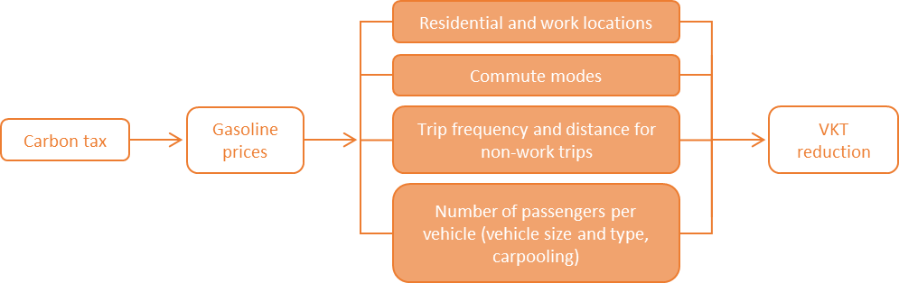{#fig-ctandvkt}

*Note: Channels (in orange boxes) are shown to illustrate the economic theory; they are not modeled/estimated separately within CPAT.*

The negative relationship between fuel prices and VKT is well
established in the economics literature. The literature provides a large
number of empirical estimates of the elasticity of VKT wrt fuel prices.
@tbl-litrev lists a selection of these estimates: most commonly, the
estimates of VKT elasticity range from -0.05 to -0.50. A review paper
found the mean estimate to be -0.10 in the short run and -0.29 in the
long run (@goodwin2004elasticities).

Some of these responses take time, so the long-run gasoline price
elasticity of road deaths is likely to exceed the short-run elasticity.
However, high fuel prices also push consumers to invest into more
fuel-efficient vehicles, either buying cars that are more efficient or
switching from cars to motorcycles (or other modes). In this case, the
literature has extensively discussed the importance of the *rebound effect*, defined as efficiency induced consumption or, more plainly, the
idea “buy a more fuel-efficient car, drive more” (@gillingham2016rebound). The rebound effect might cause long-run VKT elasticity to be
*lower* than short-run VKT elasticity.

| **Study**                                                                                                                                                                                                            | **Country** | **Fuel price elasticity of road use** | **Note**      |                                                                                                              |
| -------------------------------------------------------------------------------------------------------------------------------------------------------------------------------------------------------------------- | ----------- | ------------------------------------- | ------------- | ------------------------------------------------------------------------------------------------------------ |
|                                                                                                                                                                                                                      |             | **Short run**                         | **Long run**  |                                                                                                              |
| **US**                                                                                                                                                                                                               |             |                                       |               |                                                                                                              |
| @small2007fuel                                                                                                                                                                                            | US          | \-0.05                                | \-0.22        | VKT elasticity.                                                                                              |
| @burger2009gas                                                                                                                                                                                              | US          | \-0.16                                |               | VKT elasticity during peak congestion hours in Los Angeles.                                                  |
| @bento2013carpooling                                                                                                                                                                                                  | US          | \-0.05                                |               | Roads without carpool lanes in Los Angeles. Elasticity is for number of trips.                               |
| @gillingham2014identifying                                                                                                                                                                                                    | US          | \-0.22                                |               | Vehicle-level data for California. Effect allows \>1 years of response, but is not long-run. VKT elasticity. |
| @gillingham2015heterogeneity                                                                                                                                                                                      | US          | \-0.10                                |               | Vehicle-level data for Pennsylvania. VKT elasticity.                                                         |
| @haughton1996gasoline                                                                                                                                                                                             | US          | \-.16 to -.07                         | \-.58 to -.21 | VKT elasticity at US state level.                                                                            |
| @huang2015short                                                                                                                                                                                                | US          | \-0.06                                |               | Mean for a sample of toll roads. Elasticity is for number of trips.                                          |
| **Other countries**                                                                                                                                                                                                  |             |                                       |               |                                                                                                              |
| @raymond2003demand                                                                                                                                                                                               | Spain       | \-0.34                                | \-0.53        | Elasticity is for number of vehicle trips on toll roads.                                                     |
| @crotte2009estimation                                                                                                                                                                                                 | Mexico      | \-0.12                                |               | VKT elasticity.                                                                                              |
| @khoo2012short                                                                                                                                                                                                  | Malaysia    | \-0.16                                |               | Uses road sensor data for 2008.                                                                              |
| @frondel2012heterogeneity                                                                                                                                                                                                | Germany     | \-0.458                               |               | VKT elasticity.                                                                                              |
| @delsaut2014effect                                                                                                                                                                                                      | France      | \-0.14                                | \-0.28        | VKT elasticity.                                                                                              |
| @kwon2014asymmetric                                                                                                                                                                                                  | South Korea | \-0.11                                |               | Elasticity is for number of vehicle trips.                                                                   |
| @odeck2016elasticities                                                                                                                                                                                              | Norway      | \-0.11                                | \-0.24        | VKT elasticity.                                                                                              |

: Literature estimates of the elasticity of VKT wrt fuel prices {#tbl-litrev}

*Notes: Studies are chronologically ordered. Listed papers are a sample of prior studies. “Short run” and “long run” do not have the same definitions in all studies. Adapted from @burke2017easing and @moshiri2020consumer.*


#### Congestion

Congestion is the result of interaction between the limited vehicle
capacity of a given facility and the demands for space by individual
users. The costs of congestion occur in the form of excess travel time,
increased expected damage and injury from accidents among vehicles, and
additional vehicle operating costs for wear and fuel (@murphy1997review).

The relationship of total VKT to congestion is straightforward (see @fig-ctandcong): the less vehicles on the road, the smaller the congestion problem (@sugiyama2008traffic). This theoretical relationship has been documented in the
literature for decades (@johnson1964economics). When people share vehicles
(carpooling) or substitute to public transport, the reduction in
congestion may be achieved with constant total passenger-km (@bento2013carpooling).

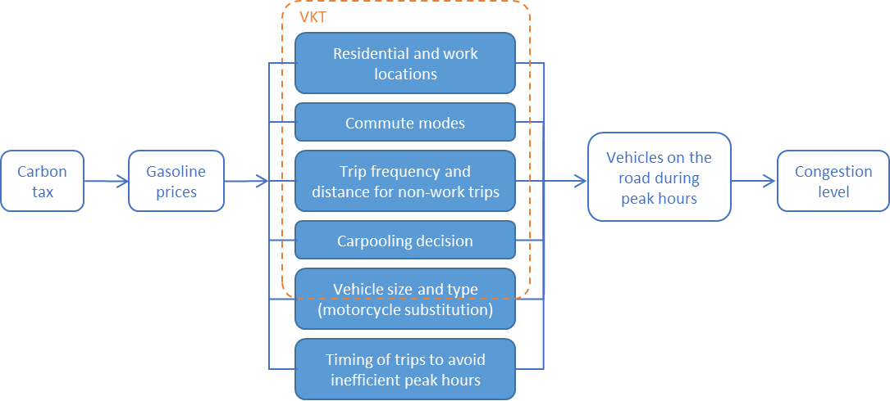{#fig-ctandcong}

*Notes: Channels (in blue boxes) are shown to illustrate the economic theory; they are not modeled/estimated separately within CPAT.*

Empirically, congestion has been difficult to measure until very
recently. Conventional measurement methods are costly, such as employing
humans to count, establishing cameras or installing wires on the road.
The resulting measurements only cover a limited number of precise
locations and often only short periods of time. More recently, the
development of mobile communication technology has allowed newer
measures such as the congestion indicators of Waze, Google Maps, Inrix
and TomTom. These GPS-based data cover larger areas over long periods of
time and are highly disaggregated.

Given the limited/recent availability of congestion data, the empirical
literature on the impact of fuel prices on congestion levels is
relatively scarce. @burger2009gas find that a USD 1 increase in
fuel prices reduces congestion and raises average freeway speeds by
approximately 7% during rush-hour periods. They estimate short-run
elasticity with a methodology similar to ours and find estimates ranging
from -0.12 to -0.29. In an older study, @dahl1979consumer finds an
estimate of -0.35 for the elasticity of speed wrt fuel price. @cohen2017effect find that higher diesel prices lead to less but heavier
trucks on the road, thereby reducing congestion.

@burke2017easing examine the reaction to a fuel tax reform in
Indonesia and find a fuel price elasticity of motor vehicle flows
(number of vehicles on toll roads) between –0.1 and –0.2. They estimate
that Indonesia’s fuel subsidy reforms of 2013 and 2014 have reduced
traffic pressure by around 10%, relative to the counterfactual without
reform.

The externality cost of congestion can be measured in monetary
equivalent by multiplying time lost in traffic congestion by the value
of travel time (@abrantes2011meta).

#### Road accident fatalities

Road traffic injury is now the leading cause of death for children and
young adults aged 5-29 years. It is the eighth leading cause of death
for all age groups surpassing HIV/AIDS, tuberculosis and diarrheal
diseases (@world2018global).

Road accidents are a function of factors including road user behavior,
road characteristics, vehicle characteristics, and the distances driven
(vehicle-kilometers traveled, VKT) on roads by different types of
drivers. Research has also shown that economic variables affect road
accident risk exposure. Among these, fuel prices and key macroeconomic
measures such as the unemployment rate have been the focus of prior
studies rates (@ahangari2014investigation; @gerdtham2006deaths;
@IRF2). The negative effect of fuel prices
on the risk of fatal accidents is well established in the literature.

For international comparisons, the literature considers data on
fatalities more reliable than data on the number of accidents and number
of injuries (@luoma2007characteristics; @sauerzapf2010problems; @world2013global). This is why most studies concentrate on deadly crashes, when trying to assess the relationship of fuel prices and road accidents. @chi2010gasoline is a notable exception to this rule.

The relationship from fuel prices (and thus taxes) to accidents is
multifactorial (see @fig-ctandacc), as shown in @chi2013impact. Several aspects
may be summarized to a principal channel which is VKT. Reduced driving
decreases the exposure of both vehicle occupants and others to road
crashes.

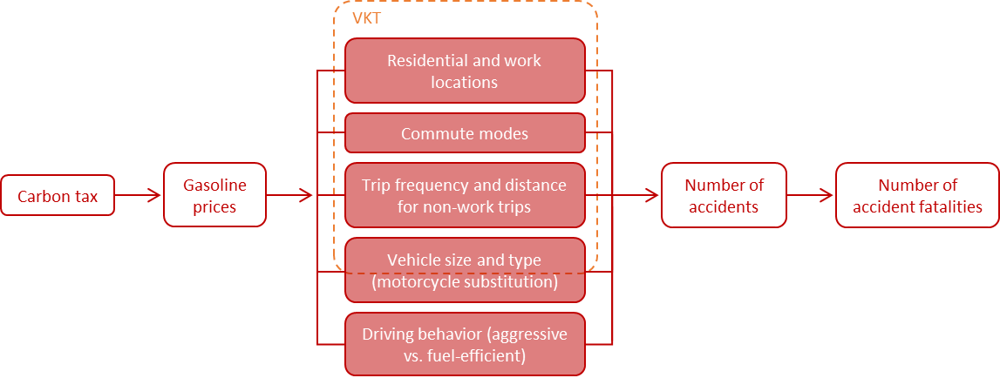{#fig-ctandacc}

*Note: Channels (in red boxes) are shown to illustrate the economic theory; they are not modeled/estimated separately within CPAT.*

In addition to reducing VKT, higher gasoline prices might also lead to a
reduction in road deaths per kilometer driven. One reason is that, to
conserve fuel, drivers might reduce high-speed driving and so-called
“aggressive driving” (high rates of acceleration and braking). Another
reason is that high-risk drivers, including the young, the old, and
those taking leisure-related trips, are particularly sensitive to
gasoline prices (@morrisey2011gas; @sivak2009mechanisms). Higher
gasoline prices also result in substitution from heavier to lighter,
more fuel-efficient cars, which are associated with a lower overall
number of road deaths per kilometer traveled (@gayer2004fatality; @white2004arms).
Substitution to bus travel may also reduce overall road safety risks.

However, through other channels higher gasoline prices might actually
lead to *more* rather than fewer road deaths. Higher gasoline prices
reduce congestion and thereby increase average speed (@burger2009gas), which increases the risk of fatal crashes. Fuel price-induced
substitution to motorcycles, which are more fuel-efficient, may also
cause additional road deaths (@hyatt2009association; @wilson2009gasoline).
In particular, substitution to lighter cars and motorcycles would
explain why long-run elasticities of accidents wrt fuel prices would be
*smaller* in absolute magnitude than short-run elasticities.

Many studies in this field concentrate on the United States. Some
authors argue that the effect of higher gasoline prices on road deaths
operates via a reduction in VKT (@grabowski2004gasoline), whereas
others report also a reduction in road deaths per VKT (@chi2010gasoline;
@chi2013gasoline; @grabowski2006higher; @haughton1996gasoline; @montour2011death; @sivak2009mechanisms). @sivak2009mechanisms explains this
reduction by the disproportionate reduction in leisure driving (riskier
than commuter driving) and rural driving (more risky than urban
driving).

@leigh1991effect examine the relationship between gas price, gas
tax, and road fatalities for all 50 states using a multiple regression
framework. They find that a 1% increase in gas tax leads to a 0.18% to
0.20% reduction in road fatalities, but that gas prices are not
statistically significant in explaining road fatalities. They use a
different method, using cent-per-gallon rather than a log-log
specification as does this study. A later study by @grabowski2004gasoline, using 1983 to 2000 state-level data and a panel model to
investigate the relationship between gas prices and road fatalities,
finds that a 1% increase in gasoline prices reduces road fatalities by
0.23%. Looking only at Mississippi, @chi2010gasoline finds a short-run
elasticity of -0.25 and a long-run elasticity of -0.47. For Minnesota,
@chi2013gasoline find an elasticity of -0.219 for fatal
crashes wrt to fuel prices and their estimates are higher in rural areas
than in urban areas.

In an international study, @burke2015gasoline find a 1% increase
in the gasoline pump price would reduce road fatalities by 0.3% to 0.6%.
Around 35,000 road deaths per year could be avoided by the removal of
global fuel subsidies. @litman2012pricing presents a scatterplot for 16
Organization for Economic Co-operation and Development (OECD) countries
that shows a negative association between average gasoline prices and
traffic fatality rates. Using a panel model of 16 industrialized
countries, @ahangari2014investigation find an elasticity of -0.22 after
controlling for VKT.

Other country-specific short-term elasticity estimates include -0.2 to
-0.3 for New Zealand (@best2019fuel) and -0.2 for Australia (@burke2018fuel).

In a dynamic urban model, @avner2014carbon examine the impact of
carbon taxes on urban mobility and underline the lock-in effect from
public transport investments: while the quality of urban transport
infrastructure is difficult to capture quantitatively, we include data
on satisfaction with public transport in our elasticity estimation to
account for this effect.

#### Road damage {#sec-roaddam}

Road damage depends strongly on road usage (@jacobson2005prediction),
but not all vehicles affect road damage equally: wear and tear on the
pavement is a rapidly rising function of a vehicle’s axle weight
(@jacobson2005prediction; @murphy1997review; @parker2006pavement; @fhwa2000addendum). Estimations suggest that the pavement wear and
tear of one average five-axle truck equates to approximately 4,000 cars
(@dounderstanding). Therefore, nearly
all of the vehicle-caused road damage is attributable to heavy-duty
vehicles (trucks).

In most countries around the world,[^7_1] light-duty vehicles (cars) use
gasoline and trucks use diesel. Road damage is thus more dependent on
diesel price than on gasoline price.

The externality cost of road transport from pavement wear and tear has
been discussed extensively in the economics literature, going back as
far as Adam Smith (@lindsey2006economists). There is a consensus that diesel is strongly under-taxed, when comparing tax level to externality cost (@parry2008should; @santos2017road).

Many authors have suggested addressing it directly through different
forms of road pricing explicitly indexed on road damage cost (e.g.
@newbery1988road; @parker2006pavement; @santos2010part). From
an economist’s point of view, addressing the externality explicitly,
with taxes mirroring the externality cost directly, is the first best
solution. However, as a carbon tax also increases diesel prices, it
decreases truck VKT and thereby reduces road damage (@barla2014demand;
; @wadud2016diesel). In general, a carbon tax reduces all road transport
externalities that depend on VKT (@ekins1996large).

The strength of this co-benefit depends on the elasticity of truck VKT
with respect to fuel prices/taxes. There is large evidence that trucks
reduce their VKT when fuel prices rise. Let us cite just a few recent
studies finding significantly elastic VKT for trucks: @barla2014demand find short and long-run price elasticities of -0.43 and -0.80
respectively; @he2015does estimates a VKT elasticity of -0.54; @ramli2014demand estimate short-run price elasticity between -0.11 and
-0.16, long-run elasticity between -0.21 and -0.30 for trucks; @leard2015fuel find estimates around -0.20.

Some studies find that the elasticity depends on the type of trucks:
@wadud2016diesel finds that rigid trucks show statistically significant
price elasticity, but articulated trucks do not respond to changes in
fuel prices.

On the opposite, some authors find that trucks are relatively inelastic
with regards to fuel prices (@WINEBRAKE2015178). One study finds
that higher diesel prices are associated with fewer but heavier trucks,
and therefore *more* road damage (@cohen2017effect).

In practice, two cost components to road damage may arise: the cost of
repairing the pavement damage, and the additional cost to users, which
result from traveling on damaged roadways. Given the difficulty to
measure the second component, we concentrate on the first component in
CPAT.

Methodologically, it is important to note that some countries earmark
revenues from fuel taxes or road charges for road maintenance (@gultom2017road). In these countries, our estimation technique is not valid because of endogeneity, so that we exclude them.

Quantitatively, road damage may be considered the smallest of the three
transport externalities considered here.

#### Within-country heterogeneity (by socio-demographic characteristics)

Regarding the within-country heterogeneity of the effect of fuel price
on VKT, the literature has not reached a consensus. Within countries,
@bastian2014s find that urban populations, in particular
those with low incomes, respond stronger to fuel price increases and
economic downturn, i.e. are reducing car travel more. Similarly, many
studies find that (absolute) elasticity diminishes with higher income
levels (@santos2005distributional; @small2007fuel; @west2017distributional). On the opposite, @wang2014impact find that higher income households show greater fuel price elasticity than lower income
households.

Regarding the effect of fuel prices on accident fatalities, the
literature suggest that the poor are more often victims of road
accidents because of the vehicles they travel in. There is evidence that
larger vehicles (in particular light trucks and SUVs) cause more
fatalities than light passenger vehicles, while drivers of SUVs are
relatively more protected: (@white2004arms) calls this disequilibrium “the
‘Arms race’ on American roads”. The highest risk is borne by
motorcyclists who tend to have lower incomes than four-wheeled vehicle
drivers (@hyatt2009association). A particular group at high risk for road
death are young drivers (aged 15–24) and their passengers. As these
drivers are more sensitive to fuel prices, the young drivers accident
rate responds particularly strongly to fuel price increases (@morrisey2011gas). One of the few studies looking at gender and race, @chi2010gasoline find that fuel prices affect accident rates similarly for
men and women, as well as for white and black population.

#### Between-country heterogeneity

Regarding the between-country heterogeneity of the effect of fuel prices
on VKT, most estimates concentrate on developed countries, in particular
the USA. Studies on developing countries often face data challenges, but
so far the literature suggests that the elasticities lay within the same
order of magnitude in developed and developing countries (@gillingham2016rebound).

Regarding the effect of fuel prices on accident fatalities, some studies
look at differences between high- and low-income countries, but the
literature on within-country determinants of road fatalities and their
elasticity wrt to fuel prices is scarce. Data is notoriously more scarce
in developing countries. Country-level panel data identification
strategies such as used in @burke2015gasoline typically yield
one elasticity for all countries. A priori, the effect is unclear:
wealthier individuals travel larger distances and thus have a higher
risk of traffic accidents, but poorer individuals travel more on foot
and on motorcycles, which increases their risk to die from a road
accident.

#### Fuel prices vs. taxes

Most of the above mentioned literature examines the effect of fuel
prices on the various outcomes discussed. However, for CPAT we are
interested in the effect of a carbon tax.

Regarding the effect on VKT, @li2014gasoline show that gasoline
consumption responds more strongly to gasoline taxes than to gasoline
prices. They explain that consumers may respond more to taxes than
equal-sized changes in tax-inclusive gasoline prices because of
perceived persistence and salience. Variation in gasoline taxes also is
covered much more intensively in the media.

Regarding road fatalities, @leigh1991effect show that gasoline
taxes have a significant effect on fatalities while the effect of price
effect from oil market fluctuations is not significant. However, these
findings are on a cents-per-liter basis rather than a percent basis, so
they are not directly comparable to our results.

#### Methodology {#sec-methodo}

Literature generally finds that the short-term elasticity of fuel use is
weaker than the long-term elasticity wrt fuel prices (@chi2010gasoline).
Usually, researchers explain this finding by structural adjustments to
the vehicle fleet, travel demand (work and residence locations) and
infrastructure. Hence, there has been some methodological effort to
estimate short-run and long-run elasticities separately.

The methodology for elasticity estimation in the Road Transport Module
is similar to @burke2015gasoline. Using country-year-level data,
the main estimations are fixed effects and between estimators of a
linear log-log equation. The between estimator uses average data for
each country and provides estimates of long-run effects (@baltagi2008econometric; @baltagi1984short; @pesaran1995estimating; @pirotte1999convergence; @stern2010between). Fixed-effects estimations control for time-invariant factors such as the extent of mountainous terrain, but when a static fixed-effects equation is estimated the coefficients represent short-run effects. This method has been widely used in the literature looking at the effect of fuel prices on road safety (@best2019fuel; @burke2015gasoline; @grabowski2006higher; Montour, 2011). An alternative way of estimating long-run elasticities is the distributed lag specification (@burke2015gasoline; @chi2013impact; @montour2011death).

Other studies, e.g. @chi2013gasoline, use more time-series
related methods, in particular testing for unit roots and accounting for
stationarity. These methods are difficult to implement with unbalanced
panels, as in our case. However, in his standard econometrics textbook
(@baltagi2008econometric; @baltagi1984short) considers that time-series
methods should apply when T (the number of periods) is large and N (the
number of countries) is small, whereas panel data methods like the
between estimator are appropriate when T small and N large: “Using panel
data, one can avoid the problem of spurious regression$…$ Unlike the
single time series spurious regression literature, the panel data
spurious regression estimates give a consistent estimate of the true
value of the parameter as both N and T tend to $\infty$. This is
because, the panel estimator averages across individuals and the
information in the independent cross-section data in the panel leads to
a stronger overall signal than the pure time series case.”

### Data sources

#### General

We use a panel dataset of country-year-level data, including as many
countries and years as available, resulting in an unbalanced panel. The
dataset covers the time from 1994 to 2021 and 186 countries around the
world.

The main data source are the World Road Statistics (WRS), regularly
published by the International Road Foundation (@IRF). We use data from its editions 2001 to 2021, covering the years 1995 to 2019.

Aside many of our covariates, WRS also contains two of our outcomes of
interest: we use total distance driven in vehicle-kilometers traveled
(VKT) and road damage, as measured by infrastructure maintenance
investment.

General demographic and macroeconomic variables are provided by the
World Bank’s World Development Indicators (WDI) database.[^7_2] The World
Bank’s World Governance Indicators (WGI) database[^7_3] gives indicator
measures of corruption and rule of law.

The online database for Sustainable Development Report (SDR) 2019[^7_4]
(@Sachs2019) gives an indicator of the quality of public transport.

Weather information at the country-year level is provided by the
Climatic Research Unit (CRU) of the University of East Anglia,
downloadable via the World Bank’s Climate Change Knowledge Portal
(CCKP).[^7_5] We use the precipitation (in mm), the minimum temperature
(in °C), the number of hot days (Tmax\>40°C), and the number of ice days
(Tmax\<0°C).

All monetary variables are deflated to 2018 USD using the World Bank’s
US GDP deflator and adjusted for purchasing power parity (WDI).

An exhaustive list of variables with their sources can be found in
@sec-appvar.

#### Congestion {#sec-cong}

Traffic congestion is measured using the TomTom Traffic Index. This
index covers over 400 cities across 61 countries. The TomTom Traffic
index statistics are calculated from anonymized GPS data collected via
navigation devices, in-dashboard systems and smartphones.

The congestion level percentages represent the measured amount of extra
travel time experienced by drivers across the entire year. As a first
step, TomTom establishes a baseline of travel times during uncongested,
free flow conditions across each road segment in each city. They then
analyze travel times across the entire year for each city. The TomTom
Traffic Index then represents the difference between observed travel
times and free flow travel time.

For example, an overall congestion level of 36% means that the extra
travel time is 36% more than an average trip would take during
uncongested conditions. Average times are of actual taken trips, across
every vehicle in the entire network, 24/7. Travel times in free-flow
(uncongested) conditions are not based on legal speed limits but on
actual trips made.

The TomTom Traffic Index is available both overall, as well as for
specific weekdays and peak times, including morning and evening peak
hours.

#### Road safety

The United Nations Economic Commission for Europe (UNECE)[^7_6] and the
Organization for Economic Co-operation and Development (OECD)[^7_7]
provide statistical databases, used to complete missing data points in
the WRS, in particular for accident fatalities.

The World Health Organization (WHO) publishes reports on Road Safety. We
use the 2013 edition with data on 2011 (@world2013global)
and the 2018 edition with data on 2017 (@world2018global), which include detailed covariates on the legal framework of
traffic, such as seat belt wearing rate, blood alcohol concentration
limit, helmet enforcement and others.[^7_8]

For Côte d’Ivoire and Mexico, country-specific projects made more
detailed accident data available, which are included in the general CPAT
analysis. Missing data for Côte d’Ivoire in WRS are completed using the
national accident statistics provided by the Ivorian Ministry of
Transport. Unrealistically low accident numbers for Mexico in WRS are
replaced by data from the Mexican National Institute of Statistics and
Geography (INEGI) and the Mexican Transport Institute (IMT).

#### Fuel prices

Fuel prices are taken from the fuel price database of the overall CPAT
project. For road fuels, the sources used are the IMF’s Fiscal Affairs
Department (FAD), Enerdata’s Global Energy and CO<sub>2</sub> Data,
IEA’s Data and statistics and GIZ’s Sustainable Urban Transport
Project.

In combining these different data sources, the following order of steps
is applied:

1.  If Enerdata, IEA and IMF data is available, we establish a weighted
    average of price data in Enerdata (60%), IEA (10%) and IMF (30%);

2.  if IMF or IEA are missing, we use Enerdata;

3.  If Enerdata is missing, we use the information in the IMF database;

4.  If IMF is missing, we use the information in the IEA database;

5.  If IEA is missing, we use the information in the GIZ database.

Aside the final retail price at the pump, we use data on taxes
summarizing VAT, existing carbon taxes, excise tax and others. We use
the same algorithm as described above for prices to construct time
series of fuel taxes. Supply cost is defined as the difference of price
at the pump minus taxes.

#### Externality costs

The benefits of prevented mortalities can be expressed in terms of a
“Value of a Statistical Life” (VSL), which represents the value a
given population places *ex ante* on avoiding the death of an
unidentified individual. VSL is based on the sum of money each
individual is prepared to pay for a given reduction in the risk of
premature death, for example from diseases linked to air pollution
@oecd12.

The country-specific VSL in CPAT is adapted from @oecd12, adjusted
for GDP growth and inflation (within the Air Pollution Module).

We compute the average speed from TomTom’s total VKT and total travel
time. We then compute the VKT per capita from WRS’ national VKT divided
by the population size from the WB’s World Development Indicators (WDI).
This average VKT per capita is multiplied by the size of urban
population over 15 year of age (WDI) and divided by the average speed,
yielding total urban travel time.

The total urban travel time is then multiplied by 80% of the average
hourly after-tax wages (from Air Pollution Module), yielding the value
of travel time.

#### Data cleaning

Several variables result of the combination of several data sources. For
example, we combine information on accident fatalities from WRS, OECD
and UNECE. In these cases, we define a clear order and only “fill up”
missing variables with the second and third source.

After establishing this mix of data sources, a visual control of
country-specific time series is performed to identify outliers. For each
visually identified outlier, we perform thorough background checks and
in case of doubt only keep one source (resulting in some limited data
loss).

Stock variables such as length of road network, country area or size of
population are interpolated linearly when missing between years with
non-missing data for that country. However, we do not extrapolate beyond
the last/first year with non-missing data. The variable table in @sec-appvar indicates for which variables such interpolation is
performed.

### Methods for elasticity estimation

This section explains the general methodology for estimating short- and
long-run elasticities and making them country-specific in a
data-parsimonious way. This methodology is then applied to VKT and the
three outcomes of interest: congestion, road damage and fatalities from
road accidents.

#### Estimation equation

We regress the logarithm of the outcome variable onto a constant, the
logarithm of fuel prices, a list of covariates and fixed effects. The
general form of the estimated regression estimation is


$$\ln\left( Y_{\text{ct}} \right) = \alpha + \beta\ln\left( p_{\text{ct}} \right) + \gamma\ X_{\text{ct}} + \mu_{t} + \mu_{c} + \epsilon_{\text{ct}}$$ {#eq-no1}

Where $\ln\left( Y_{\text{ct}} \right)$ is the natural logarithm of
the outcome in country $c$ in year $t$, $\ln{(p_{\text{ct}})}$ is
the natural logarithm of pump price for gasoline, $X_{\text{ct}}$ is a
vector of covariates including income per capita and population density,
and $\mu_{c}$ and $\mu_{t}$ are country- and year-specific effects.

An elasticity measures how much an outcome changes relatively to its
initial value (e.g. in percent) when another variable, here the pump
price of gasoline, changes (in percent). As we are using the log-log
specification, the coefficient estimate $\widehat{\beta}$ in @eq-no1 is an estimate of the elasticity of the outcome $Y_{\text{ct}}$
with respect to (wrt) fuel prices $p_{\text{ct}}$.

#### Short-run and long-run estimators

Following @burke2015gasoline, we consider that the within
estimator from a static fixed-effects equation represents shorter-run
effects, and the between estimator provides estimates of long-run
effects (@baltagi2008econometric; @baltagi1984short; @pesaran1995estimating; @pirotte1999convergence; @stern2010between).[^7_9]

For simplicity, let us reduce the notation of the previous equation (@eq-no1)
to:

 $$y_{\text{ct}} = \alpha + \beta x_{\text{ct}} + \mu_{c} + \epsilon_{\text{ct}}$$  {#eq-no2}

Where the logarithms have been omitted and all righthand-side variables
summarized under the vector $x_{\text{ct}}$.

The interpretation for the long and short run is based on the idea that
the previous @eq-no2 may alternatively be formulated:

$$y_{\text{ct}} = \alpha + \beta'{\overline{x}}_{c} + \beta''(x_{\text{ct}} - {\overline{x}}_{c}) + \mu_{c} + \epsilon_{\text{ct}}$$ {#eq-no3}

Where ${\overline{x}}_{c}$ is the average of $x_{\text{ct}}$ over
time: ${\overline{x}}_{c} = \sum_{t}^{}{x_{\text{ct}}/T_{c}}$, where
$T_{c}$ is the number of years included for country $c$ in the
regression.

In the model described by @eq-no3, we postulate that changes in the
average value of $x_{\text{ct}}$ for an individual country may have a
different effect from temporary departures from the average. The model
allows a different response to permanent rather than transitory changes.
If $\beta' = \beta''$, then the model in @eq-no3 collapses into the
previous model in @eq-no2.

Whatever the properties of $\mu_{c}$ and $\epsilon_{\text{ct}}$, if
@eq-no2 is true, we can take the averages and find that:

$${\overline{y}}_{c} = \alpha + \beta'{\overline{x}}_{c} + \mu_{c} + {\overline{\epsilon}}_{c}$$ {#eq-no4}

where ${\overline{y}}_{c}$ is the average of $y_{\text{ct}}$ over
time: ${\overline{y}}_{c} = \sum_{t}^{}{y_{\text{ct}}/T_{c}}$ and
${\overline{\epsilon}}_{c}$ is the average of the error term:
${\overline{\epsilon}}_{c} = \sum_{t}^{}{\epsilon_{\text{ct}}/T_{c}}$.

Subtracting @eq-no4 from @eq-no3, it must also be true that:

$${y_{\text{ct}} - \overline{y}}_{c} = \beta''{(x_{\text{ct}} - \overline{x}}_{c}) + (\epsilon_{\text{ct}} - {\overline{\epsilon}}_{c})$$  {#eq-no5} 

These equations are known from panel econometrics textbooks: 
@eq-no4 describes the between estimator and @eq-no5 describes the
within estimator, also known as fixed-effects estimator.

Fixed-effects estimations control for time-invariant characteristics of
countries such as the extent of size or mountainous terrain. As
illustrated in  @eq-no5, the identifying variation comes from
within-country deviations from the country-mean. Given standard
assumptions on the error term $\epsilon_{\text{ct}}$ (mean$\ 0$,
uncorrelated with itself, uncorrelated with $x_{\text{ct}}$,
uncorrelated with $\mu_{c}$, and homoscedastic), the within estimator
can be estimated as an OLS on @eq-no5 or, equivalently, an OLS on 
@eq-no1 including country dummy variables. For this study, this equation is
estimated using the Stata command *xtreg, fe*.

The between estimator is given by the OLS estimator on @eq-no4.
This specification cancels out time-differences. The between estimates
are based on cross-sectional country differences. Individual-invariant
regressors such as time dummies cannot be identified. For this project,
this equation is estimated using the Stata command *xtreg, be*.[^7_10]

#### Covariates

The choice of the variables used as covariates $X_{\text{ct}}$ follows
the list of variables used in @world2018global. A
detailed list can be found in @sec-appvar.

#### Country-specific elasticity estimates

The effect of fuel prices on our three outcomes of interest is likely to
be heterogeneous across different countries. However, there is limited
data available for most countries, so that unparametrically
country-specific estimations proved not feasible. We discard to option
to create *ad hoc* regional groups and estimate group-specific
elasticities, as we want a more data-driven methodology. To strike a
balance between accounting for heterogeneity and using available data
parsimoniously, we estimate elasticities that are linear expressions of
several covariates.

The estimation includes interaction terms between fuel prices and the
additional variables. For example, if elasticity depends on two more
variables, the estimation equation is:

$$\ln\left( Y_{\text{ct}} \right) = \alpha + \beta_{0}\ln{(p_{\text{ct}})} + \beta_{1}v_{\text{ct}}^{1}\ln{(p_{\text{ct}})} + \beta_{2}v_{\text{ct}}^{2}\ln{(p_{\text{ct}})} + \gamma\ X_{\text{ct}} + \mu_{c} + \ \mu_{t} + \epsilon_{\text{ct}}$$ {#eq-no6}

where the variables are the same as before, and$\ v_{\text{ct}}^{1}$
is the first additional variable influencing elasticity and
$v_{\text{ct}}^{2}$ is the second additional variable influencing
elasticity. The “country-specific” elasticity estimated is then:

$${\widehat{\beta}}_{c} = {\widehat{\beta}}_{0} + {\widehat{\beta}}_{1}\overline{v_{c}^{1}} + {\widehat{\beta}}_{2}\overline{v_{c}^{2}}$$ {#eq-no7}


where $\overline{v_{c}^{1}}$ is the average across recent years[^7_11]
of variable $v_{\text{ct}}^{1}$ for country $c$ (and analogously for
variable $\overline{v_{c}^{2}}$). In practice, we include not two but
five additional variables $v_{\text{ct}}^{k}$, which we omit here for
readability.

We consider 15 candidate variables linked to traffic conditions,
demographics and availability of substitutes to private vehicles. The
final estimations include only the variables found to be empirically
most important.

The selection of covariates $v_{\text{ct}}^{k}$ included in the
expressions of elasticities is data-driven using a lasso regression as
implemented in Stata command *lasso2* (@ahrens2020lassopack). The lasso
procedure penalizes additional variables/parameters and thereby
encourages simple, sparse models, i.e. models with fewer parameters. The
algorithm sequentially includes one variable after the other, in an
optimized order. The order in which predictors are entered into the
model can be interpreted as an indication of the relative predictive
power of each predictor.

#### Fuel prices or taxes

We are interested in the effect of carbon taxes on accidents. The most
classical way of estimating tax impact consists in estimating price
elasticity from exogenous price variation. However, some of the
literature states that consumers might not react identically to price
changes and to tax changes (salience, anticipation of persistence over
time).

Therefore, we estimate two sets of elasticities: elasticities wrt fuel prices and wrt fuel taxes. The estimation for
elasticity wrt to prices follows the equations above. The estimations
for elasticity wrt to taxes include the natural logarithms of both
tax-exclusive prices and taxes as two separate variables. The elasticity
of interest is then the estimated coefficient of the tax variable. Fuel
tax data is only available for a limited amount of countries.

### Elasticity results

For readability, this note includes shortened results tables. For the
full results, please refer to the *Tran\_Elas* sheet of CPAT.

#### Congestion

@fig-urbcong20 shows descriptive evidence of the relationship between urban
congestion and gasoline prices: across countries, there is a significant
negative correlation in 2018.[^7_12] Congestion is measured with the
TomTom Traffic Index, indicating the additional time spent in congested
traffic as compared to free-flowing traffic (in percent, see @sec-cong for more details).

This simple descriptive evidence omits many variables. In particular,
the elasticity of demand of private vehicle trips depends on the
availability of (and practicability) alternative means of transport.
Moreover the resulting congestion depends on whether these alternative
means of transport will also be on the road (e.g. buses) or elsewhere
(e.g. trains).

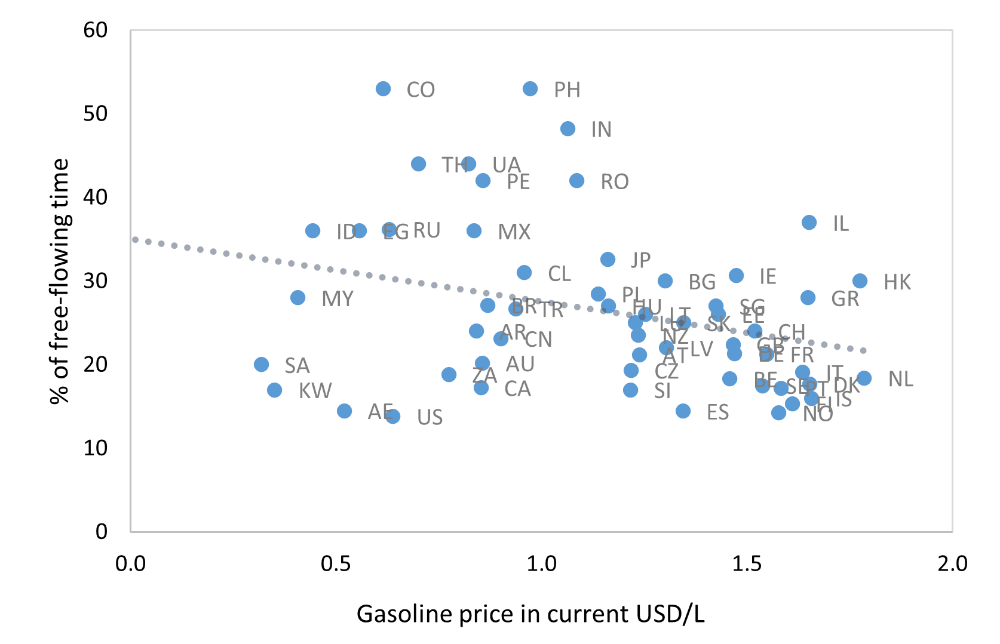{#fig-urbcong20}

Source: Tomtom, Enerdata, EIU, IEA, own computations.

##### Short-run elasticity

This section shows the results for the short-run estimations of
congestion on fuel prices and a list of covariates. The most relevant
specification $i$ the within estimator of @eq-no1, as specified in
@eq-no5.

For simplicity, we only show the regression results for overall
congestion, whereas CPAT also contains estimates for weekday congestion
and weekday peak time congestion. The results on these three indicators
are similar, but the effect on peak congestion is typically slightly
stronger.

| **Urban congestion**                                                                                                                                                                                                                                                                                                                                                                                                                                      | **(1)**        | **(2)**              | **(4)**     | **(3)**          | **(5)**          | **(6)**        |
| --------------------------------------------------------------------------------------------------------------------------------------------------------------------------------------------------------------------------------------------------------------------------------------------------------------------------------------------------------------------------------------------------------------------------------------------------------- | -------------- | -------------------- | ----------- | ---------------- | ---------------- | -------------- |
|                                                                                                                                                                                                                                                                                                                                                                                                                                                           | **pooled OLS** | **within estimator** |             |                  |                  |                |
| **Ln of gasoline pump price (2018 PPP-adj USD cents/liter)**                                                                                                                                                                                                                                                                                                                                                                                              | **0.0189**     | **-0.0776\***        | \-0.335\*\* | **-0.149\*\*\*** | **-0.288\*\*\*** | \-0.503\*\*\*  |
|                                                                                                                                                                                                                                                                                                                                                                                                                                                           | **(0.584)**    | **(0.0799)**         | (0.0382)    | **(0.000620)**   | **(6.12e-10)**   | (0.00171)      |
| Interaction ln(gasoline) w/ Ln of number of vehicles per capita                                                                                                                                                                                                                                                                                                                                                                                           |                |                      | 0.312\*\*   |                  |                  | 0.294\*\*      |
|                                                                                                                                                                                                                                                                                                                                                                                                                                                           |                |                      | (0.0153)    |                  |                  | (0.0454)       |
| Interaction ln(gasoline) w/ Precipitation (in mm)                                                                                                                                                                                                                                                                                                                                                                                                         |                |                      | 0.207\*\*\* |                  |                  | 0.103\*\*      |
|                                                                                                                                                                                                                                                                                                                                                                                                                                                           |                |                      | (2.05e-05)  |                  |                  | (0.0107)       |
| Interaction ln(gasoline) w/ Satisfaction with public transport (%)                                                                                                                                                                                                                                                                                                                                                                                        |                |                      | \-0.0106    |                  |                  | \-0.0322\*\*\* |
|                                                                                                                                                                                                                                                                                                                                                                                                                                                           |                |                      | (0.667)     |                  |                  | (0.00398)      |
| Interaction ln(gasoline) w/ Share of paved roads (in %)                                                                                                                                                                                                                                                                                                                                                                                                   |                |                      | \-0.0477\*  |                  |                  | \-0.116        |
|                                                                                                                                                                                                                                                                                                                                                                                                                                                           |                |                      | (0.0555)    |                  |                  | (0.239)        |
| Interaction ln(gasoline) w/ Ln of population                                                                                                                                                                                                                                                                                                                                                                                                              |                |                      | 0.171\*\*\* |                  |                  | 0.0536         |
|                                                                                                                                                                                                                                                                                                                                                                                                                                                           |                |                      | (0.00205)   |                  |                  | (0.439)        |
| Covariates                                                                                                                                                                                                                                                                                                                                                                                                                                                | No             | Yes                  | Yes         | No               | Yes              | Yes            |
| Fixed effects                                                                                                                                                                                                                                                                                                                                                                                                                                             | No             | No                   | No          | Yes              | Yes              | Yes            |
| Interaction terms                                                                                                                                                                                                                                                                                                                                                                                                                                         | No             | No                   | Yes         | No               | No               | Yes            |
| Observations                                                                                                                                                                                                                                                                                                                                                                                                                                              | 583            | 467                  | 467         | 583              | 467              | 467            |
| R-squared                                                                                                                                                                                                                                                                                                                                                                                                                                                 | 0.287          | 0.495                | 0.550       | 0.214            | 0.384            | 0.415          |
| Number of countries                                                                                                                                                                                                                                                                                                                                                                                                                                       |                |                      |             | 61               | 52               | 52             |
| 

: Regression results short-run congestion {#tbl-srcong}

*Robust p-values in parentheses,* \*\*\* p\<0.01, \*\* p\<0.05, \* p\<0.1. *Ln(gasoline) is the natural logarithm of the gasoline pump price (2018 PPP\_adjusted USD cents/liter). The parameter marked in green is the default short-run elasticity in CPAT for countries that have not sufficient data for country-specific elasticity estimation. Sample averages are subtracted from the interaction variables prior to interacting with the fuel price.*

@tbl-srcong shows results of the pooled OLS (column 1-3) and within
estimator (column 4-6). For each estimator, we compute the coefficient
first without and then with covariates included. All of the estimates
lie within a similar order of magnitude: the short-run elasticity of
congestion wrt fuel price is estimated between -0.08 and -0.29. This is
very close to the estimates ranging from -0.12 to -0.29 in @burger2009gas and more inelastic than the estimate of -0.35 in @dahl1979consumer.

The columns 4 and 6 show the results of including additional interaction
terms between the fuel price and selected variables. The coefficient of
the fuel price is not directly interpretable in this specification. In
order to obtain country-specific elasticity estimates, one needs to
multiply the coefficients with the country-specific values of the
covariates. The results are given below in @sec-speelas.

##### Long-run elasticity

Computing the between estimator of @eq-no1, given by @eq-no4,
we obtain the long-run elasticity.

| **Urban congestion**                                                                                                                                                                                                                                                                                                                                                                                                                                     | **(1)**               | **(2)**          | **(4)**     |
| -------------------------------------------------------------------------------------------------------------------------------------------------------------------------------------------------------------------------------------------------------------------------------------------------------------------------------------------------------------------------------------------------------------------------------------------------------- | --------------------- | ---------------- | ----------- |
|                                                                                                                                                                                                                                                                                                                                                                                                                                                          | **between estimator** |                  |             |
| **Ln of gasoline pump price (2018 PPP-adj USD cents/liter)**                                                                                                                                                                                                                                                                                                                                                                                             | **-0.125\*\*\***      | **-0.364\*\*\*** | \-0.707     |
|                                                                                                                                                                                                                                                                                                                                                                                                                                                          | **(0.00436)**         | **(2.07e-08)**   | (0.214)     |
| Interaction ln(gasoline) w/ Maximum speed on urban roads (in km/h)                                                                                                                                                                                                                                                                                                                                                                                       |                       |                  | 0.260       |
|                                                                                                                                                                                                                                                                                                                                                                                                                                                          |                       |                  | (0.129)     |
| Interaction ln(gasoline) w/ Precipitation (in mm)                                                                                                                                                                                                                                                                                                                                                                                                        |                       |                  | 0.0821      |
|                                                                                                                                                                                                                                                                                                                                                                                                                                                          |                       |                  | (0.421)     |
| Interaction ln(gasoline) w/ Seat-belt wearing rate (%)                                                                                                                                                                                                                                                                                                                                                                                                   |                       |                  | \-0.105     |
|                                                                                                                                                                                                                                                                                                                                                                                                                                                          |                       |                  | (0.326)     |
| Interaction lnsuper w/ Infant mortality rate (per 1,000 live births)                                                                                                                                                                                                                                                                                                                                                                                     |                       |                  | \-0.906\*\* |
|                                                                                                                                                                                                                                                                                                                                                                                                                                                          |                       |                  | (0.0394)    |
| Interaction ln(gasoline) w/ Ln of population                                                                                                                                                                                                                                                                                                                                                                                                             |                       |                  | \-0.0210    |
|                                                                                                                                                                                                                                                                                                                                                                                                                                                          |                       |                  | (0.934)     |
| Covariates                                                                                                                                                                                                                                                                                                                                                                                                                                               | No                    | Yes              | Yes         |
| Interaction terms                                                                                                                                                                                                                                                                                                                                                                                                                                        | No                    | No               | Yes         |
| Observations                                                                                                                                                                                                                                                                                                                                                                                                                                             | 583                   | 467              | 467         |
| R-squared                                                                                                                                                                                                                                                                                                                                                                                                                                                |                       |                  | 0.786       |
| Number of countries                                                                                                                                                                                                                                                                                                                                                                                                                                      | 61                    | 52               | 52          |
| 

: Regression results long-run congestion {#tbl-lrcong}

*Robust p-values in parentheses,* \*\*\* p\<0.01, \*\* p\<0.05, \* p\<0.1. *Ln(gasoline) is the natural logarithm of the gasoline pump price (2018 PPP\_adjusted USD cents/liter). The parameter marked in green is the default long-run elasticity in CPAT for countries that have not sufficient data for country-specific elasticity estimation. Sample averages are subtracted from the interaction variables prior to interacting with the fuel price.*

Again, the first two columns of @tbl-lrcong show the estimates first without and then with covariates included into the regression. The third column shows the results of including the interaction of fuel price with the empirically relevant covariates, which are not directly interpretable and will be discussed in the next subsection.

##### Country-specific elasticities {#sec-speelas}

@tbl-srcong and @tbl-lrcong show the results of regressing congestion on
fuel prices and covariates, estimating the short-run (within estimator)
and long-run (between estimator) elasticities. The parameters of the
last column of each table give the results of including interaction
terms with relevant covariates, as described by @eq-no6. The most
relevant interaction terms are chosen using lasso regressions (see
@sec-methodo for methodology).

While using fuel price data for estimating elasticity is standard in the
literature, some authors have suggested that consumers react more
strongly to changes in fuel taxes than to (equivalent) changes in fuel
prices. This hypothesis typically relies on additional salience of
taxes, which are often strongly featured in the media, and on
expectations about the persistence of the price change into the future.

Therefore, we repeat the same estimations of @tbl-srcong and @tbl-lrcong
using fuel supply cost and fuel taxes as two separate variables, rather
than overall fuel price at the pump. Detailed results are omitted here,
but can be found in the MS Excel file appendix to this report.

As a result, we have four elasticity estimates for each country:
short-run and long-run, each wrt prices and wrt taxes.

@tbl-varspe shows the lists of variables which are selected by the lasso
regression algorithm as the five most relevant covariates for fuel price
elasticity of congestion. The elasticities depend on characteristics of
the vehicle fleet (number of vehicles per capita, share of motorcycles),
on characteristics of the road network (density, speed limits),
characteristics of transport substitutes (satisfaction with public
transport) and on more general features of society (population size,
rule of law indicator, urbanization, share of young people, and others).

| **Short run**                                                                                                                                                       | **Long run**                           |                                               |                                               |
| ------------------------------------------------------------------------------------------------------------------------------------------------------------------- | -------------------------------------- | --------------------------------------------- | --------------------------------------------- |
| **wrt price**                                                                                                                                                       | **wrt tax**                            | **wrt price**                                 | **wrt tax**                                   |
| Ln of number of vehicles per capita                                                                                                                                 | Number of vehicles per capita          | Maximum speed on urban roads (in km/h)        | Maximum speed on urban roads (in km/h)        |
| Satisfaction with public transport (%)                                                                                                                              | Satisfaction with public transport (%) | Ln of population                              | Ln of population                              |
| Share of paved roads (in %)                                                                                                                                         | Share of urban population (in %)       | Infant mortality rate (per 1,000 live births) | Infant mortality rate (per 1,000 live births) |
| Ln of population                                                                                                                                                    | Seat-belt wearing rate (%)             | Seat-belt wearing rate (%)                    | Satisfaction with public transport (%)        |
| Precipitation (in mm)                                                                                                                                               | Maximum speed on urban roads (in km/h) | Precipitation (in mm)                         | Road density (in km per km2)                  |
|                                        |

: Variables selected for country-specific congestion elasticity estimation {#tbl-varspe}

*Notes: The covariates used for estimating the country-specific elasticities are chosen by a data-driven machine learning algorithm among a list of 30 candidate variables.*

Given the large number of countries and variants, the elasticities are
not reproduced here. The detailed numbers can be found in CPAT or in the
MS Excel appendix to this report.

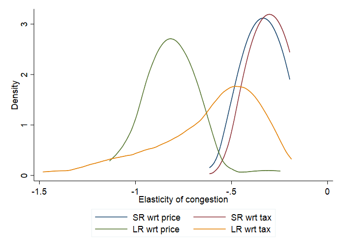{#fig-specongela}

@fig-specongela shows the kernel densities[^7_13] of the congestion elasticity
estimates in the short and the long-run, wrt fuel price and wrt fuel
tax. One can see that congestion is more elastic to fuel prices in the
long run than in the short run. This is a classical result, as consumers
have the possibility to adjust more in the long run than in the short
run.

@tbl-specong summarizes the key characteristics of the distributions shown
in @fig-specongela: mean, median, 5<sup>th</sup> and 95<sup>th</sup>
percentiles of the distribution.

| **Urban congestion**    | **Short-run** | **Long-run** |               |             |
| ----------------------- | ------------- | ------------ | ------------- | ----------- |
|                         | **wrt price** | **wrt tax**  | **wrt price** | **wrt tax** |
| **Default elasticity**  | \-0.288       | \-0.118      | \-0.364       | \-0.119     |
| **Mean**                | \-0.339       | \-0.305      | \-0.807       | \-0.612     |
| **Median**              | \-0.340       | \-0.296      | \-0.798       | \-0.531     |
| **5th percentile**      | \-0.433       | \-0.381      | \-1.001       | \-1.127     |
| **95th percentile**     | \-0.242       | \-0.229      | \-0.667       | \-0.294     |
| **Number of estimates** | 158           | 151          | 174           | 154         |

: Country-specific congestion elasticities, numerical overview {#tbl-specong}

#### Fatalities from road accidents

For illustration, @fig-roadfat shows descriptive evidence of the negative
correlation between fuel prices and road accident fatalities. The higher
the gasoline price the lower the accident fatality rate per 100,000
inhabitants.

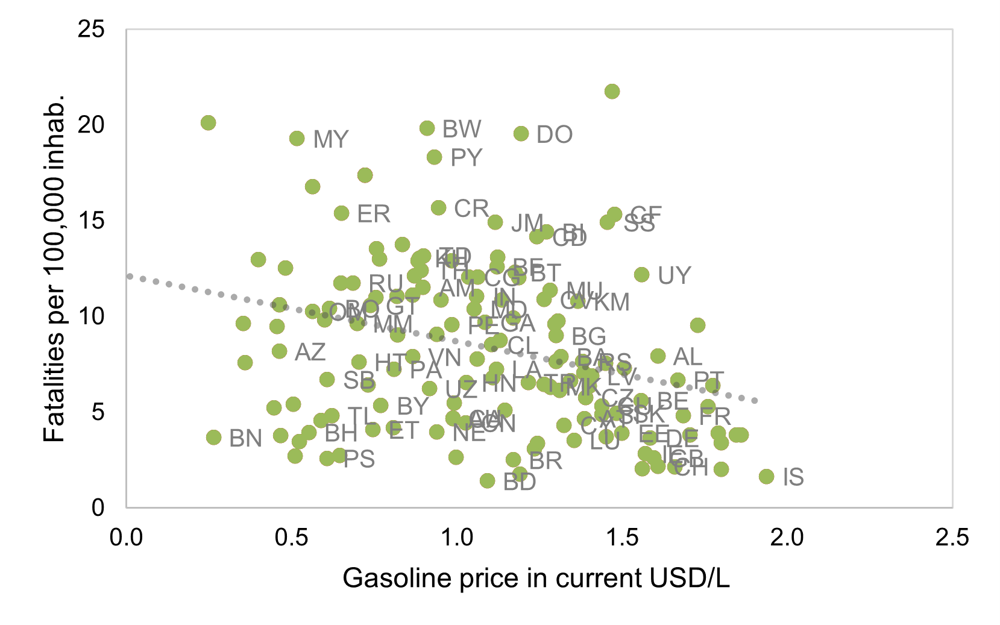{#fig-roadfat}

Source: WRS, Enerdata, EIU, IEA, own computations.

##### Short-run elasticity

This section shows the results for the short-run estimations of road
accident fatalities on fuel prices and a list of covariates, following
the general form of @eq-no1.


| **Accident fatalities**                                                                                                                                                                                                                                                                                                                                                                                                                                   | **(1)**          | **(2)**              | **(4)**        | **(3)**          | **(5)**          | **(6)**       |
| --------------------------------------------------------------------------------------------------------------------------------------------------------------------------------------------------------------------------------------------------------------------------------------------------------------------------------------------------------------------------------------------------------------------------------------------------------- | ---------------- | -------------------- | -------------- | ---------------- | ---------------- | ------------- |
|                                                                                                                                                                                                                                                                                                                                                                                                                                                           | **pooled OLS**   | **within estimator** |                |                  |                  |               |
| **Ln of gasoline pump price (2018 PPP-adj USD cents/liter)**                                                                                                                                                                                                                                                                                                                                                                                              | **-0.113\*\*\*** | **-0.112\*\*\***     | \-0.211\*\*\*  | **-0.143\*\*\*** | **-0.168\*\*\*** | \-0.366\*\*\* |
|                                                                                                                                                                                                                                                                                                                                                                                                                                                           | **(1.41e-07)**   | **(0.00123)**        | (5.58e-06)     | **(0)**          | **(1.86e-07)**   | (0)           |
| Interaction ln(gasoline) w/ Road density (in km per km2)                                                                                                                                                                                                                                                                                                                                                                                                  |                  |                      | 0.324\*\*      |                  |                  | \-0.533\*\*\* |
|                                                                                                                                                                                                                                                                                                                                                                                                                                                           |                  |                      | (0.0333)       |                  |                  | (0.000228)    |
| Interaction ln(gasoline) w/ Population share of 15 to 24 years-old (in %)                                                                                                                                                                                                                                                                                                                                                                                 |                  |                      | \-0.174\*\*\*  |                  |                  | 0.131\*\*\*   |
|                                                                                                                                                                                                                                                                                                                                                                                                                                                           |                  |                      | (2.78e-07)     |                  |                  | (2.13e-05)    |
| Interaction ln(gasoline) w/ Seat-belt wearing rate (%)                                                                                                                                                                                                                                                                                                                                                                                                    |                  |                      | \-0.0766\*\*\* |                  |                  | 0.0122        |
|                                                                                                                                                                                                                                                                                                                                                                                                                                                           |                  |                      | (2.12e-09)     |                  |                  | (0.241)       |
| Interaction ln(gasoline) w/ Satisfaction with public transport (%)                                                                                                                                                                                                                                                                                                                                                                                        |                  |                      | \-0.0766\*\*\* |                  |                  | \-0.0111      |
|                                                                                                                                                                                                                                                                                                                                                                                                                                                           |                  |                      | (1.06e-10)     |                  |                  | (0.138)       |
| Interaction ln(gasoline) w/ Number of vehicles per capita                                                                                                                                                                                                                                                                                                                                                                                                 |                  |                      | \-0.241\*\*\*  |                  |                  | \-0.127\*\*\* |
|                                                                                                                                                                                                                                                                                                                                                                                                                                                           |                  |                      | (1.14e-08)     |                  |                  | (0.00171)     |
| Covariates                                                                                                                                                                                                                                                                                                                                                                                                                                                | No               | Yes                  | Yes            | No               | Yes              | Yes           |
| Fixed effects                                                                                                                                                                                                                                                                                                                                                                                                                                             | No               | No                   | No             | Yes              | Yes              | Yes           |
| Interaction terms                                                                                                                                                                                                                                                                                                                                                                                                                                         | No               | No                   | Yes            | No               | No               | Yes           |
| Observations                                                                                                                                                                                                                                                                                                                                                                                                                                              | 3,240            | 2,035                | 1,874          | 1,953            | 3,240            | 2,035         |
| R-squared                                                                                                                                                                                                                                                                                                                                                                                                                                                 | 0.869            | 0.905                | 0.930          | 0.907            | 0.202            | 0.287         |
| Number of country FE                                                                                                                                                                                                                                                                                                                                                                                                                                      |                  |                      |                | 170              | 138              | 121           |
| 

: Regression results short-run accident fatalities {#tbl-regfat}

*Robust p-values in parentheses,* \*\*\* p\<0.01, \*\* p\<0.05, \* p\<0.1. *Ln(gasoline) is the natural logarithm of the gasoline pump price (2018 PPP\_adjusted USD cents/liter). The parameter marked in green is the default short-run elasticity in CPAT for countries that have not sufficient data for country-specific elasticity estimation. Sample averages are subtracted from the interaction variables prior to interacting with the fuel price.*

The estimates for the short-run elasticity of accidents wrt fuel prices
lie between -0.11 and -0.168 (@tbl-regfat, columns 1, 2, 4 and 5). Our
estimates are similar to the short-run estimate of (@burke2015gasoline) with -0.10. The columns 3 and 6 include the interaction terms and
are not directly interpretable; the resulting country-specific
elasticities are discussed in @sec-speelas2.

##### Long-run elasticity

| **Accident fatalities**                                                                                                                                                                                                                                                                                                                                                                                                                                  | **(1)**               | **(2)**          | **(3)** |
| -------------------------------------------------------------------------------------------------------------------------------------------------------------------------------------------------------------------------------------------------------------------------------------------------------------------------------------------------------------------------------------------------------------------------------------------------------- | --------------------- | ---------------- | ------- |
|                                                                                                                                                                                                                                                                                                                                                                                                                                                          | **between estimator** |                  |         |
| **Ln of gasoline pump price (2018 PPP-adj USD cents/liter)**                                                                                                                                                                                                                                                                                                                                                                                             | **-0.214\*\***        | **-0.192\*\*\*** | 0.123   |
|                                                                                                                                                                                                                                                                                                                                                                                                                                                          | **(0.0322)**          | **(2.18e-09)**   | (0.432) |
| Interaction ln(gasoline) w/ Ln of number of vehicles per capita                                                                                                                                                                                                                                                                                                                                                                                          |                       |                  | \-0.150 |
|                                                                                                                                                                                                                                                                                                                                                                                                                                                          |                       |                  | (0.438) |
| Interaction ln(gasoline) w/ Alcohol, recorded per capita (15+) consumption (in litres                                                                                                                                                                                                                                                                                                                                                                    |                       |                  | 0.179   |
|                                                                                                                                                                                                                                                                                                                                                                                                                                                          |                       |                  | (0.210) |
| Interaction ln(gasoline) w/ Number of motorcycles per capita                                                                                                                                                                                                                                                                                                                                                                                             |                       |                  | 0.0909  |
|                                                                                                                                                                                                                                                                                                                                                                                                                                                          |                       |                  | (0.461) |
| Interaction ln(gasoline) w/ GDP per capita (in 2018 PPP-adj USD)                                                                                                                                                                                                                                                                                                                                                                                         |                       |                  | 0.0124  |
|                                                                                                                                                                                                                                                                                                                                                                                                                                                          |                       |                  | (0.936) |
| Interaction ln(gasoline) w/ Share of urban population (in %)                                                                                                                                                                                                                                                                                                                                                                                             |                       |                  | 0.0690  |
|                                                                                                                                                                                                                                                                                                                                                                                                                                                          |                       |                  | (0.465) |
| Covariates                                                                                                                                                                                                                                                                                                                                                                                                                                               | No                    | Yes              | Yes     |
| Interaction terms                                                                                                                                                                                                                                                                                                                                                                                                                                        | No                    | No               | Yes     |
| Observations                                                                                                                                                                                                                                                                                                                                                                                                                                             | 3,240                 | 2,035            | 2,035   |
| R-squared                                                                                                                                                                                                                                                                                                                                                                                                                                                | 0.880                 | 0.900            | 0.919   |
| Number of countries                                                                                                                                                                                                                                                                                                                                                                                                                                      | 170                   |                  | 138     |
| 

: Regression results long-run accident fatalities {#tbl-reglrfat}

*Robust p-values in parentheses,* \*\*\* p\<0.01, \*\* p\<0.05, \* p\<0.1. *Ln(gasoline) is the natural logarithm of the gasoline pump price (2018 PPP\_adjusted USD cents/liter). The parameter marked in green is the default long-run elasticity in CPAT for countries that have not sufficient data for country-specific elasticity estimation. Sample averages are subtracted from the interaction variables prior to interacting with the fuel price.*

The long-run elasticity estimates in @tbl-reglrfat lie between -0.19 and
-0.21 (column 1 and 2). This is less elastic than the estimates of
(@burke2015gasoline) with -0.30 to -0.60. The third column cannot
be directly interepreted and is discussed in the following subsection.

##### Country-specific elasticities {#sec-speelas2}

@tbl-varelas shows the lists of variables which are selected by the lasso
regression algorithm as the five most relevant covariates for the
elasticity of accident fatalities, chosen by a data-driven algorithm.
Again, the elasticities depend on characteristics of the vehicle fleet,
on characteristics of the road network and on more general features of
society. In particular, motorcyclist are known to be at particularly
high risk for accident injury and death. Classical road safety features
such as seat-belt wearing rate, alcohol consumption and maximum speed
allowed also play a role. More broadly, GDP and infant mortality rate
capture the general development situation of the country, as well as the
quality of the country’s health system.


| **Short run**                                                                                                                                                       | **Long run**                                  |                                                                            |                                                                            |
| ------------------------------------------------------------------------------------------------------------------------------------------------------------------- | --------------------------------------------- | -------------------------------------------------------------------------- | -------------------------------------------------------------------------- |
| **wrt price**                                                                                                                                                       | **wrt tax**                                   | **wrt price**                                                              | **wrt tax**                                                                |
| Number of vehicles per capita                                                                                                                                       | Ln of number of vehicles per capita           | GDP per capita (in 2018 PPP-adj USD)                                       | GDP per capita (in 2018 PPP-adj USD)                                       |
| Population share of 15 to 24 years-old (in %)                                                                                                                       | Population share of 15 to 24 years-old (in %) | Alcohol, recorded per capita (15+) consumption (in litres of pure alcohol) | Alcohol, recorded per capita (15+) consumption (in litres of pure alcohol) |
| Satisfaction with public transport (%)                                                                                                                              | Infant mortality rate (per 1,000 live births) | Share of urban population (in %)                                           | Share of urban population (in %)                                           |
| Road density (in km per km2)                                                                                                                                        | Number of motorcycles per capita              | Ln of number of vehicles per capita                                        | Number of motorcycles per capita                                           |
| Seat-belt wearing rate (%)                                                                                                                                          | Maximum speed on rural roads (in km/h)        | Number of motorcycles per capita                                           | Maximum speed on rural roads (in km/h)                                     |
|

: Variables selected for country-specific accident elasticity estimation {#tbl-varelas}

*Notes: The covariates used for estimating the country-specific elasticities are chosen by a data-driven machine learning algorithm among a list of 30 candidate variables.*

@fig-speacc shows the distribution of country-specific accident
elasticity estimates. We see that both the long-run and short-run, as
well as tax and price estimates are rather similar and lie between -0.2
and ‑0.8, thus comparable to the estimates of (@burke2015gasoline) with -0.3 to -0.6.

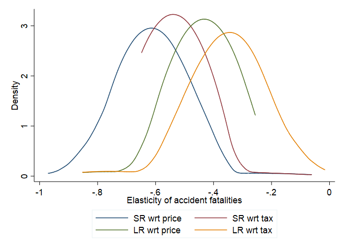{#fig-speacc}

@tbl-speaccela summarizes the key characteristics of the distributions shown
in @fig-speacc: mean, median, 5<sup>th</sup> and 95<sup>th</sup>
percentiles.

| **Accident fatalities** | **Short-run** | **Long-run** |               |             |
| ----------------------- | ------------- | ------------ | ------------- | ----------- |
|                         | **wrt price** | **wrt tax**  | **wrt price** | **wrt tax** |
| **Default elasticity**  | \-0.168       | \-0.150      | \-0.192       | \-0.137     |
| **Mean**                | \-0.613       | \-0.536      | \-0.443       | \-0.357     |
| **Median**              | \-0.603       | \-0.546      | \-0.432       | \-0.364     |
| **5th percentile**      | \-0.741       | \-0.571      | \-0.514       | \-0.459     |
| **95th percentile**     | \-0.532       | \-0.491      | \-0.373       | \-0.208     |
| **Number of estimates** | 151           | 160          | 169           | 158         |

: Country-specific accident elasticities, numerical overview {#tbl-speaccela}

#### Road damage 

Road damage is measured in CPAT with the road infrastructure expenditure
for maintenance, as listed in the WRS. The underlying hypothesis is that
all road damage is repaired and therefore captured by the road
maintenance budget of the government, as opposed to road investment for
the expansion of the road network.

Compared to the other two outcomes previously discussed, road damage
presents the particularity to be more dependent on diesel price than on
fuel price. Although the differential impact of a carbon tax on fuel and
gasoline prices is relatively small, we thus use diesel prices in this
section rather than gasoline prices as before.

##### Short-run elasticity

The results of road damage in the short run are not significant. They
are included in the MS Excel appendix to this report, but within CPAT we
assume the short run elasticity of road damage wrt fuel prices to be
zero.

##### Long-run elasticity

In the long run, road damage costs react to diesel prices, but the
results are not statistically significant as shown in @tbl-regroaddam. In the
simple specifications (columns 1 and 2), the elasticity is around -0.3. We use the parameters estimated in the specification including
interaction terms (column 3) in order to compute the country-specific
elasticities for CPAT presented in the next subsection.

| **Road damage**                                                                                                                                                                                                                                                                                                                                                                                                                                        | **(1)**               | **(2)**     | **(3)**       |
| ------------------------------------------------------------------------------------------------------------------------------------------------------------------------------------------------------------------------------------------------------------------------------------------------------------------------------------------------------------------------------------------------------------------------------------------------------ | --------------------- | ----------- | ------------- |
|                                                                                                                                                                                                                                                                                                                                                                                                                                                        | **between estimator** |             |               |
| **Lag of ln of diesel pump price (2018 PPP-adj USD cents/liter)**                                                                                                                                                                                                                                                                                                                                                                                      | **0.0957**            | **-0.269**  | 0.819         |
|                                                                                                                                                                                                                                                                                                                                                                                                                                                        | **(0.862)**           | **(0.735)** | (0.156)       |
| Interaction ln(diesel) w/ Minimum of daily min-temperature (in B0C)                                                                                                                                                                                                                                                                                                                                                                                    |                       |             | 0.352         |
|                                                                                                                                                                                                                                                                                                                                                                                                                                                        |                       |             | (0.397)       |
| Interaction ln(diesel) w/ Total length of road network (in km)                                                                                                                                                                                                                                                                                                                                                                                         |                       |             | \-1.476\*\*\* |
|                                                                                                                                                                                                                                                                                                                                                                                                                                                        |                       |             | (0.00177)     |
| Interaction ln(diesel) w/ Share of paved roads (in %)                                                                                                                                                                                                                                                                                                                                                                                                  |                       |             | \-0.947\*\*   |
|                                                                                                                                                                                                                                                                                                                                                                                                                                                        |                       |             | (0.0431)      |
| Interaction ln(diesel) w/ Share of urban population (in %)                                                                                                                                                                                                                                                                                                                                                                                             |                       |             | 0.391         |
|                                                                                                                                                                                                                                                                                                                                                                                                                                                        |                       |             | (0.277)       |
| Interaction ln(diesel) w/ Number of lorries and vans                                                                                                                                                                                                                                                                                                                                                                                                   |                       |             | 0.563         |
|                                                                                                                                                                                                                                                                                                                                                                                                                                                        |                       |             | (0.677)       |
| Covariates                                                                                                                                                                                                                                                                                                                                                                                                                                             | No                    | Yes         | Yes           |
| Interaction terms                                                                                                                                                                                                                                                                                                                                                                                                                                      | No                    | No          | Yes           |
| Observations                                                                                                                                                                                                                                                                                                                                                                                                                                           | 1,321                 | 1,039       | 1,039         |
| R-squared                                                                                                                                                                                                                                                                                                                                                                                                                                              | 0.726                 | 0.803       | 0.914         |
| Number of countries                                                                                                                                                                                                                                                                                                                                                                                                                                    | 118                   | 103         | 103           |
| 

: Regression results long-run road damage costs {#tbl-regroaddam}

*Robust p-values in parentheses,* \*\*\* p\<0.01, \*\* p\<0.05, \* p\<0.1. *Ln(diesel) is the natural logarithm of the gasoline pump price (2018 PPP\_adjusted USD cents/liter). The parameter marked in green is the default long-run elasticity in CPAT for countries that have not sufficient data for country-specific elasticity estimation. Sample averages are subtracted from the interaction variables prior to interacting with the fuel price.*


##### Country-specific elasticities

As shown on @tbl-varroaddam, the long-run road damage elasticities depend on
structural features of the country’s transportation system (population
density, total road network, urbanization), on the vehicle fleet,
particularly larger vehicles, and rule of law. Additionally, weather
plays an important role for road damage. In particular, minimum
temperatures seem to impact the effect of a carbon tax: with less
traffic, the effect of low temperatures (frost) on road damage is
reduced.


| **Long run**                                                                                                                                                        |                                                     |
| ------------------------------------------------------------------------------------------------------------------------------------------------------------------- | --------------------------------------------------- |
| **wrt price**                                                                                                                                                       | **wrt tax**                                         |
| Number of lorries and vans                                                                                                                                          | Number of lorries and vans                          |
| Total length of road network (in km)                                                                                                                                | Total length of road network (in km)                |
| Share of urban population (in %)                                                                                                                                    | Share of urban population (in %)                    |
| Share of paved roads (in %)                                                                                                                                         | Road density (in km per km2)                        |
| Minimum of daily min-temperature (in °C)                                                                                                                            | Population density (people per sq. km of land area) |
| 

: Variables selected for country-specific road damage elasticity estimation {#tbl-varroaddam}

*Notes: The covariates used for estimating the country-specific elasticities are chosen by a data-driven machine learning algorithm among a list of 30 candidate variables.*

@fig-speroaddam shows that the estimates using fuel taxes suggest less
elasticity of road prices wrt fuel taxes than the estimates using prices
at the pump. Overall, virtually all estimates lie above -1, suggesting a
less than one-to-one reaction of road damage to changes in fuel prices.

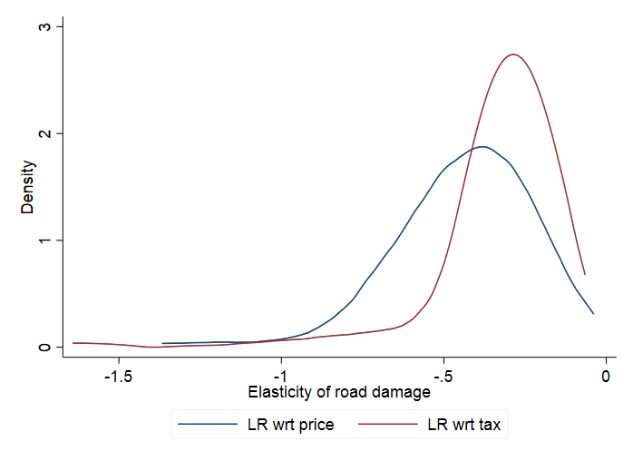{#fig-speroaddam}

@tbl-speroaddamela summarizes the key characteristics of the distributions shown
in @fig-speroaddam.


| **Road damage**         | **Long-run**  |             |
| ----------------------- | ------------- | ----------- |
|                         | **wrt price** | **wrt tax** |
| **Default elasticity**  | \-0.269       | \-0.497     |
| **Mean**                | \-0.440       | \-0.335     |
| **Median**              | \-0.415       | \-0.284     |
| **5th percentile**      | \-0.768       | \-0.699     |
| **95th percentile**     | \-0.187       | \-0.173     |
| **Number of estimates** | 170           | 178         |

: Country-specific road damage elasticities, numerical overview {#tbl-speroaddamela}

#### Vehicle-km travelled (VKT)

We analyze the effect of fuel prices on VKT in order to illustrate one
of the main channels through which fuel prices affect congestion,
accidents and road damage. We do not consider VKT a policy outcome per
se and the effect of fuel prices on the other outcomes is calculated
directly (not via the VKT elasticities).

##### Short-run elasticity

The estimated short-run elasticities of VKT wrt fuel price are shown
@tbl-regsrvkt. The short-run elasticity is estimated at -0.395, which is
similar to the more elastic estimates in the literature (@tbl-litrev).

| **VKT**                                                                                                                                                                                                                                                                                                                                                                                                                                                   | **(1)**        | **(2)**              | **(3)**     | **(4)**          | **(5)**          | **(6)**       |
| --------------------------------------------------------------------------------------------------------------------------------------------------------------------------------------------------------------------------------------------------------------------------------------------------------------------------------------------------------------------------------------------------------------------------------------------------------- | -------------- | -------------------- | ----------- | ---------------- | ---------------- | ------------- |
|                                                                                                                                                                                                                                                                                                                                                                                                                                                           | **pooled OLS** | **within estimator** |             |                  |                  |               |
| **Ln of gasoline pump price (2018 PPP-adj USD cents/liter)**                                                                                                                                                                                                                                                                                                                                                                                              | **-0.203\*\*** | **-0.0940**          | \-0.0595    | **-0.237\*\*\*** | **-0.395\*\*\*** | \-0.470\*\*\* |
|                                                                                                                                                                                                                                                                                                                                                                                                                                                           | **(0.0276)**   | **(0.403)**          | (0.787)     | **(9.23e-07)**   | **(9.98e-08)**   | (1.15e-05)    |
| Interaction lnsuper w/ Ln of number of vehicles per capita                                                                                                                                                                                                                                                                                                                                                                                                |                |                      | 0.631\*\*\* |                  |                  | \-0.569\*\*\* |
|                                                                                                                                                                                                                                                                                                                                                                                                                                                           |                |                      | (0.00195)   |                  |                  | (8.36e-07)    |
| Interaction lnsuper w/ Ln of population                                                                                                                                                                                                                                                                                                                                                                                                                   |                |                      | 0.0230      |                  |                  | \-0.0117      |
|                                                                                                                                                                                                                                                                                                                                                                                                                                                           |                |                      | (0.905)     |                  |                  | (0.904)       |
| Interaction lnsuper w/ Infant mortality rate (per 1,000 live births                                                                                                                                                                                                                                                                                                                                                                                       |                |                      | 0.509\*\*   |                  |                  | \-0.676\*\*\* |
|                                                                                                                                                                                                                                                                                                                                                                                                                                                           |                |                      | (0.0117)    |                  |                  | (5.36e-08)    |
| Interaction lnsuper w/ Number of motorcycles per capita                                                                                                                                                                                                                                                                                                                                                                                                   |                |                      | 0.194       |                  |                  | 0.231\*\*\*   |
|                                                                                                                                                                                                                                                                                                                                                                                                                                                           |                |                      | (0.205)     |                  |                  | (0.00485)     |
| Interaction lnsuper w/ Maximum speed on urban roads (in km/h)                                                                                                                                                                                                                                                                                                                                                                                             |                |                      | 0.199       |                  |                  | \-0.127\*     |
|                                                                                                                                                                                                                                                                                                                                                                                                                                                           |                |                      | (0.136)     |                  |                  | (0.0790)      |
| Covariates                                                                                                                                                                                                                                                                                                                                                                                                                                                | No             | Yes                  | Yes         | No               | Yes              | Yes           |
| Fixed effects                                                                                                                                                                                                                                                                                                                                                                                                                                             | No             | No                   | No          | Yes              | Yes              | Yes           |
| Interaction terms                                                                                                                                                                                                                                                                                                                                                                                                                                         | No             | No                   | Yes         | No               | No               | Yes           |
| Number of country\_iso3\_num                                                                                                                                                                                                                                                                                                                                                                                                                              |                |                      |             | 118              | 106              | 106           |
| Robust pval in parentheses                                                                                                                                                                                                                                                                                                                                                                                                                                | 0              | 0                    | 0           | 0                | 0                | 0             |
| Number of country FE                                                                                                                                                                                                                                                                                                                                                                                                                                      | 0              | 0                    | 0           | 0                | 0                | 0             |
| 

: Regression results short-run VKT {#tbl-regsrvkt}

*Robust p-values in parentheses,* \*\*\* p\<0.01, \*\* p\<0.05, \* p\<0.1. *Ln(gasoline) is the natural logarithm of the gasoline pump price (2018 PPP\_adjusted USD cents/liter). The parameter marked in green is the default short-run elasticity in CPAT for countries that have not sufficient data for country-specific elasticity estimation. Sample averages are subtracted from the interaction variables prior to interacting with the fuel price.*

##### Long-run elasticity

The long-run estimate for the VKT elasticity is shown in @tbl-reglrvkt.
With an estimate of 0.228, our result is at the more inelastic side of
estimates in the literature (@tbl-litrev).

| **VKT**                                                                                                                                                                                                                                                                                                                                                                                                                                                  | **(1)**               | **(2)**     | **(3)** |
| -------------------------------------------------------------------------------------------------------------------------------------------------------------------------------------------------------------------------------------------------------------------------------------------------------------------------------------------------------------------------------------------------------------------------------------------------------- | --------------------- | ----------- | ------- |
|                                                                                                                                                                                                                                                                                                                                                                                                                                                          | **between estimator** |             |         |
| **Ln of gasoline pump price (2018 PPP-adj USD cents/liter)**                                                                                                                                                                                                                                                                                                                                                                                             | **-0.493**            | **-0.228**  | 0.694   |
|                                                                                                                                                                                                                                                                                                                                                                                                                                                          | **(0.242)**           | **(0.652)** | (0.503) |
| Interaction lnsuper w/ Number of motorcycles per capita                                                                                                                                                                                                                                                                                                                                                                                                  |                       |             | 0.131   |
|                                                                                                                                                                                                                                                                                                                                                                                                                                                          |                       |             | (0.824) |
| Interaction lnsuper w/ Population density (people per sq. km of land area)                                                                                                                                                                                                                                                                                                                                                                               |                       |             | 5.058   |
|                                                                                                                                                                                                                                                                                                                                                                                                                                                          |                       |             | (0.333) |
| Interaction lnsuper w/ Rule of law (from -2.5=low to 2.5=high)                                                                                                                                                                                                                                                                                                                                                                                           |                       |             | 0.222   |
|                                                                                                                                                                                                                                                                                                                                                                                                                                                          |                       |             | (0.646) |
| Interaction lnsuper w/ Total length of road network (in km)                                                                                                                                                                                                                                                                                                                                                                                              |                       |             | 0.197   |
|                                                                                                                                                                                                                                                                                                                                                                                                                                                          |                       |             | (0.436) |
| Interaction lnsuper w/ Maximum speed on rural roads (in km/h)                                                                                                                                                                                                                                                                                                                                                                                            |                       |             | 0.0638  |
|                                                                                                                                                                                                                                                                                                                                                                                                                                                          |                       |             | (0.895) |
| Covariates                                                                                                                                                                                                                                                                                                                                                                                                                                               | No                    | Yes         | Yes     |
| Interaction terms                                                                                                                                                                                                                                                                                                                                                                                                                                        | No                    | No          | Yes     |
| Number of country\_iso3\_num                                                                                                                                                                                                                                                                                                                                                                                                                             | 118                   | 106         | 106     |
| Robust pval in parentheses                                                                                                                                                                                                                                                                                                                                                                                                                               | 0                     | 0           | 0       |
| Number of country FE                                                                                                                                                                                                                                                                                                                                                                                                                                     | 0                     | 0           | 0       |
| 

: Regression results long-run VKT {#tbl-reglrvkt}

*Robust p-values in parentheses,* \*\*\* p\<0.01, \*\* p\<0.05, \* p\<0.1. *Ln(gasoline) is the natural logarithm of the gasoline pump price (2018 PPP\_adjusted USD cents/liter). The parameter marked in green is the default long-run elasticity in CPAT for countries that have not sufficient data for country-specific elasticity estimation. Sample averages are subtracted from the interaction variables prior to interacting with the fuel price.*


##### Country-specific elasticities

Similar to the other variables, @tbl-varspevkt shows the variables selected
by the algorithm for estimating the country-specific elasticities. We
see that the road network (total length of the network, road density),
the fleet (motorcycles, number of vehicles) and more general country
characteristics (population size and density, infant mortality rate,
GDP) enter into the calculation.

| **Short run**                                                                                                                                                       | **Long run**                                        |                                                     |                                        |
| ------------------------------------------------------------------------------------------------------------------------------------------------------------------- | --------------------------------------------------- | --------------------------------------------------- | -------------------------------------- |
| **wrt price**                                                                                                                                                       | **wrt tax**                                         | **wrt price**                                       | **wrt tax**                            |
| Ln of number of vehicles per capita                                                                                                                                 | Number of vehicles per capita                       | Total length of road network (in km)                | Total length of road network (in km)   |
| Number of motorcycles per capita                                                                                                                                    | Number of motorcycles per capita                    | Maximum speed on rural roads (in km/h)              | Maximum speed on rural roads (in km/h) |
| Ln of population                                                                                                                                                    | Population density (people per sq. km of land area) | Number of motorcycles per capita                    | Number of motorcycles per capita       |
| Infant mortality rate (per 1,000 live births)                                                                                                                       | Road density (in km per km2)                        | Rule of law (from -2.5=low to 2.5=high)             | GDP per capita (in 2018 PPP-adj USD)   |
| Maximum speed on urban roads (in km/h)                                                                                                                              | Precipitation (in mm)                               | Population density (people per sq. km of land area) | Road density (in km per km2)           |
|

: Variables selected for country-specific VKT elasticity estimation {#tbl-varspevkt}

*Notes: The covariates used for estimating the country-specific elasticities are chosen by a data-driven machine learning algorithm among a list of 30 candidate variables.*

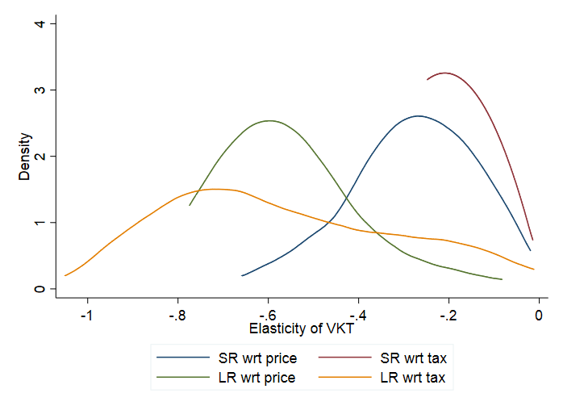{#fig-spevkt}

The distribution of the resulting country-specific elasticity estimates
is described in @fig-spevkt and @tbl-spevktelanum. In the majority of countries,
VKT is more elastic in the long-run than in the short-run.

| **VKT**                 | **Short-run** | **Long-run** |               |             |
| ----------------------- | ------------- | ------------ | ------------- | ----------- |
|                         | **wrt price** | **wrt tax**  | **wrt price** | **wrt tax** |
| **Default elasticity**  | \-0.395       | \-0.218      | \-0.228       | \-0.225     |
| **Mean**                | \-0.282       | \-0.209      | \-0.561       | \-0.566     |
| **Median**              | \-0.241       | \-0.220      | \-0.591       | \-0.620     |
| **5th percentile**      | \-0.512       | \-0.245      | \-0.724       | \-0.891     |
| **95th percentile**     | \-0.138       | \-0.128      | \-0.245       | \-0.126     |
| **Number of estimates** | 163           | 167          | 158           | 141         |

: Country-specific VKT elasticities, numerical overview {#tbl-spevktelanum}

### Excel implementation: CPAT’s Road Transport Module

#### General

The Road Transport Module takes as an input the road fuel price changes
induced by the policy indicated by the user in the dashboard. The module
then computes changes in VKT, congestion, accidents and road damage and
presents them graphically in the dashboard tab. The information flow is
schematized in @fig-mitmodule. Although the effect on VKT is computed, the
other outcomes are modeled directly as a function of price, in order to
avoid having to take functional form assumptions on the influence of VKT
and its interaction with the other channels.

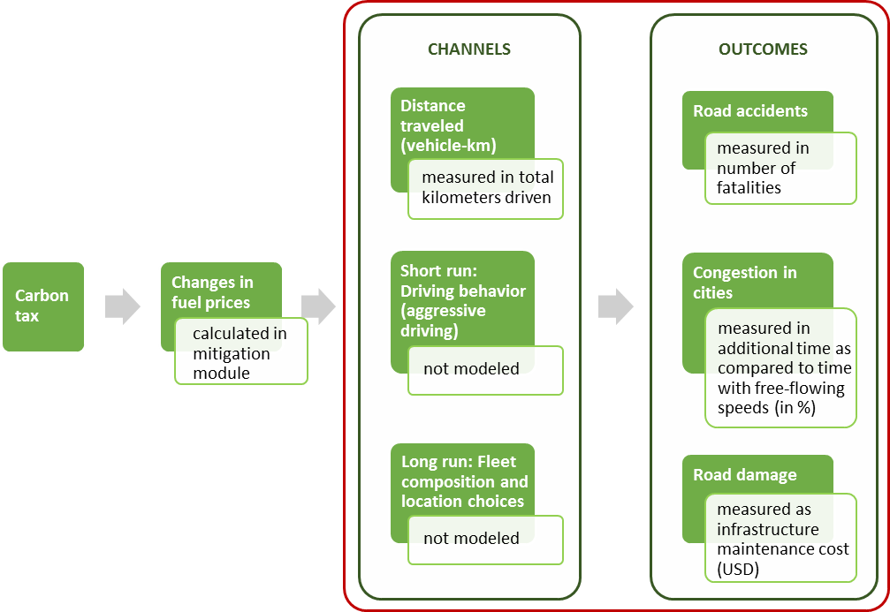{#fig-mitmodule}

*Note: Channels are shown to illustrate the economic theory; they are not modeled/estimated separately within CPAT. The estimated elasticities result of the interaction of all channels in the data.*

#### Baseline forecasts

In order to graphically represent changes induced by the policy compared
to a baseline, we must first establish a baseline forecast. The
methodology in CPAT is identical for all three outcomes and VKT. It
follows the following structure:

  - Establish a linear forecast based on the average growth rate of
    available (often incomplete) time series of the variable in the
    past;
    
      - The sheet “Tran\_Data” contains recent values of the outcome
        variables as well as the geometric average of growth rates over
        the past years.

  - Adjust the variable’s linear forecast:
    
      - for (forecasted) future deviations from (observed) average past
        GDP growth using the estimated elasticity of the outcome wrt
        GDP,
    
      - for (forecasted) future deviations from (observed) average past
        population growth using the estimated elasticity of the outcome
        wrt population.

$$Y_{t}^{\text{baseline}} = \left( 1 + g_{t}^{\text{GDP}} - \overline{g^{\text{GDP}}} \right)^{\eta_{\text{GDP}}}\left( 1 + g_{t}^{\text{pop}} - \overline{g^{\text{pop}}} \right)^{\eta_{\text{pop}}}Y_{t}^{\text{simple}}$$ {#eq-basefor}

where:

  - $Y_{t}^{\text{baseline}}$ is the baseline (without policy)
    forecast of variable $Y$,

  - $Y_{t}^{\text{simple}}$ is the “naïve” linear forecast based only
    on past observed values of $Y$,

  - $g_{t}^{\text{GDP}} = \frac{\text{GDP}_{t}}{\text{GDP}_{t - 1}} - 1$ is the GDP growth rate,
    from the contemporary and previous GDP (GDP growth forecast for coming years from IMF
    World Economic Outlook),

  - $\overline{g^{\text{GDP}}}$ is the expected GDP growth rate (geometric
    average growth rate over past years, a net rate like $g_{t}^{\text{GDP}}$),

  - $\eta_{\text{GDP}}$ is the elasticity of the outcome wrt GDP,

  - $g_{t}^{\text{pop}} = \frac{\text{pop}_{t}}{\text{pop}_{t - 1}} - 1$ is the population growth rate,
    from the contemporary and previous population sizes (WB Population Estimates and
    Projections),

  - $\overline{g^{\text{pop}}}$ is the expected population growth rate
    (geometric average growth rate over past years, a net rate like $g_{t}^{\text{pop}}$),

  - and $\eta_{\text{pop}}$ is the elasticity of the outcome wrt
    population size.

We need to subtract expected GDP/population growth from the actual
(forecasted) GDP/population growth, as the past growth rates are
implicitly included in the linear forecast $Y_{t}^{\text{simple}}$.

Adjusting for GDP growth in this way should allow us to account for
booms and recessions, as for example the graphically impressive drop
caused by Covid-19.

#### Policy forecast

The impact of the carbon policy depends on the change in fuel prices and
the variable’s elasticity wrt fuel prices/taxes.

The fuel price is computed as follows:

  - the baseline road fuel price is computed as the weighted average of
    baseline gasoline and diesel price, where the weights equal the
    respective fuel’s share of baseline total road fuel consumption;

  - the policy road fuel price is computed as the weighted average of
    policy gasoline and diesel price, where the weights equal the
    respective fuel’s share of policy total road fuel consumption;

  - the price change is defined as the ratio of the policy road fuel
    price over the baseline road fuel price.

We obtain the policy forecast $Y_{t}^{\text{policy}}$ by weighting the
price change by the elasticity wrt fuel price $\eta_{p}$.

$$Y_{t}^{\text{policy}} = \left( \frac{p^{\text{policy}}}{p^{\text{baseline}}} \right)^{\eta_{p}}Y_{t}^{\text{baseline}}$$ {#eq-policy}

where $p^{\text{baseline}}$ is the baseline road fuel price and
$p^{\text{policy}}$ is the policy road fuel price.

#### Dashboard graphics

For VKT and the three outcomes of interest, we establish similar
graphics in the CPAT dashboard.

For each variable, there is a line graph representing the time series of
the baseline forecast $Y_{t}^{\text{baseline}}$ and the policy
forecast $Y_{t}^{\text{policy}}$. An example is given in Figure @fig-urbcongmex.

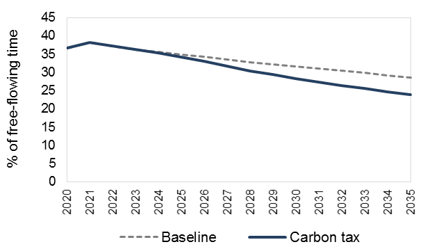{#fig-urbcongmex}

Source: Tomtom, own computations.

We then plot a bar chart of the difference between the two lines of
Figure @fig-urbcongmex, representing only the change induced by the policy. An
example is given in @fig-avdeathind.

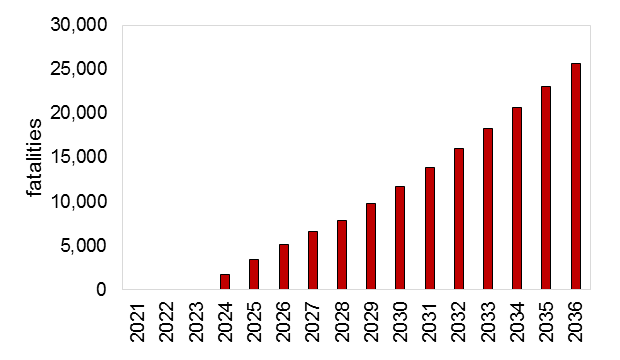{#fig-avdeathind}

Source: WRS, OECD, UNECE, own computations.

Finally, we provide some general evidence of the effect of fuel prices
on accident and congestion with a scatter graph. For this scatter graph,
we combine cross-sectional country-level information for a given year
with year-level information of all available years for the country for
which the policy introduction is studied. We also add a linear
trendline, which captures the negative correlation between fuel prices
and our outcomes. An example is given in @fig-histdeu.

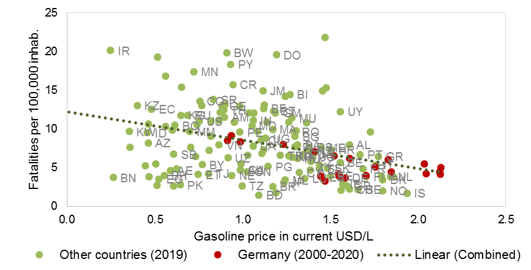{#fig-histdeu}

Source: WRS, Enerdata, EIU, IEA, own computations.

#### Externality cost per liter of motor fuel {#sec-extcost}

This section explains how CPAT computes the externality cost (per liter
of motor fuel) from accidents and congestion. The externality costs are
computed as the co-benefits from a carbon tax-induced reduction in motor
fuel consumption.

The main road transport co-benefits of a carbon tax are a reduction in
road accidents (from a reduction in driving, changes in the vehicle
fleet, less aggressive driving, etc.) and a reduction in congestion
(from a reduction in driving, an increase in car sharing, changes in the
vehicle fleet, changes in transport timing decisions, etc.).

Within CPAT, the magnitude of these co-benefits is computed using
empirical elasticities from a large historical dataset using econometric
panel methods. Given the multitude of channels involved in the final
result, the effect on accidents/congestion is not directly proportional
to the change in vehicle-kilometers traveled (VKT) or the change in fuel
consumption. For more details on the data and estimation procedure,
please refer to the Technical Appendix to the CPAT Road Transport
Module.

The externality cost is computed as follows:

  - Compute baseline forecast of accidents/congestion ***without policy;***
    
      - Baseline forecasts take into account historical growth rates,
        adjusted for forecasted GDP and population growth.

  - Compute policy forecast of accidents/congestion ***with carbon tax*** of users choice;
    
      - Policy forecasts are the baseline forecast adjusted for the fuel
        price change using the country-specific elasticity; this
        country-specific elasticity is empirically estimated and
        measures overall (i.e. across channels) which fuel prices affect
        accidents/congestion.

  - Compute for policy and baseline scenarios the ***monetary*** value
    of accidents (multiplying fatalities by value of statistical life)
    and congestion (multiplying time lost in traffic times value of
    travel time);

  - Compute the ***change*** in value of accidents/congestion;

  - ***Divide*** change in value by change in motor fuel consumption
    from CPAT Mitigation Module.

The externality cost estimate <span class="underline">varies each
year</span>. For simplicity, only one year is shown as an example in the
CPAT Dashboard. As an example @fig-extcostcol shows the graph for Colombia.

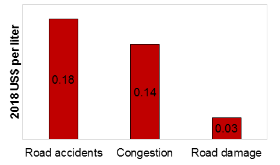{#fig-extcostcol}

Source: Tomtom, WRS, UNECE, OECD, IMF, own computations.

*Note that the TomTom Traffic Index is defined on the city-level. Therefore, <span class="underline">the congestion externality shown in CPAT applies only the urban part of transport</span>. To our knowledge, there is no database measuring congestion levels on the national level. Rural transport is assumed to be free of congestion, i.e. causing zero congestion externality cost.*

### Caveats

The CPAT Road Transport Module choses a reduced-form econometric
approach to predict the impact of carbon taxes on road transport
externalities. Certain caveats must be kept in mind:

  - The quality of the estimates relies on the quality of available
    data. For certain countries/years, there is no sufficient data to
    estimate country-specific transport externality elasticities. In
    these cases, an internationally estimated default value was used. In
    the Road Transport Module (Transport tab, section B – elasticities),
    the user can see whether country-specific or default elasticities
    have been used.

  - Reduced-form approaches do not explicitly model the mechanisms. A
    carbon tax impacts transport demand through various channels: more
    fuel-efficient use of existing vehicles (e.g. speed, carpooling),
    switch to less carbon-intensive means of transport (e.g. public
    transport, non-motorized), reduction in the number/length of trips.
    The CPAT Road Transport Module cannot disentangle these channels,
    and can thus not attribute changes in outcomes to individual
    channels. In particular, carbon taxes make the use of private
    vehicles more expensive and CPAT cannot measure the loss from the
    value of non-realized trips.

  - General equilibrium effects are not included, such as changes in
    prices or availability of the outside options. One example
    frequently discussed are electric vehicles (EVs). Currently, CPAT
    Road Transport Module does not include EVs. However, an extension of
    the CPAT Road Transport Module is planned in order to include EVs.

  - Elasticities, such as estimated with the CPAT Road Transport
    Module’s methodology, predict the reaction of outcomes to *small*
    changes in carbon taxes. CPAT Road Transport module does not account
    for potentially non-linear responses to large policy changes. In
    particular, large policy changes across the world may induce
    technology changes and relevant changes in the vehicle fleet.

  - A uniform carbon tax would impact not only private vehicles but also
    lower-emitting transport modes such as buses. An increase in the
    price of public transit could have a negative impact on people’s
    ability to reach jobs and essential services thereby contributing to
    fragmented labor markets and loss of welfare. Since low-income
    households are more likely to reduce their number of trips (instead
    of switching means of transport), a carbon tax could reduce their
    access to economic opportunities and thereby impact inequality.
    While it is not within the scope of CPAT1.0, understanding the
    potential impact of carbon pricing on access to employment is
    important to inform the development of more targeted policies that
    can offset any such negative distributional effects of a carbon tax
    on transit accessibility.

### Status of upgrades since the last review, changes not implemented and remaining issues

We constantly update the dataset used to estimate the parameters behind
the CPAT Road Transport Module. So far, CPAT reflects the last complete
update using the WRS 2020 edition. A further update using the WRS 2021
edition is in progress.

As we are using proprietary data, we had to transform all non-shareable
(proprietary) data into a shareable form. For the Road Transport Module,
this was mainly achieved by using (near-future) forecast based on
historic data forecasts, instead of the historic data itself.

We have further added estimates of the externality cost per liter of
motor fuel, described in @sec-extcost.

We are still working on two features not yet implemented:

  - *Integration of electric vehicles (EVs)*: The introduction of EVs
    and their necessary charging infrastructure is relatively slow,
    especially in developing countries. So far, we have struggled to get
    sufficient data for credible estimations. Nevertheless, we are aware
    that EVs may fundamentally change the link between traffic
    (including accidents and congestion) and carbon taxes. We are thus
    working on a methodology to include EVs and EV-supporting policies
    into CPAT.

  - *Between-module consistency*: Currently, the VKT estimates in the
    CPAT Road Transport Module are not linked to the transport
    CO<sub>2</sub> in the Mitigation Module. In fact, VKT and
    CO<sub>2</sub> may follow distinct paths as technology and driving
    habits (e.g. number of people in a vehicle) change. Nevertheless,
    future versions of CPAT will improve the coordination between
    modules.

### Appendices

#### Detailed variable list with data sources {#sec-appvar}

| **Definition**                                    | **Source**                                                                                                                                                                                           | **Inter-polated**       |   |
| ------------------------------------------------- | ---------------------------------------------------------------------------------------------------------------------------------------------------------------------------------------------------- | ----------------------- | - |
| **Outcomes**                                      |                                                                                                                                                                                                      |                         |   |
|                                                   | Total road distance travelled (in million vehicle-km)                                                                                                                                                | WRS, OECD[^7_14]         |   |
|                                                   | Number of fatalities by road accident: Any person killed immediately or dying within 30 days as a result of an accident (accident involving at least one road vehicle in motion), excluding suicides | WRS, UNECE, OECD        |   |
|                                                   | Congestion index (in % deviation from free-flowing speed)                                                                                                                                            | TomTom                  |   |
|                                                   | Road maintenance cost (in million 2010 USD)                                                                                                                                                          | WRS                     |   |
| **Covariates**                                    |                                                                                                                                                                                                      |                         |   |
|                                                   | Year                                                                                                                                                                                                 |                         |   |
|                                                   | Retail price per liter of motor gasoline (unleaded Octan 95) at the pump (in 2010 USD cent/liter)                                                                                                    | IMF, Enerdata, IEA, GIZ |   |
|                                                   | Retail price per liter of motor diesel at the pump (in 2010 USD cent/liter)                                                                                                                          | IMF, Enerdata, IEA, GIZ |   |
|                                                   | Population                                                                                                                                                                                           | WDI                     | X |
|                                                   | GDP per capita (in 2010 USD)                                                                                                                                                                         | WDI                     |   |
|                                                   | Youth share (population 15 to 24 years-old in % of total)                                                                                                                                            | WDI                     |   |
|                                                   | Alcohol, recorded per capita (15+) consumption (in liters of pure alcohol)                                                                                                                           | WHO/GHO                 |   |
|                                                   | Maximum speed in rural areas[^7_15] (in km/h)                                                                                                                                                         | WHO/GHO                 | X |
|                                                   | Maximum speed in urban areas (in km/h)                                                                                                                                                               | WHO/GHO                 | X |
|                                                   | Control of corruption (from -2.5=low to 2.5=high)                                                                                                                                                    | WGI                     |   |
|                                                   | Road density (km of road per km<sup>2</sup> of country area)                                                                                                                                         | WRS                     |   |
|                                                   | Share of motorcycles (in % of total vehicle fleet)                                                                                                                                                   | WRS                     | X |
|                                                   | Vehicles per capita                                                                                                                                                                                  | WRS                     | X |
| **Additional candidate variables for elasticity** |                                                                                                                                                                                                      |                         |   |
|                                                   | Yearly in rainfall (in total mm)                                                                                                                                                                     | CCKP                    |   |
|                                                   | Annual number of days with minimum temperature ≤ 0°F/-17.8°C                                                                                                                                         | NCEI                    |   |
|                                                   | Annual number of days with minimum temperature ≤ 32°F/0°C                                                                                                                                            | NCEI                    |   |
|                                                   | Annual number of days with minimum temperature ≥ 90°F/32.2°C                                                                                                                                         | NCEI                    |   |
|                                                   | Extreme minimum temperature for the year (in °C)                                                                                                                                                     | NCEI                    |   |
|                                                   | Satisfaction with public transport (in %)                                                                                                                                                            | SDR                     |   |
|                                                   | GDP (in 2010 USD)                                                                                                                                                                                    | WDI                     |   |
|                                                   | Infant mortality rate (per 1,000 live births)                                                                                                                                                        | WDI                     |   |
|                                                   | Population density (in persons/km<sup>2</sup>)                                                                                                                                                       | WDI                     | X |
|                                                   | Share of urban population (in % of total population)                                                                                                                                                 | WDI                     | X |
|                                                   | Rule of law (from -2.5=low to 2.5=high)                                                                                                                                                              | WGI                     |   |
|                                                   | Blood alcohol concentration (BAC) legal driving limit (in g/dl)                                                                                                                                      | WHO/GHO                 | X |
|                                                   | Maximum speed (average of urban and rural, in km/h)                                                                                                                                                  | WHO/GHO                 | X |
|                                                   | Seat belt wearing rate in front seat (in %)                                                                                                                                                          | WHO/GHO                 | X |
|                                                   | Motorcycles per capita                                                                                                                                                                               | WRS                     | X |
|                                                   | Number of lorries and trucks                                                                                                                                                                         | WRS                     | X |
|                                                   | Share of lorries and trucks (in % of total vehicle fleet)                                                                                                                                            | WRS                     | X |
|                                                   | Share of paved roads (in % of total road km)                                                                                                                                                         | WRS                     | X |
|                                                   | Total length of road network (in km)                                                                                                                                                                 | WRS                     | X |

#### Countries/years covered by the dataset

| no outcomes                      | None of the outcomes                          |
| -------------------------------- | --------------------------------------------- |
| some outcomes and covars         | Some outcomes and covariates                  |
| all outcomes, but not all covars | All outcome variables, but not all covariates |
| all                              | All outcomes and all covariates               |

|                                | 1995                     | 1996                     | 1997                     | 1998                     | 1999                     | 2000                     | 2001                     | 2002                     | 2003                     | 2004                     | 2005                     | 2006                     | 2007                     | 2008                             | 2009                             | 2010                             | 2011                             | 2012                     | 2013                             | 2014                             | 2015                             | 2016                             | 2017                             | 2018                             | 2019                             | 2020                             | 2021                     |
| ------------------------------ | ------------------------ | ------------------------ | ------------------------ | ------------------------ | ------------------------ | ------------------------ | ------------------------ | ------------------------ | ------------------------ | ------------------------ | ------------------------ | ------------------------ | ------------------------ | -------------------------------- | -------------------------------- | -------------------------------- | -------------------------------- | ------------------------ | -------------------------------- | -------------------------------- | -------------------------------- | -------------------------------- | -------------------------------- | -------------------------------- | -------------------------------- | -------------------------------- | ------------------------ |
| Afghanistan                    | no outcomes              | no outcomes              | no outcomes              | no outcomes              | no outcomes              | some outcomes and covars | some outcomes and covars | some outcomes and covars | some outcomes and covars | some outcomes and covars | some outcomes and covars | some outcomes and covars | some outcomes and covars | some outcomes and covars         | some outcomes and covars         | some outcomes and covars         | some outcomes and covars         | some outcomes and covars | some outcomes and covars         | some outcomes and covars         | some outcomes and covars         | some outcomes and covars         | some outcomes and covars         | some outcomes and covars         | some outcomes and covars         | no outcomes                      | no outcomes              |
| Albania                        | some outcomes and covars | some outcomes and covars | some outcomes and covars | some outcomes and covars | some outcomes and covars | some outcomes and covars | some outcomes and covars | some outcomes and covars | some outcomes and covars | some outcomes and covars | some outcomes and covars | some outcomes and covars | some outcomes and covars | some outcomes and covars         | some outcomes and covars         | some outcomes and covars         | some outcomes and covars         | some outcomes and covars | some outcomes and covars         | some outcomes and covars         | some outcomes and covars         | some outcomes and covars         | some outcomes and covars         | some outcomes and covars         | some outcomes and covars         | some outcomes and covars         | no outcomes              |
| Algeria                        | no outcomes              | some outcomes and covars | no outcomes              | no outcomes              | no outcomes              | no outcomes              | no outcomes              | no outcomes              | some outcomes and covars | no outcomes              | some outcomes and covars | some outcomes and covars | some outcomes and covars | some outcomes and covars         | some outcomes and covars         | some outcomes and covars         | some outcomes and covars         | some outcomes and covars | some outcomes and covars         | some outcomes and covars         | some outcomes and covars         | some outcomes and covars         | some outcomes and covars         | no outcomes                      | some outcomes and covars         | no outcomes                      | no outcomes              |
| American Samoa                 | no outcomes              | no outcomes              | no outcomes              | no outcomes              | no outcomes              | no outcomes              | no outcomes              | no outcomes              | no outcomes              | no outcomes              | no outcomes              | no outcomes              | no outcomes              | no outcomes                      | no outcomes                      | no outcomes                      | no outcomes                      | no outcomes              | no outcomes                      | no outcomes                      | no outcomes                      | no outcomes                      | no outcomes                      | no outcomes                      | no outcomes                      | no outcomes                      | no outcomes              |
| Andorra                        | no outcomes              | no outcomes              | no outcomes              | no outcomes              | no outcomes              | no outcomes              | no outcomes              | no outcomes              | no outcomes              | no outcomes              | no outcomes              | no outcomes              | no outcomes              | no outcomes                      | no outcomes                      | no outcomes                      | no outcomes                      | no outcomes              | no outcomes                      | no outcomes                      | no outcomes                      | no outcomes                      | no outcomes                      | no outcomes                      | no outcomes                      | no outcomes                      | no outcomes              |
| Angola                         | some outcomes and covars | no outcomes              | no outcomes              | no outcomes              | no outcomes              | some outcomes and covars | some outcomes and covars | some outcomes and covars | some outcomes and covars | some outcomes and covars | some outcomes and covars | some outcomes and covars | some outcomes and covars | some outcomes and covars         | some outcomes and covars         | some outcomes and covars         | some outcomes and covars         | some outcomes and covars | some outcomes and covars         | some outcomes and covars         | some outcomes and covars         | some outcomes and covars         | some outcomes and covars         | some outcomes and covars         | some outcomes and covars         | no outcomes                      | no outcomes              |
| Anguilla                       | no outcomes              | no outcomes              | no outcomes              | no outcomes              | no outcomes              | no outcomes              | no outcomes              | no outcomes              | no outcomes              | no outcomes              | no outcomes              | no outcomes              | no outcomes              | no outcomes                      | no outcomes                      | no outcomes                      | no outcomes                      | no outcomes              | no outcomes                      | no outcomes                      | no outcomes                      | no outcomes                      | no outcomes                      | no outcomes                      | no outcomes                      | no outcomes                      | no outcomes              |
| Antigua and Barbuda            | no outcomes              | no outcomes              | no outcomes              | no outcomes              | no outcomes              | no outcomes              | no outcomes              | no outcomes              | no outcomes              | no outcomes              | no outcomes              | no outcomes              | no outcomes              | no outcomes                      | no outcomes                      | no outcomes                      | no outcomes                      | no outcomes              | no outcomes                      | no outcomes                      | no outcomes                      | no outcomes                      | no outcomes                      | no outcomes                      | no outcomes                      | no outcomes                      | no outcomes              |
| Argentina                      | some outcomes and covars | some outcomes and covars | some outcomes and covars | some outcomes and covars | some outcomes and covars | some outcomes and covars | some outcomes and covars | some outcomes and covars | some outcomes and covars | some outcomes and covars | some outcomes and covars | some outcomes and covars | some outcomes and covars | some outcomes and covars         | some outcomes and covars         | some outcomes and covars         | some outcomes and covars         | some outcomes and covars | some outcomes and covars         | some outcomes and covars         | all outcomes, but not all covars | all outcomes, but not all covars | some outcomes and covars         | some outcomes and covars         | some outcomes and covars         | some outcomes and covars         | some outcomes and covars |
| Armenia                        | some outcomes and covars | some outcomes and covars | some outcomes and covars | some outcomes and covars | some outcomes and covars | some outcomes and covars | some outcomes and covars | some outcomes and covars | some outcomes and covars | some outcomes and covars | some outcomes and covars | some outcomes and covars | some outcomes and covars | some outcomes and covars         | some outcomes and covars         | some outcomes and covars         | some outcomes and covars         | some outcomes and covars | some outcomes and covars         | some outcomes and covars         | some outcomes and covars         | some outcomes and covars         | some outcomes and covars         | some outcomes and covars         | some outcomes and covars         | some outcomes and covars         | no outcomes              |
| Aruba                          | no outcomes              | no outcomes              | no outcomes              | no outcomes              | no outcomes              | no outcomes              | no outcomes              | no outcomes              | no outcomes              | no outcomes              | no outcomes              | no outcomes              | no outcomes              | no outcomes                      | no outcomes                      | no outcomes                      | no outcomes                      | no outcomes              | no outcomes                      | no outcomes                      | no outcomes                      | no outcomes                      | no outcomes                      | no outcomes                      | no outcomes                      | no outcomes                      | no outcomes              |
| Australia                      | some outcomes and covars | some outcomes and covars | some outcomes and covars | some outcomes and covars | some outcomes and covars | some outcomes and covars | some outcomes and covars | some outcomes and covars | some outcomes and covars | some outcomes and covars | some outcomes and covars | some outcomes and covars | some outcomes and covars | some outcomes and covars         | some outcomes and covars         | some outcomes and covars         | some outcomes and covars         | some outcomes and covars | all                              | all                              | all                              | all                              | all                              | all outcomes, but not all covars | some outcomes and covars         | some outcomes and covars         | some outcomes and covars |
| Austria                        | some outcomes and covars | some outcomes and covars | some outcomes and covars | some outcomes and covars | some outcomes and covars | some outcomes and covars | some outcomes and covars | some outcomes and covars | some outcomes and covars | some outcomes and covars | some outcomes and covars | some outcomes and covars | some outcomes and covars | all                              | all                              | all                              | all                              | all                      | all                              | all                              | all                              | all                              | all                              | all outcomes, but not all covars | all outcomes, but not all covars | some outcomes and covars         | some outcomes and covars |
| Azerbaijan                     | some outcomes and covars | some outcomes and covars | some outcomes and covars | some outcomes and covars | some outcomes and covars | some outcomes and covars | some outcomes and covars | some outcomes and covars | some outcomes and covars | some outcomes and covars | some outcomes and covars | some outcomes and covars | some outcomes and covars | some outcomes and covars         | some outcomes and covars         | some outcomes and covars         | some outcomes and covars         | some outcomes and covars | some outcomes and covars         | some outcomes and covars         | some outcomes and covars         | some outcomes and covars         | some outcomes and covars         | some outcomes and covars         | some outcomes and covars         | some outcomes and covars         | no outcomes              |
| Bahamas                        | no outcomes              | no outcomes              | no outcomes              | no outcomes              | no outcomes              | no outcomes              | no outcomes              | no outcomes              | no outcomes              | no outcomes              | no outcomes              | no outcomes              | no outcomes              | no outcomes                      | no outcomes                      | no outcomes                      | no outcomes                      | no outcomes              | no outcomes                      | no outcomes                      | no outcomes                      | no outcomes                      | no outcomes                      | no outcomes                      | no outcomes                      | no outcomes                      | no outcomes              |
| Bahrain                        | some outcomes and covars | some outcomes and covars | some outcomes and covars | some outcomes and covars | some outcomes and covars | some outcomes and covars | some outcomes and covars | some outcomes and covars | some outcomes and covars | some outcomes and covars | some outcomes and covars | some outcomes and covars | some outcomes and covars | some outcomes and covars         | some outcomes and covars         | some outcomes and covars         | some outcomes and covars         | some outcomes and covars | some outcomes and covars         | some outcomes and covars         | some outcomes and covars         | some outcomes and covars         | some outcomes and covars         | some outcomes and covars         | some outcomes and covars         | no outcomes                      | no outcomes              |
| Bangladesh                     | some outcomes and covars | some outcomes and covars | some outcomes and covars | some outcomes and covars | some outcomes and covars | some outcomes and covars | no outcomes              | no outcomes              | some outcomes and covars | no outcomes              | no outcomes              | some outcomes and covars | no outcomes              | some outcomes and covars         | some outcomes and covars         | some outcomes and covars         | some outcomes and covars         | some outcomes and covars | some outcomes and covars         | some outcomes and covars         | some outcomes and covars         | some outcomes and covars         | some outcomes and covars         | some outcomes and covars         | some outcomes and covars         | no outcomes                      | no outcomes              |
| Barbados                       | some outcomes and covars | some outcomes and covars | some outcomes and covars | some outcomes and covars | some outcomes and covars | some outcomes and covars | some outcomes and covars | some outcomes and covars | some outcomes and covars | no outcomes              | no outcomes              | no outcomes              | some outcomes and covars | no outcomes                      | no outcomes                      | no outcomes                      | some outcomes and covars         | no outcomes              | some outcomes and covars         | no outcomes                      | no outcomes                      | no outcomes                      | no outcomes                      | some outcomes and covars         | some outcomes and covars         | no outcomes                      | no outcomes              |
| Belarus                        | some outcomes and covars | some outcomes and covars | some outcomes and covars | some outcomes and covars | some outcomes and covars | some outcomes and covars | some outcomes and covars | some outcomes and covars | some outcomes and covars | some outcomes and covars | some outcomes and covars | some outcomes and covars | some outcomes and covars | some outcomes and covars         | some outcomes and covars         | some outcomes and covars         | some outcomes and covars         | some outcomes and covars | some outcomes and covars         | some outcomes and covars         | some outcomes and covars         | some outcomes and covars         | some outcomes and covars         | some outcomes and covars         | some outcomes and covars         | some outcomes and covars         | no outcomes              |
| Belgium                        | some outcomes and covars | some outcomes and covars | some outcomes and covars | some outcomes and covars | some outcomes and covars | some outcomes and covars | some outcomes and covars | some outcomes and covars | some outcomes and covars | some outcomes and covars | some outcomes and covars | some outcomes and covars | some outcomes and covars | all                              | all outcomes, but not all covars | all                              | all                              | all                      | all                              | all                              | all                              | all outcomes, but not all covars | all outcomes, but not all covars | some outcomes and covars         | some outcomes and covars         | some outcomes and covars         | some outcomes and covars |
| Belize                         | no outcomes              | some outcomes and covars | some outcomes and covars | some outcomes and covars | no outcomes              | no outcomes              | no outcomes              | no outcomes              | no outcomes              | no outcomes              | no outcomes              | some outcomes and covars | some outcomes and covars | some outcomes and covars         | some outcomes and covars         | some outcomes and covars         | some outcomes and covars         | some outcomes and covars | some outcomes and covars         | some outcomes and covars         | no outcomes                      | no outcomes                      | no outcomes                      | some outcomes and covars         | some outcomes and covars         | no outcomes                      | no outcomes              |
| Benin                          | some outcomes and covars | some outcomes and covars | no outcomes              | no outcomes              | no outcomes              | no outcomes              | no outcomes              | no outcomes              | no outcomes              | some outcomes and covars | some outcomes and covars | some outcomes and covars | some outcomes and covars | some outcomes and covars         | some outcomes and covars         | no outcomes                      | some outcomes and covars         | some outcomes and covars | some outcomes and covars         | some outcomes and covars         | some outcomes and covars         | some outcomes and covars         | some outcomes and covars         | some outcomes and covars         | no outcomes                      | no outcomes                      | no outcomes              |
| Bermuda                        | no outcomes              | no outcomes              | no outcomes              | no outcomes              | no outcomes              | no outcomes              | no outcomes              | no outcomes              | no outcomes              | no outcomes              | no outcomes              | no outcomes              | no outcomes              | no outcomes                      | no outcomes                      | no outcomes                      | some outcomes and covars         | no outcomes              | no outcomes                      | no outcomes                      | some outcomes and covars         | some outcomes and covars         | some outcomes and covars         | no outcomes                      | no outcomes                      | no outcomes                      | no outcomes              |
| Bhutan                         | no outcomes              | no outcomes              | no outcomes              | some outcomes and covars | some outcomes and covars | no outcomes              | no outcomes              | no outcomes              | no outcomes              | no outcomes              | no outcomes              | no outcomes              | some outcomes and covars | some outcomes and covars         | some outcomes and covars         | some outcomes and covars         | some outcomes and covars         | some outcomes and covars | some outcomes and covars         | some outcomes and covars         | some outcomes and covars         | some outcomes and covars         | some outcomes and covars         | some outcomes and covars         | some outcomes and covars         | no outcomes                      | no outcomes              |
| Bolivia                        | some outcomes and covars | some outcomes and covars | no outcomes              | some outcomes and covars | some outcomes and covars | some outcomes and covars | some outcomes and covars | some outcomes and covars | some outcomes and covars | some outcomes and covars | some outcomes and covars | some outcomes and covars | some outcomes and covars | some outcomes and covars         | some outcomes and covars         | some outcomes and covars         | some outcomes and covars         | some outcomes and covars | some outcomes and covars         | some outcomes and covars         | some outcomes and covars         | some outcomes and covars         | some outcomes and covars         | some outcomes and covars         | some outcomes and covars         | no outcomes                      | no outcomes              |
| Bosnia and Herzegovina         | some outcomes and covars | some outcomes and covars | some outcomes and covars | some outcomes and covars | some outcomes and covars | some outcomes and covars | some outcomes and covars | some outcomes and covars | some outcomes and covars | some outcomes and covars | some outcomes and covars | some outcomes and covars | some outcomes and covars | some outcomes and covars         | some outcomes and covars         | some outcomes and covars         | some outcomes and covars         | some outcomes and covars | some outcomes and covars         | some outcomes and covars         | some outcomes and covars         | some outcomes and covars         | some outcomes and covars         | some outcomes and covars         | some outcomes and covars         | some outcomes and covars         | no outcomes              |
| Botswana                       | some outcomes and covars | some outcomes and covars | some outcomes and covars | some outcomes and covars | some outcomes and covars | some outcomes and covars | some outcomes and covars | some outcomes and covars | some outcomes and covars | some outcomes and covars | some outcomes and covars | some outcomes and covars | some outcomes and covars | some outcomes and covars         | some outcomes and covars         | some outcomes and covars         | some outcomes and covars         | some outcomes and covars | some outcomes and covars         | some outcomes and covars         | some outcomes and covars         | some outcomes and covars         | some outcomes and covars         | some outcomes and covars         | some outcomes and covars         | no outcomes                      | no outcomes              |
| Brazil                         | some outcomes and covars | some outcomes and covars | no outcomes              | some outcomes and covars | no outcomes              | no outcomes              | no outcomes              | no outcomes              | some outcomes and covars | some outcomes and covars | some outcomes and covars | some outcomes and covars | some outcomes and covars | some outcomes and covars         | some outcomes and covars         | some outcomes and covars         | some outcomes and covars         | some outcomes and covars | some outcomes and covars         | some outcomes and covars         | some outcomes and covars         | some outcomes and covars         | some outcomes and covars         | some outcomes and covars         | some outcomes and covars         | some outcomes and covars         | some outcomes and covars |
| British Virgin Islands         | no outcomes              | no outcomes              | no outcomes              | no outcomes              | no outcomes              | no outcomes              | no outcomes              | no outcomes              | no outcomes              | no outcomes              | no outcomes              | no outcomes              | no outcomes              | no outcomes                      | no outcomes                      | no outcomes                      | no outcomes                      | no outcomes              | no outcomes                      | no outcomes                      | no outcomes                      | no outcomes                      | no outcomes                      | no outcomes                      | no outcomes                      | no outcomes                      | no outcomes              |
| Brunei Darussalam              | some outcomes and covars | some outcomes and covars | some outcomes and covars | some outcomes and covars | some outcomes and covars | some outcomes and covars | some outcomes and covars | some outcomes and covars | some outcomes and covars | no outcomes              | some outcomes and covars | some outcomes and covars | some outcomes and covars | some outcomes and covars         | some outcomes and covars         | some outcomes and covars         | some outcomes and covars         | some outcomes and covars | some outcomes and covars         | some outcomes and covars         | some outcomes and covars         | some outcomes and covars         | some outcomes and covars         | some outcomes and covars         | some outcomes and covars         | no outcomes                      | no outcomes              |
| Bulgaria                       | some outcomes and covars | some outcomes and covars | some outcomes and covars | some outcomes and covars | some outcomes and covars | some outcomes and covars | some outcomes and covars | some outcomes and covars | some outcomes and covars | some outcomes and covars | some outcomes and covars | some outcomes and covars | some outcomes and covars | all outcomes, but not all covars | all                              | all                              | all                              | all                      | all                              | all                              | all                              | all                              | all                              | all outcomes, but not all covars | some outcomes and covars         | some outcomes and covars         | some outcomes and covars |
| Burkina Faso                   | some outcomes and covars | some outcomes and covars | no outcomes              | no outcomes              | no outcomes              | some outcomes and covars | some outcomes and covars | some outcomes and covars | some outcomes and covars | some outcomes and covars | some outcomes and covars | some outcomes and covars | some outcomes and covars | some outcomes and covars         | some outcomes and covars         | some outcomes and covars         | some outcomes and covars         | some outcomes and covars | some outcomes and covars         | some outcomes and covars         | some outcomes and covars         | some outcomes and covars         | some outcomes and covars         | some outcomes and covars         | some outcomes and covars         | no outcomes                      | no outcomes              |
| Burundi                        | no outcomes              | no outcomes              | no outcomes              | no outcomes              | no outcomes              | some outcomes and covars | some outcomes and covars | some outcomes and covars | some outcomes and covars | some outcomes and covars | some outcomes and covars | some outcomes and covars | some outcomes and covars | some outcomes and covars         | some outcomes and covars         | some outcomes and covars         | some outcomes and covars         | some outcomes and covars | some outcomes and covars         | some outcomes and covars         | some outcomes and covars         | some outcomes and covars         | some outcomes and covars         | some outcomes and covars         | some outcomes and covars         | no outcomes                      | no outcomes              |
| Cambodia                       | some outcomes and covars | some outcomes and covars | some outcomes and covars | some outcomes and covars | some outcomes and covars | some outcomes and covars | some outcomes and covars | some outcomes and covars | some outcomes and covars | no outcomes              | no outcomes              | no outcomes              | some outcomes and covars | no outcomes                      | some outcomes and covars         | some outcomes and covars         | no outcomes                      | no outcomes              | some outcomes and covars         | no outcomes                      | no outcomes                      | no outcomes                      | no outcomes                      | some outcomes and covars         | some outcomes and covars         | no outcomes                      | no outcomes              |
| Cameroon                       | no outcomes              | no outcomes              | no outcomes              | no outcomes              | no outcomes              | no outcomes              | no outcomes              | no outcomes              | no outcomes              | some outcomes and covars | some outcomes and covars | some outcomes and covars | some outcomes and covars | some outcomes and covars         | some outcomes and covars         | some outcomes and covars         | some outcomes and covars         | some outcomes and covars | some outcomes and covars         | some outcomes and covars         | some outcomes and covars         | some outcomes and covars         | some outcomes and covars         | no outcomes                      | no outcomes                      | no outcomes                      | no outcomes              |
| Canada                         | some outcomes and covars | some outcomes and covars | some outcomes and covars | some outcomes and covars | some outcomes and covars | some outcomes and covars | some outcomes and covars | some outcomes and covars | some outcomes and covars | some outcomes and covars | some outcomes and covars | some outcomes and covars | some outcomes and covars | all                              | all                              | some outcomes and covars         | some outcomes and covars         | some outcomes and covars | some outcomes and covars         | all                              | all                              | all                              | all                              | all outcomes, but not all covars | all outcomes, but not all covars | some outcomes and covars         | some outcomes and covars |
| Cape Verde                     | no outcomes              | no outcomes              | no outcomes              | no outcomes              | no outcomes              | some outcomes and covars | some outcomes and covars | some outcomes and covars | some outcomes and covars | some outcomes and covars | some outcomes and covars | some outcomes and covars | some outcomes and covars | some outcomes and covars         | some outcomes and covars         | some outcomes and covars         | some outcomes and covars         | some outcomes and covars | some outcomes and covars         | some outcomes and covars         | some outcomes and covars         | some outcomes and covars         | some outcomes and covars         | some outcomes and covars         | some outcomes and covars         | no outcomes                      | no outcomes              |
| Cayman Islands                 | no outcomes              | no outcomes              | no outcomes              | no outcomes              | no outcomes              | no outcomes              | no outcomes              | no outcomes              | no outcomes              | no outcomes              | no outcomes              | some outcomes and covars | some outcomes and covars | some outcomes and covars         | some outcomes and covars         | some outcomes and covars         | some outcomes and covars         | some outcomes and covars | some outcomes and covars         | some outcomes and covars         | some outcomes and covars         | some outcomes and covars         | some outcomes and covars         | no outcomes                      | no outcomes                      | no outcomes                      | no outcomes              |
| Central African Republic       | no outcomes              | some outcomes and covars | no outcomes              | no outcomes              | no outcomes              | some outcomes and covars | some outcomes and covars | some outcomes and covars | some outcomes and covars | some outcomes and covars | some outcomes and covars | some outcomes and covars | some outcomes and covars | some outcomes and covars         | some outcomes and covars         | some outcomes and covars         | some outcomes and covars         | some outcomes and covars | some outcomes and covars         | some outcomes and covars         | some outcomes and covars         | some outcomes and covars         | some outcomes and covars         | some outcomes and covars         | some outcomes and covars         | no outcomes                      | no outcomes              |
| Chad                           | no outcomes              | no outcomes              | no outcomes              | no outcomes              | no outcomes              | some outcomes and covars | some outcomes and covars | some outcomes and covars | some outcomes and covars | some outcomes and covars | some outcomes and covars | some outcomes and covars | some outcomes and covars | some outcomes and covars         | some outcomes and covars         | some outcomes and covars         | some outcomes and covars         | some outcomes and covars | some outcomes and covars         | some outcomes and covars         | some outcomes and covars         | some outcomes and covars         | some outcomes and covars         | some outcomes and covars         | some outcomes and covars         | no outcomes                      | no outcomes              |
| Channel Islands                | no outcomes              | no outcomes              | no outcomes              | no outcomes              | no outcomes              | no outcomes              | no outcomes              | no outcomes              | no outcomes              | no outcomes              | no outcomes              | no outcomes              | no outcomes              | no outcomes                      | no outcomes                      | no outcomes                      | no outcomes                      | no outcomes              | no outcomes                      | no outcomes                      | no outcomes                      | no outcomes                      | no outcomes                      | no outcomes                      | no outcomes                      | no outcomes                      | no outcomes              |
| Chile                          | some outcomes and covars | some outcomes and covars | some outcomes and covars | some outcomes and covars | some outcomes and covars | some outcomes and covars | some outcomes and covars | some outcomes and covars | some outcomes and covars | some outcomes and covars | some outcomes and covars | some outcomes and covars | some outcomes and covars | some outcomes and covars         | some outcomes and covars         | some outcomes and covars         | some outcomes and covars         | some outcomes and covars | some outcomes and covars         | some outcomes and covars         | some outcomes and covars         | some outcomes and covars         | some outcomes and covars         | some outcomes and covars         | some outcomes and covars         | some outcomes and covars         | some outcomes and covars |
| China                          | no outcomes              | some outcomes and covars | some outcomes and covars | some outcomes and covars | some outcomes and covars | some outcomes and covars | some outcomes and covars | some outcomes and covars | some outcomes and covars | some outcomes and covars | some outcomes and covars | some outcomes and covars | some outcomes and covars | some outcomes and covars         | some outcomes and covars         | some outcomes and covars         | some outcomes and covars         | some outcomes and covars | some outcomes and covars         | some outcomes and covars         | some outcomes and covars         | some outcomes and covars         | some outcomes and covars         | some outcomes and covars         | some outcomes and covars         | some outcomes and covars         | no outcomes              |
| China, Hong Kong               | some outcomes and covars | some outcomes and covars | some outcomes and covars | some outcomes and covars | some outcomes and covars | some outcomes and covars | some outcomes and covars | some outcomes and covars | some outcomes and covars | some outcomes and covars | some outcomes and covars | some outcomes and covars | some outcomes and covars | some outcomes and covars         | some outcomes and covars         | some outcomes and covars         | some outcomes and covars         | some outcomes and covars | some outcomes and covars         | some outcomes and covars         | some outcomes and covars         | some outcomes and covars         | some outcomes and covars         | some outcomes and covars         | some outcomes and covars         | some outcomes and covars         | some outcomes and covars |
| Colombia                       | some outcomes and covars | some outcomes and covars | some outcomes and covars | some outcomes and covars | some outcomes and covars | some outcomes and covars | some outcomes and covars | some outcomes and covars | some outcomes and covars | some outcomes and covars | some outcomes and covars | some outcomes and covars | some outcomes and covars | some outcomes and covars         | some outcomes and covars         | some outcomes and covars         | some outcomes and covars         | some outcomes and covars | some outcomes and covars         | some outcomes and covars         | some outcomes and covars         | some outcomes and covars         | some outcomes and covars         | some outcomes and covars         | some outcomes and covars         | some outcomes and covars         | some outcomes and covars |
| Comoros                        | no outcomes              | no outcomes              | no outcomes              | no outcomes              | no outcomes              | some outcomes and covars | some outcomes and covars | some outcomes and covars | some outcomes and covars | some outcomes and covars | some outcomes and covars | some outcomes and covars | some outcomes and covars | some outcomes and covars         | some outcomes and covars         | some outcomes and covars         | some outcomes and covars         | some outcomes and covars | some outcomes and covars         | some outcomes and covars         | some outcomes and covars         | some outcomes and covars         | some outcomes and covars         | some outcomes and covars         | some outcomes and covars         | no outcomes                      | no outcomes              |
| Congo, Dem. Rep.               | no outcomes              | no outcomes              | no outcomes              | no outcomes              | no outcomes              | some outcomes and covars | some outcomes and covars | some outcomes and covars | some outcomes and covars | some outcomes and covars | some outcomes and covars | some outcomes and covars | some outcomes and covars | some outcomes and covars         | some outcomes and covars         | some outcomes and covars         | some outcomes and covars         | some outcomes and covars | some outcomes and covars         | some outcomes and covars         | some outcomes and covars         | some outcomes and covars         | some outcomes and covars         | some outcomes and covars         | some outcomes and covars         | no outcomes                      | no outcomes              |
| Congo, Rep.                    | no outcomes              | no outcomes              | no outcomes              | no outcomes              | no outcomes              | some outcomes and covars | some outcomes and covars | some outcomes and covars | some outcomes and covars | some outcomes and covars | some outcomes and covars | some outcomes and covars | some outcomes and covars | some outcomes and covars         | some outcomes and covars         | some outcomes and covars         | some outcomes and covars         | some outcomes and covars | some outcomes and covars         | some outcomes and covars         | some outcomes and covars         | some outcomes and covars         | some outcomes and covars         | some outcomes and covars         | some outcomes and covars         | no outcomes                      | no outcomes              |
| Costa Rica                     | some outcomes and covars | some outcomes and covars | some outcomes and covars | some outcomes and covars | some outcomes and covars | some outcomes and covars | some outcomes and covars | some outcomes and covars | some outcomes and covars | some outcomes and covars | some outcomes and covars | some outcomes and covars | some outcomes and covars | some outcomes and covars         | some outcomes and covars         | some outcomes and covars         | some outcomes and covars         | some outcomes and covars | some outcomes and covars         | some outcomes and covars         | some outcomes and covars         | some outcomes and covars         | some outcomes and covars         | some outcomes and covars         | some outcomes and covars         | no outcomes                      | no outcomes              |
| Cote d'Ivoire                  | no outcomes              | no outcomes              | no outcomes              | no outcomes              | no outcomes              | no outcomes              | no outcomes              | no outcomes              | no outcomes              | no outcomes              | no outcomes              | no outcomes              | no outcomes              | some outcomes and covars         | no outcomes                      | no outcomes                      | no outcomes                      | some outcomes and covars | some outcomes and covars         | some outcomes and covars         | some outcomes and covars         | some outcomes and covars         | some outcomes and covars         | some outcomes and covars         | no outcomes                      | no outcomes                      | no outcomes              |
| Croatia                        | some outcomes and covars | some outcomes and covars | some outcomes and covars | some outcomes and covars | some outcomes and covars | some outcomes and covars | some outcomes and covars | some outcomes and covars | some outcomes and covars | some outcomes and covars | some outcomes and covars | some outcomes and covars | some outcomes and covars | some outcomes and covars         | some outcomes and covars         | some outcomes and covars         | some outcomes and covars         | some outcomes and covars | some outcomes and covars         | some outcomes and covars         | some outcomes and covars         | some outcomes and covars         | some outcomes and covars         | some outcomes and covars         | some outcomes and covars         | some outcomes and covars         | no outcomes              |
| Cuba                           | some outcomes and covars | some outcomes and covars | some outcomes and covars | no outcomes              | no outcomes              | no outcomes              | no outcomes              | no outcomes              | no outcomes              | some outcomes and covars | some outcomes and covars | some outcomes and covars | some outcomes and covars | some outcomes and covars         | some outcomes and covars         | some outcomes and covars         | some outcomes and covars         | some outcomes and covars | some outcomes and covars         | some outcomes and covars         | some outcomes and covars         | some outcomes and covars         | some outcomes and covars         | some outcomes and covars         | some outcomes and covars         | no outcomes                      | no outcomes              |
| Curacao                        | no outcomes              | no outcomes              | no outcomes              | no outcomes              | no outcomes              | no outcomes              | no outcomes              | no outcomes              | no outcomes              | no outcomes              | no outcomes              | no outcomes              | no outcomes              | no outcomes                      | no outcomes                      | no outcomes                      | no outcomes                      | no outcomes              | no outcomes                      | no outcomes                      | no outcomes                      | no outcomes                      | no outcomes                      | no outcomes                      | no outcomes                      | no outcomes                      | no outcomes              |
| Cyprus                         | some outcomes and covars | some outcomes and covars | some outcomes and covars | some outcomes and covars | some outcomes and covars | some outcomes and covars | some outcomes and covars | some outcomes and covars | some outcomes and covars | some outcomes and covars | some outcomes and covars | some outcomes and covars | some outcomes and covars | some outcomes and covars         | some outcomes and covars         | some outcomes and covars         | some outcomes and covars         | some outcomes and covars | some outcomes and covars         | some outcomes and covars         | some outcomes and covars         | some outcomes and covars         | some outcomes and covars         | some outcomes and covars         | some outcomes and covars         | no outcomes                      | no outcomes              |
| Czech Republic                 | some outcomes and covars | some outcomes and covars | some outcomes and covars | some outcomes and covars | some outcomes and covars | some outcomes and covars | some outcomes and covars | some outcomes and covars | some outcomes and covars | some outcomes and covars | some outcomes and covars | some outcomes and covars | some outcomes and covars | all outcomes, but not all covars | all                              | all                              | all                              | all                      | all                              | all                              | all                              | all                              | all                              | all outcomes, but not all covars | all outcomes, but not all covars | all outcomes, but not all covars | some outcomes and covars |
| Denmark                        | some outcomes and covars | some outcomes and covars | some outcomes and covars | some outcomes and covars | some outcomes and covars | some outcomes and covars | some outcomes and covars | some outcomes and covars | some outcomes and covars | some outcomes and covars | some outcomes and covars | some outcomes and covars | some outcomes and covars | all                              | all                              | all                              | all                              | all                      | all                              | all                              | all                              | all                              | all                              | all outcomes, but not all covars | all outcomes, but not all covars | some outcomes and covars         | some outcomes and covars |
| Djibouti                       | no outcomes              | no outcomes              | no outcomes              | no outcomes              | no outcomes              | some outcomes and covars | some outcomes and covars | some outcomes and covars | some outcomes and covars | some outcomes and covars | some outcomes and covars | some outcomes and covars | some outcomes and covars | some outcomes and covars         | some outcomes and covars         | some outcomes and covars         | some outcomes and covars         | some outcomes and covars | some outcomes and covars         | some outcomes and covars         | some outcomes and covars         | some outcomes and covars         | some outcomes and covars         | some outcomes and covars         | some outcomes and covars         | no outcomes                      | no outcomes              |
| Dominica                       | no outcomes              | no outcomes              | no outcomes              | no outcomes              | no outcomes              | no outcomes              | no outcomes              | no outcomes              | no outcomes              | no outcomes              | no outcomes              | no outcomes              | no outcomes              | no outcomes                      | no outcomes                      | no outcomes                      | no outcomes                      | no outcomes              | no outcomes                      | no outcomes                      | no outcomes                      | no outcomes                      | no outcomes                      | no outcomes                      | no outcomes                      | no outcomes                      | no outcomes              |
| Dominican Republic             | some outcomes and covars | some outcomes and covars | some outcomes and covars | some outcomes and covars | no outcomes              | some outcomes and covars | some outcomes and covars | some outcomes and covars | some outcomes and covars | some outcomes and covars | some outcomes and covars | some outcomes and covars | some outcomes and covars | some outcomes and covars         | some outcomes and covars         | some outcomes and covars         | some outcomes and covars         | some outcomes and covars | some outcomes and covars         | some outcomes and covars         | some outcomes and covars         | some outcomes and covars         | some outcomes and covars         | some outcomes and covars         | some outcomes and covars         | no outcomes                      | no outcomes              |
| Ecuador                        | some outcomes and covars | some outcomes and covars | some outcomes and covars | some outcomes and covars | some outcomes and covars | some outcomes and covars | some outcomes and covars | some outcomes and covars | some outcomes and covars | no outcomes              | some outcomes and covars | some outcomes and covars | some outcomes and covars | some outcomes and covars         | some outcomes and covars         | some outcomes and covars         | some outcomes and covars         | some outcomes and covars | some outcomes and covars         | some outcomes and covars         | some outcomes and covars         | some outcomes and covars         | some outcomes and covars         | some outcomes and covars         | some outcomes and covars         | no outcomes                      | no outcomes              |
| Egypt                          | no outcomes              | some outcomes and covars | no outcomes              | no outcomes              | no outcomes              | some outcomes and covars | some outcomes and covars | some outcomes and covars | some outcomes and covars | some outcomes and covars | some outcomes and covars | some outcomes and covars | some outcomes and covars | some outcomes and covars         | some outcomes and covars         | some outcomes and covars         | some outcomes and covars         | some outcomes and covars | some outcomes and covars         | some outcomes and covars         | some outcomes and covars         | some outcomes and covars         | some outcomes and covars         | some outcomes and covars         | some outcomes and covars         | some outcomes and covars         | some outcomes and covars |
| El Salvador                    | some outcomes and covars | some outcomes and covars | some outcomes and covars | no outcomes              | no outcomes              | no outcomes              | no outcomes              | no outcomes              | no outcomes              | no outcomes              | no outcomes              | some outcomes and covars | some outcomes and covars | some outcomes and covars         | some outcomes and covars         | some outcomes and covars         | some outcomes and covars         | no outcomes              | some outcomes and covars         | no outcomes                      | no outcomes                      | no outcomes                      | no outcomes                      | no outcomes                      | no outcomes                      | no outcomes                      | no outcomes              |
| Equatorial Guinea              | no outcomes              | no outcomes              | no outcomes              | no outcomes              | no outcomes              | some outcomes and covars | some outcomes and covars | some outcomes and covars | some outcomes and covars | some outcomes and covars | some outcomes and covars | some outcomes and covars | some outcomes and covars | some outcomes and covars         | some outcomes and covars         | some outcomes and covars         | some outcomes and covars         | some outcomes and covars | some outcomes and covars         | some outcomes and covars         | some outcomes and covars         | some outcomes and covars         | some outcomes and covars         | some outcomes and covars         | some outcomes and covars         | no outcomes                      | no outcomes              |
| Eritrea                        | no outcomes              | no outcomes              | no outcomes              | no outcomes              | no outcomes              | some outcomes and covars | some outcomes and covars | some outcomes and covars | some outcomes and covars | some outcomes and covars | some outcomes and covars | some outcomes and covars | some outcomes and covars | some outcomes and covars         | some outcomes and covars         | some outcomes and covars         | some outcomes and covars         | some outcomes and covars | some outcomes and covars         | some outcomes and covars         | some outcomes and covars         | some outcomes and covars         | some outcomes and covars         | some outcomes and covars         | some outcomes and covars         | no outcomes                      | no outcomes              |
| Estonia                        | some outcomes and covars | some outcomes and covars | some outcomes and covars | some outcomes and covars | some outcomes and covars | some outcomes and covars | some outcomes and covars | some outcomes and covars | some outcomes and covars | some outcomes and covars | some outcomes and covars | some outcomes and covars | some outcomes and covars | all                              | all                              | all outcomes, but not all covars | all                              | all                      | all                              | all                              | all                              | all                              | all                              | all outcomes, but not all covars | all outcomes, but not all covars | some outcomes and covars         | some outcomes and covars |
| Eswatini                       | some outcomes and covars | some outcomes and covars | some outcomes and covars | some outcomes and covars | some outcomes and covars | some outcomes and covars | some outcomes and covars | some outcomes and covars | no outcomes              | no outcomes              | no outcomes              | no outcomes              | some outcomes and covars | no outcomes                      | no outcomes                      | no outcomes                      | no outcomes                      | no outcomes              | some outcomes and covars         | no outcomes                      | no outcomes                      | no outcomes                      | no outcomes                      | no outcomes                      | no outcomes                      | no outcomes                      | no outcomes              |
| Ethiopia                       | some outcomes and covars | some outcomes and covars | some outcomes and covars | some outcomes and covars | some outcomes and covars | some outcomes and covars | some outcomes and covars | some outcomes and covars | some outcomes and covars | no outcomes              | no outcomes              | some outcomes and covars | some outcomes and covars | some outcomes and covars         | no outcomes                      | no outcomes                      | no outcomes                      | no outcomes              | some outcomes and covars         | some outcomes and covars         | some outcomes and covars         | some outcomes and covars         | some outcomes and covars         | some outcomes and covars         | some outcomes and covars         | no outcomes                      | no outcomes              |
| Faeroe Islands                 | no outcomes              | no outcomes              | no outcomes              | no outcomes              | no outcomes              | no outcomes              | no outcomes              | no outcomes              | no outcomes              | no outcomes              | no outcomes              | no outcomes              | no outcomes              | no outcomes                      | no outcomes                      | no outcomes                      | no outcomes                      | no outcomes              | no outcomes                      | no outcomes                      | no outcomes                      | no outcomes                      | no outcomes                      | no outcomes                      | no outcomes                      | no outcomes                      | no outcomes              |
| Fiji                           | no outcomes              | no outcomes              | no outcomes              | no outcomes              | no outcomes              | some outcomes and covars | some outcomes and covars | some outcomes and covars | some outcomes and covars | some outcomes and covars | some outcomes and covars | some outcomes and covars | some outcomes and covars | some outcomes and covars         | some outcomes and covars         | some outcomes and covars         | some outcomes and covars         | some outcomes and covars | some outcomes and covars         | some outcomes and covars         | some outcomes and covars         | some outcomes and covars         | some outcomes and covars         | some outcomes and covars         | some outcomes and covars         | no outcomes                      | no outcomes              |
| Finland                        | some outcomes and covars | some outcomes and covars | some outcomes and covars | some outcomes and covars | some outcomes and covars | some outcomes and covars | some outcomes and covars | some outcomes and covars | some outcomes and covars | some outcomes and covars | some outcomes and covars | some outcomes and covars | some outcomes and covars | all                              | all outcomes, but not all covars | all                              | all                              | all                      | all                              | all                              | all                              | some outcomes and covars         | all                              | all outcomes, but not all covars | all outcomes, but not all covars | all outcomes, but not all covars | some outcomes and covars |
| France                         | some outcomes and covars | some outcomes and covars | some outcomes and covars | some outcomes and covars | some outcomes and covars | some outcomes and covars | some outcomes and covars | some outcomes and covars | some outcomes and covars | some outcomes and covars | some outcomes and covars | some outcomes and covars | some outcomes and covars | all                              | all                              | all                              | all                              | all                      | all                              | all                              | all                              | all                              | all                              | all outcomes, but not all covars | all outcomes, but not all covars | all outcomes, but not all covars | some outcomes and covars |
| French Polynesia               | no outcomes              | no outcomes              | no outcomes              | no outcomes              | no outcomes              | no outcomes              | no outcomes              | no outcomes              | no outcomes              | no outcomes              | no outcomes              | no outcomes              | no outcomes              | no outcomes                      | no outcomes                      | no outcomes                      | no outcomes                      | no outcomes              | no outcomes                      | no outcomes                      | no outcomes                      | no outcomes                      | no outcomes                      | no outcomes                      | no outcomes                      | no outcomes                      | no outcomes              |
| Gabon                          | no outcomes              | no outcomes              | no outcomes              | no outcomes              | no outcomes              | some outcomes and covars | some outcomes and covars | some outcomes and covars | some outcomes and covars | some outcomes and covars | some outcomes and covars | some outcomes and covars | some outcomes and covars | some outcomes and covars         | some outcomes and covars         | some outcomes and covars         | some outcomes and covars         | some outcomes and covars | some outcomes and covars         | some outcomes and covars         | some outcomes and covars         | some outcomes and covars         | some outcomes and covars         | some outcomes and covars         | some outcomes and covars         | no outcomes                      | no outcomes              |
| Gambia                         | no outcomes              | no outcomes              | no outcomes              | no outcomes              | no outcomes              | some outcomes and covars | some outcomes and covars | some outcomes and covars | some outcomes and covars | some outcomes and covars | some outcomes and covars | some outcomes and covars | some outcomes and covars | some outcomes and covars         | some outcomes and covars         | some outcomes and covars         | some outcomes and covars         | some outcomes and covars | some outcomes and covars         | some outcomes and covars         | some outcomes and covars         | some outcomes and covars         | some outcomes and covars         | some outcomes and covars         | some outcomes and covars         | no outcomes                      | no outcomes              |
| Georgia                        | some outcomes and covars | some outcomes and covars | some outcomes and covars | some outcomes and covars | some outcomes and covars | some outcomes and covars | some outcomes and covars | some outcomes and covars | some outcomes and covars | some outcomes and covars | some outcomes and covars | some outcomes and covars | some outcomes and covars | some outcomes and covars         | some outcomes and covars         | some outcomes and covars         | some outcomes and covars         | some outcomes and covars | some outcomes and covars         | some outcomes and covars         | some outcomes and covars         | some outcomes and covars         | some outcomes and covars         | some outcomes and covars         | some outcomes and covars         | some outcomes and covars         | no outcomes              |
| Germany                        | some outcomes and covars | some outcomes and covars | some outcomes and covars | some outcomes and covars | some outcomes and covars | some outcomes and covars | some outcomes and covars | some outcomes and covars | some outcomes and covars | some outcomes and covars | some outcomes and covars | some outcomes and covars | some outcomes and covars | some outcomes and covars         | some outcomes and covars         | some outcomes and covars         | some outcomes and covars         | some outcomes and covars | some outcomes and covars         | some outcomes and covars         | some outcomes and covars         | some outcomes and covars         | some outcomes and covars         | some outcomes and covars         | some outcomes and covars         | some outcomes and covars         | some outcomes and covars |
| Ghana                          | no outcomes              | no outcomes              | no outcomes              | some outcomes and covars | some outcomes and covars | some outcomes and covars | some outcomes and covars | some outcomes and covars | some outcomes and covars | some outcomes and covars | some outcomes and covars | some outcomes and covars | some outcomes and covars | some outcomes and covars         | some outcomes and covars         | some outcomes and covars         | some outcomes and covars         | some outcomes and covars | some outcomes and covars         | no outcomes                      | no outcomes                      | no outcomes                      | no outcomes                      | no outcomes                      | no outcomes                      | no outcomes                      | no outcomes              |
| Gibraltar                      | no outcomes              | no outcomes              | no outcomes              | no outcomes              | no outcomes              | no outcomes              | no outcomes              | no outcomes              | no outcomes              | no outcomes              | no outcomes              | no outcomes              | no outcomes              | no outcomes                      | no outcomes                      | no outcomes                      | no outcomes                      | no outcomes              | no outcomes                      | some outcomes and covars         | some outcomes and covars         | some outcomes and covars         | some outcomes and covars         | no outcomes                      | no outcomes                      | no outcomes                      | no outcomes              |
| Greece                         | some outcomes and covars | some outcomes and covars | some outcomes and covars | some outcomes and covars | some outcomes and covars | some outcomes and covars | some outcomes and covars | some outcomes and covars | some outcomes and covars | some outcomes and covars | some outcomes and covars | some outcomes and covars | some outcomes and covars | some outcomes and covars         | some outcomes and covars         | some outcomes and covars         | some outcomes and covars         | some outcomes and covars | some outcomes and covars         | some outcomes and covars         | some outcomes and covars         | some outcomes and covars         | some outcomes and covars         | some outcomes and covars         | some outcomes and covars         | some outcomes and covars         | some outcomes and covars |
| Greenland                      | no outcomes              | no outcomes              | no outcomes              | no outcomes              | no outcomes              | no outcomes              | no outcomes              | no outcomes              | no outcomes              | no outcomes              | no outcomes              | no outcomes              | no outcomes              | no outcomes                      | no outcomes                      | no outcomes                      | no outcomes                      | no outcomes              | no outcomes                      | no outcomes                      | no outcomes                      | no outcomes                      | no outcomes                      | no outcomes                      | no outcomes                      | no outcomes                      | no outcomes              |
| Grenada                        | no outcomes              | no outcomes              | no outcomes              | no outcomes              | no outcomes              | no outcomes              | no outcomes              | no outcomes              | no outcomes              | no outcomes              | no outcomes              | no outcomes              | no outcomes              | no outcomes                      | no outcomes                      | no outcomes                      | no outcomes                      | no outcomes              | no outcomes                      | no outcomes                      | no outcomes                      | no outcomes                      | no outcomes                      | no outcomes                      | no outcomes                      | no outcomes                      | no outcomes              |
| Guam                           | no outcomes              | no outcomes              | no outcomes              | no outcomes              | no outcomes              | no outcomes              | no outcomes              | no outcomes              | no outcomes              | no outcomes              | no outcomes              | no outcomes              | no outcomes              | no outcomes                      | no outcomes                      | no outcomes                      | no outcomes                      | no outcomes              | no outcomes                      | no outcomes                      | no outcomes                      | no outcomes                      | no outcomes                      | no outcomes                      | no outcomes                      | no outcomes                      | no outcomes              |
| Guatemala                      | some outcomes and covars | some outcomes and covars | some outcomes and covars | some outcomes and covars | some outcomes and covars | no outcomes              | no outcomes              | no outcomes              | no outcomes              | some outcomes and covars | no outcomes              | no outcomes              | no outcomes              | some outcomes and covars         | some outcomes and covars         | some outcomes and covars         | some outcomes and covars         | some outcomes and covars | some outcomes and covars         | some outcomes and covars         | some outcomes and covars         | some outcomes and covars         | some outcomes and covars         | some outcomes and covars         | some outcomes and covars         | no outcomes                      | no outcomes              |
| Guinea                         | no outcomes              | no outcomes              | no outcomes              | no outcomes              | no outcomes              | some outcomes and covars | some outcomes and covars | some outcomes and covars | some outcomes and covars | some outcomes and covars | some outcomes and covars | some outcomes and covars | some outcomes and covars | some outcomes and covars         | some outcomes and covars         | some outcomes and covars         | some outcomes and covars         | some outcomes and covars | some outcomes and covars         | some outcomes and covars         | some outcomes and covars         | some outcomes and covars         | some outcomes and covars         | some outcomes and covars         | some outcomes and covars         | no outcomes                      | no outcomes              |
| Guinea-Bissau                  | no outcomes              | no outcomes              | no outcomes              | no outcomes              | no outcomes              | some outcomes and covars | some outcomes and covars | some outcomes and covars | some outcomes and covars | some outcomes and covars | some outcomes and covars | some outcomes and covars | some outcomes and covars | some outcomes and covars         | some outcomes and covars         | some outcomes and covars         | some outcomes and covars         | some outcomes and covars | some outcomes and covars         | some outcomes and covars         | some outcomes and covars         | some outcomes and covars         | some outcomes and covars         | some outcomes and covars         | some outcomes and covars         | no outcomes                      | no outcomes              |
| Guyana                         | no outcomes              | no outcomes              | no outcomes              | no outcomes              | no outcomes              | some outcomes and covars | some outcomes and covars | some outcomes and covars | some outcomes and covars | some outcomes and covars | some outcomes and covars | some outcomes and covars | some outcomes and covars | some outcomes and covars         | some outcomes and covars         | some outcomes and covars         | some outcomes and covars         | some outcomes and covars | some outcomes and covars         | some outcomes and covars         | some outcomes and covars         | some outcomes and covars         | some outcomes and covars         | some outcomes and covars         | some outcomes and covars         | no outcomes                      | no outcomes              |
| Haiti                          | no outcomes              | no outcomes              | no outcomes              | no outcomes              | no outcomes              | some outcomes and covars | some outcomes and covars | some outcomes and covars | some outcomes and covars | some outcomes and covars | some outcomes and covars | some outcomes and covars | some outcomes and covars | some outcomes and covars         | some outcomes and covars         | some outcomes and covars         | some outcomes and covars         | some outcomes and covars | some outcomes and covars         | some outcomes and covars         | some outcomes and covars         | some outcomes and covars         | some outcomes and covars         | some outcomes and covars         | some outcomes and covars         | no outcomes                      | no outcomes              |
| Honduras                       | no outcomes              | no outcomes              | no outcomes              | no outcomes              | no outcomes              | some outcomes and covars | some outcomes and covars | some outcomes and covars | some outcomes and covars | some outcomes and covars | some outcomes and covars | some outcomes and covars | some outcomes and covars | some outcomes and covars         | some outcomes and covars         | some outcomes and covars         | some outcomes and covars         | some outcomes and covars | some outcomes and covars         | some outcomes and covars         | some outcomes and covars         | some outcomes and covars         | some outcomes and covars         | some outcomes and covars         | some outcomes and covars         | no outcomes                      | no outcomes              |
| Hungary                        | some outcomes and covars | some outcomes and covars | some outcomes and covars | some outcomes and covars | some outcomes and covars | some outcomes and covars | some outcomes and covars | some outcomes and covars | some outcomes and covars | some outcomes and covars | some outcomes and covars | some outcomes and covars | some outcomes and covars | all                              | all outcomes, but not all covars | all                              | all                              | all                      | all                              | all                              | all                              | all                              | all                              | all outcomes, but not all covars | all outcomes, but not all covars | all outcomes, but not all covars | some outcomes and covars |
| Iceland                        | some outcomes and covars | some outcomes and covars | some outcomes and covars | some outcomes and covars | some outcomes and covars | some outcomes and covars | some outcomes and covars | some outcomes and covars | some outcomes and covars | some outcomes and covars | some outcomes and covars | some outcomes and covars | some outcomes and covars | some outcomes and covars         | some outcomes and covars         | some outcomes and covars         | some outcomes and covars         | some outcomes and covars | some outcomes and covars         | some outcomes and covars         | some outcomes and covars         | some outcomes and covars         | all                              | all outcomes, but not all covars | all outcomes, but not all covars | some outcomes and covars         | some outcomes and covars |
| India                          | some outcomes and covars | some outcomes and covars | some outcomes and covars | some outcomes and covars | some outcomes and covars | some outcomes and covars | some outcomes and covars | some outcomes and covars | some outcomes and covars | some outcomes and covars | some outcomes and covars | some outcomes and covars | some outcomes and covars | some outcomes and covars         | some outcomes and covars         | some outcomes and covars         | some outcomes and covars         | some outcomes and covars | some outcomes and covars         | some outcomes and covars         | some outcomes and covars         | some outcomes and covars         | some outcomes and covars         | some outcomes and covars         | some outcomes and covars         | some outcomes and covars         | some outcomes and covars |
| Indonesia                      | no outcomes              | some outcomes and covars | no outcomes              | no outcomes              | no outcomes              | no outcomes              | no outcomes              | no outcomes              | some outcomes and covars | some outcomes and covars | some outcomes and covars | some outcomes and covars | some outcomes and covars | some outcomes and covars         | some outcomes and covars         | some outcomes and covars         | some outcomes and covars         | some outcomes and covars | some outcomes and covars         | some outcomes and covars         | some outcomes and covars         | some outcomes and covars         | some outcomes and covars         | some outcomes and covars         | some outcomes and covars         | some outcomes and covars         | some outcomes and covars |
| Iran                           | some outcomes and covars | some outcomes and covars | some outcomes and covars | some outcomes and covars | some outcomes and covars | some outcomes and covars | some outcomes and covars | some outcomes and covars | some outcomes and covars | some outcomes and covars | some outcomes and covars | some outcomes and covars | some outcomes and covars | some outcomes and covars         | some outcomes and covars         | some outcomes and covars         | some outcomes and covars         | some outcomes and covars | some outcomes and covars         | some outcomes and covars         | some outcomes and covars         | some outcomes and covars         | some outcomes and covars         | some outcomes and covars         | some outcomes and covars         | no outcomes                      | no outcomes              |
| Iraq                           | some outcomes and covars | some outcomes and covars | no outcomes              | no outcomes              | no outcomes              | no outcomes              | no outcomes              | no outcomes              | no outcomes              | no outcomes              | some outcomes and covars | some outcomes and covars | some outcomes and covars | some outcomes and covars         | some outcomes and covars         | some outcomes and covars         | some outcomes and covars         | some outcomes and covars | some outcomes and covars         | no outcomes                      | some outcomes and covars         | no outcomes                      | no outcomes                      | no outcomes                      | no outcomes                      | no outcomes                      | no outcomes              |
| Ireland                        | some outcomes and covars | some outcomes and covars | some outcomes and covars | some outcomes and covars | some outcomes and covars | some outcomes and covars | some outcomes and covars | some outcomes and covars | some outcomes and covars | some outcomes and covars | some outcomes and covars | some outcomes and covars | some outcomes and covars | all                              | all                              | all                              | all                              | all                      | all                              | all                              | all                              | all                              | all                              | all outcomes, but not all covars | all outcomes, but not all covars | some outcomes and covars         | some outcomes and covars |
| Isle of Man                    | no outcomes              | no outcomes              | no outcomes              | no outcomes              | no outcomes              | no outcomes              | no outcomes              | no outcomes              | no outcomes              | no outcomes              | no outcomes              | no outcomes              | no outcomes              | no outcomes                      | no outcomes                      | no outcomes                      | no outcomes                      | no outcomes              | no outcomes                      | no outcomes                      | no outcomes                      | no outcomes                      | no outcomes                      | no outcomes                      | no outcomes                      | no outcomes                      | no outcomes              |
| Israel                         | some outcomes and covars | some outcomes and covars | some outcomes and covars | some outcomes and covars | some outcomes and covars | some outcomes and covars | some outcomes and covars | some outcomes and covars | some outcomes and covars | some outcomes and covars | some outcomes and covars | some outcomes and covars | some outcomes and covars | some outcomes and covars         | some outcomes and covars         | some outcomes and covars         | some outcomes and covars         | some outcomes and covars | some outcomes and covars         | some outcomes and covars         | some outcomes and covars         | some outcomes and covars         | some outcomes and covars         | some outcomes and covars         | some outcomes and covars         | some outcomes and covars         | some outcomes and covars |
| Italy                          | some outcomes and covars | some outcomes and covars | some outcomes and covars | some outcomes and covars | some outcomes and covars | some outcomes and covars | some outcomes and covars | some outcomes and covars | some outcomes and covars | some outcomes and covars | some outcomes and covars | some outcomes and covars | some outcomes and covars | all                              | all                              | all                              | all                              | all                      | all                              | all                              | all                              | all                              | all                              | all outcomes, but not all covars | all outcomes, but not all covars | some outcomes and covars         | some outcomes and covars |
| Jamaica                        | no outcomes              | no outcomes              | no outcomes              | no outcomes              | no outcomes              | no outcomes              | some outcomes and covars | some outcomes and covars | some outcomes and covars | some outcomes and covars | some outcomes and covars | some outcomes and covars | some outcomes and covars | some outcomes and covars         | some outcomes and covars         | some outcomes and covars         | some outcomes and covars         | some outcomes and covars | some outcomes and covars         | some outcomes and covars         | some outcomes and covars         | some outcomes and covars         | some outcomes and covars         | some outcomes and covars         | some outcomes and covars         | no outcomes                      | no outcomes              |
| Japan                          | some outcomes and covars | some outcomes and covars | some outcomes and covars | some outcomes and covars | some outcomes and covars | some outcomes and covars | some outcomes and covars | some outcomes and covars | some outcomes and covars | some outcomes and covars | some outcomes and covars | some outcomes and covars | some outcomes and covars | some outcomes and covars         | some outcomes and covars         | some outcomes and covars         | some outcomes and covars         | some outcomes and covars | some outcomes and covars         | some outcomes and covars         | some outcomes and covars         | some outcomes and covars         | some outcomes and covars         | all outcomes, but not all covars | all outcomes, but not all covars | some outcomes and covars         | some outcomes and covars |
| Jordan                         | some outcomes and covars | some outcomes and covars | no outcomes              | some outcomes and covars | some outcomes and covars | some outcomes and covars | some outcomes and covars | some outcomes and covars | some outcomes and covars | some outcomes and covars | some outcomes and covars | some outcomes and covars | some outcomes and covars | some outcomes and covars         | some outcomes and covars         | some outcomes and covars         | some outcomes and covars         | some outcomes and covars | some outcomes and covars         | some outcomes and covars         | some outcomes and covars         | some outcomes and covars         | some outcomes and covars         | some outcomes and covars         | some outcomes and covars         | no outcomes                      | no outcomes              |
| Kazakhstan                     | some outcomes and covars | some outcomes and covars | some outcomes and covars | some outcomes and covars | some outcomes and covars | some outcomes and covars | some outcomes and covars | some outcomes and covars | some outcomes and covars | some outcomes and covars | some outcomes and covars | some outcomes and covars | some outcomes and covars | some outcomes and covars         | some outcomes and covars         | some outcomes and covars         | some outcomes and covars         | some outcomes and covars | some outcomes and covars         | some outcomes and covars         | some outcomes and covars         | some outcomes and covars         | some outcomes and covars         | some outcomes and covars         | some outcomes and covars         | some outcomes and covars         | no outcomes              |
| Kenya                          | no outcomes              | some outcomes and covars | no outcomes              | some outcomes and covars | some outcomes and covars | some outcomes and covars | some outcomes and covars | some outcomes and covars | some outcomes and covars | some outcomes and covars | some outcomes and covars | some outcomes and covars | some outcomes and covars | some outcomes and covars         | some outcomes and covars         | some outcomes and covars         | some outcomes and covars         | some outcomes and covars | some outcomes and covars         | some outcomes and covars         | some outcomes and covars         | some outcomes and covars         | some outcomes and covars         | some outcomes and covars         | some outcomes and covars         | no outcomes                      | no outcomes              |
| Kiribati                       | no outcomes              | no outcomes              | no outcomes              | no outcomes              | no outcomes              | no outcomes              | no outcomes              | no outcomes              | no outcomes              | no outcomes              | no outcomes              | no outcomes              | no outcomes              | no outcomes                      | no outcomes                      | no outcomes                      | no outcomes                      | no outcomes              | no outcomes                      | no outcomes                      | no outcomes                      | no outcomes                      | no outcomes                      | no outcomes                      | no outcomes                      | no outcomes                      | no outcomes              |
| Korea, Dem. Rep.               | no outcomes              | no outcomes              | no outcomes              | no outcomes              | no outcomes              | some outcomes and covars | some outcomes and covars | some outcomes and covars | some outcomes and covars | some outcomes and covars | some outcomes and covars | some outcomes and covars | some outcomes and covars | some outcomes and covars         | some outcomes and covars         | some outcomes and covars         | some outcomes and covars         | some outcomes and covars | some outcomes and covars         | some outcomes and covars         | some outcomes and covars         | some outcomes and covars         | some outcomes and covars         | some outcomes and covars         | some outcomes and covars         | no outcomes                      | no outcomes              |
| Korea, Rep.                    | some outcomes and covars | some outcomes and covars | some outcomes and covars | some outcomes and covars | some outcomes and covars | some outcomes and covars | some outcomes and covars | some outcomes and covars | some outcomes and covars | some outcomes and covars | some outcomes and covars | some outcomes and covars | some outcomes and covars | some outcomes and covars         | some outcomes and covars         | some outcomes and covars         | some outcomes and covars         | some outcomes and covars | some outcomes and covars         | some outcomes and covars         | some outcomes and covars         | some outcomes and covars         | some outcomes and covars         | some outcomes and covars         | some outcomes and covars         | some outcomes and covars         | no outcomes              |
| Kosovo                         | no outcomes              | no outcomes              | no outcomes              | no outcomes              | no outcomes              | no outcomes              | no outcomes              | no outcomes              | no outcomes              | no outcomes              | no outcomes              | no outcomes              | some outcomes and covars | some outcomes and covars         | some outcomes and covars         | some outcomes and covars         | some outcomes and covars         | some outcomes and covars | some outcomes and covars         | some outcomes and covars         | no outcomes                      | no outcomes                      | some outcomes and covars         | some outcomes and covars         | some outcomes and covars         | no outcomes                      | no outcomes              |
| Kuwait                         | no outcomes              | no outcomes              | no outcomes              | some outcomes and covars | some outcomes and covars | some outcomes and covars | some outcomes and covars | some outcomes and covars | some outcomes and covars | some outcomes and covars | some outcomes and covars | some outcomes and covars | some outcomes and covars | some outcomes and covars         | some outcomes and covars         | some outcomes and covars         | some outcomes and covars         | some outcomes and covars | some outcomes and covars         | some outcomes and covars         | some outcomes and covars         | some outcomes and covars         | some outcomes and covars         | some outcomes and covars         | some outcomes and covars         | some outcomes and covars         | some outcomes and covars |
| Kyrgyz Republic                | some outcomes and covars | some outcomes and covars | some outcomes and covars | some outcomes and covars | some outcomes and covars | some outcomes and covars | some outcomes and covars | some outcomes and covars | some outcomes and covars | some outcomes and covars | some outcomes and covars | some outcomes and covars | some outcomes and covars | some outcomes and covars         | some outcomes and covars         | some outcomes and covars         | some outcomes and covars         | some outcomes and covars | some outcomes and covars         | some outcomes and covars         | some outcomes and covars         | some outcomes and covars         | some outcomes and covars         | some outcomes and covars         | some outcomes and covars         | some outcomes and covars         | no outcomes              |
| Lao PDR                        | no outcomes              | no outcomes              | no outcomes              | no outcomes              | no outcomes              | some outcomes and covars | some outcomes and covars | some outcomes and covars | some outcomes and covars | some outcomes and covars | some outcomes and covars | some outcomes and covars | some outcomes and covars | some outcomes and covars         | some outcomes and covars         | some outcomes and covars         | some outcomes and covars         | some outcomes and covars | some outcomes and covars         | some outcomes and covars         | some outcomes and covars         | some outcomes and covars         | some outcomes and covars         | some outcomes and covars         | some outcomes and covars         | no outcomes                      | no outcomes              |
| Latvia                         | some outcomes and covars | some outcomes and covars | some outcomes and covars | some outcomes and covars | some outcomes and covars | some outcomes and covars | some outcomes and covars | some outcomes and covars | some outcomes and covars | some outcomes and covars | some outcomes and covars | some outcomes and covars | some outcomes and covars | all                              | all                              | all outcomes, but not all covars | all                              | all                      | all                              | all                              | all                              | all                              | all                              | all outcomes, but not all covars | all outcomes, but not all covars | some outcomes and covars         | some outcomes and covars |
| Lebanon                        | no outcomes              | some outcomes and covars | some outcomes and covars | no outcomes              | no outcomes              | no outcomes              | no outcomes              | no outcomes              | no outcomes              | some outcomes and covars | no outcomes              | some outcomes and covars | some outcomes and covars | some outcomes and covars         | some outcomes and covars         | some outcomes and covars         | some outcomes and covars         | some outcomes and covars | some outcomes and covars         | some outcomes and covars         | some outcomes and covars         | some outcomes and covars         | some outcomes and covars         | some outcomes and covars         | no outcomes                      | no outcomes                      | no outcomes              |
| Lesotho                        | some outcomes and covars | some outcomes and covars | some outcomes and covars | some outcomes and covars | some outcomes and covars | some outcomes and covars | no outcomes              | no outcomes              | no outcomes              | no outcomes              | some outcomes and covars | some outcomes and covars | some outcomes and covars | no outcomes                      | no outcomes                      | no outcomes                      | no outcomes                      | no outcomes              | some outcomes and covars         | no outcomes                      | no outcomes                      | no outcomes                      | no outcomes                      | no outcomes                      | no outcomes                      | no outcomes                      | no outcomes              |
| Liberia                        | no outcomes              | no outcomes              | no outcomes              | no outcomes              | no outcomes              | no outcomes              | no outcomes              | no outcomes              | no outcomes              | no outcomes              | no outcomes              | no outcomes              | no outcomes              | no outcomes                      | some outcomes and covars         | some outcomes and covars         | some outcomes and covars         | no outcomes              | some outcomes and covars         | some outcomes and covars         | no outcomes                      | no outcomes                      | no outcomes                      | no outcomes                      | no outcomes                      | no outcomes                      | no outcomes              |
| Libya                          | some outcomes and covars | some outcomes and covars | no outcomes              | no outcomes              | no outcomes              | no outcomes              | no outcomes              | no outcomes              | no outcomes              | no outcomes              | no outcomes              | no outcomes              | some outcomes and covars | no outcomes                      | no outcomes                      | no outcomes                      | no outcomes                      | no outcomes              | some outcomes and covars         | no outcomes                      | no outcomes                      | no outcomes                      | no outcomes                      | no outcomes                      | no outcomes                      | no outcomes                      | no outcomes              |
| Liechtenstein                  | no outcomes              | no outcomes              | no outcomes              | no outcomes              | no outcomes              | no outcomes              | no outcomes              | no outcomes              | no outcomes              | no outcomes              | no outcomes              | no outcomes              | no outcomes              | no outcomes                      | no outcomes                      | no outcomes                      | no outcomes                      | no outcomes              | no outcomes                      | no outcomes                      | no outcomes                      | no outcomes                      | no outcomes                      | no outcomes                      | no outcomes                      | no outcomes                      | no outcomes              |
| Lithuania                      | some outcomes and covars | some outcomes and covars | some outcomes and covars | some outcomes and covars | some outcomes and covars | some outcomes and covars | some outcomes and covars | some outcomes and covars | some outcomes and covars | some outcomes and covars | some outcomes and covars | some outcomes and covars | some outcomes and covars | all                              | all                              | all                              | all                              | all                      | all                              | all                              | all                              | all                              | all                              | all outcomes, but not all covars | all outcomes, but not all covars | some outcomes and covars         | some outcomes and covars |
| Luxembourg                     | some outcomes and covars | some outcomes and covars | some outcomes and covars | some outcomes and covars | some outcomes and covars | some outcomes and covars | some outcomes and covars | some outcomes and covars | some outcomes and covars | some outcomes and covars | some outcomes and covars | some outcomes and covars | some outcomes and covars | all                              | all outcomes, but not all covars | all                              | all                              | all                      | all                              | all                              | all                              | all                              | all                              | all outcomes, but not all covars | some outcomes and covars         | some outcomes and covars         | some outcomes and covars |
| Macao SAR, China               | no outcomes              | no outcomes              | no outcomes              | no outcomes              | no outcomes              | no outcomes              | no outcomes              | no outcomes              | no outcomes              | no outcomes              | no outcomes              | no outcomes              | no outcomes              | no outcomes                      | no outcomes                      | no outcomes                      | no outcomes                      | no outcomes              | no outcomes                      | no outcomes                      | no outcomes                      | no outcomes                      | no outcomes                      | no outcomes                      | no outcomes                      | no outcomes                      | no outcomes              |
| Macedonia                      | some outcomes and covars | some outcomes and covars | some outcomes and covars | some outcomes and covars | some outcomes and covars | some outcomes and covars | some outcomes and covars | some outcomes and covars | some outcomes and covars | some outcomes and covars | some outcomes and covars | some outcomes and covars | some outcomes and covars | some outcomes and covars         | some outcomes and covars         | some outcomes and covars         | some outcomes and covars         | some outcomes and covars | some outcomes and covars         | some outcomes and covars         | some outcomes and covars         | some outcomes and covars         | some outcomes and covars         | some outcomes and covars         | some outcomes and covars         | some outcomes and covars         | no outcomes              |
| Madagascar                     | some outcomes and covars | no outcomes              | no outcomes              | no outcomes              | no outcomes              | no outcomes              | no outcomes              | no outcomes              | no outcomes              | no outcomes              | no outcomes              | some outcomes and covars | some outcomes and covars | some outcomes and covars         | some outcomes and covars         | some outcomes and covars         | some outcomes and covars         | some outcomes and covars | some outcomes and covars         | no outcomes                      | no outcomes                      | no outcomes                      | no outcomes                      | no outcomes                      | no outcomes                      | no outcomes                      | no outcomes              |
| Malawi                         | some outcomes and covars | some outcomes and covars | some outcomes and covars | no outcomes              | no outcomes              | some outcomes and covars | some outcomes and covars | some outcomes and covars | some outcomes and covars | some outcomes and covars | some outcomes and covars | some outcomes and covars | some outcomes and covars | some outcomes and covars         | some outcomes and covars         | some outcomes and covars         | some outcomes and covars         | some outcomes and covars | some outcomes and covars         | some outcomes and covars         | some outcomes and covars         | some outcomes and covars         | no outcomes                      | no outcomes                      | no outcomes                      | no outcomes                      | no outcomes              |
| Malaysia                       | some outcomes and covars | some outcomes and covars | some outcomes and covars | some outcomes and covars | some outcomes and covars | some outcomes and covars | some outcomes and covars | some outcomes and covars | some outcomes and covars | some outcomes and covars | some outcomes and covars | some outcomes and covars | some outcomes and covars | some outcomes and covars         | some outcomes and covars         | some outcomes and covars         | some outcomes and covars         | some outcomes and covars | some outcomes and covars         | some outcomes and covars         | some outcomes and covars         | some outcomes and covars         | some outcomes and covars         | some outcomes and covars         | some outcomes and covars         | some outcomes and covars         | some outcomes and covars |
| Maldives                       | no outcomes              | no outcomes              | no outcomes              | no outcomes              | no outcomes              | no outcomes              | no outcomes              | no outcomes              | no outcomes              | no outcomes              | no outcomes              | no outcomes              | no outcomes              | no outcomes                      | no outcomes                      | no outcomes                      | no outcomes                      | no outcomes              | no outcomes                      | no outcomes                      | no outcomes                      | no outcomes                      | no outcomes                      | no outcomes                      | no outcomes                      | no outcomes                      | no outcomes              |
| Mali                           | no outcomes              | no outcomes              | no outcomes              | no outcomes              | no outcomes              | no outcomes              | no outcomes              | no outcomes              | no outcomes              | no outcomes              | no outcomes              | no outcomes              | some outcomes and covars | some outcomes and covars         | some outcomes and covars         | some outcomes and covars         | some outcomes and covars         | some outcomes and covars | some outcomes and covars         | some outcomes and covars         | some outcomes and covars         | some outcomes and covars         | some outcomes and covars         | some outcomes and covars         | some outcomes and covars         | no outcomes                      | no outcomes              |
| Malta                          | some outcomes and covars | some outcomes and covars | some outcomes and covars | some outcomes and covars | some outcomes and covars | some outcomes and covars | some outcomes and covars | some outcomes and covars | some outcomes and covars | some outcomes and covars | some outcomes and covars | some outcomes and covars | some outcomes and covars | some outcomes and covars         | some outcomes and covars         | some outcomes and covars         | some outcomes and covars         | some outcomes and covars | some outcomes and covars         | some outcomes and covars         | some outcomes and covars         | some outcomes and covars         | some outcomes and covars         | some outcomes and covars         | some outcomes and covars         | no outcomes                      | no outcomes              |
| Marshall Islands               | no outcomes              | no outcomes              | no outcomes              | no outcomes              | no outcomes              | no outcomes              | no outcomes              | no outcomes              | no outcomes              | no outcomes              | no outcomes              | no outcomes              | no outcomes              | no outcomes                      | no outcomes                      | no outcomes                      | no outcomes                      | no outcomes              | no outcomes                      | no outcomes                      | no outcomes                      | no outcomes                      | no outcomes                      | no outcomes                      | no outcomes                      | no outcomes                      | no outcomes              |
| Mauritania                     | no outcomes              | no outcomes              | no outcomes              | no outcomes              | no outcomes              | no outcomes              | no outcomes              | no outcomes              | no outcomes              | some outcomes and covars | some outcomes and covars | some outcomes and covars | some outcomes and covars | some outcomes and covars         | some outcomes and covars         | some outcomes and covars         | no outcomes                      | some outcomes and covars | some outcomes and covars         | no outcomes                      | no outcomes                      | no outcomes                      | no outcomes                      | no outcomes                      | no outcomes                      | no outcomes                      | no outcomes              |
| Mauritius                      | some outcomes and covars | some outcomes and covars | some outcomes and covars | some outcomes and covars | some outcomes and covars | some outcomes and covars | some outcomes and covars | some outcomes and covars | some outcomes and covars | some outcomes and covars | some outcomes and covars | some outcomes and covars | some outcomes and covars | some outcomes and covars         | some outcomes and covars         | some outcomes and covars         | some outcomes and covars         | some outcomes and covars | some outcomes and covars         | some outcomes and covars         | some outcomes and covars         | some outcomes and covars         | some outcomes and covars         | some outcomes and covars         | some outcomes and covars         | no outcomes                      | no outcomes              |
| Mexico                         | some outcomes and covars | some outcomes and covars | some outcomes and covars | some outcomes and covars | some outcomes and covars | some outcomes and covars | some outcomes and covars | some outcomes and covars | some outcomes and covars | some outcomes and covars | some outcomes and covars | some outcomes and covars | some outcomes and covars | all                              | all                              | all                              | all                              | all                      | all                              | all                              | all                              | all                              | all                              | all outcomes, but not all covars | some outcomes and covars         | some outcomes and covars         | some outcomes and covars |
| Micronesia, Fed. Sts.          | no outcomes              | no outcomes              | no outcomes              | no outcomes              | no outcomes              | no outcomes              | no outcomes              | no outcomes              | no outcomes              | no outcomes              | no outcomes              | no outcomes              | no outcomes              | no outcomes                      | no outcomes                      | no outcomes                      | no outcomes                      | no outcomes              | no outcomes                      | no outcomes                      | no outcomes                      | no outcomes                      | no outcomes                      | no outcomes                      | no outcomes                      | no outcomes                      | no outcomes              |
| Moldova                        | some outcomes and covars | some outcomes and covars | some outcomes and covars | some outcomes and covars | some outcomes and covars | some outcomes and covars | some outcomes and covars | some outcomes and covars | some outcomes and covars | some outcomes and covars | some outcomes and covars | some outcomes and covars | some outcomes and covars | some outcomes and covars         | some outcomes and covars         | some outcomes and covars         | some outcomes and covars         | some outcomes and covars | some outcomes and covars         | some outcomes and covars         | some outcomes and covars         | some outcomes and covars         | some outcomes and covars         | some outcomes and covars         | some outcomes and covars         | some outcomes and covars         | no outcomes              |
| Monaco                         | no outcomes              | no outcomes              | no outcomes              | no outcomes              | no outcomes              | no outcomes              | no outcomes              | no outcomes              | no outcomes              | no outcomes              | no outcomes              | some outcomes and covars | some outcomes and covars | some outcomes and covars         | some outcomes and covars         | some outcomes and covars         | some outcomes and covars         | some outcomes and covars | some outcomes and covars         | some outcomes and covars         | some outcomes and covars         | some outcomes and covars         | some outcomes and covars         | some outcomes and covars         | some outcomes and covars         | no outcomes                      | no outcomes              |
| Mongolia                       | some outcomes and covars | some outcomes and covars | some outcomes and covars | some outcomes and covars | some outcomes and covars | some outcomes and covars | some outcomes and covars | some outcomes and covars | no outcomes              | no outcomes              | no outcomes              | no outcomes              | some outcomes and covars | no outcomes                      | no outcomes                      | no outcomes                      | no outcomes                      | no outcomes              | some outcomes and covars         | some outcomes and covars         | some outcomes and covars         | no outcomes                      | some outcomes and covars         | some outcomes and covars         | some outcomes and covars         | no outcomes                      | no outcomes              |
| Montenegro                     | no outcomes              | no outcomes              | no outcomes              | no outcomes              | no outcomes              | no outcomes              | some outcomes and covars | some outcomes and covars | some outcomes and covars | some outcomes and covars | some outcomes and covars | some outcomes and covars | some outcomes and covars | some outcomes and covars         | some outcomes and covars         | some outcomes and covars         | some outcomes and covars         | some outcomes and covars | some outcomes and covars         | some outcomes and covars         | some outcomes and covars         | some outcomes and covars         | some outcomes and covars         | some outcomes and covars         | some outcomes and covars         | some outcomes and covars         | no outcomes              |
| Morocco                        | some outcomes and covars | some outcomes and covars | some outcomes and covars | some outcomes and covars | some outcomes and covars | some outcomes and covars | some outcomes and covars | some outcomes and covars | some outcomes and covars | some outcomes and covars | some outcomes and covars | some outcomes and covars | some outcomes and covars | some outcomes and covars         | some outcomes and covars         | some outcomes and covars         | some outcomes and covars         | some outcomes and covars | some outcomes and covars         | some outcomes and covars         | some outcomes and covars         | some outcomes and covars         | some outcomes and covars         | some outcomes and covars         | some outcomes and covars         | no outcomes                      | no outcomes              |
| Mozambique                     | some outcomes and covars | some outcomes and covars | some outcomes and covars | no outcomes              | no outcomes              | no outcomes              | no outcomes              | no outcomes              | no outcomes              | some outcomes and covars | some outcomes and covars | some outcomes and covars | some outcomes and covars | some outcomes and covars         | some outcomes and covars         | some outcomes and covars         | some outcomes and covars         | some outcomes and covars | some outcomes and covars         | some outcomes and covars         | some outcomes and covars         | some outcomes and covars         | some outcomes and covars         | some outcomes and covars         | some outcomes and covars         | no outcomes                      | no outcomes              |
| Myanmar                        | no outcomes              | no outcomes              | no outcomes              | no outcomes              | no outcomes              | some outcomes and covars | some outcomes and covars | some outcomes and covars | some outcomes and covars | some outcomes and covars | some outcomes and covars | some outcomes and covars | some outcomes and covars | some outcomes and covars         | some outcomes and covars         | some outcomes and covars         | some outcomes and covars         | some outcomes and covars | some outcomes and covars         | some outcomes and covars         | some outcomes and covars         | some outcomes and covars         | some outcomes and covars         | some outcomes and covars         | some outcomes and covars         | no outcomes                      | no outcomes              |
| Namibia                        | some outcomes and covars | some outcomes and covars | some outcomes and covars | some outcomes and covars | some outcomes and covars | some outcomes and covars | some outcomes and covars | some outcomes and covars | no outcomes              | no outcomes              | no outcomes              | no outcomes              | some outcomes and covars | no outcomes                      | some outcomes and covars         | some outcomes and covars         | some outcomes and covars         | some outcomes and covars | some outcomes and covars         | some outcomes and covars         | some outcomes and covars         | some outcomes and covars         | some outcomes and covars         | some outcomes and covars         | some outcomes and covars         | no outcomes                      | no outcomes              |
| Nauru                          | no outcomes              | no outcomes              | no outcomes              | no outcomes              | no outcomes              | no outcomes              | no outcomes              | no outcomes              | no outcomes              | no outcomes              | no outcomes              | no outcomes              | no outcomes              | no outcomes                      | no outcomes                      | no outcomes                      | no outcomes                      | no outcomes              | no outcomes                      | no outcomes                      | no outcomes                      | no outcomes                      | no outcomes                      | no outcomes                      | no outcomes                      | no outcomes                      | no outcomes              |
| Nepal                          | no outcomes              | no outcomes              | no outcomes              | no outcomes              | no outcomes              | no outcomes              | some outcomes and covars | some outcomes and covars | some outcomes and covars | some outcomes and covars | some outcomes and covars | some outcomes and covars | some outcomes and covars | some outcomes and covars         | some outcomes and covars         | some outcomes and covars         | some outcomes and covars         | some outcomes and covars | some outcomes and covars         | some outcomes and covars         | some outcomes and covars         | no outcomes                      | no outcomes                      | no outcomes                      | no outcomes                      | no outcomes                      | no outcomes              |
| Netherlands                    | some outcomes and covars | some outcomes and covars | some outcomes and covars | some outcomes and covars | some outcomes and covars | some outcomes and covars | some outcomes and covars | some outcomes and covars | some outcomes and covars | some outcomes and covars | some outcomes and covars | some outcomes and covars | some outcomes and covars | all                              | all outcomes, but not all covars | all                              | all                              | some outcomes and covars | some outcomes and covars         | some outcomes and covars         | some outcomes and covars         | some outcomes and covars         | some outcomes and covars         | some outcomes and covars         | some outcomes and covars         | some outcomes and covars         | some outcomes and covars |
| Netherlands Antilles           |                          | no outcomes              |                          | no outcomes              |                          | no outcomes              | no outcomes              | no outcomes              | no outcomes              | no outcomes              | no outcomes              | no outcomes              | no outcomes              | no outcomes                      | no outcomes                      | no outcomes                      | no outcomes                      | no outcomes              | no outcomes                      | no outcomes                      | no outcomes                      | no outcomes                      | no outcomes                      | no outcomes                      | no outcomes                      | no outcomes                      | no outcomes              |
| New Caledonia                  | no outcomes              | no outcomes              | no outcomes              | no outcomes              | no outcomes              | no outcomes              | no outcomes              | no outcomes              | no outcomes              | no outcomes              | no outcomes              | some outcomes and covars | some outcomes and covars | some outcomes and covars         | some outcomes and covars         | some outcomes and covars         | some outcomes and covars         | some outcomes and covars | some outcomes and covars         | some outcomes and covars         | some outcomes and covars         | some outcomes and covars         | some outcomes and covars         | some outcomes and covars         | no outcomes                      | no outcomes                      | no outcomes              |
| New Zealand                    | some outcomes and covars | some outcomes and covars | some outcomes and covars | some outcomes and covars | some outcomes and covars | some outcomes and covars | some outcomes and covars | some outcomes and covars | some outcomes and covars | some outcomes and covars | some outcomes and covars | some outcomes and covars | some outcomes and covars | all                              | all outcomes, but not all covars | all                              | all                              | all                      | all                              | all                              | all                              | all                              | all                              | all outcomes, but not all covars | all outcomes, but not all covars | some outcomes and covars         | some outcomes and covars |
| Nicaragua                      | some outcomes and covars | no outcomes              | no outcomes              | some outcomes and covars | some outcomes and covars | some outcomes and covars | some outcomes and covars | some outcomes and covars | no outcomes              | some outcomes and covars | some outcomes and covars | some outcomes and covars | some outcomes and covars | some outcomes and covars         | some outcomes and covars         | some outcomes and covars         | some outcomes and covars         | some outcomes and covars | some outcomes and covars         | some outcomes and covars         | some outcomes and covars         | some outcomes and covars         | some outcomes and covars         | some outcomes and covars         | some outcomes and covars         | no outcomes                      | no outcomes              |
| Niger                          | no outcomes              | some outcomes and covars | no outcomes              | no outcomes              | no outcomes              | no outcomes              | some outcomes and covars | some outcomes and covars | some outcomes and covars | some outcomes and covars | some outcomes and covars | some outcomes and covars | some outcomes and covars | some outcomes and covars         | some outcomes and covars         | some outcomes and covars         | some outcomes and covars         | some outcomes and covars | some outcomes and covars         | some outcomes and covars         | some outcomes and covars         | some outcomes and covars         | some outcomes and covars         | some outcomes and covars         | some outcomes and covars         | no outcomes                      | no outcomes              |
| Nigeria                        | some outcomes and covars | some outcomes and covars | no outcomes              | no outcomes              | no outcomes              | some outcomes and covars | some outcomes and covars | some outcomes and covars | some outcomes and covars | some outcomes and covars | some outcomes and covars | some outcomes and covars | some outcomes and covars | some outcomes and covars         | some outcomes and covars         | some outcomes and covars         | no outcomes                      | no outcomes              | some outcomes and covars         | some outcomes and covars         | some outcomes and covars         | no outcomes                      | some outcomes and covars         | some outcomes and covars         | some outcomes and covars         | no outcomes                      | no outcomes              |
| Northern Mariana Islands       | no outcomes              | no outcomes              | no outcomes              | no outcomes              | no outcomes              | no outcomes              | no outcomes              | no outcomes              | no outcomes              | no outcomes              | no outcomes              | no outcomes              | no outcomes              | no outcomes                      | no outcomes                      | no outcomes                      | no outcomes                      | no outcomes              | no outcomes                      | no outcomes                      | no outcomes                      | no outcomes                      | no outcomes                      | no outcomes                      | no outcomes                      | no outcomes                      | no outcomes              |
| Norway                         | some outcomes and covars | some outcomes and covars | some outcomes and covars | some outcomes and covars | some outcomes and covars | some outcomes and covars | some outcomes and covars | some outcomes and covars | some outcomes and covars | some outcomes and covars | some outcomes and covars | some outcomes and covars | some outcomes and covars | all                              | all outcomes, but not all covars | all outcomes, but not all covars | all outcomes, but not all covars | all                      | all outcomes, but not all covars | all                              | all                              | some outcomes and covars         | some outcomes and covars         | some outcomes and covars         | some outcomes and covars         | some outcomes and covars         | some outcomes and covars |
| Oman                           | some outcomes and covars | some outcomes and covars | no outcomes              | no outcomes              | no outcomes              | no outcomes              | no outcomes              | some outcomes and covars | some outcomes and covars | some outcomes and covars | some outcomes and covars | some outcomes and covars | some outcomes and covars | some outcomes and covars         | some outcomes and covars         | some outcomes and covars         | some outcomes and covars         | some outcomes and covars | some outcomes and covars         | some outcomes and covars         | some outcomes and covars         | some outcomes and covars         | some outcomes and covars         | some outcomes and covars         | some outcomes and covars         | no outcomes                      | no outcomes              |
| Pakistan                       | some outcomes and covars | some outcomes and covars | some outcomes and covars | some outcomes and covars | some outcomes and covars | some outcomes and covars | some outcomes and covars | some outcomes and covars | some outcomes and covars | some outcomes and covars | some outcomes and covars | some outcomes and covars | some outcomes and covars | some outcomes and covars         | some outcomes and covars         | some outcomes and covars         | some outcomes and covars         | some outcomes and covars | some outcomes and covars         | some outcomes and covars         | some outcomes and covars         | some outcomes and covars         | some outcomes and covars         | some outcomes and covars         | some outcomes and covars         | no outcomes                      | no outcomes              |
| Palau                          | no outcomes              | no outcomes              | no outcomes              | no outcomes              | no outcomes              | no outcomes              | no outcomes              | no outcomes              | no outcomes              | no outcomes              | no outcomes              | no outcomes              | no outcomes              | no outcomes                      | no outcomes                      | no outcomes                      | no outcomes                      | no outcomes              | no outcomes                      | no outcomes                      | no outcomes                      | no outcomes                      | no outcomes                      | no outcomes                      | no outcomes                      | no outcomes                      | no outcomes              |
| Panama                         | some outcomes and covars | some outcomes and covars | some outcomes and covars | some outcomes and covars | some outcomes and covars | some outcomes and covars | some outcomes and covars | some outcomes and covars | no outcomes              | some outcomes and covars | some outcomes and covars | some outcomes and covars | some outcomes and covars | some outcomes and covars         | some outcomes and covars         | some outcomes and covars         | some outcomes and covars         | some outcomes and covars | some outcomes and covars         | some outcomes and covars         | some outcomes and covars         | some outcomes and covars         | no outcomes                      | some outcomes and covars         | some outcomes and covars         | no outcomes                      | no outcomes              |
| Papua New Guinea               | no outcomes              | no outcomes              | no outcomes              | no outcomes              | no outcomes              | some outcomes and covars | some outcomes and covars | some outcomes and covars | some outcomes and covars | some outcomes and covars | some outcomes and covars | some outcomes and covars | some outcomes and covars | some outcomes and covars         | some outcomes and covars         | some outcomes and covars         | some outcomes and covars         | some outcomes and covars | some outcomes and covars         | some outcomes and covars         | some outcomes and covars         | some outcomes and covars         | some outcomes and covars         | some outcomes and covars         | some outcomes and covars         | no outcomes                      | no outcomes              |
| Paraguay                       | no outcomes              | no outcomes              | no outcomes              | some outcomes and covars | some outcomes and covars | some outcomes and covars | no outcomes              | no outcomes              | no outcomes              | no outcomes              | no outcomes              | some outcomes and covars | some outcomes and covars | some outcomes and covars         | some outcomes and covars         | some outcomes and covars         | some outcomes and covars         | some outcomes and covars | some outcomes and covars         | some outcomes and covars         | some outcomes and covars         | some outcomes and covars         | some outcomes and covars         | some outcomes and covars         | some outcomes and covars         | no outcomes                      | no outcomes              |
| Peru                           | some outcomes and covars | some outcomes and covars | some outcomes and covars | some outcomes and covars | some outcomes and covars | some outcomes and covars | some outcomes and covars | some outcomes and covars | some outcomes and covars | some outcomes and covars | some outcomes and covars | some outcomes and covars | some outcomes and covars | some outcomes and covars         | some outcomes and covars         | some outcomes and covars         | some outcomes and covars         | some outcomes and covars | some outcomes and covars         | some outcomes and covars         | some outcomes and covars         | some outcomes and covars         | some outcomes and covars         | some outcomes and covars         | some outcomes and covars         | some outcomes and covars         | some outcomes and covars |
| Philippines                    | some outcomes and covars | some outcomes and covars | some outcomes and covars | some outcomes and covars | some outcomes and covars | some outcomes and covars | some outcomes and covars | some outcomes and covars | no outcomes              | no outcomes              | no outcomes              | some outcomes and covars | some outcomes and covars | some outcomes and covars         | some outcomes and covars         | some outcomes and covars         | some outcomes and covars         | some outcomes and covars | some outcomes and covars         | some outcomes and covars         | some outcomes and covars         | some outcomes and covars         | some outcomes and covars         | some outcomes and covars         | some outcomes and covars         | some outcomes and covars         | some outcomes and covars |
| Poland                         | some outcomes and covars | some outcomes and covars | some outcomes and covars | some outcomes and covars | some outcomes and covars | some outcomes and covars | some outcomes and covars | some outcomes and covars | some outcomes and covars | some outcomes and covars | some outcomes and covars | some outcomes and covars | some outcomes and covars | all                              | all                              | all                              | all                              | all                      | all                              | all                              | all                              | all                              | all                              | all outcomes, but not all covars | all outcomes, but not all covars | all outcomes, but not all covars | some outcomes and covars |
| Portugal                       | some outcomes and covars | some outcomes and covars | some outcomes and covars | some outcomes and covars | some outcomes and covars | some outcomes and covars | some outcomes and covars | some outcomes and covars | some outcomes and covars | some outcomes and covars | some outcomes and covars | some outcomes and covars | some outcomes and covars | all                              | some outcomes and covars         | some outcomes and covars         | some outcomes and covars         | some outcomes and covars | some outcomes and covars         | some outcomes and covars         | some outcomes and covars         | some outcomes and covars         | some outcomes and covars         | some outcomes and covars         | some outcomes and covars         | some outcomes and covars         | some outcomes and covars |
| Puerto Rico                    | no outcomes              | no outcomes              | no outcomes              | some outcomes and covars | some outcomes and covars | some outcomes and covars | some outcomes and covars | some outcomes and covars | some outcomes and covars | some outcomes and covars | some outcomes and covars | some outcomes and covars | some outcomes and covars | some outcomes and covars         | some outcomes and covars         | some outcomes and covars         | some outcomes and covars         | some outcomes and covars | some outcomes and covars         | some outcomes and covars         | some outcomes and covars         | some outcomes and covars         | some outcomes and covars         | some outcomes and covars         | some outcomes and covars         | no outcomes                      | no outcomes              |
| Qatar                          | no outcomes              | no outcomes              | no outcomes              | some outcomes and covars | some outcomes and covars | some outcomes and covars | some outcomes and covars | some outcomes and covars | no outcomes              | some outcomes and covars | some outcomes and covars | some outcomes and covars | some outcomes and covars | some outcomes and covars         | some outcomes and covars         | some outcomes and covars         | some outcomes and covars         | some outcomes and covars | some outcomes and covars         | some outcomes and covars         | some outcomes and covars         | some outcomes and covars         | some outcomes and covars         | some outcomes and covars         | some outcomes and covars         | no outcomes                      | some outcomes and covars |
| Romania                        | some outcomes and covars | some outcomes and covars | some outcomes and covars | some outcomes and covars | some outcomes and covars | some outcomes and covars | some outcomes and covars | some outcomes and covars | some outcomes and covars | some outcomes and covars | some outcomes and covars | some outcomes and covars | some outcomes and covars | some outcomes and covars         | some outcomes and covars         | some outcomes and covars         | some outcomes and covars         | some outcomes and covars | some outcomes and covars         | some outcomes and covars         | some outcomes and covars         | some outcomes and covars         | some outcomes and covars         | some outcomes and covars         | some outcomes and covars         | some outcomes and covars         | some outcomes and covars |
| Russia                         | some outcomes and covars | some outcomes and covars | some outcomes and covars | some outcomes and covars | some outcomes and covars | some outcomes and covars | some outcomes and covars | some outcomes and covars | some outcomes and covars | some outcomes and covars | some outcomes and covars | some outcomes and covars | some outcomes and covars | some outcomes and covars         | some outcomes and covars         | some outcomes and covars         | some outcomes and covars         | some outcomes and covars | some outcomes and covars         | some outcomes and covars         | some outcomes and covars         | some outcomes and covars         | some outcomes and covars         | some outcomes and covars         | some outcomes and covars         | some outcomes and covars         | some outcomes and covars |
| Rwanda                         | no outcomes              | no outcomes              | no outcomes              | no outcomes              | no outcomes              | some outcomes and covars | some outcomes and covars | no outcomes              | no outcomes              | no outcomes              | no outcomes              | no outcomes              | some outcomes and covars | no outcomes                      | some outcomes and covars         | some outcomes and covars         | some outcomes and covars         | some outcomes and covars | some outcomes and covars         | some outcomes and covars         | some outcomes and covars         | some outcomes and covars         | some outcomes and covars         | some outcomes and covars         | some outcomes and covars         | no outcomes                      | no outcomes              |
| Samoa                          | some outcomes and covars | no outcomes              | no outcomes              | no outcomes              | no outcomes              | no outcomes              | no outcomes              | no outcomes              | no outcomes              | no outcomes              | no outcomes              | no outcomes              | no outcomes              | no outcomes                      | no outcomes                      | no outcomes                      | no outcomes                      | no outcomes              | no outcomes                      | no outcomes                      | no outcomes                      | no outcomes                      | no outcomes                      | no outcomes                      | no outcomes                      | no outcomes                      | no outcomes              |
| San Marino                     | no outcomes              | no outcomes              | no outcomes              | no outcomes              | no outcomes              | no outcomes              | no outcomes              | no outcomes              | no outcomes              | no outcomes              | no outcomes              | no outcomes              | no outcomes              | no outcomes                      | no outcomes                      | some outcomes and covars         | some outcomes and covars         | some outcomes and covars | some outcomes and covars         | some outcomes and covars         | some outcomes and covars         | some outcomes and covars         | some outcomes and covars         | some outcomes and covars         | some outcomes and covars         | no outcomes                      | no outcomes              |
| Sao Tome and Principe          | no outcomes              | no outcomes              | no outcomes              | no outcomes              | no outcomes              | no outcomes              | no outcomes              | no outcomes              | no outcomes              | no outcomes              | no outcomes              | no outcomes              | no outcomes              | no outcomes                      | no outcomes                      | no outcomes                      | no outcomes                      | no outcomes              | no outcomes                      | no outcomes                      | no outcomes                      | no outcomes                      | no outcomes                      | no outcomes                      | no outcomes                      | no outcomes                      | no outcomes              |
| Saudi Arabia                   | some outcomes and covars | some outcomes and covars | some outcomes and covars | some outcomes and covars | some outcomes and covars | some outcomes and covars | no outcomes              | no outcomes              | no outcomes              | some outcomes and covars | some outcomes and covars | some outcomes and covars | some outcomes and covars | no outcomes                      | some outcomes and covars         | some outcomes and covars         | no outcomes                      | some outcomes and covars | some outcomes and covars         | some outcomes and covars         | some outcomes and covars         | some outcomes and covars         | some outcomes and covars         | some outcomes and covars         | some outcomes and covars         | some outcomes and covars         | some outcomes and covars |
| Senegal                        | some outcomes and covars | some outcomes and covars | some outcomes and covars | some outcomes and covars | some outcomes and covars | some outcomes and covars | no outcomes              | no outcomes              | no outcomes              | some outcomes and covars | some outcomes and covars | some outcomes and covars | some outcomes and covars | some outcomes and covars         | some outcomes and covars         | some outcomes and covars         | some outcomes and covars         | some outcomes and covars | some outcomes and covars         | some outcomes and covars         | some outcomes and covars         | some outcomes and covars         | some outcomes and covars         | some outcomes and covars         | no outcomes                      | no outcomes                      | no outcomes              |
| Serbia                         | no outcomes              | no outcomes              | some outcomes and covars | some outcomes and covars | some outcomes and covars | some outcomes and covars | some outcomes and covars | some outcomes and covars | some outcomes and covars | some outcomes and covars | some outcomes and covars | some outcomes and covars | some outcomes and covars | some outcomes and covars         | some outcomes and covars         | some outcomes and covars         | some outcomes and covars         | some outcomes and covars | some outcomes and covars         | some outcomes and covars         | some outcomes and covars         | some outcomes and covars         | some outcomes and covars         | some outcomes and covars         | some outcomes and covars         | some outcomes and covars         | no outcomes              |
| Seychelles                     | no outcomes              | no outcomes              | no outcomes              | no outcomes              | no outcomes              | no outcomes              | no outcomes              | no outcomes              | no outcomes              | no outcomes              | no outcomes              | no outcomes              | no outcomes              | no outcomes                      | no outcomes                      | no outcomes                      | some outcomes and covars         | some outcomes and covars | some outcomes and covars         | no outcomes                      | no outcomes                      | no outcomes                      | no outcomes                      | no outcomes                      | no outcomes                      | no outcomes                      | no outcomes              |
| Sierra Leone                   | some outcomes and covars | some outcomes and covars | some outcomes and covars | no outcomes              | some outcomes and covars | some outcomes and covars | no outcomes              | some outcomes and covars | some outcomes and covars | some outcomes and covars | some outcomes and covars | no outcomes              | some outcomes and covars | no outcomes                      | some outcomes and covars         | some outcomes and covars         | no outcomes                      | some outcomes and covars | some outcomes and covars         | no outcomes                      | no outcomes                      | no outcomes                      | no outcomes                      | no outcomes                      | no outcomes                      | no outcomes                      | no outcomes              |
| Singapore                      | some outcomes and covars | some outcomes and covars | some outcomes and covars | some outcomes and covars | some outcomes and covars | some outcomes and covars | some outcomes and covars | some outcomes and covars | some outcomes and covars | some outcomes and covars | some outcomes and covars | some outcomes and covars | some outcomes and covars | some outcomes and covars         | some outcomes and covars         | some outcomes and covars         | some outcomes and covars         | some outcomes and covars | some outcomes and covars         | some outcomes and covars         | some outcomes and covars         | some outcomes and covars         | some outcomes and covars         | some outcomes and covars         | some outcomes and covars         | some outcomes and covars         | some outcomes and covars |
| Sint Maarten (Dutch part)      | no outcomes              | no outcomes              | no outcomes              | no outcomes              | no outcomes              | no outcomes              | no outcomes              | no outcomes              | no outcomes              | no outcomes              | no outcomes              | no outcomes              | no outcomes              | no outcomes                      | no outcomes                      | no outcomes                      | no outcomes                      | no outcomes              | no outcomes                      | no outcomes                      | no outcomes                      | no outcomes                      | no outcomes                      | no outcomes                      | no outcomes                      | no outcomes                      | no outcomes              |
| Slovak Republic                | some outcomes and covars | some outcomes and covars | some outcomes and covars | some outcomes and covars | some outcomes and covars | some outcomes and covars | some outcomes and covars | some outcomes and covars | some outcomes and covars | some outcomes and covars | some outcomes and covars | some outcomes and covars | some outcomes and covars | all outcomes, but not all covars | all outcomes, but not all covars | all                              | all                              | all                      | all                              | all                              | all                              | all                              | all                              | all outcomes, but not all covars | all outcomes, but not all covars | some outcomes and covars         | some outcomes and covars |
| Slovenia                       | some outcomes and covars | some outcomes and covars | some outcomes and covars | some outcomes and covars | some outcomes and covars | some outcomes and covars | some outcomes and covars | some outcomes and covars | some outcomes and covars | some outcomes and covars | some outcomes and covars | some outcomes and covars | some outcomes and covars | all outcomes, but not all covars | all                              | all                              | all                              | all                      | all                              | all                              | all                              | all                              | all                              | all outcomes, but not all covars | all outcomes, but not all covars | some outcomes and covars         | some outcomes and covars |
| Solomon Islands                | no outcomes              | no outcomes              | no outcomes              | no outcomes              | no outcomes              | some outcomes and covars | some outcomes and covars | some outcomes and covars | some outcomes and covars | some outcomes and covars | some outcomes and covars | some outcomes and covars | some outcomes and covars | some outcomes and covars         | some outcomes and covars         | some outcomes and covars         | some outcomes and covars         | some outcomes and covars | some outcomes and covars         | some outcomes and covars         | some outcomes and covars         | some outcomes and covars         | some outcomes and covars         | some outcomes and covars         | some outcomes and covars         | no outcomes                      | no outcomes              |
| Somalia                        | no outcomes              | no outcomes              | no outcomes              | no outcomes              | no outcomes              | some outcomes and covars | some outcomes and covars | some outcomes and covars | some outcomes and covars | some outcomes and covars | some outcomes and covars | some outcomes and covars | some outcomes and covars | some outcomes and covars         | some outcomes and covars         | some outcomes and covars         | some outcomes and covars         | some outcomes and covars | some outcomes and covars         | some outcomes and covars         | some outcomes and covars         | some outcomes and covars         | some outcomes and covars         | some outcomes and covars         | some outcomes and covars         | no outcomes                      | no outcomes              |
| South Africa                   | some outcomes and covars | some outcomes and covars | some outcomes and covars | some outcomes and covars | no outcomes              | some outcomes and covars | some outcomes and covars | some outcomes and covars | some outcomes and covars | some outcomes and covars | some outcomes and covars | some outcomes and covars | some outcomes and covars | some outcomes and covars         | some outcomes and covars         | some outcomes and covars         | some outcomes and covars         | some outcomes and covars | some outcomes and covars         | some outcomes and covars         | some outcomes and covars         | some outcomes and covars         | some outcomes and covars         | some outcomes and covars         | some outcomes and covars         | some outcomes and covars         | some outcomes and covars |
| South Sudan                    | no outcomes              | no outcomes              | no outcomes              | no outcomes              | no outcomes              | some outcomes and covars | some outcomes and covars | some outcomes and covars | some outcomes and covars | some outcomes and covars | some outcomes and covars | some outcomes and covars | some outcomes and covars | some outcomes and covars         | some outcomes and covars         | some outcomes and covars         | some outcomes and covars         | some outcomes and covars | some outcomes and covars         | some outcomes and covars         | some outcomes and covars         | some outcomes and covars         | some outcomes and covars         | some outcomes and covars         | some outcomes and covars         | no outcomes                      | no outcomes              |
| Spain                          | some outcomes and covars | some outcomes and covars | some outcomes and covars | some outcomes and covars | some outcomes and covars | some outcomes and covars | some outcomes and covars | some outcomes and covars | some outcomes and covars | some outcomes and covars | some outcomes and covars | some outcomes and covars | some outcomes and covars | all                              | all                              | all                              | some outcomes and covars         | some outcomes and covars | some outcomes and covars         | some outcomes and covars         | some outcomes and covars         | some outcomes and covars         | some outcomes and covars         | some outcomes and covars         | some outcomes and covars         | some outcomes and covars         | some outcomes and covars |
| Sri Lanka                      | some outcomes and covars | some outcomes and covars | some outcomes and covars | some outcomes and covars | some outcomes and covars | some outcomes and covars | some outcomes and covars | some outcomes and covars | some outcomes and covars | some outcomes and covars | some outcomes and covars | some outcomes and covars | some outcomes and covars | some outcomes and covars         | some outcomes and covars         | some outcomes and covars         | some outcomes and covars         | some outcomes and covars | some outcomes and covars         | some outcomes and covars         | some outcomes and covars         | some outcomes and covars         | some outcomes and covars         | some outcomes and covars         | some outcomes and covars         | no outcomes                      | no outcomes              |
| St. Kitts and Nevis            | no outcomes              | no outcomes              | no outcomes              | no outcomes              | no outcomes              | no outcomes              | no outcomes              | no outcomes              | no outcomes              | no outcomes              | no outcomes              | no outcomes              | no outcomes              | some outcomes and covars         | some outcomes and covars         | some outcomes and covars         | some outcomes and covars         | some outcomes and covars | some outcomes and covars         | no outcomes                      | no outcomes                      | no outcomes                      | no outcomes                      | no outcomes                      | no outcomes                      | no outcomes                      | no outcomes              |
| St. Lucia                      | some outcomes and covars | some outcomes and covars | no outcomes              | no outcomes              | no outcomes              | no outcomes              | no outcomes              | no outcomes              | no outcomes              | no outcomes              | no outcomes              | no outcomes              | no outcomes              | no outcomes                      | no outcomes                      | no outcomes                      | no outcomes                      | no outcomes              | no outcomes                      | no outcomes                      | no outcomes                      | no outcomes                      | no outcomes                      | no outcomes                      | no outcomes                      | no outcomes                      | no outcomes              |
| St. Martin (French part)       | no outcomes              | no outcomes              | no outcomes              | no outcomes              | no outcomes              | no outcomes              | no outcomes              | no outcomes              | no outcomes              | no outcomes              | no outcomes              | no outcomes              | no outcomes              | no outcomes                      | no outcomes                      | no outcomes                      | no outcomes                      | no outcomes              | no outcomes                      | no outcomes                      | no outcomes                      | no outcomes                      | no outcomes                      | no outcomes                      | no outcomes                      | no outcomes                      | no outcomes              |
| St. Vincent and the Grenadines | no outcomes              | no outcomes              | no outcomes              | some outcomes and covars | some outcomes and covars | some outcomes and covars | some outcomes and covars | some outcomes and covars | some outcomes and covars | no outcomes              | no outcomes              | no outcomes              | no outcomes              | no outcomes                      | no outcomes                      | no outcomes                      | no outcomes                      | no outcomes              | no outcomes                      | no outcomes                      | no outcomes                      | no outcomes                      | no outcomes                      | no outcomes                      | no outcomes                      | no outcomes                      | no outcomes              |
| Sudan                          | no outcomes              | no outcomes              | no outcomes              | no outcomes              | no outcomes              | some outcomes and covars | some outcomes and covars | some outcomes and covars | some outcomes and covars | some outcomes and covars | some outcomes and covars | some outcomes and covars | some outcomes and covars | some outcomes and covars         | some outcomes and covars         | some outcomes and covars         | some outcomes and covars         | some outcomes and covars | some outcomes and covars         | some outcomes and covars         | some outcomes and covars         | some outcomes and covars         | some outcomes and covars         | some outcomes and covars         | some outcomes and covars         | no outcomes                      | no outcomes              |
| Suriname                       | some outcomes and covars | some outcomes and covars | some outcomes and covars | some outcomes and covars | some outcomes and covars | some outcomes and covars | no outcomes              | no outcomes              | some outcomes and covars | some outcomes and covars | no outcomes              | no outcomes              | no outcomes              | some outcomes and covars         | some outcomes and covars         | some outcomes and covars         | some outcomes and covars         | some outcomes and covars | some outcomes and covars         | some outcomes and covars         | some outcomes and covars         | some outcomes and covars         | some outcomes and covars         | some outcomes and covars         | some outcomes and covars         | no outcomes                      | no outcomes              |
| Sweden                         | some outcomes and covars | some outcomes and covars | some outcomes and covars | some outcomes and covars | some outcomes and covars | some outcomes and covars | some outcomes and covars | some outcomes and covars | some outcomes and covars | some outcomes and covars | some outcomes and covars | some outcomes and covars | some outcomes and covars | all                              | all                              | all                              | all                              | all                      | all                              | all outcomes, but not all covars | all outcomes, but not all covars | all outcomes, but not all covars | all outcomes, but not all covars | all outcomes, but not all covars | all outcomes, but not all covars | all outcomes, but not all covars | some outcomes and covars |
| Switzerland                    | some outcomes and covars | some outcomes and covars | some outcomes and covars | some outcomes and covars | some outcomes and covars | some outcomes and covars | some outcomes and covars | some outcomes and covars | some outcomes and covars | some outcomes and covars | some outcomes and covars | some outcomes and covars | some outcomes and covars | all outcomes, but not all covars | all                              | all outcomes, but not all covars | all outcomes, but not all covars | all                      | all outcomes, but not all covars | all                              | all                              | all                              | all                              | all outcomes, but not all covars | all outcomes, but not all covars | some outcomes and covars         | some outcomes and covars |
| Syria                          | some outcomes and covars | no outcomes              | no outcomes              | some outcomes and covars | some outcomes and covars | some outcomes and covars | some outcomes and covars | some outcomes and covars | some outcomes and covars | some outcomes and covars | some outcomes and covars | some outcomes and covars | some outcomes and covars | some outcomes and covars         | some outcomes and covars         | some outcomes and covars         | no outcomes                      | no outcomes              | no outcomes                      | some outcomes and covars         | no outcomes                      | no outcomes                      | no outcomes                      | no outcomes                      | no outcomes                      | no outcomes                      | no outcomes              |
| Taiwan                         | some outcomes and covars | some outcomes and covars | some outcomes and covars | some outcomes and covars | some outcomes and covars | some outcomes and covars | some outcomes and covars | some outcomes and covars | some outcomes and covars | some outcomes and covars | some outcomes and covars | some outcomes and covars | some outcomes and covars | some outcomes and covars         | some outcomes and covars         | some outcomes and covars         | some outcomes and covars         | some outcomes and covars | some outcomes and covars         | some outcomes and covars         | some outcomes and covars         | some outcomes and covars         | some outcomes and covars         | some outcomes and covars         | some outcomes and covars         | no outcomes                      | some outcomes and covars |
| Tajikistan                     | some outcomes and covars | some outcomes and covars | some outcomes and covars | some outcomes and covars | some outcomes and covars | some outcomes and covars | some outcomes and covars | no outcomes              | some outcomes and covars | some outcomes and covars | some outcomes and covars | no outcomes              | some outcomes and covars | no outcomes                      | some outcomes and covars         | some outcomes and covars         | some outcomes and covars         | some outcomes and covars | some outcomes and covars         | some outcomes and covars         | some outcomes and covars         | some outcomes and covars         | some outcomes and covars         | some outcomes and covars         | some outcomes and covars         | some outcomes and covars         | no outcomes              |
| Tanzania                       | some outcomes and covars | some outcomes and covars | no outcomes              | no outcomes              | no outcomes              | no outcomes              | no outcomes              | no outcomes              | no outcomes              | no outcomes              | no outcomes              | no outcomes              | some outcomes and covars | some outcomes and covars         | some outcomes and covars         | some outcomes and covars         | no outcomes                      | some outcomes and covars | some outcomes and covars         | some outcomes and covars         | some outcomes and covars         | some outcomes and covars         | some outcomes and covars         | some outcomes and covars         | some outcomes and covars         | no outcomes                      | no outcomes              |
| Thailand                       | some outcomes and covars | some outcomes and covars | no outcomes              | no outcomes              | no outcomes              | some outcomes and covars | some outcomes and covars | some outcomes and covars | some outcomes and covars | some outcomes and covars | some outcomes and covars | some outcomes and covars | some outcomes and covars | some outcomes and covars         | some outcomes and covars         | some outcomes and covars         | some outcomes and covars         | some outcomes and covars | some outcomes and covars         | some outcomes and covars         | some outcomes and covars         | some outcomes and covars         | some outcomes and covars         | some outcomes and covars         | some outcomes and covars         | some outcomes and covars         | some outcomes and covars |
| Timor-Leste                    | no outcomes              | no outcomes              | no outcomes              | no outcomes              | no outcomes              | some outcomes and covars | some outcomes and covars | some outcomes and covars | some outcomes and covars | some outcomes and covars | some outcomes and covars | some outcomes and covars | some outcomes and covars | some outcomes and covars         | some outcomes and covars         | some outcomes and covars         | some outcomes and covars         | some outcomes and covars | some outcomes and covars         | some outcomes and covars         | some outcomes and covars         | some outcomes and covars         | some outcomes and covars         | some outcomes and covars         | some outcomes and covars         | no outcomes                      | no outcomes              |
| Togo                           | no outcomes              | some outcomes and covars | no outcomes              | no outcomes              | no outcomes              | no outcomes              | no outcomes              | no outcomes              | no outcomes              | no outcomes              | no outcomes              | no outcomes              | some outcomes and covars | no outcomes                      | no outcomes                      | no outcomes                      | no outcomes                      | no outcomes              | some outcomes and covars         | some outcomes and covars         | no outcomes                      | no outcomes                      | no outcomes                      | some outcomes and covars         | no outcomes                      | no outcomes                      | no outcomes              |
| Tonga                          | no outcomes              | no outcomes              | no outcomes              | no outcomes              | no outcomes              | no outcomes              | no outcomes              | no outcomes              | no outcomes              | no outcomes              | no outcomes              | no outcomes              | no outcomes              | no outcomes                      | no outcomes                      | no outcomes                      | no outcomes                      | no outcomes              | no outcomes                      | no outcomes                      | no outcomes                      | no outcomes                      | no outcomes                      | no outcomes                      | no outcomes                      | no outcomes                      | no outcomes              |
| Trinidad and Tobago            | no outcomes              | no outcomes              | no outcomes              | no outcomes              | no outcomes              | some outcomes and covars | some outcomes and covars | some outcomes and covars | some outcomes and covars | some outcomes and covars | some outcomes and covars | some outcomes and covars | some outcomes and covars | some outcomes and covars         | some outcomes and covars         | some outcomes and covars         | some outcomes and covars         | some outcomes and covars | some outcomes and covars         | some outcomes and covars         | some outcomes and covars         | some outcomes and covars         | some outcomes and covars         | some outcomes and covars         | some outcomes and covars         | no outcomes                      | no outcomes              |
| Tunisia                        | no outcomes              | some outcomes and covars | some outcomes and covars | some outcomes and covars | some outcomes and covars | some outcomes and covars | some outcomes and covars | some outcomes and covars | some outcomes and covars | some outcomes and covars | some outcomes and covars | some outcomes and covars | some outcomes and covars | some outcomes and covars         | some outcomes and covars         | some outcomes and covars         | some outcomes and covars         | some outcomes and covars | some outcomes and covars         | some outcomes and covars         | some outcomes and covars         | some outcomes and covars         | some outcomes and covars         | some outcomes and covars         | no outcomes                      | no outcomes                      | no outcomes              |
| Turkey                         | some outcomes and covars | some outcomes and covars | some outcomes and covars | some outcomes and covars | some outcomes and covars | some outcomes and covars | some outcomes and covars | some outcomes and covars | some outcomes and covars | some outcomes and covars | some outcomes and covars | some outcomes and covars | some outcomes and covars | all                              | all                              | all                              | all                              | all                      | all                              | all                              | all                              | all                              | all                              | all outcomes, but not all covars | some outcomes and covars         | some outcomes and covars         | some outcomes and covars |
| Turkmenistan                   | some outcomes and covars | some outcomes and covars | some outcomes and covars | some outcomes and covars | some outcomes and covars | no outcomes              | no outcomes              | some outcomes and covars | some outcomes and covars | no outcomes              | some outcomes and covars | some outcomes and covars | some outcomes and covars | some outcomes and covars         | some outcomes and covars         | some outcomes and covars         | some outcomes and covars         | some outcomes and covars | some outcomes and covars         | some outcomes and covars         | some outcomes and covars         | some outcomes and covars         | some outcomes and covars         | some outcomes and covars         | some outcomes and covars         | some outcomes and covars         | no outcomes              |
| Turks and Caicos Islands       | no outcomes              | no outcomes              | no outcomes              | no outcomes              | no outcomes              | no outcomes              | no outcomes              | no outcomes              | no outcomes              | no outcomes              | no outcomes              | no outcomes              | no outcomes              | no outcomes                      | no outcomes                      | no outcomes                      | no outcomes                      | no outcomes              | no outcomes                      | no outcomes                      | no outcomes                      | no outcomes                      | no outcomes                      | no outcomes                      | no outcomes                      | no outcomes                      | no outcomes              |
| Tuvalu                         | no outcomes              | no outcomes              | no outcomes              | no outcomes              | no outcomes              | no outcomes              | no outcomes              | no outcomes              | no outcomes              | no outcomes              | no outcomes              | no outcomes              | no outcomes              | no outcomes                      | no outcomes                      | no outcomes                      | no outcomes                      | no outcomes              | no outcomes                      | no outcomes                      | no outcomes                      | no outcomes                      | no outcomes                      | no outcomes                      | no outcomes                      | no outcomes                      | no outcomes              |
| Uganda                         | some outcomes and covars | some outcomes and covars | some outcomes and covars | some outcomes and covars | some outcomes and covars | some outcomes and covars | no outcomes              | no outcomes              | no outcomes              | no outcomes              | no outcomes              | some outcomes and covars | some outcomes and covars | some outcomes and covars         | some outcomes and covars         | some outcomes and covars         | some outcomes and covars         | some outcomes and covars | some outcomes and covars         | some outcomes and covars         | some outcomes and covars         | some outcomes and covars         | some outcomes and covars         | some outcomes and covars         | some outcomes and covars         | no outcomes                      | no outcomes              |
| Ukraine                        | some outcomes and covars | some outcomes and covars | some outcomes and covars | some outcomes and covars | some outcomes and covars | some outcomes and covars | some outcomes and covars | some outcomes and covars | some outcomes and covars | some outcomes and covars | some outcomes and covars | some outcomes and covars | some outcomes and covars | some outcomes and covars         | some outcomes and covars         | some outcomes and covars         | some outcomes and covars         | some outcomes and covars | some outcomes and covars         | some outcomes and covars         | some outcomes and covars         | some outcomes and covars         | all outcomes, but not all covars | some outcomes and covars         | some outcomes and covars         | some outcomes and covars         | some outcomes and covars |
| United Arab Emirates           | no outcomes              | no outcomes              | no outcomes              | no outcomes              | no outcomes              | no outcomes              | some outcomes and covars | some outcomes and covars | some outcomes and covars | some outcomes and covars | some outcomes and covars | some outcomes and covars | some outcomes and covars | no outcomes                      | no outcomes                      | no outcomes                      | no outcomes                      | no outcomes              | some outcomes and covars         | some outcomes and covars         | some outcomes and covars         | some outcomes and covars         | some outcomes and covars         | some outcomes and covars         | some outcomes and covars         | some outcomes and covars         | some outcomes and covars |
| United Kingdom                 | some outcomes and covars | some outcomes and covars | some outcomes and covars | some outcomes and covars | some outcomes and covars | some outcomes and covars | some outcomes and covars | some outcomes and covars | some outcomes and covars | some outcomes and covars | some outcomes and covars | some outcomes and covars | some outcomes and covars | all                              | all                              | all                              | all                              | all                      | all                              | all                              | all                              | all                              | all                              | all outcomes, but not all covars | all outcomes, but not all covars | some outcomes and covars         | some outcomes and covars |
| United States                  | some outcomes and covars | some outcomes and covars | some outcomes and covars | some outcomes and covars | some outcomes and covars | some outcomes and covars | some outcomes and covars | some outcomes and covars | some outcomes and covars | some outcomes and covars | some outcomes and covars | some outcomes and covars | some outcomes and covars | all                              | all                              | all                              | all                              | all                      | all                              | all                              | all                              | all                              | all                              | all outcomes, but not all covars | all outcomes, but not all covars | some outcomes and covars         | some outcomes and covars |
| Uruguay                        | some outcomes and covars | some outcomes and covars | some outcomes and covars | no outcomes              | no outcomes              | no outcomes              | no outcomes              | no outcomes              | no outcomes              | no outcomes              | some outcomes and covars | some outcomes and covars | some outcomes and covars | some outcomes and covars         | some outcomes and covars         | some outcomes and covars         | some outcomes and covars         | some outcomes and covars | some outcomes and covars         | some outcomes and covars         | some outcomes and covars         | some outcomes and covars         | some outcomes and covars         | some outcomes and covars         | some outcomes and covars         | no outcomes                      | some outcomes and covars |
| Uzbekistan                     | some outcomes and covars | some outcomes and covars | some outcomes and covars | some outcomes and covars | some outcomes and covars | some outcomes and covars | some outcomes and covars | some outcomes and covars | some outcomes and covars | some outcomes and covars | some outcomes and covars | some outcomes and covars | some outcomes and covars | some outcomes and covars         | some outcomes and covars         | some outcomes and covars         | some outcomes and covars         | some outcomes and covars | some outcomes and covars         | some outcomes and covars         | some outcomes and covars         | some outcomes and covars         | some outcomes and covars         | some outcomes and covars         | some outcomes and covars         | some outcomes and covars         | no outcomes              |
| Vanuatu                        | no outcomes              | no outcomes              | no outcomes              | no outcomes              | no outcomes              | no outcomes              | no outcomes              | no outcomes              | no outcomes              | no outcomes              | no outcomes              | no outcomes              | no outcomes              | no outcomes                      | no outcomes                      | no outcomes                      | no outcomes                      | no outcomes              | no outcomes                      | no outcomes                      | no outcomes                      | no outcomes                      | no outcomes                      | no outcomes                      | no outcomes                      | no outcomes                      | no outcomes              |
| Venezuela                      | some outcomes and covars | some outcomes and covars | some outcomes and covars | no outcomes              | no outcomes              | no outcomes              | no outcomes              | no outcomes              | no outcomes              | no outcomes              | no outcomes              | some outcomes and covars | no outcomes              | no outcomes                      | no outcomes                      | no outcomes                      | no outcomes                      | no outcomes              | no outcomes                      | some outcomes and covars         | no outcomes                      | no outcomes                      | no outcomes                      | no outcomes                      | no outcomes                      | no outcomes                      | no outcomes              |
| Vietnam                        | some outcomes and covars | no outcomes              | no outcomes              | no outcomes              | no outcomes              | some outcomes and covars | some outcomes and covars | some outcomes and covars | some outcomes and covars | some outcomes and covars | some outcomes and covars | some outcomes and covars | some outcomes and covars | some outcomes and covars         | some outcomes and covars         | no outcomes                      | no outcomes                      | some outcomes and covars | some outcomes and covars         | some outcomes and covars         | some outcomes and covars         | some outcomes and covars         | some outcomes and covars         | some outcomes and covars         | some outcomes and covars         | no outcomes                      | no outcomes              |
| Virgin Islands (U.S.)          | no outcomes              | no outcomes              | no outcomes              | no outcomes              | no outcomes              | no outcomes              | no outcomes              | no outcomes              | no outcomes              | no outcomes              | no outcomes              | no outcomes              | no outcomes              | no outcomes                      | no outcomes                      | no outcomes                      | no outcomes                      | no outcomes              | no outcomes                      | no outcomes                      | no outcomes                      | no outcomes                      | no outcomes                      | no outcomes                      | no outcomes                      | no outcomes                      | no outcomes              |
| West Bank and Gaza             | no outcomes              | no outcomes              | no outcomes              | no outcomes              | no outcomes              | no outcomes              | no outcomes              | no outcomes              | some outcomes and covars | some outcomes and covars | some outcomes and covars | some outcomes and covars | some outcomes and covars | some outcomes and covars         | some outcomes and covars         | some outcomes and covars         | some outcomes and covars         | some outcomes and covars | some outcomes and covars         | some outcomes and covars         | some outcomes and covars         | some outcomes and covars         | some outcomes and covars         | some outcomes and covars         | some outcomes and covars         | no outcomes                      | no outcomes              |
| Yemen                          | some outcomes and covars | some outcomes and covars | no outcomes              | no outcomes              | no outcomes              | no outcomes              | no outcomes              | some outcomes and covars | some outcomes and covars | some outcomes and covars | some outcomes and covars | some outcomes and covars | some outcomes and covars | some outcomes and covars         | some outcomes and covars         | no outcomes                      | some outcomes and covars         | some outcomes and covars | some outcomes and covars         | some outcomes and covars         | some outcomes and covars         | some outcomes and covars         | some outcomes and covars         | no outcomes                      | no outcomes                      | no outcomes                      | no outcomes              |
| Zambia                         | no outcomes              | no outcomes              | no outcomes              | no outcomes              | no outcomes              | no outcomes              | no outcomes              | no outcomes              | no outcomes              | some outcomes and covars | some outcomes and covars | some outcomes and covars | some outcomes and covars | some outcomes and covars         | some outcomes and covars         | some outcomes and covars         | some outcomes and covars         | some outcomes and covars | some outcomes and covars         | some outcomes and covars         | some outcomes and covars         | no outcomes                      | no outcomes                      | some outcomes and covars         | some outcomes and covars         | no outcomes                      | no outcomes              |
| Zimbabwe                       | some outcomes and covars | some outcomes and covars | no outcomes              | some outcomes and covars | some outcomes and covars | some outcomes and covars | no outcomes              | some outcomes and covars | no outcomes              | no outcomes              | no outcomes              | some outcomes and covars | some outcomes and covars | some outcomes and covars         | some outcomes and covars         | some outcomes and covars         | some outcomes and covars         | some outcomes and covars | some outcomes and covars         | some outcomes and covars         | no outcomes                      | no outcomes                      | no outcomes                      | no outcomes                      | no outcomes                      | no outcomes                      | no outcomes              |

# References

[^7_1]:  A notable exception are some European countries with high shares of
    light-duty vehicles running on diesel.

[^7_2]:  https://databank.worldbank.org/reports.aspx?source=world-development-indicators

[^7_3]:  https://datacatalog.worldbank.org/dataset/worldwide-governance-indicators

[^7_4]:  https://dashboards.sdgindex.org/

[^7_5]:  https://climateknowledgeportal.worldbank.org/

[^7_6]:  https://w3.unece.org/PXWeb/en

[^7_7]:  https://data.oecd.org/transport/road-accidents.htm

[^7_8]:  Unfortunately, the WHO uses another definition of road accident
    deaths than WRS data, so that aggregate numbers of fatalities are
    not comparable.

[^7_9]:  (Burke & Nishitateno, 2015) use both between estimator (as described
    here) and a distributed lag specification to estimate long-run
    elasticities of road fatalities wrt fuel prices. Both methodologies
    yield very similar results in their case. In the data used here, the
    number of distributed lags to be included seems difficult to
    establish and the results do not appear very consistent.

[^7_10]: See the Stata 15 longitudinal data/panel-data reference manual for
    more details (Stata Press, 2017).

[^7_11]: In our calculations, “recent” has been defined as the country
    average over the five most recent available years of a given
    variable.

[^7_12]: Including all country-years results in an overcrowded unreadable
    graph, but the negative relationship persists.

[^7_13]: Produced using Stata’s *kdensity* command.

[^7_14]: If several sources are indicated, the order is respected: only
    missing observations of the first source are completed using the
    second source, and so forth.

[^7_15]: All variables from the WHO Road Safety reports/Global Healh
    Observatory are only available for 2011 and 2017
