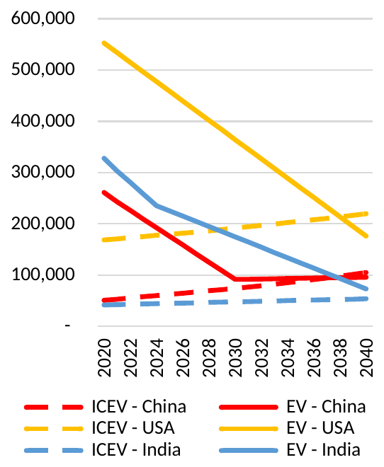
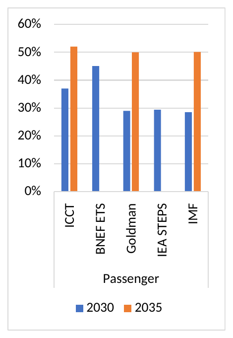
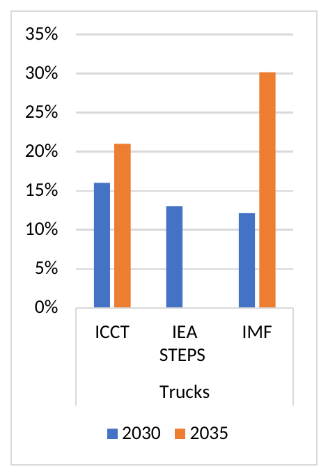
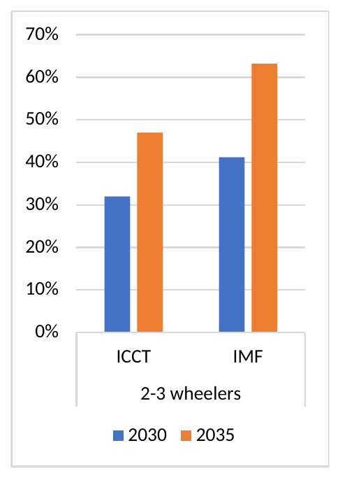
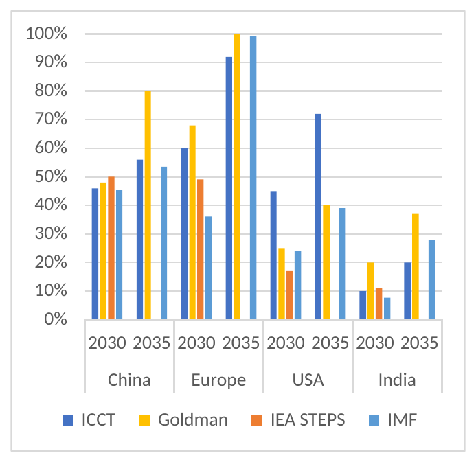

# Road Transport Module

## Scope of this chapter {.unnumbered #sec-TransportScope}

This chapter documents both parts of CPAT's road transport modelling: **the transport part of mitigation** and **the co-benefits piece**.

| Part | What it computes | Sections |
|---|---|---|
| Mitigation: the techno-economic ('engineer') road transport model | Vehicle ownership and purchases, the choice between electric and combustion vehicles, fuel economy, distance driven, and from them road fuel and electricity use, emissions and the effect of transport policies. When selected, it replaces the elasticity equation of the Mitigation chapter for road fuels | @sec-EngineerTransport |
| Co-benefits: the Road Transport Module | Vehicle-kilometers traveled, congestion, road accident fatalities and road damage, and their externality cost per liter of motor fuel, projected from fuel prices with econometrically estimated elasticities | From [Summary](#summary) to the Appendices |

The Mitigation chapter describes the default elasticity approach to road fuel use (@sec-FuelConsumptionDynamics) and links to this chapter for the engineer model ([Road transport: the engineer model](03_Mitigation.qmd#sec-RoadEngineerLink)). The co-benefits part is the 2023 text. Where it says that CPAT does not cover electric vehicles (Caveats, Status of upgrades), that applies to the co-benefits elasticities: electric vehicles are now modelled explicitly in the engineer model.

## Techno-economic ('engineer') road transport model {#sec-EngineerTransport}

### Overview {#sec-EngTrOverview}

A techno-economic ('engineer') model forecasts vehicle and driving demand, road transport energy use and emissions under various policies. It complements the engineer power model (see [the Mitigation chapter](03_Mitigation.qmd#sec-EngineerModel)), and like it, it models the capital stock explicitly: vehicles last ten to twenty years, and the choice between a combustion and an electric vehicle is made once, at purchase.

The model makes separate projections for:

- **two-three wheelers** (motorcycles);
- **light-duty vehicles** (LDVs: cars and commercial vehicles below 3.5 tons), with **new and used** vehicles separated, because purchase prices and fuel economy differ and countries rely on used-vehicle markets to very different degrees;
- **heavy-duty vehicles** (HDVs: medium- and heavy-duty freight);
- **public transport** (buses), with a simplified approach.

The classes differ in fuel pricing policies, economics and abatement pathways. For example, HDVs depreciate faster, have lower fuel economy, drive more vehicle-kilometers (VKT) and are more costly to electrify. The model covers road use of gasoline, diesel, natural gas, LPG, biofuels and electricity. Other road energy sources (e.g., coal, kerosene) and rail, aviation and navigation follow the elasticity approach of the Mitigation chapter.

**The steps.** Historical data up to the latest data year (2024-2025) are assembled first (@sec-EngTrData). From then on, each year:

1. Road transport demand, split between the size of the vehicle fleet and the distance driven per vehicle, adjusts to income, population and fuel costs, and existing vehicles depreciate and retire (@sec-EngTrDemand).
2. New vehicles are split between battery electric vehicles (BEVs) and internal combustion engine vehicles (ICEVs) according to their relative total cost of ownership (TCO) (@sec-EngTrTCO, @sec-EngTrBEV), and ICEVs between fuels (@sec-EngTrICEFuel).
3. The fuel economy of new ICEVs responds to fuel prices and policies, such as fuel taxes, feebates and fuel economy standards. Distance driven responds to the cost per kilometer (@sec-EngTrDistance).
4. Vehicles, distance and fuel economy give fuel use, calibrated to the energy balance, and with it emissions, fiscal impacts and externalities (@sec-EngTrFuelUse, @sec-EngTrLinks).

Externality calculations follow Black and others (2025), and the price inputs are those of the Mitigation chapter (@sec-PricesAndTaxes).

### Notation {#sec-EngTrNotation}

Every variable holds for a scenario $o$ and a country $c$; these indices are omitted. Where a symbol exists in the Mitigation chapter, it keeps its meaning there: $F$ fuel use, $p$ retail price, $\alpha$ autonomous efficiency improvement, $\epsilon_U$ usage elasticity, $\epsilon_F$ efficiency price elasticity, $ef$ emission factor, $K$ logit shape parameter, $t_0$ base year. $g^{GDP}$ is the GDP growth rate as in @eq-basefor. Elasticities are written $\epsilon$ with a subscript. They are distinct from the regression error term $\epsilon_{ct}$ and from the outcome elasticities $\eta$ of the co-benefits estimation.

| **Index** | **Meaning** |
|---|---|
| $m$ | Vehicle class: new passenger and light vehicles (PN), used passenger and light vehicles (PU), freight vehicles (FR), two-three wheelers (TW), buses (BU) |
| $h$ | Powertrain: ICE or BEV |
| $f$ | Fuel of an ICEV: gasoline (GSO), diesel (DIE), LPG, natural gas (NGA: CNG for cars, LNG for trucks); plug-in hybrids (PHV) are treated as a fuel of passenger ICEVs |
| $t$ | Year; $t_0$ the base year, $t_1$ the last year with vehicle data |

P denotes all passenger and light vehicles, new and used (PN + PU).

| **Notation** | **Variable** | **Unit** |
|---|---|---|
| $y_t$ | Real GDP per capita | thousand US\$ |
| $N_t$ | Population | million |
| $O_{m,t}$, $O^{*}_{m,t}$ | Vehicle ownership; its target (desired) level | vehicles per 1,000 people |
| $\overline{O}$ | Saturation level of ownership | vehicles per 1,000 people |
| $\kappa_1$, $\kappa_2$ | Gompertz shape and income parameters | -, per thousand US\$ |
| $\Lambda_m$ | Calibration factor of ownership to the latest observed level | - |
| $\chi_t$ | Freight share of four-wheel vehicle ownership | \% |
| $\rho$ | Partial adjustment speed of ownership | \% |
| $\overline{g}^{+}$, $\overline{g}^{-}$ | Maximum annual growth and decline of ownership | \% |
| $S_{m,h,t}$, $R_{m,h,t}$, $Q_{m,t}$ | Vehicle stock, retirements, purchases | vehicles per 1,000 people |
| $L_m$, $n_m$ | Useful life; years a vehicle is owned by its buyer | years |
| $\sigma^{U}_t$ | Share of used vehicles in passenger purchases | \% |
| $\sigma^{BEV}_{m,t}$, $\sigma_{m,f,t}$ | BEV share of purchases; share of fuel $f$ in ICEV purchases | \% |
| $r_t$ | Consumer discount rate | \% |
| $D_{m,h,t}$, $\overline{D}_{m,h,t}$ | Distance driven per vehicle; discounted over the ownership period | km per year; km |
| $fe^{new}$, $fe^{stk}$ | Fuel economy of new vehicles; of the stock | km per liter (BEV: km per kWh) |
| $P^{0}_{m,h,t}$, $P_{m,h,t}$ | Vehicle retail price before taxes; purchase price after taxes and policies | US\$ |
| $TCO_{m,h,t}$, $c_{m,h,t}$ | Total cost of ownership; per kilometer | US\$; US\$/km |
| $\delta$ | First-year depreciation | \% |
| $mc_{m,h}$, $ins$ | Maintenance cost; insurance rate | US\$/km; \% of value per year |
| $p_{f,t}$, $p^{EV}_t$ | Fuel price per liter incl. taxes and new policies; electricity price for EV charging | US\$/liter; US\$/kWh |
| $mku_t$ | Charging infrastructure mark-up on the electricity price | US\$/kWh |
| $CS_t$, $C^{CS}_t$ | Charging stations; cost per charging port | number; US\$ |
| $RA_{m,t}$ | Range anxiety cost of a BEV | US\$ per vehicle |
| $\epsilon_{I,m}$ | Income elasticity of distance driven | - |
| $\epsilon_{CS,V}$, $\epsilon_{CS,C}$, $\epsilon_{RA}$ | Elasticities of charging stations to the BEV stock and to their cost; of range anxiety to charging stations | - |
| $\epsilon_{own}$, $\epsilon_{cross}$ | Own- and cross-TCO elasticities of the ICEV fuel shares | - |
| $fbr_{m,t}$ | Feebate rate (shadow carbon price of a feebate or a fuel economy standard) | US\$/tCO$_2$ |
| $I_{m,h,t}$, $I^{piv}_{m,t}$ | CO$_2$ intensity of a vehicle; feebate pivot point | tCO$_2$/km |
| $FB_{m,h,t}$, $sub_{m,t}$, $dtx_{m,t}$ | Vehicle feebate (fee $>0$, rebate $<0$); EV purchase subsidy ($\le 0$); distance-based tax | US\$; US\$; US\$/km |
| $vat_m$, $du_{m,h}$, $\mu^{imp}_m$, $adv_{m,h}$ | VAT, import duty, share of imports, ad valorem purchase tax | \% |
| $bl_f$ | Biofuel blending ratio of gasoline or diesel | \% |
| $\Theta_f$ | Calibration factor of road fuel use to the energy balance | - |
| $F^{T}_{f,t}$, $E^{T}_t$ | Road fuel use and road electricity use of the engineer model | ktoe |

### Data sources for historical data {#sec-EngTrData}

Historical data on fuel demand, fuel economy, vehicle ownership, and BEV and plug-in hybrid (PHEV) shares come from several sources: the OECD's International Transport Forum ([ITF](http://www.itf-oecd.org/)), the IRF's World Road Statistics ([WRS](https://worldroadstatistics.org/)), the IEA's Electric Vehicles Initiative ([EVI](http://www.iea.org/programmes/electric-vehicles-initiative)), [Global EV Data Explorer](https://www.iea.org/data-and-statistics/data-tools/global-ev-data-explorer) (the best global source) and [Energy Efficiency Indicators](https://www.iea.org/data-and-statistics/data-product/energy-efficiency-indicators), [Statista](https://www.statista.com/topics/1487/automotive-industry/#topicOverview), the European Environment Agency ([EEA](https://www.eea.europa.eu/en/analysis/indicators/new-registrations-of-electric-vehicles)), and the International Organization of Motor Vehicle Manufacturers ([OICA](https://www.oica.net/category/sales-statistics/)). Where data are not available, they are estimated from related data (e.g., vehicle ownership to estimate disaggregated fuel consumption) and from regional and income-group averages. Much of the data is estimated, especially for developing countries, so country teams should request data on the key variables (details of the vehicle stock, the share of EV sales and more). All results are benchmarked to the latest energy balances, which limits the size of errors.

- **Fuel use by vehicle type.** The IEA, Enerdata, the UN and the US EIA provide fuel use for road transport as a whole (the energy balances). It is disaggregated by vehicle type (e.g., how much diesel LDVs, HDVs and buses use) from observed IEA data for about 40 countries, and from vehicle ownership and fuel economy for the others.[^7_eng1]
- **Vehicle ownership by vehicle type.** The IEA and IRF provide it for around 100 countries, supplemented by other sources such as CEIC. Elsewhere it comes from OICA and manual online collection, or is estimated with the Gompertz function (@sec-EngTrDemand).
- **Fuel economy by vehicle type.** The IEA provides it for around 40 countries, plus some one-off studies.[^7_eng2] More has been collected manually and from ICCT total cost of ownership studies. A quick online search for such a study is worthwhile before a mission.
- **Distance driven by vehicle type.** VKT per vehicle is estimated so that the product of fuel economy, vehicle ownership and VKT per vehicle matches observed road fuel consumption (IEA or Enerdata). If the resulting VKT per vehicle is well above what is expected for the income level, vehicle ownership is adjusted upward to reach the observed fuel consumption with a lower VKT, and vice versa.
- **Share of EVs in the stock and in sales.** The IEA, Statista and the EEA provide BEV and PHEV purchases for around 100 countries, supplemented by manual collection from online sources for another 10-20 countries.
- **Share of new and used vehicles.** The shares of used and new vehicles in sales are calculated from the shares of new and used vehicle imports (IRF and country-specific sources).
- **Purchase prices of EVs and ICEVs.** From country-specific studies (e.g., ICCT studies on [China](https://theicct.org/sites/default/files/publications/ze-hdvs-china-tco-EN-nov21.pdf), [Europe](https://theicct.org/sites/default/files/publications/TCO-BETs-Europe-white-paper-v4-nov21.pdf), the [United States](https://theicct.org/wp-content/uploads/2023/04/tco-alt-powertrain-long-haul-trucks-us-apr23.pdf) and its [meta-analysis](https://theicct.org/wp-content/uploads/2022/02/purchase-cost-ze-trucks-feb22-1.pdf)), extrapolated to other countries by income level.

[^7_eng1]: Datasets define freight or commercial vehicles differently: IEA Energy Efficiency Indicators and OICA count all goods vehicles as freight (including light commercial vehicles), while IEA EVI and IRF WRS count only vehicles above 3.5 tons. Light- and heavy-duty fuel economy and VKT are used to calculate the share of commercial diesel used by each vehicle type; all commercial gasoline is allocated to LDVs. Commercial vehicle fuel use is split between light and medium/heavy-duty vehicles based on ownership (IRF WRS), fuel economy and VKT.

[^7_eng2]: The average fuel economy of new ICEV purchases is not available in cross-country datasets, except for the EU. It is calculated by assuming that the annual change in average fuel economy comes from new vehicles entering the market, and that the LDV and HDV fleets turn over every 15 and eight years respectively. The LDV value is also used for motorcycles.

**Data years.** In the years with vehicle data (up to $t_1$), the model takes ownership, stocks, EV shares, fuel economy and distance from the data. It projects from the following year.

### Vehicle demand {#sec-EngTrDemand}

Total passenger vehicle demand follows a Gompertz function of income (e.g., Dargay and others 2006). The function captures (i) the saturation point of vehicle ownership, i.e. ownership if the country were as wealthy as the United States, which depends on urbanization and population density, and (ii) the income elasticity of ownership, whose main feature is the large increase as countries move from lower-middle to upper-middle income. For passenger and light vehicles and for freight vehicles, the target ownership is

$$
O^{*}_{m,t} = \overline{O}\,\chi_{m,t}\,\Lambda_m\,\exp\!\left(\kappa_1\, e^{\kappa_2\, y_t}\right), \qquad \chi_{PN,t} = 1 - \chi_t,\quad \chi_{FR,t} = \chi_t
$$ {#eq-EngTrGompertz}

where $\kappa_1 < 0$ and $\kappa_2 < 0$ shape the S-curve. The calibration factor $\Lambda_m$ makes the curve pass through the latest observed ownership, and is then held constant:

$$
\Lambda_m = \frac{O^{obs}_{m,t_1}}{\overline{O}\,\chi_{m,t_1}\exp\!\left(\kappa_1\, e^{\kappa_2\, y_{t_1}}\right)}
$$ {#eq-EngTrGompertzCalib}

A country below the curve therefore stays proportionally below it. **Short- and long-run responses** are captured by partial adjustment: desired ownership moves a share $\rho$ of the way to the target each year, and actual ownership may grow or fall only within limits:

$$
O_{m,t} = \max\!\Big(O_{m,t-1}\,(1 - \overline{g}^{-}),\ \min\big(O_{m,t-1}\,(1 + \overline{g}^{+}),\ \rho\, O^{*}_{m,t} + (1 - \rho)\, O_{m,t-1}\big)\Big)
$$ {#eq-EngTrOwnership}

**Freight and two-three wheelers** are expressed relative to passenger vehicles. The share of goods vehicles declines with income (a simple regression), from its latest observed value towards a high-income target $\chi^{*}$ reached at income $y^{*}$:

$$
\chi_t = \min\!\left(\chi_{t_1},\ \max\!\left(\chi^{*},\ \chi_{t_1} - (\chi_{t_1} - \chi^{*})\,\frac{y_t}{y^{*}}\right)\right)
$$ {#eq-EngTrFreightShare}

Two-three wheelers show an inverted-U shape in income ([Law and others 2015](https://www.sciencedirect.com/science/article/pii/S0966692315000976)). Ownership peaks at income $y^{pk}$, with $\Lambda_{TW}$ the peak level calibrated to the latest observation:

$$
O^{*}_{TW,t} = \frac{2\,\Lambda_{TW}\, y^{pk}\, y_t}{y_t^{2} + (y^{pk})^{2}}
$$ {#eq-EngTrHump}

The shares of HDVs among new vehicles, and of used among passenger vehicles, gradually converge to those of high-income countries (low-income countries have a greater share of HDVs and of used vehicles). The share of used vehicles that were previously new, domestically owned vehicles is held constant.

**The stock and purchases.** Each year a share of the stock retires: the average stock of the past years over the useful life, at most the stock itself,

$$
R_{m,h,t} = \min\!\left(\frac{1}{L_m}\cdot\frac{1}{\tau}\sum_{j=0}^{\tau-1} S_{m,h,t-1-j},\ \ S_{m,h,t-1}\right), \qquad \tau = \min(L_m,\ t - t_0 + 1)
$$ {#eq-EngTrRetire}

For new passenger vehicles the "life" is the ownership period $n_{PN}$, after which they move to the used market. Purchases equal the gap between desired ownership and the stock remaining after retirement. Purchases of passenger vehicles are split between new and used vehicles:

$$
Q_{m,t} = O_{m,t} - \sum_{h}\big(S_{m,h,t-1} - R_{m,h,t}\big), \qquad Q_{PN,t} = (1 - \sigma^{U}_t)\,Q_{P,t}, \quad Q_{PU,t} = \sigma^{U}_t\,Q_{P,t}
$$ {#eq-EngTrPurchases}

and the stock is updated with the purchases of each powertrain, whose shares come from the choice below:

$$
S_{m,h,t} = S_{m,h,t-1} - R_{m,h,t} + \sigma_{m,h,t}\,Q_{m,t}, \qquad \sigma_{m,BEV,t} = \sigma^{BEV}_{m,t},\quad \sigma_{m,ICE,t} = 1 - \sigma^{BEV}_{m,t}
$$ {#eq-EngTrStock}

In data years the stock is set to the data.

### Total cost of ownership {#sec-EngTrTCO}

The BEV share of purchases is driven by the total cost of ownership (TCO) of each vehicle type (see @tbl-EngTrTCO for the assumptions). The TCO is the net present value of the cost of using a vehicle over its ownership period, expressed per kilometer driven. It is made up of the purchase price (net of depreciation and resale value), insurance, maintenance, fuel costs and taxes on driving.

**Discounting.** With the annuity factor $a(r, N) = \big(1 - (1+r)^{-N}\big)/r$, the discounted distance over the ownership period is

$$
\overline{D}_{m,h,t} = D_{m,h,t}\; a(r_t, n_m)
$$ {#eq-EngTrDiscKm}

Generally, BEVs have higher upfront costs (retail prices) but lower future costs (fuel and maintenance) than ICEVs. A higher discount rate, which reduces the value of future savings, therefore raises the relative cost of BEVs. The discount rate reflects financing costs rather than a social discount rate, to better reflect consumer purchasing decisions. It falls with income, linearly between an income $y^{lo}$ and an income $y^{hi}$:

$$
r_t = \min\!\left(r^{max},\ \max\!\left(r^{min},\ r^{max} - \frac{y_t - y^{lo}}{y^{hi} - y^{lo}}\,(r^{max} - r^{min})\right)\right)
$$ {#eq-EngTrDisc}

The methodology note assumes 10 percent in high-income countries rising to 30 percent in low-income countries. These values are still to be reviewed; see @sec-EngTrParams for the values in the workbook.

**Purchase price.** The purchase price of a new vehicle depends on:

- *Retail prices.* For ICEVs they stay constant in the baseline for a given income level but rise with income (an income elasticity of prices based on a survey of countries). Retail prices of BEVs fall steeply with battery costs, for light- and heavy-duty EVs alike, and rise with income with the same elasticity as ICEVs (@fig-EngTrPrices).
- *Depreciation.* It is faster for freight vehicles, with their much higher annual mileage, and faster in the first year of ownership, reflecting the sharp fall in resale value after purchase (Argonne 2021). Depreciation rates are the same for BEVs and ICEVs.
- *Salvage or resale value.* The vehicle's estimated market value at the end of the ownership period, i.e. its depreciated value. It reduces the TCO.
- *Policies affecting purchase prices.* Modelled subsidies and feebates, and existing country-specific VAT and customs duties on passenger vehicles.[^7_eng3] Fuel efficiency standards are modelled as a shadow carbon price.
- *Range anxiety.* An additional cost for BEVs, reflecting concern over charging availability and range, which declines over time (@sec-EngTrCharging).

[^7_eng3]: The six-digit HS codes under 8703 and 8704 give the customs duties for LDV and HDV EVs and ICEVs. Non-tariff policies have been collected manually for a subset of large countries.

The purchase price after taxes and policies is

$$
P_{m,h,t} = P^{0}_{m,h,t}\,\big(1 + du_{m,h}\,\mu^{imp}_m\big)\big(1 + adv_{m,h,t}\big)\big(1 + vat_{m}\big) + FB_{m,h,t} + \mathbb{1}[h = \text{BEV}]\; sub_{m,t}
$$ {#eq-EngTrPrice}

with the feebate $FB$ of @eq-EngTrFeebate and the EV subsidy $sub \le 0$.

**The TCO.** With $\delta$ the first-year depreciation and the rest of the value depreciated linearly over the remaining life:

$$
\begin{aligned}
TCO_{m,h,t} = \; & \underbrace{\delta P + \frac{(1-\delta)P}{L_m - 1}\,a(r_t, L_m - 1)}_{\text{depreciation}} \; - \; \underbrace{P\,(1-\delta)\,\frac{L_m - n_m}{L_m}\,(1+r_t)^{-n_m}}_{\text{salvage value}} \\
& + \; \underbrace{\theta^{ins}\, ins\; P\; a(r_t, n_m + 1)}_{\text{insurance}} \; + \; \underbrace{mc_{m,h}\,\overline{D}_{m,h,t}}_{\text{maintenance}} \; + \; \underbrace{\left(\frac{p_{h,t}}{fe^{new}_{m,h,t}} + dtx_{m,t}\right)\overline{D}_{m,h,t}}_{\text{fuel and distance tax}} \; + \; \mathbb{1}[h = \text{BEV}]\, RA_{m,t}
\end{aligned}
$$ {#eq-EngTrTCO}

where $P = P_{m,h,t}$, $\theta^{ins}$ is an insurance factor, $p_{ICE,t}$ is the average ICE fuel price over the fuel mix, and $p_{BEV,t} = p^{EV}_t$. The salvage value applies to passenger vehicles. The TCO per kilometer is

$$
c_{m,h,t} = \frac{TCO_{m,h,t}}{\overline{D}_{m,h,t}}
$$ {#eq-EngTrTCOkm}

- **Maintenance** costs vary with labor costs (wage rates). They are lower for BEVs than for ICEVs, which have more moving parts.
- **Insurance** is the same share of value for BEVs and ICEVs.
- **Fuel costs** (gasoline, diesel or electricity) depend on VKT, fuel economy and fuel prices. The calculation is done separately for gasoline and diesel LDVs, and the results are averaged with ownership shares as weights.
  - *Fuel prices* follow the price module (@sec-PricesAndTaxes). Electricity prices for charging include a mark-up for charging infrastructure, which falls with technology and EV deployment (@eq-EngTrMarkup).
  - *Fuel economy* of new vehicles (@eq-EngTrFENew).
  - *VKT* for the purchase decision adjusts to income and, in the methodology, to fuel prices (@eq-EngTrDistNew). VKT per vehicle is assumed identical for BEVs and ICEVs in the TCO, because the evidence on driving differences is mixed.[^7_eng4]
- **Used vehicles** follow the same calculation, with the purchase price equal to the resale value of a new vehicle, no first-year depreciation, and the fuel economy of the year in which the vehicle was first sold. A used BEV carries range anxiety in proportion to its price.
- **Plug-in hybrids** take the capital cost of a BEV and the fuel cost of a mix of gasoline and electricity. They carry no range anxiety.

[^7_eng4]: Evidence on whether EVs are driven more than ICEVs is largely mixed for studies of the US (e.g., [Zhao et al. 2023](https://www.cell.com/joule/abstract/S2542-4351(23)00404-X), [Burlig et al. 2021](https://www.aeaweb.org/articles?id=10.1257/pandp.20211088), [Chakraborty et al. 2021](https://its.ucdavis.edu/blog-post/no-electric-vehicles-arent-driven-less-than-gas-cars/), [EPA 2023](https://nepis.epa.gov/Exe/ZyPDF.cgi?Dockey=P10175J2.pdf), [Metcalf and Doshi 2023](https://ceepr.mit.edu/workingpaper/how-much-are-electric-vehicles-driven-depends-on-the-ev/)). A Norwegian study finds EVs are driven about 10 percent more than ICEVs ([Bloomberg 2022](https://www.bloomberg.com/news/articles/2022-07-20/electric-cars-start-covering-more-ground-than-combustion-counterparts), [Rystad 2023](https://www.rystadenergy.com/news/norway-fuel-demand-electric-car-bus-truck-gasoline-diesel)), which may be more relevant for countries with high EV uptake and charging availability.

| | **ICEV LDV** | **BEV LDV** | **ICEV heavy duty** | **BEV heavy duty** | **ICEV motorcycle** | **BEV motorcycle** |
|---|---|---|---|---|---|---|
| New vehicle purchase price | [IEA](https://www.iea.org/data-and-statistics/data-tools/electric-vehicles-total-cost-of-ownership-tool) and Argonne (@fig-EngTrPrices) | as ICEV LDV | ICCT | ICCT | IEA | IEA |
| Depreciation | 30% in the first year, then linear over 19 years; new cars resold at 10 years | as ICEV LDV | 30% in the first year, then linear over 7 years; resold at 5 years | as ICEV heavy duty | Linear over 5 years (ICCT) | as ICEV motorcycle |
| Energy cost | Country-specific (see [Black and others 2023](https://www.imf.org/en/Publications/WP/Issues/2023/08/22/IMF-Fossil-Fuel-Subsidies-Data-2023-Update-537281) for sources); EVs pay an additional charge, declining with EV penetration, to recover charging infrastructure costs (ICCT) | | | | | |
| Fuel or energy efficiency | Country-specific for around 30 countries (IEA), extrapolated for others; 1% annual improvement | | 32-63 liters per 100 km (various) | 150-100 kWh per 100 km, 2.5% annual decline 2020-2030 (ICCT), continued decline | 1-3 liters per 100 km | 4 kWh per 100 km (ICCT) |
| Maintenance | \$0.03-\$0.12 per km (Argonne, ICCT) | 1/3 of ICEV (Argonne) | \$0.045-\$0.135 per km (Argonne, ICCT) | 1/3 of ICEV (Argonne) | \$0.01-\$0.04 per km (ICCT) | 1/3 of ICEV (ICCT) |
| Insurance | 1.5% of vehicle value (Argonne) | | | | | |
| VKT per year | Country-specific, around 10,000 km | | Country-specific, around 80,000 km | | Country-specific | |

: Total cost of ownership parameters. ICCT refers to the average of ICCT studies for [China](https://theicct.org/sites/default/files/publications/ze-hdvs-china-tco-EN-nov21.pdf), [Europe](https://theicct.org/sites/default/files/publications/TCO-BETs-Europe-white-paper-v4-nov21.pdf), the [United States](https://theicct.org/wp-content/uploads/2023/04/tco-alt-powertrain-long-haul-trucks-us-apr23.pdf), its [meta-analysis](https://theicct.org/wp-content/uploads/2022/02/purchase-cost-ze-trucks-feb22-1.pdf) of ZEV purchase costs, or a study on [Vietnam](https://theicct.org/wp-content/uploads/2023/01/vietnam-E2W-TCO_feb23.pdf) for two-three wheelers. Argonne refers to its [2021 TCO review](https://publications.anl.gov/anlpubs/2021/05/167399.pdf) and [AFLEET 2024](https://afleet.esia.anl.gov/afleet/total-cost-ownership-calculator). All prices are in 2023 real terms. VKT is calculated from vehicle ownership, fuel consumption and fuel economy for ICEVs, and scaled for EVs by the difference in cost per km and an assumed driving elasticity. For freight purchase costs, the average of straight trucks and tractor trailers is used. {#tbl-EngTrTCO}

{#fig-EngTrPrices width=45%}

#### Charging and range anxiety {#sec-EngTrCharging}

**Charging mark-up.** The electricity price for EV charging is the previous year's end-user electricity price (residential for passenger vehicles and two-three wheelers, industrial for freight; lagged to avoid a circular reference with the power model) plus a mark-up that recovers the fixed cost of charging infrastructure:

$$
p^{EV}_t = p^{ele}_{t-1} + mku_t, \qquad mku_t = \varsigma\,\max\!\left(mku^{min},\ mku^{max}\,\frac{\bar{e} - e_t}{1 - \bar{e}}\right)
$$ {#eq-EngTrMarkup}

where $e_t$ is the EV share of the passenger stock, $\bar{e}$ the EV share at which the mark-up reaches its minimum, and $\varsigma$ the share of public charging. As charging utilization rises from low levels to those reached in Europe by 2030 (around 50 percent BEV penetration), the cost of covering the fixed cost of charging falls from about US\$0.10 to US\$0.02 per kWh (following [ICCT 2021](https://theicct.org/sites/default/files/publications/TCO-BETs-Europe-white-paper-v4-nov21.pdf)).

**Charging stations** grow with the BEV stock $V^{BEV}$ (a network effect: more EVs bring more stations, and vice versa) and fall with their cost, which a charging-station subsidy lowers:

$$
CS_t = CS_{t-1}\left(\frac{V^{BEV}_t}{V^{BEV}_{t-1}}\right)^{\epsilon_{CS,V}}\left(\frac{C^{CS}_t}{C^{CS}_{t-1}}\right)^{\epsilon_{CS,C}}
$$ {#eq-EngTrStations}

**Range anxiety** falls as charging stations spread:

$$
RA_{m,t} = RA_{m,t-1}\left(\frac{CS_t}{CS_{t-1}}\right)^{\epsilon_{RA}}
$$ {#eq-EngTrRA}

The elasticities mimic [Cole and others (2021)](https://scholar.harvard.edu/files/stock/files/policies_for_electrifying_the_light-duty_vehicle_fleet_in_the_united_states.pdf): a 10 percent increase in charging availability raises EV uptake by 3.7 percent at relatively low levels of availability, and the elasticity of charging station supply to its cost is $\epsilon_{CS,C} = -0.67$. **Calibration.** The starting value $RA_{m,t_0}$ is set so that modelled new BEV sales in the latest data year match actual sales. Sales here are the vehicles new to the road: new vehicles and imported used vehicles, excluding second-hand sales of vehicles already owned domestically.

#### Fuel economy of new vehicles {#sec-EngTrFENew}

In the baseline, fuel economy improves exogenously with technology for all vehicles, and additionally with learning-by-doing and economies of scale for BEVs. Light- and heavy-duty ICEVs and light BEVs improve by about one percent a year, while heavy-duty BEVs improve from 0.7 km per kWh in 2020 to 1.5 km per kWh in 2050 ([ICCT 2021](https://theicct.org/sites/default/files/publications/TCO-BETs-Europe-white-paper-v4-nov21.pdf)). The fuel economy of new ICEVs also rises with fuel prices, as manufacturers modify technology and buyers shift to more efficient models. This is the efficiency margin of the Mitigation chapter, with the same elasticity $\epsilon_F$ (around $-0.4$ for light-duty and $-0.3$ for heavy-duty ICEVs, with some country variation; see [Black and others 2023](https://www.imf.org/en/Publications/WP/Issues/2023/06/22/The-IMF-World-Bank-Climate-Policy-Assessment-Tool-CPAT-A-Model-to-Help-Countries-Mitigate-535096)):

$$
fe^{new}_{m,f,t} = fe^{new}_{m,f,t-1}\,(1 + \alpha_f)\left(\frac{p_{f,t} + fb_{m,f,t}}{p_{f,t-1} + fb_{m,f,t-1}}\right)^{-\epsilon_{F,f}}, \qquad fb_{m,f,t} = fbr_{m,t}\; ef_f\,(1 - bl_f)
$$ {#eq-EngTrFENew}

where $fb$ is the feebate (or fuel economy standard) expressed per liter: the feebate rate times the fossil CO$_2$ per liter of fuel ($ef_f$ in tCO$_2$ per liter, net of the biofuel blend). Since $\epsilon_F < 0$, fuel economy (km per liter) rises with the price. The fuel economy of BEVs is assumed not to respond to electricity prices, given their high energy efficiency and the low share of fuel in their costs.

### BEV shares {#sec-EngTrBEV}

A logit function of the relative TCO of ICEVs and BEVs determines the share of vehicle demand met by each. It is computed separately for new and used passenger vehicles, freight vehicles and two-three wheelers. It is the two-option form of the multilogit of the engineer power model (see [Logit function](03_Mitigation.qmd#logit-function)), applied to the cost per km relative to its average $\bar{c}_{m,t}$:

$$
\sigma^{BEV}_{m,t} = \frac{e^{-K_m c_{m,BEV,t}/\bar{c}_{m,t}}}{e^{-K_m c_{m,BEV,t}/\bar{c}_{m,t}} + e^{-K_m c_{m,ICE,t}/\bar{c}_{m,t}}}, \qquad \bar{c}_{m,t} = (1 - \sigma^{BEV}_{m,t-1})\,c_{m,ICE,t} + \sigma^{BEV}_{m,t-1}\,c_{m,BEV,t}
$$ {#eq-EngTrLogit}

The shape parameter $K_m$ is 3 for passenger vehicles, 2 for freight and 4 for two-three wheelers. It is fitted to minimize the difference between modelled and actual EV sales between 2015 and 2024 for selected economies. In data years the observed shares are used.

Used vehicles are split between imported used vehicles and used vehicles previously owned domestically. The supply of both, imported and second-hand domestic used BEVs, is limited by the global and domestic EV purchases of 10 years before (the assumed ownership period) for passenger vehicles, and of 4 years before for freight.

The resulting BEV shares are similar to other forecasts at the global and country level (@fig-EngTrEVGlobal, @fig-EngTrEVMarkets).

::: {#fig-EngTrEVGlobal layout-ncol=3}

{#fig-EngTrEVGlobalPas}

{#fig-EngTrEVGlobalFre}

{#fig-EngTrEVGlobalTW}

EV sales shares, global, 2030 and 2035. Source: IMF staff estimates using [IEA Global EV Outlook 2025](https://www.iea.org/reports/global-ev-outlook-2025), [BNEF Electric Vehicle Outlook 2024](https://assets.bbhub.io/professional/sites/24/847354_BNEF_EVO2024_ExecutiveSummary.pdf), [ICCT Vision 2050](https://theicct.org/publication/vision-2050-global-zev-transition-2024-jan25/) and Goldman Sachs Research.
:::

{#fig-EngTrEVMarkets width=60%}

### Share of ICEVs by fuel type {#sec-EngTrICEFuel}

Once total ICEV purchases are known, they are split by fuel: gasoline, diesel, LPG, CNG and PHEVs for passenger vehicles; diesel, LPG and LNG for freight; gasoline for two-three wheelers. Each fuel's share moves with the change in its own TCO and in the TCO of the other fuels, with own- and cross-price elasticities from a study of how the Norwegian vehicle fleet responds to changes in total cost of ownership ([Fridstrøm and Østli 2021](https://trid.trb.org/View/1762174)):

$$
\tilde{\sigma}_{m,f,t} = \tilde{\sigma}_{m,f,t-1}\left(\frac{TCO_{m,f,t}}{TCO_{m,f,t-1}}\right)^{\epsilon_{own}}\left(\frac{\sum_{f' \ne f}\tilde{\sigma}_{m,f',t-1}\,TCO_{m,f',t}/TCO_{m,f',t-1}}{\sum_{f' \ne f}\tilde{\sigma}_{m,f',t-1}}\right)^{\epsilon_{cross}}, \qquad \sigma_{m,f,t} = \frac{\tilde{\sigma}_{m,f,t}}{\sum_{f'}\tilde{\sigma}_{m,f',t}}\,\big(1 - \sigma^{BEV}_{m,t}\big)
$$ {#eq-EngTrICESplit}

The fuel shares of the stock turn over slowly, replacing one ownership period's share each year.

### Distance driven per vehicle and fuel economy {#sec-EngTrDistance}

**Distance in the purchase decision.** The VKT a buyer expects from a new vehicle grows with income and, in the methodology, responds to the cost per km through the driving (usage) elasticity $\epsilon_U$ (around $-0.3$ for LDVs and two-three wheelers and $-0.2$ for HDVs):

$$
D^{new}_{m,f,t} = D^{new}_{m,f,t-1}\left(\frac{p_{f,t}/fe^{new}_{m,f,t} + dtx_{m,t}}{p_{f,t-1}/fe^{new}_{m,f,t-1} + dtx_{m,t-1}}\right)^{\epsilon_{U,f}}\big(1 + g^{GDP}_{t-1}\big)^{\epsilon_{I,m}}
$$ {#eq-EngTrDistNew}

**Distance driven by the stock.** Distance per vehicle responds to any fiscal instrument that changes the marginal cost per kilometer (fuel or carbon taxes, distance-based taxes) and to income. It differs between ICEVs and EVs through their cost per km:

$$
D_{m,f,t} = D_{m,f,t-1}\left(\frac{c^{km}_{m,f,t}}{c^{km}_{m,f,t-1}}\right)^{\epsilon_{U,f}}\left(\frac{y_t}{y_{t-1}}\right)^{\epsilon_{I,m}}, \qquad c^{km}_{m,f,t} = \frac{p_{f,t}}{fe^{stk}_{m,f,t-1}} + dtx_{m,t}
$$ {#eq-EngTrDist}

**Fuel economy of the stock** turns over with purchases, with $\overline{L}_m$ the average holding period:

$$
fe^{stk}_{m,f,t} = \frac{1}{\overline{L}_m}\, fe^{new}_{m,f,t} + \left(1 - \frac{1}{\overline{L}_m}\right) fe^{stk}_{m,f,t-1}
$$ {#eq-EngTrFEStock}

### Fuel use, buses and biofuels {#sec-EngTrFuelUse}

Combining the number of vehicles, the distance driven and the fuel economy gives fuel use, and with it emissions and the fiscal effects of road decarbonization policies. With $S_{m,f,t}$ the stock of class $m$ using fuel $f$ (per 1,000 people):

$$
F^{T}_{f,t} = \Theta_f\,\sum_{m}\frac{N_t\, S_{m,f,t}}{1000}\cdot\frac{D_{m,f,t}}{fe^{stk}_{m,f,t}}, \qquad \Theta_f = \frac{F^{bal}_{ROD,f,t_0}}{\left.\sum_{m}\frac{N\,S_{m,f}}{1000}\cdot\frac{D_{m,f}}{fe^{stk}_{m,f}}\right|_{t_0}}
$$ {#eq-EngTrFuel}

Liters are converted to ktoe. The factor $\Theta_f$ calibrates the bottom-up fleet to road fuel use in the energy balance $F^{bal}_{ROD,f,t_0}$ in the base year and is then held. In practice it is applied in two steps: a distance factor by vehicle class, then a residual factor by fuel. A factor far from one signals that the vehicle data explain only part of road fuel use. PHEV distance is split between gasoline and electricity. Road electricity $E^{T}_t$ is computed in the same way from the BEV stock, its distance and its fuel economy (km per kWh).

**Public transport.** Buses are covered with a simplified approach (rail and air are not). Bus fuel and electricity use change at the same rate as passenger vehicle energy use, so buses electrify at roughly the same rate as passenger vehicles:

$$
F_{BU,f,t} = F_{BU,f,t_0}\;\frac{F_{P,t}}{F_{P,t_0}}
$$ {#eq-EngTrBus}

where $F_{P,t}$ is the energy use (fuel and electricity, ktoe) of passenger vehicles. Bus electricity grows with passenger electricity in the same way.

**Biofuels.** The blending ratio $bl_f$ comes from the IEA energy balances and is held constant, so biofuel use changes in proportion to gasoline and diesel:

$$
F^{T}_{BGS,t} = F_{ROD,BGS,t_0}\,\frac{F^{T}_{GSO,t}}{F_{ROD,GSO,t_0}}, \qquad F^{T}_{BDI,t} = F_{ROD,BDI,t_0}\,\frac{F^{T}_{DIE,t}}{F_{ROD,DIE,t_0}}
$$ {#eq-EngTrBio}

Blending enters the emission intensities of gasoline and diesel, which matters for CO$_2$-based policies such as feebates and carbon taxes (@eq-EngTrFENew, @eq-EngTrFeebate).

### Modelled policies {#sec-EngTrPolicies}

A range of policies work through separate channels.

- **Policies that change fuel prices**, such as carbon taxes and fuel excises, act through three channels: the fuel economy of newly purchased ICEVs, through the efficiency elasticity $\epsilon_F$ (around $-0.3$ for freight and $-0.4$ for passenger vehicles and two-three wheelers; @eq-EngTrFENew); the distance driven by all ICEVs, through the intensive-margin elasticity $\epsilon_U$ (around $-0.2$ for freight and $-0.3$ for passenger vehicles and two-three wheelers; @eq-EngTrDist); and a larger EV share of new purchases, because ICEVs become relatively more expensive (@eq-EngTrLogit).
- **Feebates** improve the fuel economy of new ICEVs (as fuel price policies do) and raise the EV share of purchases, through higher ICEV purchase taxes and EV subsidies (with the pivot point set above zero). The effect on the purchase price of a vehicle is the product of (i) the net present value of kilometers driven over its life, (ii) the difference between its CO$_2$ intensity and that of all new vehicle purchases (the pivot), and (iii) the shadow carbon price:

  $$
  FB_{m,h,t} = \big(I_{m,h,t} - I^{piv}_{m,t}\big)\; fbr_{m,t}\; \overline{D}_{m,h,t}
  $$ {#eq-EngTrFeebate}

  The EV rebate follows from the same equation with $I_{m,BEV,t} = 0$, which makes the first term negative. Fuel economy standards are modelled the same way, as a shadow carbon price added to $fbr$. The carbon price itself is not added, since it is already in the fuel price.
- **Distance-based taxes** $dtx$ reduce distance driven, like the driving part of carbon taxes (@eq-EngTrDist), and raise the TCO of all vehicles (@eq-EngTrTCO).
- **EV purchase subsidies, ad valorem purchase taxes, VAT and customs duties on BEVs** change the purchase price (@eq-EngTrPrice). **Charging-station subsidies** lower the cost of a charging port, which adds stations and reduces range anxiety (@eq-EngTrStations, @eq-EngTrRA).

### Links to the mitigation and co-benefits results {#sec-EngTrLinks}

**Mitigation.** The model user chooses, by scenario, whether road fuel use comes from the elasticity approach of the Mitigation chapter (@sec-FuelConsumptionDynamics) or from the engineer model. With the engineer model selected, road use of gasoline, diesel, LPG, natural gas and biofuels is $F_{o,c,s=ROD,f,t} = F^{T}_{f,t}$ (@eq-EngTrFuel, @eq-EngTrBio). Road electricity demand in the power sector is $E^{T}_t$ after the base year. CO$_2$ and other emissions, local air pollutants, fiscal revenues and all totals then follow the engineer road fuel use. The engineer model reads the fuel prices including new policies (@sec-PricesAndTaxes), GDP and population, and the previous year's electricity price, so it adds no circular reference.

**Co-benefits.** The co-benefits part of this chapter projects congestion, accidents and road damage from the change in road fuel prices (@eq-policy). Their externality cost per liter of motor fuel divides the change in their value by the change in road fuel use from the Mitigation module (@sec-extcost), which is the engineer model's road fuel use when it is selected.

### Parameters: methodology and workbook {#sec-EngTrParams}

The CPAT workbook does not yet use all of the methodology note's parameter values. The values below are those of the workbook (legacy CPAT, kept in CPAT-AI), next to the note's where they differ. The full parameter list, and the implementation in Excel-AI and CPAT Python, are in the CPAT-AI Model book ([Road transport](../CPAT_model_documentation_html/05_Road_transport.html#sec-tr-params)).

| **Parameter** | **Symbol** | **Workbook** | **Methodology note** |
|---|---|---|---|
| Consumer discount rate, low / high income | $r^{max}$, $r^{min}$ | 15% at US\$1,000 / 5% at US\$50,000 | 30% / 10% |
| Gompertz parameters | $\kappa_1$, $\kappa_2$ | $-5.897$; $-0.23$ per thousand US\$ | |
| Partial adjustment speed; maximum growth / decline of ownership | $\rho$; $\overline{g}^{+}$, $\overline{g}^{-}$ | 0.09; 7.5% / 10% a year | |
| Two-three wheeler peak income | $y^{pk}$ | US\$7,000 | |
| Freight share target; income at the target | $\chi^{*}$; $y^{*}$ | 0.0236; US\$87,398 | |
| Useful life: passenger, freight, two-three wheeler | $L_m$ | 20, 10, 7 years | |
| Ownership period of a new passenger vehicle | $n_{PN}$ | 7 years | 10 years |
| First-year depreciation; insurance; insurance factor | $\delta$; $ins$; $\theta^{ins}$ | 30%; 1.5%; 0.5 | |
| EV maintenance | $mc_{m,BEV}$ | ICEV × 2/3 | ICEV × 1/3 |
| Driving (usage) elasticity, light / heavy vehicles | $\epsilon_U$ | $-0.4$ / $-0.3$ (road gasoline / diesel of the Mitigation chapter) | $-0.3$ / $-0.2$ |
| Income elasticity of distance | $\epsilon_{I,m}$ | 0.1 (two-three wheelers $-0.4$) | 0.05 |
| Distance of new vehicles responds to fuel prices | | No | Yes |
| BEV / ICEV distance in the TCO | | BEV capped at 1.2 × ICEV | identical |
| Logit shape parameter: passenger, freight, two-three wheeler | $K_m$ | 3, 2, 4 | |
| Own / cross TCO elasticity of ICEV fuel shares | $\epsilon_{own}$, $\epsilon_{cross}$ | $-1.265$ / $0.5725$ | |
| Charging stations to the BEV stock; to their cost | $\epsilon_{CS,V}$, $\epsilon_{CS,C}$ | 0.3; $-0.67$ | |
| Range anxiety to charging stations | $\epsilon_{RA}$ | $-0.5$ | |
| Charging mark-up maximum / minimum; EV share at the minimum; public share | $mku^{max}$, $mku^{min}$; $\bar{e}$; $\varsigma$ | US\$0.30 / 0.02 per kWh; 0.5; 0.2 | US\$0.10 / 0.02 per kWh |
| Maintenance cost | | Fixed US\$ per km | Rises with wages |
| ICEV retail prices | $P^{0}$ | Price path by country | Rise with income |

: Parameters of the engineer road transport model {#tbl-EngTrParams}

### Caveats {#sec-EngTrCaveats}

- **Data.** Much of the vehicle data is estimated, especially for developing countries. The calibration to the energy balance (@eq-EngTrFuel) ensures base-year fuel use is right, but large calibration factors show that the fleet data explain only part of road fuel use.
- **Range anxiety** is calibrated to one year of observed EV sales and is the main lever on the EV share. Its path depends on assumed elasticities.
- **Parameters** of the note and the workbook differ (@tbl-EngTrParams); several values, including the discount rates, are still to be reviewed.
- **Public transport** is scaled with passenger vehicles; mode shift (to public transport, rail or non-motorized transport) is not modelled.
- **The co-benefits elasticities** (from [Summary](#summary) onward) are estimated on historical data and do not yet reflect the engineer model's fleet composition, e.g. a large EV share.

## Co-benefits: summary {#summary}

Carbon taxes impact fuel prices and thereby shape driving behavior. In
particular, carbon taxes increase incentives to substitute away from
private vehicles towards more fuel-efficient means of transport. As road
traffic has many externalities aside carbon emissions, carbon taxes may
lead to a reduction in road transport-related externalities such as
congestion, accidents and road damage. To estimate the magnitude of
these co-benefits, the CPAT Road Transport Module quantifies the effect
of a user-defined carbon tax or road fuel tax on (a) the intensity of
congestion as measured by the time lost relative to free-flowing
traffic, (b) the number of road fatalities, and (c) the maintenance cost
due to road damage.

The Road Transport Module is based on elasticities that we estimate
using an international country-year level dataset. This dataset is
compiled from many sources and describes road transport, as well as
general demographics and economic variables. The dataset covers the time
from 1994 to 2021 and 186 countries, so that we can use within-country
and between-country variation for identification. We estimate
elasticities with respect to fuel prices and with respect to fuel taxes,
as well as short and long-run elasticities. We estimate country-specific
elasticities based on global coefficients and country-specific
covariates.

The magnitude of the resulting elasticities are broadly in line with the
literature: for a 10% fuel price increase from a carbon tax, total
vehicle-km traveled decrease in the short run on average by 2.8 %;
congestion levels decrease by 3.4 %; accident fatalities decrease by 6.1
%; and road damage decreases by 4.4 % in the long run.

The estimated elasticities are used within CPAT to produce policy
forecasts of total vehicle-km traveled, congestion levels, accident
fatalities and road damage cost. By choosing a country and inputting
different parameters for a policy in the dashboard, the user obtains a
series of graphs showing the time series with and without the policy, as
well as the policy impact defined by the difference of the two time
series.

Important caveats of the CPAT Road Transport Module include the assumed
linearity of effects, which may potentially not apply to large policy
changes. Moreover, econometrically estimated elasticities take the
historic capital stock as given and do not predict the impact of
disruptive technological changes such as electric vehicles (EVs).
Finally, CPAT does not measure the externality cost of non-realized
trips.

## List of acronyms 

BEV Battery electric vehicle

CCKP Climate Change Knowledge Portal (from the World Bank)

FAD IMF’s Fiscal Affairs Department

GHO Global Health Observatory (from the World Health Organization)

GIZ Gesellschaft für Internationale Zusammenarbeit (German development
agency)

HDV Heavy-duty vehicle (medium- and heavy-duty freight)

ICEV Internal combustion engine vehicle

IEA International Energy Agency

IMF International Monetary Fund

LDV Light-duty vehicle (cars and commercial vehicles below 3.5 tons)

NCEI National Centers for Environmental Information (United States)

OECD Organisation for Economic Co-operation and Development

OLS Ordinary Least Squares (econometric estimation method)

PHEV Plug-in hybrid electric vehicle

SDG Sustainable Development Goals

SDR Sustainable Development Report (@Sachs2019)

TCO Total cost of ownership

UNECE United Nations Economic Commission for Europe

VKT Vehicle-kilometers traveled (analogous to the US American
vehicle-miles traveled)

WDI World Development Indicators (from the World Bank)

WGI World Governance Indicators (from the World Bank)

WHO World Health Organization

WRS World Road Statistics (from the International Road Federation)

wrt “with respect to”

## Introduction

Aside carbon emissions, road transport causes various externalities. The
most important transport externalities examined here are congestion,
road damage and accidents. These externalities are not the explicit
target of carbon taxes, but also decline when the total distance
traveled declines. Such reductions in externalities occur as a “side
effect” to the direct goal of a carbon tax and are commonly called
*co-benefits* (@parry2014getting).

As a tool for assessing the overall impact of carbon tax reforms across
the globe, CPAT predicts the magnitude of these co-benefits, among
others for the transport sector. The methodology relies on econometric
estimations of long-run and short-run elasticities of externalities with
respect to fuel prices. The fuel price change induced by a carbon tax is
then multiplied by the elasticities to predict the transport co-benefits
of the carbon tax policy.

The following sections will first give an overview over the relevant
literature; then present the data sources used and explain the
methodology for estimating the elasticities of externalities with
respect to fuel prices. In a next section, we will present the
estimation results on three transport externalities: congestion, road
damage and accidents. Finally, we present the Excel implementation of
this work in CPAT.

### Vehicle-kilometers traveled (VKT)

We do not consider VKT (analogous to the US American vehicle-miles
traveled, VMT) a policy target *per se* but include it in order to
illustrate one of the main channels through which fuel prices affect
congestion, road damage and accidents. Reductions in VKT may be a result
of people transitioning to less transport-intensive activities, other
transport modes, in particular public/collective transport options,
closer workplaces and residence location choice (@molloy2013effect).

In particular, a carbon tax may incite passengers to travel together,
such that a reduction of vehicle-km may be achieved *without* a
reduction in passenger-trips, by increasing the rate of passengers per
vehicle. @bento2013carpooling show that the average number of users
increases with fuel prices, because users carpool (i.e. share a vehicle)
more. Carbon taxes may also deter detours, so that vehicle-km, and even
passenger-km, may be reduced without a reduction in passenger-trips (see @fig-ctandvkt).

{#fig-ctandvkt}

*Note: Channels (in orange boxes) are shown to illustrate the economic theory; they are not modeled/estimated separately within CPAT.*

The negative relationship between fuel prices and VKT is well
established in the economics literature. The literature provides a large
number of empirical estimates of the elasticity of VKT wrt fuel prices.
@tbl-litrev lists a selection of these estimates: most commonly, the
estimates of VKT elasticity range from -0.05 to -0.50. A review paper
found the mean estimate to be -0.10 in the short run and -0.29 in the
long run (@goodwin2004elasticities).

Some of these responses take time, so the long-run gasoline price
elasticity of road deaths is likely to exceed the short-run elasticity.
However, high fuel prices also push consumers to invest into more
fuel-efficient vehicles, either buying cars that are more efficient or
switching from cars to motorcycles (or other modes). In this case, the
literature has extensively discussed the importance of the *rebound effect*, defined as efficiency induced consumption or, more plainly, the
idea “buy a more fuel-efficient car, drive more” (@gillingham2016rebound). The rebound effect might cause long-run VKT elasticity to be
*lower* than short-run VKT elasticity.

| **Study**                                                                                                                                                                                                            | **Country** | **Fuel price elasticity of road use** | **Note**      |                                                                                                              |
| -------------------------------------------------------------------------------------------------------------------------------------------------------------------------------------------------------------------- | ----------- | ------------------------------------- | ------------- | ------------------------------------------------------------------------------------------------------------ |
|                                                                                                                                                                                                                      |             | **Short run**                         | **Long run**  |                                                                                                              |
| **US**                                                                                                                                                                                                               |             |                                       |               |                                                                                                              |
| @small2007fuel                                                                                                                                                                                            | US          | \-0.05                                | \-0.22        | VKT elasticity.                                                                                              |
| @burger2009gas                                                                                                                                                                                              | US          | \-0.16                                |               | VKT elasticity during peak congestion hours in Los Angeles.                                                  |
| @bento2013carpooling                                                                                                                                                                                                  | US          | \-0.05                                |               | Roads without carpool lanes in Los Angeles. Elasticity is for number of trips.                               |
| @gillingham2014identifying                                                                                                                                                                                                    | US          | \-0.22                                |               | Vehicle-level data for California. Effect allows \>1 years of response, but is not long-run. VKT elasticity. |
| @gillingham2015heterogeneity                                                                                                                                                                                      | US          | \-0.10                                |               | Vehicle-level data for Pennsylvania. VKT elasticity.                                                         |
| @haughton1996gasoline                                                                                                                                                                                             | US          | \-.16 to -.07                         | \-.58 to -.21 | VKT elasticity at US state level.                                                                            |
| @huang2015short                                                                                                                                                                                                | US          | \-0.06                                |               | Mean for a sample of toll roads. Elasticity is for number of trips.                                          |
| **Other countries**                                                                                                                                                                                                  |             |                                       |               |                                                                                                              |
| @raymond2003demand                                                                                                                                                                                               | Spain       | \-0.34                                | \-0.53        | Elasticity is for number of vehicle trips on toll roads.                                                     |
| @crotte2009estimation                                                                                                                                                                                                 | Mexico      | \-0.12                                |               | VKT elasticity.                                                                                              |
| @khoo2012short                                                                                                                                                                                                  | Malaysia    | \-0.16                                |               | Uses road sensor data for 2008.                                                                              |
| @frondel2012heterogeneity                                                                                                                                                                                                | Germany     | \-0.458                               |               | VKT elasticity.                                                                                              |
| @delsaut2014effect                                                                                                                                                                                                      | France      | \-0.14                                | \-0.28        | VKT elasticity.                                                                                              |
| @kwon2014asymmetric                                                                                                                                                                                                  | South Korea | \-0.11                                |               | Elasticity is for number of vehicle trips.                                                                   |
| @odeck2016elasticities                                                                                                                                                                                              | Norway      | \-0.11                                | \-0.24        | VKT elasticity.                                                                                              |

: Literature estimates of the elasticity of VKT wrt fuel prices {#tbl-litrev}

*Notes: Studies are chronologically ordered. Listed papers are a sample of prior studies. “Short run” and “long run” do not have the same definitions in all studies. Adapted from @burke2017easing and @moshiri2020consumer.*

### Congestion

Congestion is the result of interaction between the limited vehicle
capacity of a given facility and the demands for space by individual
users. The costs of congestion occur in the form of excess travel time,
increased expected damage and injury from accidents among vehicles, and
additional vehicle operating costs for wear and fuel (@murphy1997review).

The relationship of total VKT to congestion is straightforward (see @fig-ctandcong): the less vehicles on the road, the smaller the congestion problem (@sugiyama2008traffic). This theoretical relationship has been documented in the
literature for decades (@johnson1964economics). When people share vehicles
(carpooling) or substitute to public transport, the reduction in
congestion may be achieved with constant total passenger-km (@bento2013carpooling).

{#fig-ctandcong}

*Notes: Channels (in blue boxes) are shown to illustrate the economic theory; they are not modeled/estimated separately within CPAT.*

Empirically, congestion has been difficult to measure until very
recently. Conventional measurement methods are costly, such as employing
humans to count, establishing cameras or installing wires on the road.
The resulting measurements only cover a limited number of precise
locations and often only short periods of time. More recently, the
development of mobile communication technology has allowed newer
measures such as the congestion indicators of Waze, Google Maps, Inrix
and TomTom. These GPS-based data cover larger areas over long periods of
time and are highly disaggregated.

Given the limited/recent availability of congestion data, the empirical
literature on the impact of fuel prices on congestion levels is
relatively scarce. @burger2009gas find that a USD 1 increase in
fuel prices reduces congestion and raises average freeway speeds by
approximately 7% during rush-hour periods. They estimate short-run
elasticity with a methodology similar to ours and find estimates ranging
from -0.12 to -0.29. In an older study, @dahl1979consumer finds an
estimate of -0.35 for the elasticity of speed wrt fuel price. @cohen2017effect find that higher diesel prices lead to less but heavier
trucks on the road, thereby reducing congestion.

@burke2017easing examine the reaction to a fuel tax reform in
Indonesia and find a fuel price elasticity of motor vehicle flows
(number of vehicles on toll roads) between –0.1 and –0.2. They estimate
that Indonesia’s fuel subsidy reforms of 2013 and 2014 have reduced
traffic pressure by around 10%, relative to the counterfactual without
reform.

The externality cost of congestion can be measured in monetary
equivalent by multiplying time lost in traffic congestion by the value
of travel time (@abrantes2011meta).

### Road accident fatalities

Road traffic injury is now the leading cause of death for children and
young adults aged 5-29 years. It is the eighth leading cause of death
for all age groups surpassing HIV/AIDS, tuberculosis and diarrheal
diseases (@world2018global).

Road accidents are a function of factors including road user behavior,
road characteristics, vehicle characteristics, and the distances driven
(vehicle-kilometers traveled, VKT) on roads by different types of
drivers. Research has also shown that economic variables affect road
accident risk exposure. Among these, fuel prices and key macroeconomic
measures such as the unemployment rate have been the focus of prior
studies rates (@ahangari2014investigation; @gerdtham2006deaths;
@IRF2). The negative effect of fuel prices
on the risk of fatal accidents is well established in the literature.

For international comparisons, the literature considers data on
fatalities more reliable than data on the number of accidents and number
of injuries (@luoma2007characteristics; @sauerzapf2010problems; @world2013global). This is why most studies concentrate on deadly crashes, when trying to assess the relationship of fuel prices and road accidents. @chi2010gasoline is a notable exception to this rule.

The relationship from fuel prices (and thus taxes) to accidents is
multifactorial (see @fig-ctandacc), as shown in @chi2013impact. Several aspects
may be summarized to a principal channel which is VKT. Reduced driving
decreases the exposure of both vehicle occupants and others to road
crashes.

{#fig-ctandacc}

*Note: Channels (in red boxes) are shown to illustrate the economic theory; they are not modeled/estimated separately within CPAT.*

In addition to reducing VKT, higher gasoline prices might also lead to a
reduction in road deaths per kilometer driven. One reason is that, to
conserve fuel, drivers might reduce high-speed driving and so-called
“aggressive driving” (high rates of acceleration and braking). Another
reason is that high-risk drivers, including the young, the old, and
those taking leisure-related trips, are particularly sensitive to
gasoline prices (@morrisey2011gas; @sivak2009mechanisms). Higher
gasoline prices also result in substitution from heavier to lighter,
more fuel-efficient cars, which are associated with a lower overall
number of road deaths per kilometer traveled (@gayer2004fatality; @white2004arms).
Substitution to bus travel may also reduce overall road safety risks.

However, through other channels higher gasoline prices might actually
lead to *more* rather than fewer road deaths. Higher gasoline prices
reduce congestion and thereby increase average speed (@burger2009gas), which increases the risk of fatal crashes. Fuel price-induced
substitution to motorcycles, which are more fuel-efficient, may also
cause additional road deaths (@hyatt2009association; @wilson2009gasoline).
In particular, substitution to lighter cars and motorcycles would
explain why long-run elasticities of accidents wrt fuel prices would be
*smaller* in absolute magnitude than short-run elasticities.

Many studies in this field concentrate on the United States. Some
authors argue that the effect of higher gasoline prices on road deaths
operates via a reduction in VKT (@grabowski2004gasoline), whereas
others report also a reduction in road deaths per VKT (@chi2010gasoline;
@chi2013gasoline; @grabowski2006higher; @haughton1996gasoline; @montour2011death; @sivak2009mechanisms). @sivak2009mechanisms explains this
reduction by the disproportionate reduction in leisure driving (riskier
than commuter driving) and rural driving (more risky than urban
driving).

@leigh1991effect examine the relationship between gas price, gas
tax, and road fatalities for all 50 states using a multiple regression
framework. They find that a 1% increase in gas tax leads to a 0.18% to
0.20% reduction in road fatalities, but that gas prices are not
statistically significant in explaining road fatalities. They use a
different method, using cent-per-gallon rather than a log-log
specification as does this study. A later study by @grabowski2004gasoline, using 1983 to 2000 state-level data and a panel model to
investigate the relationship between gas prices and road fatalities,
finds that a 1% increase in gasoline prices reduces road fatalities by
0.23%. Looking only at Mississippi, @chi2010gasoline finds a short-run
elasticity of -0.25 and a long-run elasticity of -0.47. For Minnesota,
@chi2013gasoline find an elasticity of -0.219 for fatal
crashes wrt to fuel prices and their estimates are higher in rural areas
than in urban areas.

In an international study, @burke2015gasoline find a 1% increase
in the gasoline pump price would reduce road fatalities by 0.3% to 0.6%.
Around 35,000 road deaths per year could be avoided by the removal of
global fuel subsidies. @litman2012pricing presents a scatterplot for 16
Organization for Economic Co-operation and Development (OECD) countries
that shows a negative association between average gasoline prices and
traffic fatality rates. Using a panel model of 16 industrialized
countries, @ahangari2014investigation find an elasticity of -0.22 after
controlling for VKT.

Other country-specific short-term elasticity estimates include -0.2 to
-0.3 for New Zealand (@best2019fuel) and -0.2 for Australia (@burke2018fuel).

In a dynamic urban model, @avner2014carbon examine the impact of
carbon taxes on urban mobility and underline the lock-in effect from
public transport investments: while the quality of urban transport
infrastructure is difficult to capture quantitatively, we include data
on satisfaction with public transport in our elasticity estimation to
account for this effect.

### Road damage {#sec-roaddam}

Road damage depends strongly on road usage (@jacobson2005prediction),
but not all vehicles affect road damage equally: wear and tear on the
pavement is a rapidly rising function of a vehicle’s axle weight
(@jacobson2005prediction; @murphy1997review; @parker2006pavement; @fhwa2000addendum). Estimations suggest that the pavement wear and
tear of one average five-axle truck equates to approximately 4,000 cars
(@dounderstanding). Therefore, nearly
all of the vehicle-caused road damage is attributable to heavy-duty
vehicles (trucks).

In most countries around the world,[^7_1] light-duty vehicles (cars) use
gasoline and trucks use diesel. Road damage is thus more dependent on
diesel price than on gasoline price.

The externality cost of road transport from pavement wear and tear has
been discussed extensively in the economics literature, going back as
far as Adam Smith (@lindsey2006economists). There is a consensus that diesel is strongly under-taxed, when comparing tax level to externality cost (@parry2008should; @santos2017road).

Many authors have suggested addressing it directly through different
forms of road pricing explicitly indexed on road damage cost (e.g.
@newbery1988road; @parker2006pavement; @santos2010part). From
an economist’s point of view, addressing the externality explicitly,
with taxes mirroring the externality cost directly, is the first best
solution. However, as a carbon tax also increases diesel prices, it
decreases truck VKT and thereby reduces road damage (@barla2014demand;
; @wadud2016diesel). In general, a carbon tax reduces all road transport
externalities that depend on VKT (@ekins1996large).

The strength of this co-benefit depends on the elasticity of truck VKT
with respect to fuel prices/taxes. There is large evidence that trucks
reduce their VKT when fuel prices rise. Let us cite just a few recent
studies finding significantly elastic VKT for trucks: @barla2014demand find short and long-run price elasticities of -0.43 and -0.80
respectively; @he2015does estimates a VKT elasticity of -0.54; @ramli2014demand estimate short-run price elasticity between -0.11 and
-0.16, long-run elasticity between -0.21 and -0.30 for trucks; @leard2015fuel find estimates around -0.20.

Some studies find that the elasticity depends on the type of trucks:
@wadud2016diesel finds that rigid trucks show statistically significant
price elasticity, but articulated trucks do not respond to changes in
fuel prices.

On the opposite, some authors find that trucks are relatively inelastic
with regards to fuel prices (@WINEBRAKE2015178). One study finds
that higher diesel prices are associated with fewer but heavier trucks,
and therefore *more* road damage (@cohen2017effect).

In practice, two cost components to road damage may arise: the cost of
repairing the pavement damage, and the additional cost to users, which
result from traveling on damaged roadways. Given the difficulty to
measure the second component, we concentrate on the first component in
CPAT.

Methodologically, it is important to note that some countries earmark
revenues from fuel taxes or road charges for road maintenance (@gultom2017road). In these countries, our estimation technique is not valid because of endogeneity, so that we exclude them.

Quantitatively, road damage may be considered the smallest of the three
transport externalities considered here.

### Within-country heterogeneity (by socio-demographic characteristics)

Regarding the within-country heterogeneity of the effect of fuel price
on VKT, the literature has not reached a consensus. Within countries,
@bastian2014s find that urban populations, in particular
those with low incomes, respond stronger to fuel price increases and
economic downturn, i.e. are reducing car travel more. Similarly, many
studies find that (absolute) elasticity diminishes with higher income
levels (@santos2005distributional; @small2007fuel; @west2017distributional). On the opposite, @wang2014impact find that higher income households show greater fuel price elasticity than lower income
households.

Regarding the effect of fuel prices on accident fatalities, the
literature suggest that the poor are more often victims of road
accidents because of the vehicles they travel in. There is evidence that
larger vehicles (in particular light trucks and SUVs) cause more
fatalities than light passenger vehicles, while drivers of SUVs are
relatively more protected: (@white2004arms) calls this disequilibrium “the
‘Arms race’ on American roads”. The highest risk is borne by
motorcyclists who tend to have lower incomes than four-wheeled vehicle
drivers (@hyatt2009association). A particular group at high risk for road
death are young drivers (aged 15–24) and their passengers. As these
drivers are more sensitive to fuel prices, the young drivers accident
rate responds particularly strongly to fuel price increases (@morrisey2011gas). One of the few studies looking at gender and race, @chi2010gasoline find that fuel prices affect accident rates similarly for
men and women, as well as for white and black population.

### Between-country heterogeneity

Regarding the between-country heterogeneity of the effect of fuel prices
on VKT, most estimates concentrate on developed countries, in particular
the USA. Studies on developing countries often face data challenges, but
so far the literature suggests that the elasticities lay within the same
order of magnitude in developed and developing countries (@gillingham2016rebound).

Regarding the effect of fuel prices on accident fatalities, some studies
look at differences between high- and low-income countries, but the
literature on within-country determinants of road fatalities and their
elasticity wrt to fuel prices is scarce. Data is notoriously more scarce
in developing countries. Country-level panel data identification
strategies such as used in @burke2015gasoline typically yield
one elasticity for all countries. A priori, the effect is unclear:
wealthier individuals travel larger distances and thus have a higher
risk of traffic accidents, but poorer individuals travel more on foot
and on motorcycles, which increases their risk to die from a road
accident.

### Fuel prices vs. taxes

Most of the above mentioned literature examines the effect of fuel
prices on the various outcomes discussed. However, for CPAT we are
interested in the effect of a carbon tax.

Regarding the effect on VKT, @li2014gasoline show that gasoline
consumption responds more strongly to gasoline taxes than to gasoline
prices. They explain that consumers may respond more to taxes than
equal-sized changes in tax-inclusive gasoline prices because of
perceived persistence and salience. Variation in gasoline taxes also is
covered much more intensively in the media.

Regarding road fatalities, @leigh1991effect show that gasoline
taxes have a significant effect on fatalities while the effect of price
effect from oil market fluctuations is not significant. However, these
findings are on a cents-per-liter basis rather than a percent basis, so
they are not directly comparable to our results.

### Methodology {#sec-methodo}

Literature generally finds that the short-term elasticity of fuel use is
weaker than the long-term elasticity wrt fuel prices (@chi2010gasoline).
Usually, researchers explain this finding by structural adjustments to
the vehicle fleet, travel demand (work and residence locations) and
infrastructure. Hence, there has been some methodological effort to
estimate short-run and long-run elasticities separately.

The methodology for elasticity estimation in the Road Transport Module
is similar to @burke2015gasoline. Using country-year-level data,
the main estimations are fixed effects and between estimators of a
linear log-log equation. The between estimator uses average data for
each country and provides estimates of long-run effects (@baltagi2008econometric; @baltagi1984short; @pesaran1995estimating; @pirotte1999convergence; @stern2010between). Fixed-effects estimations control for time-invariant factors such as the extent of mountainous terrain, but when a static fixed-effects equation is estimated the coefficients represent short-run effects. This method has been widely used in the literature looking at the effect of fuel prices on road safety (@best2019fuel; @burke2015gasoline; @grabowski2006higher; Montour, 2011). An alternative way of estimating long-run elasticities is the distributed lag specification (@burke2015gasoline; @chi2013impact; @montour2011death).

Other studies, e.g. @chi2013gasoline, use more time-series
related methods, in particular testing for unit roots and accounting for
stationarity. These methods are difficult to implement with unbalanced
panels, as in our case. However, in his standard econometrics textbook
(@baltagi2008econometric; @baltagi1984short) considers that time-series
methods should apply when T (the number of periods) is large and N (the
number of countries) is small, whereas panel data methods like the
between estimator are appropriate when T small and N large: “Using panel
data, one can avoid the problem of spurious regression$…$ Unlike the
single time series spurious regression literature, the panel data
spurious regression estimates give a consistent estimate of the true
value of the parameter as both N and T tend to $\infty$. This is
because, the panel estimator averages across individuals and the
information in the independent cross-section data in the panel leads to
a stronger overall signal than the pure time series case.”

## Data sources

### General

We use a panel dataset of country-year-level data, including as many
countries and years as available, resulting in an unbalanced panel. The
dataset covers the time from 1994 to 2021 and 186 countries around the
world.

The main data source are the World Road Statistics (WRS), regularly
published by the International Road Foundation (@IRF). We use data from its editions 2001 to 2021, covering the years 1995 to 2019.

Aside many of our covariates, WRS also contains two of our outcomes of
interest: we use total distance driven in vehicle-kilometers traveled
(VKT) and road damage, as measured by infrastructure maintenance
investment.

General demographic and macroeconomic variables are provided by the
World Bank’s World Development Indicators (WDI) database.[^7_2] The World
Bank’s World Governance Indicators (WGI) database[^7_3] gives indicator
measures of corruption and rule of law.

The online database for Sustainable Development Report (SDR) 2019[^7_4]
(@Sachs2019) gives an indicator of the quality of public transport.

Weather information at the country-year level is provided by the
Climatic Research Unit (CRU) of the University of East Anglia,
downloadable via the World Bank’s Climate Change Knowledge Portal
(CCKP).[^7_5] We use the precipitation (in mm), the minimum temperature
(in °C), the number of hot days (Tmax\>40°C), and the number of ice days
(Tmax\<0°C).

All monetary variables are deflated to 2018 USD using the World Bank’s
US GDP deflator and adjusted for purchasing power parity (WDI).

An exhaustive list of variables with their sources can be found in
@sec-appvar.

### Congestion {#sec-cong}

Traffic congestion is measured using the TomTom Traffic Index. This
index covers over 400 cities across 61 countries. The TomTom Traffic
index statistics are calculated from anonymized GPS data collected via
navigation devices, in-dashboard systems and smartphones.

The congestion level percentages represent the measured amount of extra
travel time experienced by drivers across the entire year. As a first
step, TomTom establishes a baseline of travel times during uncongested,
free flow conditions across each road segment in each city. They then
analyze travel times across the entire year for each city. The TomTom
Traffic Index then represents the difference between observed travel
times and free flow travel time.

For example, an overall congestion level of 36% means that the extra
travel time is 36% more than an average trip would take during
uncongested conditions. Average times are of actual taken trips, across
every vehicle in the entire network, 24/7. Travel times in free-flow
(uncongested) conditions are not based on legal speed limits but on
actual trips made.

The TomTom Traffic Index is available both overall, as well as for
specific weekdays and peak times, including morning and evening peak
hours.

### Road safety

The United Nations Economic Commission for Europe (UNECE)[^7_6] and the
Organization for Economic Co-operation and Development (OECD)[^7_7]
provide statistical databases, used to complete missing data points in
the WRS, in particular for accident fatalities.

The World Health Organization (WHO) publishes reports on Road Safety. We
use the 2013 edition with data on 2011 (@world2013global)
and the 2018 edition with data on 2017 (@world2018global), which include detailed covariates on the legal framework of
traffic, such as seat belt wearing rate, blood alcohol concentration
limit, helmet enforcement and others.[^7_8]

For Côte d’Ivoire and Mexico, country-specific projects made more
detailed accident data available, which are included in the general CPAT
analysis. Missing data for Côte d’Ivoire in WRS are completed using the
national accident statistics provided by the Ivorian Ministry of
Transport. Unrealistically low accident numbers for Mexico in WRS are
replaced by data from the Mexican National Institute of Statistics and
Geography (INEGI) and the Mexican Transport Institute (IMT).

### Fuel prices

Fuel prices are taken from the fuel price database of the overall CPAT
project. For road fuels, the sources used are the IMF’s Fiscal Affairs
Department (FAD), Enerdata’s Global Energy and CO2 Data,
IEA’s Data and statistics and GIZ’s Sustainable Urban Transport
Project.

In combining these different data sources, the following order of steps
is applied:

1.  If Enerdata, IEA and IMF data is available, we establish a weighted
    average of price data in Enerdata (60%), IEA (10%) and IMF (30%);

2.  if IMF or IEA are missing, we use Enerdata;

3.  If Enerdata is missing, we use the information in the IMF database;

4.  If IMF is missing, we use the information in the IEA database;

5.  If IEA is missing, we use the information in the GIZ database.

Aside the final retail price at the pump, we use data on taxes
summarizing VAT, existing carbon taxes, excise tax and others. We use
the same algorithm as described above for prices to construct time
series of fuel taxes. Supply cost is defined as the difference of price
at the pump minus taxes.

### Externality costs

The benefits of prevented mortalities can be expressed in terms of a
“Value of a Statistical Life” (VSL), which represents the value a
given population places *ex ante* on avoiding the death of an
unidentified individual. VSL is based on the sum of money each
individual is prepared to pay for a given reduction in the risk of
premature death, for example from diseases linked to air pollution
@oecd12.

The country-specific VSL in CPAT is adapted from @oecd12, adjusted
for GDP growth and inflation (within the Air Pollution Module).

We compute the average speed from TomTom’s total VKT and total travel
time. We then compute the VKT per capita from WRS’ national VKT divided
by the population size from the WB’s World Development Indicators (WDI).
This average VKT per capita is multiplied by the size of urban
population over 15 year of age (WDI) and divided by the average speed,
yielding total urban travel time.

The total urban travel time is then multiplied by 80% of the average
hourly after-tax wages (from Air Pollution Module), yielding the value
of travel time.

### Data cleaning

Several variables result of the combination of several data sources. For
example, we combine information on accident fatalities from WRS, OECD
and UNECE. In these cases, we define a clear order and only “fill up”
missing variables with the second and third source.

After establishing this mix of data sources, a visual control of
country-specific time series is performed to identify outliers. For each
visually identified outlier, we perform thorough background checks and
in case of doubt only keep one source (resulting in some limited data
loss).

Stock variables such as length of road network, country area or size of
population are interpolated linearly when missing between years with
non-missing data for that country. However, we do not extrapolate beyond
the last/first year with non-missing data. The variable table in @sec-appvar indicates for which variables such interpolation is
performed.

## Methods for elasticity estimation

This chapter explains the general methodology for estimating short- and
long-run elasticities and making them country-specific in a
data-parsimonious way. This methodology is then applied to VKT and the
three outcomes of interest: congestion, road damage and fatalities from
road accidents.

### Estimation equation

We regress the logarithm of the outcome variable onto a constant, the
logarithm of fuel prices, a list of covariates and fixed effects. The
general form of the estimated regression estimation is

$$\ln\left( Y_{\text{ct}} \right) = \alpha + \beta\ln\left( p_{\text{ct}} \right) + \gamma\ X_{\text{ct}} + \mu_{t} + \mu_{c} + \epsilon_{\text{ct}}$$ {#eq-no1}

Where $\ln\left( Y_{\text{ct}} \right)$ is the natural logarithm of
the outcome in country $c$ in year $t$, $\ln{(p_{\text{ct}})}$ is
the natural logarithm of pump price for gasoline, $X_{\text{ct}}$ is a
vector of covariates including income per capita and population density,
and $\mu_{c}$ and $\mu_{t}$ are country- and year-specific effects.

An elasticity measures how much an outcome changes relatively to its
initial value (e.g. in percent) when another variable, here the pump
price of gasoline, changes (in percent). As we are using the log-log
specification, the coefficient estimate $\widehat{\beta}$ in @eq-no1 is an estimate of the elasticity of the outcome $Y_{\text{ct}}$
with respect to (wrt) fuel prices $p_{\text{ct}}$.

### Short-run and long-run estimators

Following @burke2015gasoline, we consider that the within
estimator from a static fixed-effects equation represents shorter-run
effects, and the between estimator provides estimates of long-run
effects (@baltagi2008econometric; @baltagi1984short; @pesaran1995estimating; @pirotte1999convergence; @stern2010between).[^7_9]

For simplicity, let us reduce the notation of the previous equation (@eq-no1)
to:

 $$y_{\text{ct}} = \alpha + \beta x_{\text{ct}} + \mu_{c} + \epsilon_{\text{ct}}$$  {#eq-no2}

Where the logarithms have been omitted and all righthand-side variables
summarized under the vector $x_{\text{ct}}$.

The interpretation for the long and short run is based on the idea that
the previous @eq-no2 may alternatively be formulated:

$$y_{\text{ct}} = \alpha + \beta'{\overline{x}}_{c} + \beta''(x_{\text{ct}} - {\overline{x}}_{c}) + \mu_{c} + \epsilon_{\text{ct}}$$ {#eq-no3}

Where ${\overline{x}}_{c}$ is the average of $x_{\text{ct}}$ over
time: ${\overline{x}}_{c} = \sum_{t}^{}{x_{\text{ct}}/T_{c}}$, where
$T_{c}$ is the number of years included for country $c$ in the
regression.

In the model described by @eq-no3, we postulate that changes in the
average value of $x_{\text{ct}}$ for an individual country may have a
different effect from temporary departures from the average. The model
allows a different response to permanent rather than transitory changes.
If $\beta' = \beta''$, then the model in @eq-no3 collapses into the
previous model in @eq-no2.

Whatever the properties of $\mu_{c}$ and $\epsilon_{\text{ct}}$, if
@eq-no2 is true, we can take the averages and find that:

$${\overline{y}}_{c} = \alpha + \beta'{\overline{x}}_{c} + \mu_{c} + {\overline{\epsilon}}_{c}$$ {#eq-no4}

where ${\overline{y}}_{c}$ is the average of $y_{\text{ct}}$ over
time: ${\overline{y}}_{c} = \sum_{t}^{}{y_{\text{ct}}/T_{c}}$ and
${\overline{\epsilon}}_{c}$ is the average of the error term:
${\overline{\epsilon}}_{c} = \sum_{t}^{}{\epsilon_{\text{ct}}/T_{c}}$.

Subtracting @eq-no4 from @eq-no3, it must also be true that:

$${y_{\text{ct}} - \overline{y}}_{c} = \beta''{(x_{\text{ct}} - \overline{x}}_{c}) + (\epsilon_{\text{ct}} - {\overline{\epsilon}}_{c})$$  {#eq-no5} 

These equations are known from panel econometrics textbooks: 
@eq-no4 describes the between estimator and @eq-no5 describes the
within estimator, also known as fixed-effects estimator.

Fixed-effects estimations control for time-invariant characteristics of
countries such as the extent of size or mountainous terrain. As
illustrated in  @eq-no5, the identifying variation comes from
within-country deviations from the country-mean. Given standard
assumptions on the error term $\epsilon_{\text{ct}}$ (mean$\ 0$,
uncorrelated with itself, uncorrelated with $x_{\text{ct}}$,
uncorrelated with $\mu_{c}$, and homoscedastic), the within estimator
can be estimated as an OLS on @eq-no5 or, equivalently, an OLS on 
@eq-no1 including country dummy variables. For this study, this equation is
estimated using the Stata command *xtreg, fe*.

The between estimator is given by the OLS estimator on @eq-no4.
This specification cancels out time-differences. The between estimates
are based on cross-sectional country differences. Individual-invariant
regressors such as time dummies cannot be identified. For this project,
this equation is estimated using the Stata command *xtreg, be*.[^7_10]

### Covariates

The choice of the variables used as covariates $X_{\text{ct}}$ follows
the list of variables used in @world2018global. A
detailed list can be found in @sec-appvar.

### Country-specific elasticity estimates

The effect of fuel prices on our three outcomes of interest is likely to
be heterogeneous across different countries. However, there is limited
data available for most countries, so that unparametrically
country-specific estimations proved not feasible. We discard to option
to create *ad hoc* regional groups and estimate group-specific
elasticities, as we want a more data-driven methodology. To strike a
balance between accounting for heterogeneity and using available data
parsimoniously, we estimate elasticities that are linear expressions of
several covariates.

The estimation includes interaction terms between fuel prices and the
additional variables. For example, if elasticity depends on two more
variables, the estimation equation is:

$$\ln\left( Y_{\text{ct}} \right) = \alpha + \beta_{0}\ln{(p_{\text{ct}})} + \beta_{1}v_{\text{ct}}^{1}\ln{(p_{\text{ct}})} + \beta_{2}v_{\text{ct}}^{2}\ln{(p_{\text{ct}})} + \gamma\ X_{\text{ct}} + \mu_{c} + \ \mu_{t} + \epsilon_{\text{ct}}$$ {#eq-no6}

where the variables are the same as before, and$\ v_{\text{ct}}^{1}$
is the first additional variable influencing elasticity and
$v_{\text{ct}}^{2}$ is the second additional variable influencing
elasticity. The “country-specific” elasticity estimated is then:

$${\widehat{\beta}}_{c} = {\widehat{\beta}}_{0} + {\widehat{\beta}}_{1}\overline{v_{c}^{1}} + {\widehat{\beta}}_{2}\overline{v_{c}^{2}}$$ {#eq-no7}

where $\overline{v_{c}^{1}}$ is the average across recent years[^7_11]
of variable $v_{\text{ct}}^{1}$ for country $c$ (and analogously for
variable $\overline{v_{c}^{2}}$). In practice, we include not two but
five additional variables $v_{\text{ct}}^{k}$, which we omit here for
readability.

We consider 15 candidate variables linked to traffic conditions,
demographics and availability of substitutes to private vehicles. The
final estimations include only the variables found to be empirically
most important.

The selection of covariates $v_{\text{ct}}^{k}$ included in the
expressions of elasticities is data-driven using a lasso regression as
implemented in Stata command *lasso2* (@ahrens2020lassopack). The lasso
procedure penalizes additional variables/parameters and thereby
encourages simple, sparse models, i.e. models with fewer parameters. The
algorithm sequentially includes one variable after the other, in an
optimized order. The order in which predictors are entered into the
model can be interpreted as an indication of the relative predictive
power of each predictor.

### Fuel prices or taxes

We are interested in the effect of carbon taxes on accidents. The most
classical way of estimating tax impact consists in estimating price
elasticity from exogenous price variation. However, some of the
literature states that consumers might not react identically to price
changes and to tax changes (salience, anticipation of persistence over
time).

Therefore, we estimate two sets of elasticities: elasticities wrt fuel prices and wrt fuel taxes. The estimation for
elasticity wrt to prices follows the equations above. The estimations
for elasticity wrt to taxes include the natural logarithms of both
tax-exclusive prices and taxes as two separate variables. The elasticity
of interest is then the estimated coefficient of the tax variable. Fuel
tax data is only available for a limited amount of countries.

## Elasticity results

For readability, this note includes shortened results tables. For the
full results, please refer to the *Tran\_Elas* sheet of CPAT.

### Congestion

@fig-urbcong20 shows descriptive evidence of the relationship between urban
congestion and gasoline prices: across countries, there is a significant
negative correlation in 2018.[^7_12] Congestion is measured with the
TomTom Traffic Index, indicating the additional time spent in congested
traffic as compared to free-flowing traffic (in percent, see @sec-cong for more details).

This simple descriptive evidence omits many variables. In particular,
the elasticity of demand of private vehicle trips depends on the
availability of (and practicability) alternative means of transport.
Moreover the resulting congestion depends on whether these alternative
means of transport will also be on the road (e.g. buses) or elsewhere
(e.g. trains).

{#fig-urbcong20}

Source: Tomtom, Enerdata, EIU, IEA, own computations.

#### Short-run elasticity

This section shows the results for the short-run estimations of
congestion on fuel prices and a list of covariates. The most relevant
specification $i$ the within estimator of @eq-no1, as specified in
@eq-no5.

For simplicity, we only show the regression results for overall
congestion, whereas CPAT also contains estimates for weekday congestion
and weekday peak time congestion. The results on these three indicators
are similar, but the effect on peak congestion is typically slightly
stronger.

| **Urban congestion**                                                                                                                                                                                                                                                                                                                                                                                                                                      | **(1)**        | **(2)**              | **(4)**     | **(3)**          | **(5)**          | **(6)**        |
| --------------------------------------------------------------------------------------------------------------------------------------------------------------------------------------------------------------------------------------------------------------------------------------------------------------------------------------------------------------------------------------------------------------------------------------------------------- | -------------- | -------------------- | ----------- | ---------------- | ---------------- | -------------- |
|                                                                                                                                                                                                                                                                                                                                                                                                                                                           | **pooled OLS** | **within estimator** |             |                  |                  |                |
| **Ln of gasoline pump price (2018 PPP-adj USD cents/liter)**                                                                                                                                                                                                                                                                                                                                                                                              | **0.0189**     | **-0.0776\***        | \-0.335\*\* | **-0.149\*\*\*** | **-0.288\*\*\*** | \-0.503\*\*\*  |
|                                                                                                                                                                                                                                                                                                                                                                                                                                                           | **(0.584)**    | **(0.0799)**         | (0.0382)    | **(0.000620)**   | **(6.12e-10)**   | (0.00171)      |
| Interaction ln(gasoline) w/ Ln of number of vehicles per capita                                                                                                                                                                                                                                                                                                                                                                                           |                |                      | 0.312\*\*   |                  |                  | 0.294\*\*      |
|                                                                                                                                                                                                                                                                                                                                                                                                                                                           |                |                      | (0.0153)    |                  |                  | (0.0454)       |
| Interaction ln(gasoline) w/ Precipitation (in mm)                                                                                                                                                                                                                                                                                                                                                                                                         |                |                      | 0.207\*\*\* |                  |                  | 0.103\*\*      |
|                                                                                                                                                                                                                                                                                                                                                                                                                                                           |                |                      | (2.05e-05)  |                  |                  | (0.0107)       |
| Interaction ln(gasoline) w/ Satisfaction with public transport (%)                                                                                                                                                                                                                                                                                                                                                                                        |                |                      | \-0.0106    |                  |                  | \-0.0322\*\*\* |
|                                                                                                                                                                                                                                                                                                                                                                                                                                                           |                |                      | (0.667)     |                  |                  | (0.00398)      |
| Interaction ln(gasoline) w/ Share of paved roads (in %)                                                                                                                                                                                                                                                                                                                                                                                                   |                |                      | \-0.0477\*  |                  |                  | \-0.116        |
|                                                                                                                                                                                                                                                                                                                                                                                                                                                           |                |                      | (0.0555)    |                  |                  | (0.239)        |
| Interaction ln(gasoline) w/ Ln of population                                                                                                                                                                                                                                                                                                                                                                                                              |                |                      | 0.171\*\*\* |                  |                  | 0.0536         |
|                                                                                                                                                                                                                                                                                                                                                                                                                                                           |                |                      | (0.00205)   |                  |                  | (0.439)        |
| Covariates                                                                                                                                                                                                                                                                                                                                                                                                                                                | No             | Yes                  | Yes         | No               | Yes              | Yes            |
| Fixed effects                                                                                                                                                                                                                                                                                                                                                                                                                                             | No             | No                   | No          | Yes              | Yes              | Yes            |
| Interaction terms                                                                                                                                                                                                                                                                                                                                                                                                                                         | No             | No                   | Yes         | No               | No               | Yes            |
| Observations                                                                                                                                                                                                                                                                                                                                                                                                                                              | 583            | 467                  | 467         | 583              | 467              | 467            |
| R-squared                                                                                                                                                                                                                                                                                                                                                                                                                                                 | 0.287          | 0.495                | 0.550       | 0.214            | 0.384            | 0.415          |
| Number of countries                                                                                                                                                                                                                                                                                                                                                                                                                                       |                |                      |             | 61               | 52               | 52             |
| 

: Regression results short-run congestion {#tbl-srcong}

*Robust p-values in parentheses,* \*\*\* p\<0.01, \*\* p\<0.05, \* p\<0.1. *Ln(gasoline) is the natural logarithm of the gasoline pump price (2018 PPP\_adjusted USD cents/liter). The parameter marked in green is the default short-run elasticity in CPAT for countries that have not sufficient data for country-specific elasticity estimation. Sample averages are subtracted from the interaction variables prior to interacting with the fuel price.*

@tbl-srcong shows results of the pooled OLS (column 1-3) and within
estimator (column 4-6). For each estimator, we compute the coefficient
first without and then with covariates included. All of the estimates
lie within a similar order of magnitude: the short-run elasticity of
congestion wrt fuel price is estimated between -0.08 and -0.29. This is
very close to the estimates ranging from -0.12 to -0.29 in @burger2009gas and more inelastic than the estimate of -0.35 in @dahl1979consumer.

The columns 4 and 6 show the results of including additional interaction
terms between the fuel price and selected variables. The coefficient of
the fuel price is not directly interpretable in this specification. In
order to obtain country-specific elasticity estimates, one needs to
multiply the coefficients with the country-specific values of the
covariates. The results are given below in @sec-speelas.

#### Long-run elasticity

Computing the between estimator of @eq-no1, given by @eq-no4,
we obtain the long-run elasticity.

| **Urban congestion**                                                                                                                                                                                                                                                                                                                                                                                                                                     | **(1)**               | **(2)**          | **(4)**     |
| -------------------------------------------------------------------------------------------------------------------------------------------------------------------------------------------------------------------------------------------------------------------------------------------------------------------------------------------------------------------------------------------------------------------------------------------------------- | --------------------- | ---------------- | ----------- |
|                                                                                                                                                                                                                                                                                                                                                                                                                                                          | **between estimator** |                  |             |
| **Ln of gasoline pump price (2018 PPP-adj USD cents/liter)**                                                                                                                                                                                                                                                                                                                                                                                             | **-0.125\*\*\***      | **-0.364\*\*\*** | \-0.707     |
|                                                                                                                                                                                                                                                                                                                                                                                                                                                          | **(0.00436)**         | **(2.07e-08)**   | (0.214)     |
| Interaction ln(gasoline) w/ Maximum speed on urban roads (in km/h)                                                                                                                                                                                                                                                                                                                                                                                       |                       |                  | 0.260       |
|                                                                                                                                                                                                                                                                                                                                                                                                                                                          |                       |                  | (0.129)     |
| Interaction ln(gasoline) w/ Precipitation (in mm)                                                                                                                                                                                                                                                                                                                                                                                                        |                       |                  | 0.0821      |
|                                                                                                                                                                                                                                                                                                                                                                                                                                                          |                       |                  | (0.421)     |
| Interaction ln(gasoline) w/ Seat-belt wearing rate (%)                                                                                                                                                                                                                                                                                                                                                                                                   |                       |                  | \-0.105     |
|                                                                                                                                                                                                                                                                                                                                                                                                                                                          |                       |                  | (0.326)     |
| Interaction lnsuper w/ Infant mortality rate (per 1,000 live births)                                                                                                                                                                                                                                                                                                                                                                                     |                       |                  | \-0.906\*\* |
|                                                                                                                                                                                                                                                                                                                                                                                                                                                          |                       |                  | (0.0394)    |
| Interaction ln(gasoline) w/ Ln of population                                                                                                                                                                                                                                                                                                                                                                                                             |                       |                  | \-0.0210    |
|                                                                                                                                                                                                                                                                                                                                                                                                                                                          |                       |                  | (0.934)     |
| Covariates                                                                                                                                                                                                                                                                                                                                                                                                                                               | No                    | Yes              | Yes         |
| Interaction terms                                                                                                                                                                                                                                                                                                                                                                                                                                        | No                    | No               | Yes         |
| Observations                                                                                                                                                                                                                                                                                                                                                                                                                                             | 583                   | 467              | 467         |
| R-squared                                                                                                                                                                                                                                                                                                                                                                                                                                                |                       |                  | 0.786       |
| Number of countries                                                                                                                                                                                                                                                                                                                                                                                                                                      | 61                    | 52               | 52          |
| 

: Regression results long-run congestion {#tbl-lrcong}

*Robust p-values in parentheses,* \*\*\* p\<0.01, \*\* p\<0.05, \* p\<0.1. *Ln(gasoline) is the natural logarithm of the gasoline pump price (2018 PPP\_adjusted USD cents/liter). The parameter marked in green is the default long-run elasticity in CPAT for countries that have not sufficient data for country-specific elasticity estimation. Sample averages are subtracted from the interaction variables prior to interacting with the fuel price.*

Again, the first two columns of @tbl-lrcong show the estimates first without and then with covariates included into the regression. The third column shows the results of including the interaction of fuel price with the empirically relevant covariates, which are not directly interpretable and will be discussed in the next subsection.

#### Country-specific elasticities {#sec-speelas}

@tbl-srcong and @tbl-lrcong show the results of regressing congestion on
fuel prices and covariates, estimating the short-run (within estimator)
and long-run (between estimator) elasticities. The parameters of the
last column of each table give the results of including interaction
terms with relevant covariates, as described by @eq-no6. The most
relevant interaction terms are chosen using lasso regressions (see
@sec-methodo for methodology).

While using fuel price data for estimating elasticity is standard in the
literature, some authors have suggested that consumers react more
strongly to changes in fuel taxes than to (equivalent) changes in fuel
prices. This hypothesis typically relies on additional salience of
taxes, which are often strongly featured in the media, and on
expectations about the persistence of the price change into the future.

Therefore, we repeat the same estimations of @tbl-srcong and @tbl-lrcong
using fuel supply cost and fuel taxes as two separate variables, rather
than overall fuel price at the pump. Detailed results are omitted here,
but can be found in the MS Excel file appendix to this report.

As a result, we have four elasticity estimates for each country:
short-run and long-run, each wrt prices and wrt taxes.

@tbl-varspe shows the lists of variables which are selected by the lasso
regression algorithm as the five most relevant covariates for fuel price
elasticity of congestion. The elasticities depend on characteristics of
the vehicle fleet (number of vehicles per capita, share of motorcycles),
on characteristics of the road network (density, speed limits),
characteristics of transport substitutes (satisfaction with public
transport) and on more general features of society (population size,
rule of law indicator, urbanization, share of young people, and others).

| **Short run**                                                                                                                                                       | **Long run**                           |                                               |                                               |
| ------------------------------------------------------------------------------------------------------------------------------------------------------------------- | -------------------------------------- | --------------------------------------------- | --------------------------------------------- |
| **wrt price**                                                                                                                                                       | **wrt tax**                            | **wrt price**                                 | **wrt tax**                                   |
| Ln of number of vehicles per capita                                                                                                                                 | Number of vehicles per capita          | Maximum speed on urban roads (in km/h)        | Maximum speed on urban roads (in km/h)        |
| Satisfaction with public transport (%)                                                                                                                              | Satisfaction with public transport (%) | Ln of population                              | Ln of population                              |
| Share of paved roads (in %)                                                                                                                                         | Share of urban population (in %)       | Infant mortality rate (per 1,000 live births) | Infant mortality rate (per 1,000 live births) |
| Ln of population                                                                                                                                                    | Seat-belt wearing rate (%)             | Seat-belt wearing rate (%)                    | Satisfaction with public transport (%)        |
| Precipitation (in mm)                                                                                                                                               | Maximum speed on urban roads (in km/h) | Precipitation (in mm)                         | Road density (in km per km2)                  |
|                                        |

: Variables selected for country-specific congestion elasticity estimation {#tbl-varspe}

*Notes: The covariates used for estimating the country-specific elasticities are chosen by a data-driven machine learning algorithm among a list of 30 candidate variables.*

Given the large number of countries and variants, the elasticities are
not reproduced here. The detailed numbers can be found in CPAT or in the
MS Excel appendix to this report.

{#fig-specongela}

@fig-specongela shows the kernel densities[^7_13] of the congestion elasticity
estimates in the short and the long-run, wrt fuel price and wrt fuel
tax. One can see that congestion is more elastic to fuel prices in the
long run than in the short run. This is a classical result, as consumers
have the possibility to adjust more in the long run than in the short
run.

@tbl-specong summarizes the key characteristics of the distributions shown
in @fig-specongela: mean, median, 5th and 95th
percentiles of the distribution.

| **Urban congestion**    | **Short-run** | **Long-run** |               |             |
| ----------------------- | ------------- | ------------ | ------------- | ----------- |
|                         | **wrt price** | **wrt tax**  | **wrt price** | **wrt tax** |
| **Default elasticity**  | \-0.288       | \-0.118      | \-0.364       | \-0.119     |
| **Mean**                | \-0.339       | \-0.305      | \-0.807       | \-0.612     |
| **Median**              | \-0.340       | \-0.296      | \-0.798       | \-0.531     |
| **5th percentile**      | \-0.433       | \-0.381      | \-1.001       | \-1.127     |
| **95th percentile**     | \-0.242       | \-0.229      | \-0.667       | \-0.294     |
| **Number of estimates** | 158           | 151          | 174           | 154         |

: Country-specific congestion elasticities, numerical overview {#tbl-specong}

### Fatalities from road accidents

For illustration, @fig-roadfat shows descriptive evidence of the negative
correlation between fuel prices and road accident fatalities. The higher
the gasoline price the lower the accident fatality rate per 100,000
inhabitants.

{#fig-roadfat}

Source: WRS, Enerdata, EIU, IEA, own computations.

#### Short-run elasticity

This section shows the results for the short-run estimations of road
accident fatalities on fuel prices and a list of covariates, following
the general form of @eq-no1.

| **Accident fatalities**                                                                                                                                                                                                                                                                                                                                                                                                                                   | **(1)**          | **(2)**              | **(4)**        | **(3)**          | **(5)**          | **(6)**       |
| --------------------------------------------------------------------------------------------------------------------------------------------------------------------------------------------------------------------------------------------------------------------------------------------------------------------------------------------------------------------------------------------------------------------------------------------------------- | ---------------- | -------------------- | -------------- | ---------------- | ---------------- | ------------- |
|                                                                                                                                                                                                                                                                                                                                                                                                                                                           | **pooled OLS**   | **within estimator** |                |                  |                  |               |
| **Ln of gasoline pump price (2018 PPP-adj USD cents/liter)**                                                                                                                                                                                                                                                                                                                                                                                              | **-0.113\*\*\*** | **-0.112\*\*\***     | \-0.211\*\*\*  | **-0.143\*\*\*** | **-0.168\*\*\*** | \-0.366\*\*\* |
|                                                                                                                                                                                                                                                                                                                                                                                                                                                           | **(1.41e-07)**   | **(0.00123)**        | (5.58e-06)     | **(0)**          | **(1.86e-07)**   | (0)           |
| Interaction ln(gasoline) w/ Road density (in km per km2)                                                                                                                                                                                                                                                                                                                                                                                                  |                  |                      | 0.324\*\*      |                  |                  | \-0.533\*\*\* |
|                                                                                                                                                                                                                                                                                                                                                                                                                                                           |                  |                      | (0.0333)       |                  |                  | (0.000228)    |
| Interaction ln(gasoline) w/ Population share of 15 to 24 years-old (in %)                                                                                                                                                                                                                                                                                                                                                                                 |                  |                      | \-0.174\*\*\*  |                  |                  | 0.131\*\*\*   |
|                                                                                                                                                                                                                                                                                                                                                                                                                                                           |                  |                      | (2.78e-07)     |                  |                  | (2.13e-05)    |
| Interaction ln(gasoline) w/ Seat-belt wearing rate (%)                                                                                                                                                                                                                                                                                                                                                                                                    |                  |                      | \-0.0766\*\*\* |                  |                  | 0.0122        |
|                                                                                                                                                                                                                                                                                                                                                                                                                                                           |                  |                      | (2.12e-09)     |                  |                  | (0.241)       |
| Interaction ln(gasoline) w/ Satisfaction with public transport (%)                                                                                                                                                                                                                                                                                                                                                                                        |                  |                      | \-0.0766\*\*\* |                  |                  | \-0.0111      |
|                                                                                                                                                                                                                                                                                                                                                                                                                                                           |                  |                      | (1.06e-10)     |                  |                  | (0.138)       |
| Interaction ln(gasoline) w/ Number of vehicles per capita                                                                                                                                                                                                                                                                                                                                                                                                 |                  |                      | \-0.241\*\*\*  |                  |                  | \-0.127\*\*\* |
|                                                                                                                                                                                                                                                                                                                                                                                                                                                           |                  |                      | (1.14e-08)     |                  |                  | (0.00171)     |
| Covariates                                                                                                                                                                                                                                                                                                                                                                                                                                                | No               | Yes                  | Yes            | No               | Yes              | Yes           |
| Fixed effects                                                                                                                                                                                                                                                                                                                                                                                                                                             | No               | No                   | No             | Yes              | Yes              | Yes           |
| Interaction terms                                                                                                                                                                                                                                                                                                                                                                                                                                         | No               | No                   | Yes            | No               | No               | Yes           |
| Observations                                                                                                                                                                                                                                                                                                                                                                                                                                              | 3,240            | 2,035                | 1,874          | 1,953            | 3,240            | 2,035         |
| R-squared                                                                                                                                                                                                                                                                                                                                                                                                                                                 | 0.869            | 0.905                | 0.930          | 0.907            | 0.202            | 0.287         |
| Number of country FE                                                                                                                                                                                                                                                                                                                                                                                                                                      |                  |                      |                | 170              | 138              | 121           |
| 

: Regression results short-run accident fatalities {#tbl-regfat}

*Robust p-values in parentheses,* \*\*\* p\<0.01, \*\* p\<0.05, \* p\<0.1. *Ln(gasoline) is the natural logarithm of the gasoline pump price (2018 PPP\_adjusted USD cents/liter). The parameter marked in green is the default short-run elasticity in CPAT for countries that have not sufficient data for country-specific elasticity estimation. Sample averages are subtracted from the interaction variables prior to interacting with the fuel price.*

The estimates for the short-run elasticity of accidents wrt fuel prices
lie between -0.11 and -0.168 (@tbl-regfat, columns 1, 2, 4 and 5). Our
estimates are similar to the short-run estimate of (@burke2015gasoline) with -0.10. The columns 3 and 6 include the interaction terms and
are not directly interpretable; the resulting country-specific
elasticities are discussed in @sec-speelas2.

#### Long-run elasticity

| **Accident fatalities**                                                                                                                                                                                                                                                                                                                                                                                                                                  | **(1)**               | **(2)**          | **(3)** |
| -------------------------------------------------------------------------------------------------------------------------------------------------------------------------------------------------------------------------------------------------------------------------------------------------------------------------------------------------------------------------------------------------------------------------------------------------------- | --------------------- | ---------------- | ------- |
|                                                                                                                                                                                                                                                                                                                                                                                                                                                          | **between estimator** |                  |         |
| **Ln of gasoline pump price (2018 PPP-adj USD cents/liter)**                                                                                                                                                                                                                                                                                                                                                                                             | **-0.214\*\***        | **-0.192\*\*\*** | 0.123   |
|                                                                                                                                                                                                                                                                                                                                                                                                                                                          | **(0.0322)**          | **(2.18e-09)**   | (0.432) |
| Interaction ln(gasoline) w/ Ln of number of vehicles per capita                                                                                                                                                                                                                                                                                                                                                                                          |                       |                  | \-0.150 |
|                                                                                                                                                                                                                                                                                                                                                                                                                                                          |                       |                  | (0.438) |
| Interaction ln(gasoline) w/ Alcohol, recorded per capita (15+) consumption (in litres                                                                                                                                                                                                                                                                                                                                                                    |                       |                  | 0.179   |
|                                                                                                                                                                                                                                                                                                                                                                                                                                                          |                       |                  | (0.210) |
| Interaction ln(gasoline) w/ Number of motorcycles per capita                                                                                                                                                                                                                                                                                                                                                                                             |                       |                  | 0.0909  |
|                                                                                                                                                                                                                                                                                                                                                                                                                                                          |                       |                  | (0.461) |
| Interaction ln(gasoline) w/ GDP per capita (in 2018 PPP-adj USD)                                                                                                                                                                                                                                                                                                                                                                                         |                       |                  | 0.0124  |
|                                                                                                                                                                                                                                                                                                                                                                                                                                                          |                       |                  | (0.936) |
| Interaction ln(gasoline) w/ Share of urban population (in %)                                                                                                                                                                                                                                                                                                                                                                                             |                       |                  | 0.0690  |
|                                                                                                                                                                                                                                                                                                                                                                                                                                                          |                       |                  | (0.465) |
| Covariates                                                                                                                                                                                                                                                                                                                                                                                                                                               | No                    | Yes              | Yes     |
| Interaction terms                                                                                                                                                                                                                                                                                                                                                                                                                                        | No                    | No               | Yes     |
| Observations                                                                                                                                                                                                                                                                                                                                                                                                                                             | 3,240                 | 2,035            | 2,035   |
| R-squared                                                                                                                                                                                                                                                                                                                                                                                                                                                | 0.880                 | 0.900            | 0.919   |
| Number of countries                                                                                                                                                                                                                                                                                                                                                                                                                                      | 170                   |                  | 138     |
| 

: Regression results long-run accident fatalities {#tbl-reglrfat}

*Robust p-values in parentheses,* \*\*\* p\<0.01, \*\* p\<0.05, \* p\<0.1. *Ln(gasoline) is the natural logarithm of the gasoline pump price (2018 PPP\_adjusted USD cents/liter). The parameter marked in green is the default long-run elasticity in CPAT for countries that have not sufficient data for country-specific elasticity estimation. Sample averages are subtracted from the interaction variables prior to interacting with the fuel price.*

The long-run elasticity estimates in @tbl-reglrfat lie between -0.19 and
-0.21 (column 1 and 2). This is less elastic than the estimates of
(@burke2015gasoline) with -0.30 to -0.60. The third column cannot
be directly interepreted and is discussed in the following subsection.

#### Country-specific elasticities {#sec-speelas2}

@tbl-varelas shows the lists of variables which are selected by the lasso
regression algorithm as the five most relevant covariates for the
elasticity of accident fatalities, chosen by a data-driven algorithm.
Again, the elasticities depend on characteristics of the vehicle fleet,
on characteristics of the road network and on more general features of
society. In particular, motorcyclist are known to be at particularly
high risk for accident injury and death. Classical road safety features
such as seat-belt wearing rate, alcohol consumption and maximum speed
allowed also play a role. More broadly, GDP and infant mortality rate
capture the general development situation of the country, as well as the
quality of the country’s health system.

| **Short run**                                                                                                                                                       | **Long run**                                  |                                                                            |                                                                            |
| ------------------------------------------------------------------------------------------------------------------------------------------------------------------- | --------------------------------------------- | -------------------------------------------------------------------------- | -------------------------------------------------------------------------- |
| **wrt price**                                                                                                                                                       | **wrt tax**                                   | **wrt price**                                                              | **wrt tax**                                                                |
| Number of vehicles per capita                                                                                                                                       | Ln of number of vehicles per capita           | GDP per capita (in 2018 PPP-adj USD)                                       | GDP per capita (in 2018 PPP-adj USD)                                       |
| Population share of 15 to 24 years-old (in %)                                                                                                                       | Population share of 15 to 24 years-old (in %) | Alcohol, recorded per capita (15+) consumption (in litres of pure alcohol) | Alcohol, recorded per capita (15+) consumption (in litres of pure alcohol) |
| Satisfaction with public transport (%)                                                                                                                              | Infant mortality rate (per 1,000 live births) | Share of urban population (in %)                                           | Share of urban population (in %)                                           |
| Road density (in km per km2)                                                                                                                                        | Number of motorcycles per capita              | Ln of number of vehicles per capita                                        | Number of motorcycles per capita                                           |
| Seat-belt wearing rate (%)                                                                                                                                          | Maximum speed on rural roads (in km/h)        | Number of motorcycles per capita                                           | Maximum speed on rural roads (in km/h)                                     |
|

: Variables selected for country-specific accident elasticity estimation {#tbl-varelas}

*Notes: The covariates used for estimating the country-specific elasticities are chosen by a data-driven machine learning algorithm among a list of 30 candidate variables.*

@fig-speacc shows the distribution of country-specific accident
elasticity estimates. We see that both the long-run and short-run, as
well as tax and price estimates are rather similar and lie between -0.2
and ‑0.8, thus comparable to the estimates of (@burke2015gasoline) with -0.3 to -0.6.

{#fig-speacc}

@tbl-speaccela summarizes the key characteristics of the distributions shown
in @fig-speacc: mean, median, 5th and 95th
percentiles.

| **Accident fatalities** | **Short-run** | **Long-run** |               |             |
| ----------------------- | ------------- | ------------ | ------------- | ----------- |
|                         | **wrt price** | **wrt tax**  | **wrt price** | **wrt tax** |
| **Default elasticity**  | \-0.168       | \-0.150      | \-0.192       | \-0.137     |
| **Mean**                | \-0.613       | \-0.536      | \-0.443       | \-0.357     |
| **Median**              | \-0.603       | \-0.546      | \-0.432       | \-0.364     |
| **5th percentile**      | \-0.741       | \-0.571      | \-0.514       | \-0.459     |
| **95th percentile**     | \-0.532       | \-0.491      | \-0.373       | \-0.208     |
| **Number of estimates** | 151           | 160          | 169           | 158         |

: Country-specific accident elasticities, numerical overview {#tbl-speaccela}

### Road damage 

Road damage is measured in CPAT with the road infrastructure expenditure
for maintenance, as listed in the WRS. The underlying hypothesis is that
all road damage is repaired and therefore captured by the road
maintenance budget of the government, as opposed to road investment for
the expansion of the road network.

Compared to the other two outcomes previously discussed, road damage
presents the particularity to be more dependent on diesel price than on
fuel price. Although the differential impact of a carbon tax on fuel and
gasoline prices is relatively small, we thus use diesel prices in this
section rather than gasoline prices as before.

#### Short-run elasticity

The results of road damage in the short run are not significant. They
are included in the MS Excel appendix to this report, but within CPAT we
assume the short run elasticity of road damage wrt fuel prices to be
zero.

#### Long-run elasticity

In the long run, road damage costs react to diesel prices, but the
results are not statistically significant as shown in @tbl-regroaddam. In the
simple specifications (columns 1 and 2), the elasticity is around -0.3. We use the parameters estimated in the specification including
interaction terms (column 3) in order to compute the country-specific
elasticities for CPAT presented in the next subsection.

| **Road damage**                                                                                                                                                                                                                                                                                                                                                                                                                                        | **(1)**               | **(2)**     | **(3)**       |
| ------------------------------------------------------------------------------------------------------------------------------------------------------------------------------------------------------------------------------------------------------------------------------------------------------------------------------------------------------------------------------------------------------------------------------------------------------ | --------------------- | ----------- | ------------- |
|                                                                                                                                                                                                                                                                                                                                                                                                                                                        | **between estimator** |             |               |
| **Lag of ln of diesel pump price (2018 PPP-adj USD cents/liter)**                                                                                                                                                                                                                                                                                                                                                                                      | **0.0957**            | **-0.269**  | 0.819         |
|                                                                                                                                                                                                                                                                                                                                                                                                                                                        | **(0.862)**           | **(0.735)** | (0.156)       |
| Interaction ln(diesel) w/ Minimum of daily min-temperature (in B0C)                                                                                                                                                                                                                                                                                                                                                                                    |                       |             | 0.352         |
|                                                                                                                                                                                                                                                                                                                                                                                                                                                        |                       |             | (0.397)       |
| Interaction ln(diesel) w/ Total length of road network (in km)                                                                                                                                                                                                                                                                                                                                                                                         |                       |             | \-1.476\*\*\* |
|                                                                                                                                                                                                                                                                                                                                                                                                                                                        |                       |             | (0.00177)     |
| Interaction ln(diesel) w/ Share of paved roads (in %)                                                                                                                                                                                                                                                                                                                                                                                                  |                       |             | \-0.947\*\*   |
|                                                                                                                                                                                                                                                                                                                                                                                                                                                        |                       |             | (0.0431)      |
| Interaction ln(diesel) w/ Share of urban population (in %)                                                                                                                                                                                                                                                                                                                                                                                             |                       |             | 0.391         |
|                                                                                                                                                                                                                                                                                                                                                                                                                                                        |                       |             | (0.277)       |
| Interaction ln(diesel) w/ Number of lorries and vans                                                                                                                                                                                                                                                                                                                                                                                                   |                       |             | 0.563         |
|                                                                                                                                                                                                                                                                                                                                                                                                                                                        |                       |             | (0.677)       |
| Covariates                                                                                                                                                                                                                                                                                                                                                                                                                                             | No                    | Yes         | Yes           |
| Interaction terms                                                                                                                                                                                                                                                                                                                                                                                                                                      | No                    | No          | Yes           |
| Observations                                                                                                                                                                                                                                                                                                                                                                                                                                           | 1,321                 | 1,039       | 1,039         |
| R-squared                                                                                                                                                                                                                                                                                                                                                                                                                                              | 0.726                 | 0.803       | 0.914         |
| Number of countries                                                                                                                                                                                                                                                                                                                                                                                                                                    | 118                   | 103         | 103           |
| 

: Regression results long-run road damage costs {#tbl-regroaddam}

*Robust p-values in parentheses,* \*\*\* p\<0.01, \*\* p\<0.05, \* p\<0.1. *Ln(diesel) is the natural logarithm of the gasoline pump price (2018 PPP\_adjusted USD cents/liter). The parameter marked in green is the default long-run elasticity in CPAT for countries that have not sufficient data for country-specific elasticity estimation. Sample averages are subtracted from the interaction variables prior to interacting with the fuel price.*

#### Country-specific elasticities

As shown on @tbl-varroaddam, the long-run road damage elasticities depend on
structural features of the country’s transportation system (population
density, total road network, urbanization), on the vehicle fleet,
particularly larger vehicles, and rule of law. Additionally, weather
plays an important role for road damage. In particular, minimum
temperatures seem to impact the effect of a carbon tax: with less
traffic, the effect of low temperatures (frost) on road damage is
reduced.

| **Long run**                                                                                                                                                        |                                                     |
| ------------------------------------------------------------------------------------------------------------------------------------------------------------------- | --------------------------------------------------- |
| **wrt price**                                                                                                                                                       | **wrt tax**                                         |
| Number of lorries and vans                                                                                                                                          | Number of lorries and vans                          |
| Total length of road network (in km)                                                                                                                                | Total length of road network (in km)                |
| Share of urban population (in %)                                                                                                                                    | Share of urban population (in %)                    |
| Share of paved roads (in %)                                                                                                                                         | Road density (in km per km2)                        |
| Minimum of daily min-temperature (in °C)                                                                                                                            | Population density (people per sq. km of land area) |
| 

: Variables selected for country-specific road damage elasticity estimation {#tbl-varroaddam}

*Notes: The covariates used for estimating the country-specific elasticities are chosen by a data-driven machine learning algorithm among a list of 30 candidate variables.*

@fig-speroaddam shows that the estimates using fuel taxes suggest less
elasticity of road prices wrt fuel taxes than the estimates using prices
at the pump. Overall, virtually all estimates lie above -1, suggesting a
less than one-to-one reaction of road damage to changes in fuel prices.

{#fig-speroaddam}

@tbl-speroaddamela summarizes the key characteristics of the distributions shown
in @fig-speroaddam.

| **Road damage**         | **Long-run**  |             |
| ----------------------- | ------------- | ----------- |
|                         | **wrt price** | **wrt tax** |
| **Default elasticity**  | \-0.269       | \-0.497     |
| **Mean**                | \-0.440       | \-0.335     |
| **Median**              | \-0.415       | \-0.284     |
| **5th percentile**      | \-0.768       | \-0.699     |
| **95th percentile**     | \-0.187       | \-0.173     |
| **Number of estimates** | 170           | 178         |

: Country-specific road damage elasticities, numerical overview {#tbl-speroaddamela}

### Vehicle-km travelled (VKT)

We analyze the effect of fuel prices on VKT in order to illustrate one
of the main channels through which fuel prices affect congestion,
accidents and road damage. We do not consider VKT a policy outcome per
se and the effect of fuel prices on the other outcomes is calculated
directly (not via the VKT elasticities).

#### Short-run elasticity

The estimated short-run elasticities of VKT wrt fuel price are shown
@tbl-regsrvkt. The short-run elasticity is estimated at -0.395, which is
similar to the more elastic estimates in the literature (@tbl-litrev).

| **VKT**                                                                                                                                                                                                                                                                                                                                                                                                                                                   | **(1)**        | **(2)**              | **(3)**     | **(4)**          | **(5)**          | **(6)**       |
| --------------------------------------------------------------------------------------------------------------------------------------------------------------------------------------------------------------------------------------------------------------------------------------------------------------------------------------------------------------------------------------------------------------------------------------------------------- | -------------- | -------------------- | ----------- | ---------------- | ---------------- | ------------- |
|                                                                                                                                                                                                                                                                                                                                                                                                                                                           | **pooled OLS** | **within estimator** |             |                  |                  |               |
| **Ln of gasoline pump price (2018 PPP-adj USD cents/liter)**                                                                                                                                                                                                                                                                                                                                                                                              | **-0.203\*\*** | **-0.0940**          | \-0.0595    | **-0.237\*\*\*** | **-0.395\*\*\*** | \-0.470\*\*\* |
|                                                                                                                                                                                                                                                                                                                                                                                                                                                           | **(0.0276)**   | **(0.403)**          | (0.787)     | **(9.23e-07)**   | **(9.98e-08)**   | (1.15e-05)    |
| Interaction lnsuper w/ Ln of number of vehicles per capita                                                                                                                                                                                                                                                                                                                                                                                                |                |                      | 0.631\*\*\* |                  |                  | \-0.569\*\*\* |
|                                                                                                                                                                                                                                                                                                                                                                                                                                                           |                |                      | (0.00195)   |                  |                  | (8.36e-07)    |
| Interaction lnsuper w/ Ln of population                                                                                                                                                                                                                                                                                                                                                                                                                   |                |                      | 0.0230      |                  |                  | \-0.0117      |
|                                                                                                                                                                                                                                                                                                                                                                                                                                                           |                |                      | (0.905)     |                  |                  | (0.904)       |
| Interaction lnsuper w/ Infant mortality rate (per 1,000 live births                                                                                                                                                                                                                                                                                                                                                                                       |                |                      | 0.509\*\*   |                  |                  | \-0.676\*\*\* |
|                                                                                                                                                                                                                                                                                                                                                                                                                                                           |                |                      | (0.0117)    |                  |                  | (5.36e-08)    |
| Interaction lnsuper w/ Number of motorcycles per capita                                                                                                                                                                                                                                                                                                                                                                                                   |                |                      | 0.194       |                  |                  | 0.231\*\*\*   |
|                                                                                                                                                                                                                                                                                                                                                                                                                                                           |                |                      | (0.205)     |                  |                  | (0.00485)     |
| Interaction lnsuper w/ Maximum speed on urban roads (in km/h)                                                                                                                                                                                                                                                                                                                                                                                             |                |                      | 0.199       |                  |                  | \-0.127\*     |
|                                                                                                                                                                                                                                                                                                                                                                                                                                                           |                |                      | (0.136)     |                  |                  | (0.0790)      |
| Covariates                                                                                                                                                                                                                                                                                                                                                                                                                                                | No             | Yes                  | Yes         | No               | Yes              | Yes           |
| Fixed effects                                                                                                                                                                                                                                                                                                                                                                                                                                             | No             | No                   | No          | Yes              | Yes              | Yes           |
| Interaction terms                                                                                                                                                                                                                                                                                                                                                                                                                                         | No             | No                   | Yes         | No               | No               | Yes           |
| Number of country\_iso3\_num                                                                                                                                                                                                                                                                                                                                                                                                                              |                |                      |             | 118              | 106              | 106           |
| Robust pval in parentheses                                                                                                                                                                                                                                                                                                                                                                                                                                | 0              | 0                    | 0           | 0                | 0                | 0             |
| Number of country FE                                                                                                                                                                                                                                                                                                                                                                                                                                      | 0              | 0                    | 0           | 0                | 0                | 0             |
| 

: Regression results short-run VKT {#tbl-regsrvkt}

*Robust p-values in parentheses,* \*\*\* p\<0.01, \*\* p\<0.05, \* p\<0.1. *Ln(gasoline) is the natural logarithm of the gasoline pump price (2018 PPP\_adjusted USD cents/liter). The parameter marked in green is the default short-run elasticity in CPAT for countries that have not sufficient data for country-specific elasticity estimation. Sample averages are subtracted from the interaction variables prior to interacting with the fuel price.*

#### Long-run elasticity

The long-run estimate for the VKT elasticity is shown in @tbl-reglrvkt.
With an estimate of 0.228, our result is at the more inelastic side of
estimates in the literature (@tbl-litrev).

| **VKT**                                                                                                                                                                                                                                                                                                                                                                                                                                                  | **(1)**               | **(2)**     | **(3)** |
| -------------------------------------------------------------------------------------------------------------------------------------------------------------------------------------------------------------------------------------------------------------------------------------------------------------------------------------------------------------------------------------------------------------------------------------------------------- | --------------------- | ----------- | ------- |
|                                                                                                                                                                                                                                                                                                                                                                                                                                                          | **between estimator** |             |         |
| **Ln of gasoline pump price (2018 PPP-adj USD cents/liter)**                                                                                                                                                                                                                                                                                                                                                                                             | **-0.493**            | **-0.228**  | 0.694   |
|                                                                                                                                                                                                                                                                                                                                                                                                                                                          | **(0.242)**           | **(0.652)** | (0.503) |
| Interaction lnsuper w/ Number of motorcycles per capita                                                                                                                                                                                                                                                                                                                                                                                                  |                       |             | 0.131   |
|                                                                                                                                                                                                                                                                                                                                                                                                                                                          |                       |             | (0.824) |
| Interaction lnsuper w/ Population density (people per sq. km of land area)                                                                                                                                                                                                                                                                                                                                                                               |                       |             | 5.058   |
|                                                                                                                                                                                                                                                                                                                                                                                                                                                          |                       |             | (0.333) |
| Interaction lnsuper w/ Rule of law (from -2.5=low to 2.5=high)                                                                                                                                                                                                                                                                                                                                                                                           |                       |             | 0.222   |
|                                                                                                                                                                                                                                                                                                                                                                                                                                                          |                       |             | (0.646) |
| Interaction lnsuper w/ Total length of road network (in km)                                                                                                                                                                                                                                                                                                                                                                                              |                       |             | 0.197   |
|                                                                                                                                                                                                                                                                                                                                                                                                                                                          |                       |             | (0.436) |
| Interaction lnsuper w/ Maximum speed on rural roads (in km/h)                                                                                                                                                                                                                                                                                                                                                                                            |                       |             | 0.0638  |
|                                                                                                                                                                                                                                                                                                                                                                                                                                                          |                       |             | (0.895) |
| Covariates                                                                                                                                                                                                                                                                                                                                                                                                                                               | No                    | Yes         | Yes     |
| Interaction terms                                                                                                                                                                                                                                                                                                                                                                                                                                        | No                    | No          | Yes     |
| Number of country\_iso3\_num                                                                                                                                                                                                                                                                                                                                                                                                                             | 118                   | 106         | 106     |
| Robust pval in parentheses                                                                                                                                                                                                                                                                                                                                                                                                                               | 0                     | 0           | 0       |
| Number of country FE                                                                                                                                                                                                                                                                                                                                                                                                                                     | 0                     | 0           | 0       |
| 

: Regression results long-run VKT {#tbl-reglrvkt}

*Robust p-values in parentheses,* \*\*\* p\<0.01, \*\* p\<0.05, \* p\<0.1. *Ln(gasoline) is the natural logarithm of the gasoline pump price (2018 PPP\_adjusted USD cents/liter). The parameter marked in green is the default long-run elasticity in CPAT for countries that have not sufficient data for country-specific elasticity estimation. Sample averages are subtracted from the interaction variables prior to interacting with the fuel price.*

#### Country-specific elasticities

Similar to the other variables, @tbl-varspevkt shows the variables selected
by the algorithm for estimating the country-specific elasticities. We
see that the road network (total length of the network, road density),
the fleet (motorcycles, number of vehicles) and more general country
characteristics (population size and density, infant mortality rate,
GDP) enter into the calculation.

| **Short run**                                                                                                                                                       | **Long run**                                        |                                                     |                                        |
| ------------------------------------------------------------------------------------------------------------------------------------------------------------------- | --------------------------------------------------- | --------------------------------------------------- | -------------------------------------- |
| **wrt price**                                                                                                                                                       | **wrt tax**                                         | **wrt price**                                       | **wrt tax**                            |
| Ln of number of vehicles per capita                                                                                                                                 | Number of vehicles per capita                       | Total length of road network (in km)                | Total length of road network (in km)   |
| Number of motorcycles per capita                                                                                                                                    | Number of motorcycles per capita                    | Maximum speed on rural roads (in km/h)              | Maximum speed on rural roads (in km/h) |
| Ln of population                                                                                                                                                    | Population density (people per sq. km of land area) | Number of motorcycles per capita                    | Number of motorcycles per capita       |
| Infant mortality rate (per 1,000 live births)                                                                                                                       | Road density (in km per km2)                        | Rule of law (from -2.5=low to 2.5=high)             | GDP per capita (in 2018 PPP-adj USD)   |
| Maximum speed on urban roads (in km/h)                                                                                                                              | Precipitation (in mm)                               | Population density (people per sq. km of land area) | Road density (in km per km2)           |
|

: Variables selected for country-specific VKT elasticity estimation {#tbl-varspevkt}

*Notes: The covariates used for estimating the country-specific elasticities are chosen by a data-driven machine learning algorithm among a list of 30 candidate variables.*

{#fig-spevkt}

The distribution of the resulting country-specific elasticity estimates
is described in @fig-spevkt and @tbl-spevktelanum. In the majority of countries,
VKT is more elastic in the long-run than in the short-run.

| **VKT**                 | **Short-run** | **Long-run** |               |             |
| ----------------------- | ------------- | ------------ | ------------- | ----------- |
|                         | **wrt price** | **wrt tax**  | **wrt price** | **wrt tax** |
| **Default elasticity**  | \-0.395       | \-0.218      | \-0.228       | \-0.225     |
| **Mean**                | \-0.282       | \-0.209      | \-0.561       | \-0.566     |
| **Median**              | \-0.241       | \-0.220      | \-0.591       | \-0.620     |
| **5th percentile**      | \-0.512       | \-0.245      | \-0.724       | \-0.891     |
| **95th percentile**     | \-0.138       | \-0.128      | \-0.245       | \-0.126     |
| **Number of estimates** | 163           | 167          | 158           | 141         |

: Country-specific VKT elasticities, numerical overview {#tbl-spevktelanum}

## Excel implementation: CPAT’s Road Transport Module

### General

The Road Transport Module takes as an input the road fuel price changes
induced by the policy indicated by the user in the dashboard. The module
then computes changes in VKT, congestion, accidents and road damage and
presents them graphically in the dashboard tab. The information flow is
schematized in @fig-mitmodule. Although the effect on VKT is computed, the
other outcomes are modeled directly as a function of price, in order to
avoid having to take functional form assumptions on the influence of VKT
and its interaction with the other channels.

{#fig-mitmodule}

*Note: Channels are shown to illustrate the economic theory; they are not modeled/estimated separately within CPAT. The estimated elasticities result of the interaction of all channels in the data.*

### Baseline forecasts

In order to graphically represent changes induced by the policy compared
to a baseline, we must first establish a baseline forecast. The
methodology in CPAT is identical for all three outcomes and VKT. It
follows the following structure:

  - Establish a linear forecast based on the average growth rate of
    available (often incomplete) time series of the variable in the
    past;
    
      - The sheet “Tran\_Data” contains recent values of the outcome
        variables as well as the geometric average of growth rates over
        the past years.

  - Adjust the variable’s linear forecast:
    
      - for (forecasted) future deviations from (observed) average past
        GDP growth using the estimated elasticity of the outcome wrt
        GDP,
    
      - for (forecasted) future deviations from (observed) average past
        population growth using the estimated elasticity of the outcome
        wrt population.

$$Y_{t}^{\text{baseline}} = \left( 1 + g_{t}^{\text{GDP}} - \overline{g^{\text{GDP}}} \right)^{\eta_{\text{GDP}}}\left( 1 + g_{t}^{\text{pop}} - \overline{g^{\text{pop}}} \right)^{\eta_{\text{pop}}}Y_{t}^{\text{simple}}$$ {#eq-basefor}

where:

  - $Y_{t}^{\text{baseline}}$ is the baseline (without policy)
    forecast of variable $Y$,

  - $Y_{t}^{\text{simple}}$ is the “naïve” linear forecast based only
    on past observed values of $Y$,

  - $g_{t}^{\text{GDP}} = \frac{\text{GDP}_{t}}{\text{GDP}_{t - 1}} - 1$ is the GDP growth rate,
    from the contemporary and previous GDP (GDP growth forecast for coming years from IMF
    World Economic Outlook),

  - $\overline{g^{\text{GDP}}}$ is the expected GDP growth rate (geometric
    average growth rate over past years, a net rate like $g_{t}^{\text{GDP}}$),

  - $\eta_{\text{GDP}}$ is the elasticity of the outcome wrt GDP,

  - $g_{t}^{\text{pop}} = \frac{\text{pop}_{t}}{\text{pop}_{t - 1}} - 1$ is the population growth rate,
    from the contemporary and previous population sizes (WB Population Estimates and
    Projections),

  - $\overline{g^{\text{pop}}}$ is the expected population growth rate
    (geometric average growth rate over past years, a net rate like $g_{t}^{\text{pop}}$),

  - and $\eta_{\text{pop}}$ is the elasticity of the outcome wrt
    population size.

We need to subtract expected GDP/population growth from the actual
(forecasted) GDP/population growth, as the past growth rates are
implicitly included in the linear forecast $Y_{t}^{\text{simple}}$.

Adjusting for GDP growth in this way should allow us to account for
booms and recessions, as for example the graphically impressive drop
caused by Covid-19.

### Policy forecast

The impact of the carbon policy depends on the change in fuel prices and
the variable’s elasticity wrt fuel prices/taxes.

The fuel price is computed as follows:

  - the baseline road fuel price is computed as the weighted average of
    baseline gasoline and diesel price, where the weights equal the
    respective fuel’s share of baseline total road fuel consumption;

  - the policy road fuel price is computed as the weighted average of
    policy gasoline and diesel price, where the weights equal the
    respective fuel’s share of policy total road fuel consumption;

  - the price change is defined as the ratio of the policy road fuel
    price over the baseline road fuel price.

We obtain the policy forecast $Y_{t}^{\text{policy}}$ by weighting the
price change by the elasticity wrt fuel price $\eta_{p}$.

$$Y_{t}^{\text{policy}} = \left( \frac{p^{\text{policy}}}{p^{\text{baseline}}} \right)^{\eta_{p}}Y_{t}^{\text{baseline}}$$ {#eq-policy}

where $p^{\text{baseline}}$ is the baseline road fuel price and
$p^{\text{policy}}$ is the policy road fuel price.

### Dashboard graphics

For VKT and the three outcomes of interest, we establish similar
graphics in the CPAT dashboard.

For each variable, there is a line graph representing the time series of
the baseline forecast $Y_{t}^{\text{baseline}}$ and the policy
forecast $Y_{t}^{\text{policy}}$. An example is given in Figure @fig-urbcongmex.

{#fig-urbcongmex}

Source: Tomtom, own computations.

We then plot a bar chart of the difference between the two lines of
Figure @fig-urbcongmex, representing only the change induced by the policy. An
example is given in @fig-avdeathind.

{#fig-avdeathind}

Source: WRS, OECD, UNECE, own computations.

Finally, we provide some general evidence of the effect of fuel prices
on accident and congestion with a scatter graph. For this scatter graph,
we combine cross-sectional country-level information for a given year
with year-level information of all available years for the country for
which the policy introduction is studied. We also add a linear
trendline, which captures the negative correlation between fuel prices
and our outcomes. An example is given in @fig-histdeu.

{#fig-histdeu}

Source: WRS, Enerdata, EIU, IEA, own computations.

### Externality cost per liter of motor fuel {#sec-extcost}

This section explains how CPAT computes the externality cost (per liter
of motor fuel) from accidents and congestion. The externality costs are
computed as the co-benefits from a carbon tax-induced reduction in motor
fuel consumption.

The main road transport co-benefits of a carbon tax are a reduction in
road accidents (from a reduction in driving, changes in the vehicle
fleet, less aggressive driving, etc.) and a reduction in congestion
(from a reduction in driving, an increase in car sharing, changes in the
vehicle fleet, changes in transport timing decisions, etc.).

Within CPAT, the magnitude of these co-benefits is computed using
empirical elasticities from a large historical dataset using econometric
panel methods. Given the multitude of channels involved in the final
result, the effect on accidents/congestion is not directly proportional
to the change in vehicle-kilometers traveled (VKT) or the change in fuel
consumption. For more details on the data and estimation procedure,
please refer to the Technical Appendix to the CPAT Road Transport
Module.

The externality cost is computed as follows:

  - Compute baseline forecast of accidents/congestion ***without policy;***
    
      - Baseline forecasts take into account historical growth rates,
        adjusted for forecasted GDP and population growth.

  - Compute policy forecast of accidents/congestion ***with carbon tax*** of users choice;
    
      - Policy forecasts are the baseline forecast adjusted for the fuel
        price change using the country-specific elasticity; this
        country-specific elasticity is empirically estimated and
        measures overall (i.e. across channels) which fuel prices affect
        accidents/congestion.

  - Compute for policy and baseline scenarios the ***monetary*** value
    of accidents (multiplying fatalities by value of statistical life)
    and congestion (multiplying time lost in traffic times value of
    travel time);

  - Compute the ***change*** in value of accidents/congestion;

  - ***Divide*** change in value by change in motor fuel consumption
    from CPAT Mitigation Module.

The externality cost estimate varies each
year. For simplicity, only one year is shown as an example in the
CPAT Dashboard. As an example @fig-extcostcol shows the graph for Colombia.

{#fig-extcostcol}

Source: Tomtom, WRS, UNECE, OECD, IMF, own computations.

*Note that the TomTom Traffic Index is defined on the city-level. Therefore, the congestion externality shown in CPAT applies only the urban part of transport. To our knowledge, there is no database measuring congestion levels on the national level. Rural transport is assumed to be free of congestion, i.e. causing zero congestion externality cost.*

## Caveats

The CPAT Road Transport Module choses a reduced-form econometric
approach to predict the impact of carbon taxes on road transport
externalities. Certain caveats must be kept in mind:

  - The quality of the estimates relies on the quality of available
    data. For certain countries/years, there is no sufficient data to
    estimate country-specific transport externality elasticities. In
    these cases, an internationally estimated default value was used. In
    the Road Transport Module (Transport tab, section B – elasticities),
    the user can see whether country-specific or default elasticities
    have been used.

  - Reduced-form approaches do not explicitly model the mechanisms. A
    carbon tax impacts transport demand through various channels: more
    fuel-efficient use of existing vehicles (e.g. speed, carpooling),
    switch to less carbon-intensive means of transport (e.g. public
    transport, non-motorized), reduction in the number/length of trips.
    The CPAT Road Transport Module cannot disentangle these channels,
    and can thus not attribute changes in outcomes to individual
    channels. In particular, carbon taxes make the use of private
    vehicles more expensive and CPAT cannot measure the loss from the
    value of non-realized trips.

  - General equilibrium effects are not included, such as changes in
    prices or availability of the outside options. One example
    frequently discussed are electric vehicles (EVs). Currently, CPAT
    Road Transport Module does not include EVs. However, an extension of
    the CPAT Road Transport Module is planned in order to include EVs.

  - Elasticities, such as estimated with the CPAT Road Transport
    Module’s methodology, predict the reaction of outcomes to *small*
    changes in carbon taxes. CPAT Road Transport module does not account
    for potentially non-linear responses to large policy changes. In
    particular, large policy changes across the world may induce
    technology changes and relevant changes in the vehicle fleet.

  - A uniform carbon tax would impact not only private vehicles but also
    lower-emitting transport modes such as buses. An increase in the
    price of public transit could have a negative impact on people’s
    ability to reach jobs and essential services thereby contributing to
    fragmented labor markets and loss of welfare. Since low-income
    households are more likely to reduce their number of trips (instead
    of switching means of transport), a carbon tax could reduce their
    access to economic opportunities and thereby impact inequality.
    While it is not within the scope of CPAT1.0, understanding the
    potential impact of carbon pricing on access to employment is
    important to inform the development of more targeted policies that
    can offset any such negative distributional effects of a carbon tax
    on transit accessibility.

## Status of upgrades since the last review, changes not implemented and remaining issues

We constantly update the dataset used to estimate the parameters behind
the CPAT Road Transport Module. So far, CPAT reflects the last complete
update using the WRS 2020 edition. A further update using the WRS 2021
edition is in progress.

As we are using proprietary data, we had to transform all non-shareable
(proprietary) data into a shareable form. For the Road Transport Module,
this was mainly achieved by using (near-future) forecast based on
historic data forecasts, instead of the historic data itself.

We have further added estimates of the externality cost per liter of
motor fuel, described in @sec-extcost.

We are still working on two features not yet implemented:

  - *Integration of electric vehicles (EVs)*: The introduction of EVs
    and their necessary charging infrastructure is relatively slow,
    especially in developing countries. So far, we have struggled to get
    sufficient data for credible estimations. Nevertheless, we are aware
    that EVs may fundamentally change the link between traffic
    (including accidents and congestion) and carbon taxes. We are thus
    working on a methodology to include EVs and EV-supporting policies
    into CPAT.

  - *Between-module consistency*: Currently, the VKT estimates in the
    CPAT Road Transport Module are not linked to the transport
    CO2 in the Mitigation Module. In fact, VKT and
    CO2 may follow distinct paths as technology and driving
    habits (e.g. number of people in a vehicle) change. Nevertheless,
    future versions of CPAT will improve the coordination between
    modules.

## Appendices

### Detailed variable list with data sources {#sec-appvar}

| **Definition**                                    | **Source**                                                                                                                                                                                           | **Inter-polated**       |   |
| ------------------------------------------------- | ---------------------------------------------------------------------------------------------------------------------------------------------------------------------------------------------------- | ----------------------- | - |
| **Outcomes**                                      |                                                                                                                                                                                                      |                         |   |
|                                                   | Total road distance travelled (in million vehicle-km)                                                                                                                                                | WRS, OECD[^7_14]         |   |
|                                                   | Number of fatalities by road accident: Any person killed immediately or dying within 30 days as a result of an accident (accident involving at least one road vehicle in motion), excluding suicides | WRS, UNECE, OECD        |   |
|                                                   | Congestion index (in % deviation from free-flowing speed)                                                                                                                                            | TomTom                  |   |
|                                                   | Road maintenance cost (in million 2010 USD)                                                                                                                                                          | WRS                     |   |
| **Covariates**                                    |                                                                                                                                                                                                      |                         |   |
|                                                   | Year                                                                                                                                                                                                 |                         |   |
|                                                   | Retail price per liter of motor gasoline (unleaded Octan 95) at the pump (in 2010 USD cent/liter)                                                                                                    | IMF, Enerdata, IEA, GIZ |   |
|                                                   | Retail price per liter of motor diesel at the pump (in 2010 USD cent/liter)                                                                                                                          | IMF, Enerdata, IEA, GIZ |   |
|                                                   | Population                                                                                                                                                                                           | WDI                     | X |
|                                                   | GDP per capita (in 2010 USD)                                                                                                                                                                         | WDI                     |   |
|                                                   | Youth share (population 15 to 24 years-old in % of total)                                                                                                                                            | WDI                     |   |
|                                                   | Alcohol, recorded per capita (15+) consumption (in liters of pure alcohol)                                                                                                                           | WHO/GHO                 |   |
|                                                   | Maximum speed in rural areas[^7_15] (in km/h)                                                                                                                                                         | WHO/GHO                 | X |
|                                                   | Maximum speed in urban areas (in km/h)                                                                                                                                                               | WHO/GHO                 | X |
|                                                   | Control of corruption (from -2.5=low to 2.5=high)                                                                                                                                                    | WGI                     |   |
|                                                   | Road density (km of road per km2 of country area)                                                                                                                                         | WRS                     |   |
|                                                   | Share of motorcycles (in % of total vehicle fleet)                                                                                                                                                   | WRS                     | X |
|                                                   | Vehicles per capita                                                                                                                                                                                  | WRS                     | X |
| **Additional candidate variables for elasticity** |                                                                                                                                                                                                      |                         |   |
|                                                   | Yearly in rainfall (in total mm)                                                                                                                                                                     | CCKP                    |   |
|                                                   | Annual number of days with minimum temperature ≤ 0°F/-17.8°C                                                                                                                                         | NCEI                    |   |
|                                                   | Annual number of days with minimum temperature ≤ 32°F/0°C                                                                                                                                            | NCEI                    |   |
|                                                   | Annual number of days with minimum temperature ≥ 90°F/32.2°C                                                                                                                                         | NCEI                    |   |
|                                                   | Extreme minimum temperature for the year (in °C)                                                                                                                                                     | NCEI                    |   |
|                                                   | Satisfaction with public transport (in %)                                                                                                                                                            | SDR                     |   |
|                                                   | GDP (in 2010 USD)                                                                                                                                                                                    | WDI                     |   |
|                                                   | Infant mortality rate (per 1,000 live births)                                                                                                                                                        | WDI                     |   |
|                                                   | Population density (in persons/km2)                                                                                                                                                       | WDI                     | X |
|                                                   | Share of urban population (in % of total population)                                                                                                                                                 | WDI                     | X |
|                                                   | Rule of law (from -2.5=low to 2.5=high)                                                                                                                                                              | WGI                     |   |
|                                                   | Blood alcohol concentration (BAC) legal driving limit (in g/dl)                                                                                                                                      | WHO/GHO                 | X |
|                                                   | Maximum speed (average of urban and rural, in km/h)                                                                                                                                                  | WHO/GHO                 | X |
|                                                   | Seat belt wearing rate in front seat (in %)                                                                                                                                                          | WHO/GHO                 | X |
|                                                   | Motorcycles per capita                                                                                                                                                                               | WRS                     | X |
|                                                   | Number of lorries and trucks                                                                                                                                                                         | WRS                     | X |
|                                                   | Share of lorries and trucks (in % of total vehicle fleet)                                                                                                                                            | WRS                     | X |
|                                                   | Share of paved roads (in % of total road km)                                                                                                                                                         | WRS                     | X |
|                                                   | Total length of road network (in km)                                                                                                                                                                 | WRS                     | X |

### Countries/years covered by the dataset

| no outcomes                      | None of the outcomes                          |
| -------------------------------- | --------------------------------------------- |
| some outcomes and covars         | Some outcomes and covariates                  |
| all outcomes, but not all covars | All outcome variables, but not all covariates |
| all                              | All outcomes and all covariates               |

|                                | 1995                     | 1996                     | 1997                     | 1998                     | 1999                     | 2000                     | 2001                     | 2002                     | 2003                     | 2004                     | 2005                     | 2006                     | 2007                     | 2008                             | 2009                             | 2010                             | 2011                             | 2012                     | 2013                             | 2014                             | 2015                             | 2016                             | 2017                             | 2018                             | 2019                             | 2020                             | 2021                     |
| ------------------------------ | ------------------------ | ------------------------ | ------------------------ | ------------------------ | ------------------------ | ------------------------ | ------------------------ | ------------------------ | ------------------------ | ------------------------ | ------------------------ | ------------------------ | ------------------------ | -------------------------------- | -------------------------------- | -------------------------------- | -------------------------------- | ------------------------ | -------------------------------- | -------------------------------- | -------------------------------- | -------------------------------- | -------------------------------- | -------------------------------- | -------------------------------- | -------------------------------- | ------------------------ |
| Afghanistan                    | no outcomes              | no outcomes              | no outcomes              | no outcomes              | no outcomes              | some outcomes and covars | some outcomes and covars | some outcomes and covars | some outcomes and covars | some outcomes and covars | some outcomes and covars | some outcomes and covars | some outcomes and covars | some outcomes and covars         | some outcomes and covars         | some outcomes and covars         | some outcomes and covars         | some outcomes and covars | some outcomes and covars         | some outcomes and covars         | some outcomes and covars         | some outcomes and covars         | some outcomes and covars         | some outcomes and covars         | some outcomes and covars         | no outcomes                      | no outcomes              |
| Albania                        | some outcomes and covars | some outcomes and covars | some outcomes and covars | some outcomes and covars | some outcomes and covars | some outcomes and covars | some outcomes and covars | some outcomes and covars | some outcomes and covars | some outcomes and covars | some outcomes and covars | some outcomes and covars | some outcomes and covars | some outcomes and covars         | some outcomes and covars         | some outcomes and covars         | some outcomes and covars         | some outcomes and covars | some outcomes and covars         | some outcomes and covars         | some outcomes and covars         | some outcomes and covars         | some outcomes and covars         | some outcomes and covars         | some outcomes and covars         | some outcomes and covars         | no outcomes              |
| Algeria                        | no outcomes              | some outcomes and covars | no outcomes              | no outcomes              | no outcomes              | no outcomes              | no outcomes              | no outcomes              | some outcomes and covars | no outcomes              | some outcomes and covars | some outcomes and covars | some outcomes and covars | some outcomes and covars         | some outcomes and covars         | some outcomes and covars         | some outcomes and covars         | some outcomes and covars | some outcomes and covars         | some outcomes and covars         | some outcomes and covars         | some outcomes and covars         | some outcomes and covars         | no outcomes                      | some outcomes and covars         | no outcomes                      | no outcomes              |
| American Samoa                 | no outcomes              | no outcomes              | no outcomes              | no outcomes              | no outcomes              | no outcomes              | no outcomes              | no outcomes              | no outcomes              | no outcomes              | no outcomes              | no outcomes              | no outcomes              | no outcomes                      | no outcomes                      | no outcomes                      | no outcomes                      | no outcomes              | no outcomes                      | no outcomes                      | no outcomes                      | no outcomes                      | no outcomes                      | no outcomes                      | no outcomes                      | no outcomes                      | no outcomes              |
| Andorra                        | no outcomes              | no outcomes              | no outcomes              | no outcomes              | no outcomes              | no outcomes              | no outcomes              | no outcomes              | no outcomes              | no outcomes              | no outcomes              | no outcomes              | no outcomes              | no outcomes                      | no outcomes                      | no outcomes                      | no outcomes                      | no outcomes              | no outcomes                      | no outcomes                      | no outcomes                      | no outcomes                      | no outcomes                      | no outcomes                      | no outcomes                      | no outcomes                      | no outcomes              |
| Angola                         | some outcomes and covars | no outcomes              | no outcomes              | no outcomes              | no outcomes              | some outcomes and covars | some outcomes and covars | some outcomes and covars | some outcomes and covars | some outcomes and covars | some outcomes and covars | some outcomes and covars | some outcomes and covars | some outcomes and covars         | some outcomes and covars         | some outcomes and covars         | some outcomes and covars         | some outcomes and covars | some outcomes and covars         | some outcomes and covars         | some outcomes and covars         | some outcomes and covars         | some outcomes and covars         | some outcomes and covars         | some outcomes and covars         | no outcomes                      | no outcomes              |
| Anguilla                       | no outcomes              | no outcomes              | no outcomes              | no outcomes              | no outcomes              | no outcomes              | no outcomes              | no outcomes              | no outcomes              | no outcomes              | no outcomes              | no outcomes              | no outcomes              | no outcomes                      | no outcomes                      | no outcomes                      | no outcomes                      | no outcomes              | no outcomes                      | no outcomes                      | no outcomes                      | no outcomes                      | no outcomes                      | no outcomes                      | no outcomes                      | no outcomes                      | no outcomes              |
| Antigua and Barbuda            | no outcomes              | no outcomes              | no outcomes              | no outcomes              | no outcomes              | no outcomes              | no outcomes              | no outcomes              | no outcomes              | no outcomes              | no outcomes              | no outcomes              | no outcomes              | no outcomes                      | no outcomes                      | no outcomes                      | no outcomes                      | no outcomes              | no outcomes                      | no outcomes                      | no outcomes                      | no outcomes                      | no outcomes                      | no outcomes                      | no outcomes                      | no outcomes                      | no outcomes              |
| Argentina                      | some outcomes and covars | some outcomes and covars | some outcomes and covars | some outcomes and covars | some outcomes and covars | some outcomes and covars | some outcomes and covars | some outcomes and covars | some outcomes and covars | some outcomes and covars | some outcomes and covars | some outcomes and covars | some outcomes and covars | some outcomes and covars         | some outcomes and covars         | some outcomes and covars         | some outcomes and covars         | some outcomes and covars | some outcomes and covars         | some outcomes and covars         | all outcomes, but not all covars | all outcomes, but not all covars | some outcomes and covars         | some outcomes and covars         | some outcomes and covars         | some outcomes and covars         | some outcomes and covars |
| Armenia                        | some outcomes and covars | some outcomes and covars | some outcomes and covars | some outcomes and covars | some outcomes and covars | some outcomes and covars | some outcomes and covars | some outcomes and covars | some outcomes and covars | some outcomes and covars | some outcomes and covars | some outcomes and covars | some outcomes and covars | some outcomes and covars         | some outcomes and covars         | some outcomes and covars         | some outcomes and covars         | some outcomes and covars | some outcomes and covars         | some outcomes and covars         | some outcomes and covars         | some outcomes and covars         | some outcomes and covars         | some outcomes and covars         | some outcomes and covars         | some outcomes and covars         | no outcomes              |
| Aruba                          | no outcomes              | no outcomes              | no outcomes              | no outcomes              | no outcomes              | no outcomes              | no outcomes              | no outcomes              | no outcomes              | no outcomes              | no outcomes              | no outcomes              | no outcomes              | no outcomes                      | no outcomes                      | no outcomes                      | no outcomes                      | no outcomes              | no outcomes                      | no outcomes                      | no outcomes                      | no outcomes                      | no outcomes                      | no outcomes                      | no outcomes                      | no outcomes                      | no outcomes              |
| Australia                      | some outcomes and covars | some outcomes and covars | some outcomes and covars | some outcomes and covars | some outcomes and covars | some outcomes and covars | some outcomes and covars | some outcomes and covars | some outcomes and covars | some outcomes and covars | some outcomes and covars | some outcomes and covars | some outcomes and covars | some outcomes and covars         | some outcomes and covars         | some outcomes and covars         | some outcomes and covars         | some outcomes and covars | all                              | all                              | all                              | all                              | all                              | all outcomes, but not all covars | some outcomes and covars         | some outcomes and covars         | some outcomes and covars |
| Austria                        | some outcomes and covars | some outcomes and covars | some outcomes and covars | some outcomes and covars | some outcomes and covars | some outcomes and covars | some outcomes and covars | some outcomes and covars | some outcomes and covars | some outcomes and covars | some outcomes and covars | some outcomes and covars | some outcomes and covars | all                              | all                              | all                              | all                              | all                      | all                              | all                              | all                              | all                              | all                              | all outcomes, but not all covars | all outcomes, but not all covars | some outcomes and covars         | some outcomes and covars |
| Azerbaijan                     | some outcomes and covars | some outcomes and covars | some outcomes and covars | some outcomes and covars | some outcomes and covars | some outcomes and covars | some outcomes and covars | some outcomes and covars | some outcomes and covars | some outcomes and covars | some outcomes and covars | some outcomes and covars | some outcomes and covars | some outcomes and covars         | some outcomes and covars         | some outcomes and covars         | some outcomes and covars         | some outcomes and covars | some outcomes and covars         | some outcomes and covars         | some outcomes and covars         | some outcomes and covars         | some outcomes and covars         | some outcomes and covars         | some outcomes and covars         | some outcomes and covars         | no outcomes              |
| Bahamas                        | no outcomes              | no outcomes              | no outcomes              | no outcomes              | no outcomes              | no outcomes              | no outcomes              | no outcomes              | no outcomes              | no outcomes              | no outcomes              | no outcomes              | no outcomes              | no outcomes                      | no outcomes                      | no outcomes                      | no outcomes                      | no outcomes              | no outcomes                      | no outcomes                      | no outcomes                      | no outcomes                      | no outcomes                      | no outcomes                      | no outcomes                      | no outcomes                      | no outcomes              |
| Bahrain                        | some outcomes and covars | some outcomes and covars | some outcomes and covars | some outcomes and covars | some outcomes and covars | some outcomes and covars | some outcomes and covars | some outcomes and covars | some outcomes and covars | some outcomes and covars | some outcomes and covars | some outcomes and covars | some outcomes and covars | some outcomes and covars         | some outcomes and covars         | some outcomes and covars         | some outcomes and covars         | some outcomes and covars | some outcomes and covars         | some outcomes and covars         | some outcomes and covars         | some outcomes and covars         | some outcomes and covars         | some outcomes and covars         | some outcomes and covars         | no outcomes                      | no outcomes              |
| Bangladesh                     | some outcomes and covars | some outcomes and covars | some outcomes and covars | some outcomes and covars | some outcomes and covars | some outcomes and covars | no outcomes              | no outcomes              | some outcomes and covars | no outcomes              | no outcomes              | some outcomes and covars | no outcomes              | some outcomes and covars         | some outcomes and covars         | some outcomes and covars         | some outcomes and covars         | some outcomes and covars | some outcomes and covars         | some outcomes and covars         | some outcomes and covars         | some outcomes and covars         | some outcomes and covars         | some outcomes and covars         | some outcomes and covars         | no outcomes                      | no outcomes              |
| Barbados                       | some outcomes and covars | some outcomes and covars | some outcomes and covars | some outcomes and covars | some outcomes and covars | some outcomes and covars | some outcomes and covars | some outcomes and covars | some outcomes and covars | no outcomes              | no outcomes              | no outcomes              | some outcomes and covars | no outcomes                      | no outcomes                      | no outcomes                      | some outcomes and covars         | no outcomes              | some outcomes and covars         | no outcomes                      | no outcomes                      | no outcomes                      | no outcomes                      | some outcomes and covars         | some outcomes and covars         | no outcomes                      | no outcomes              |
| Belarus                        | some outcomes and covars | some outcomes and covars | some outcomes and covars | some outcomes and covars | some outcomes and covars | some outcomes and covars | some outcomes and covars | some outcomes and covars | some outcomes and covars | some outcomes and covars | some outcomes and covars | some outcomes and covars | some outcomes and covars | some outcomes and covars         | some outcomes and covars         | some outcomes and covars         | some outcomes and covars         | some outcomes and covars | some outcomes and covars         | some outcomes and covars         | some outcomes and covars         | some outcomes and covars         | some outcomes and covars         | some outcomes and covars         | some outcomes and covars         | some outcomes and covars         | no outcomes              |
| Belgium                        | some outcomes and covars | some outcomes and covars | some outcomes and covars | some outcomes and covars | some outcomes and covars | some outcomes and covars | some outcomes and covars | some outcomes and covars | some outcomes and covars | some outcomes and covars | some outcomes and covars | some outcomes and covars | some outcomes and covars | all                              | all outcomes, but not all covars | all                              | all                              | all                      | all                              | all                              | all                              | all outcomes, but not all covars | all outcomes, but not all covars | some outcomes and covars         | some outcomes and covars         | some outcomes and covars         | some outcomes and covars |
| Belize                         | no outcomes              | some outcomes and covars | some outcomes and covars | some outcomes and covars | no outcomes              | no outcomes              | no outcomes              | no outcomes              | no outcomes              | no outcomes              | no outcomes              | some outcomes and covars | some outcomes and covars | some outcomes and covars         | some outcomes and covars         | some outcomes and covars         | some outcomes and covars         | some outcomes and covars | some outcomes and covars         | some outcomes and covars         | no outcomes                      | no outcomes                      | no outcomes                      | some outcomes and covars         | some outcomes and covars         | no outcomes                      | no outcomes              |
| Benin                          | some outcomes and covars | some outcomes and covars | no outcomes              | no outcomes              | no outcomes              | no outcomes              | no outcomes              | no outcomes              | no outcomes              | some outcomes and covars | some outcomes and covars | some outcomes and covars | some outcomes and covars | some outcomes and covars         | some outcomes and covars         | no outcomes                      | some outcomes and covars         | some outcomes and covars | some outcomes and covars         | some outcomes and covars         | some outcomes and covars         | some outcomes and covars         | some outcomes and covars         | some outcomes and covars         | no outcomes                      | no outcomes                      | no outcomes              |
| Bermuda                        | no outcomes              | no outcomes              | no outcomes              | no outcomes              | no outcomes              | no outcomes              | no outcomes              | no outcomes              | no outcomes              | no outcomes              | no outcomes              | no outcomes              | no outcomes              | no outcomes                      | no outcomes                      | no outcomes                      | some outcomes and covars         | no outcomes              | no outcomes                      | no outcomes                      | some outcomes and covars         | some outcomes and covars         | some outcomes and covars         | no outcomes                      | no outcomes                      | no outcomes                      | no outcomes              |
| Bhutan                         | no outcomes              | no outcomes              | no outcomes              | some outcomes and covars | some outcomes and covars | no outcomes              | no outcomes              | no outcomes              | no outcomes              | no outcomes              | no outcomes              | no outcomes              | some outcomes and covars | some outcomes and covars         | some outcomes and covars         | some outcomes and covars         | some outcomes and covars         | some outcomes and covars | some outcomes and covars         | some outcomes and covars         | some outcomes and covars         | some outcomes and covars         | some outcomes and covars         | some outcomes and covars         | some outcomes and covars         | no outcomes                      | no outcomes              |
| Bolivia                        | some outcomes and covars | some outcomes and covars | no outcomes              | some outcomes and covars | some outcomes and covars | some outcomes and covars | some outcomes and covars | some outcomes and covars | some outcomes and covars | some outcomes and covars | some outcomes and covars | some outcomes and covars | some outcomes and covars | some outcomes and covars         | some outcomes and covars         | some outcomes and covars         | some outcomes and covars         | some outcomes and covars | some outcomes and covars         | some outcomes and covars         | some outcomes and covars         | some outcomes and covars         | some outcomes and covars         | some outcomes and covars         | some outcomes and covars         | no outcomes                      | no outcomes              |
| Bosnia and Herzegovina         | some outcomes and covars | some outcomes and covars | some outcomes and covars | some outcomes and covars | some outcomes and covars | some outcomes and covars | some outcomes and covars | some outcomes and covars | some outcomes and covars | some outcomes and covars | some outcomes and covars | some outcomes and covars | some outcomes and covars | some outcomes and covars         | some outcomes and covars         | some outcomes and covars         | some outcomes and covars         | some outcomes and covars | some outcomes and covars         | some outcomes and covars         | some outcomes and covars         | some outcomes and covars         | some outcomes and covars         | some outcomes and covars         | some outcomes and covars         | some outcomes and covars         | no outcomes              |
| Botswana                       | some outcomes and covars | some outcomes and covars | some outcomes and covars | some outcomes and covars | some outcomes and covars | some outcomes and covars | some outcomes and covars | some outcomes and covars | some outcomes and covars | some outcomes and covars | some outcomes and covars | some outcomes and covars | some outcomes and covars | some outcomes and covars         | some outcomes and covars         | some outcomes and covars         | some outcomes and covars         | some outcomes and covars | some outcomes and covars         | some outcomes and covars         | some outcomes and covars         | some outcomes and covars         | some outcomes and covars         | some outcomes and covars         | some outcomes and covars         | no outcomes                      | no outcomes              |
| Brazil                         | some outcomes and covars | some outcomes and covars | no outcomes              | some outcomes and covars | no outcomes              | no outcomes              | no outcomes              | no outcomes              | some outcomes and covars | some outcomes and covars | some outcomes and covars | some outcomes and covars | some outcomes and covars | some outcomes and covars         | some outcomes and covars         | some outcomes and covars         | some outcomes and covars         | some outcomes and covars | some outcomes and covars         | some outcomes and covars         | some outcomes and covars         | some outcomes and covars         | some outcomes and covars         | some outcomes and covars         | some outcomes and covars         | some outcomes and covars         | some outcomes and covars |
| British Virgin Islands         | no outcomes              | no outcomes              | no outcomes              | no outcomes              | no outcomes              | no outcomes              | no outcomes              | no outcomes              | no outcomes              | no outcomes              | no outcomes              | no outcomes              | no outcomes              | no outcomes                      | no outcomes                      | no outcomes                      | no outcomes                      | no outcomes              | no outcomes                      | no outcomes                      | no outcomes                      | no outcomes                      | no outcomes                      | no outcomes                      | no outcomes                      | no outcomes                      | no outcomes              |
| Brunei Darussalam              | some outcomes and covars | some outcomes and covars | some outcomes and covars | some outcomes and covars | some outcomes and covars | some outcomes and covars | some outcomes and covars | some outcomes and covars | some outcomes and covars | no outcomes              | some outcomes and covars | some outcomes and covars | some outcomes and covars | some outcomes and covars         | some outcomes and covars         | some outcomes and covars         | some outcomes and covars         | some outcomes and covars | some outcomes and covars         | some outcomes and covars         | some outcomes and covars         | some outcomes and covars         | some outcomes and covars         | some outcomes and covars         | some outcomes and covars         | no outcomes                      | no outcomes              |
| Bulgaria                       | some outcomes and covars | some outcomes and covars | some outcomes and covars | some outcomes and covars | some outcomes and covars | some outcomes and covars | some outcomes and covars | some outcomes and covars | some outcomes and covars | some outcomes and covars | some outcomes and covars | some outcomes and covars | some outcomes and covars | all outcomes, but not all covars | all                              | all                              | all                              | all                      | all                              | all                              | all                              | all                              | all                              | all outcomes, but not all covars | some outcomes and covars         | some outcomes and covars         | some outcomes and covars |
| Burkina Faso                   | some outcomes and covars | some outcomes and covars | no outcomes              | no outcomes              | no outcomes              | some outcomes and covars | some outcomes and covars | some outcomes and covars | some outcomes and covars | some outcomes and covars | some outcomes and covars | some outcomes and covars | some outcomes and covars | some outcomes and covars         | some outcomes and covars         | some outcomes and covars         | some outcomes and covars         | some outcomes and covars | some outcomes and covars         | some outcomes and covars         | some outcomes and covars         | some outcomes and covars         | some outcomes and covars         | some outcomes and covars         | some outcomes and covars         | no outcomes                      | no outcomes              |
| Burundi                        | no outcomes              | no outcomes              | no outcomes              | no outcomes              | no outcomes              | some outcomes and covars | some outcomes and covars | some outcomes and covars | some outcomes and covars | some outcomes and covars | some outcomes and covars | some outcomes and covars | some outcomes and covars | some outcomes and covars         | some outcomes and covars         | some outcomes and covars         | some outcomes and covars         | some outcomes and covars | some outcomes and covars         | some outcomes and covars         | some outcomes and covars         | some outcomes and covars         | some outcomes and covars         | some outcomes and covars         | some outcomes and covars         | no outcomes                      | no outcomes              |
| Cambodia                       | some outcomes and covars | some outcomes and covars | some outcomes and covars | some outcomes and covars | some outcomes and covars | some outcomes and covars | some outcomes and covars | some outcomes and covars | some outcomes and covars | no outcomes              | no outcomes              | no outcomes              | some outcomes and covars | no outcomes                      | some outcomes and covars         | some outcomes and covars         | no outcomes                      | no outcomes              | some outcomes and covars         | no outcomes                      | no outcomes                      | no outcomes                      | no outcomes                      | some outcomes and covars         | some outcomes and covars         | no outcomes                      | no outcomes              |
| Cameroon                       | no outcomes              | no outcomes              | no outcomes              | no outcomes              | no outcomes              | no outcomes              | no outcomes              | no outcomes              | no outcomes              | some outcomes and covars | some outcomes and covars | some outcomes and covars | some outcomes and covars | some outcomes and covars         | some outcomes and covars         | some outcomes and covars         | some outcomes and covars         | some outcomes and covars | some outcomes and covars         | some outcomes and covars         | some outcomes and covars         | some outcomes and covars         | some outcomes and covars         | no outcomes                      | no outcomes                      | no outcomes                      | no outcomes              |
| Canada                         | some outcomes and covars | some outcomes and covars | some outcomes and covars | some outcomes and covars | some outcomes and covars | some outcomes and covars | some outcomes and covars | some outcomes and covars | some outcomes and covars | some outcomes and covars | some outcomes and covars | some outcomes and covars | some outcomes and covars | all                              | all                              | some outcomes and covars         | some outcomes and covars         | some outcomes and covars | some outcomes and covars         | all                              | all                              | all                              | all                              | all outcomes, but not all covars | all outcomes, but not all covars | some outcomes and covars         | some outcomes and covars |
| Cape Verde                     | no outcomes              | no outcomes              | no outcomes              | no outcomes              | no outcomes              | some outcomes and covars | some outcomes and covars | some outcomes and covars | some outcomes and covars | some outcomes and covars | some outcomes and covars | some outcomes and covars | some outcomes and covars | some outcomes and covars         | some outcomes and covars         | some outcomes and covars         | some outcomes and covars         | some outcomes and covars | some outcomes and covars         | some outcomes and covars         | some outcomes and covars         | some outcomes and covars         | some outcomes and covars         | some outcomes and covars         | some outcomes and covars         | no outcomes                      | no outcomes              |
| Cayman Islands                 | no outcomes              | no outcomes              | no outcomes              | no outcomes              | no outcomes              | no outcomes              | no outcomes              | no outcomes              | no outcomes              | no outcomes              | no outcomes              | some outcomes and covars | some outcomes and covars | some outcomes and covars         | some outcomes and covars         | some outcomes and covars         | some outcomes and covars         | some outcomes and covars | some outcomes and covars         | some outcomes and covars         | some outcomes and covars         | some outcomes and covars         | some outcomes and covars         | no outcomes                      | no outcomes                      | no outcomes                      | no outcomes              |
| Central African Republic       | no outcomes              | some outcomes and covars | no outcomes              | no outcomes              | no outcomes              | some outcomes and covars | some outcomes and covars | some outcomes and covars | some outcomes and covars | some outcomes and covars | some outcomes and covars | some outcomes and covars | some outcomes and covars | some outcomes and covars         | some outcomes and covars         | some outcomes and covars         | some outcomes and covars         | some outcomes and covars | some outcomes and covars         | some outcomes and covars         | some outcomes and covars         | some outcomes and covars         | some outcomes and covars         | some outcomes and covars         | some outcomes and covars         | no outcomes                      | no outcomes              |
| Chad                           | no outcomes              | no outcomes              | no outcomes              | no outcomes              | no outcomes              | some outcomes and covars | some outcomes and covars | some outcomes and covars | some outcomes and covars | some outcomes and covars | some outcomes and covars | some outcomes and covars | some outcomes and covars | some outcomes and covars         | some outcomes and covars         | some outcomes and covars         | some outcomes and covars         | some outcomes and covars | some outcomes and covars         | some outcomes and covars         | some outcomes and covars         | some outcomes and covars         | some outcomes and covars         | some outcomes and covars         | some outcomes and covars         | no outcomes                      | no outcomes              |
| Channel Islands                | no outcomes              | no outcomes              | no outcomes              | no outcomes              | no outcomes              | no outcomes              | no outcomes              | no outcomes              | no outcomes              | no outcomes              | no outcomes              | no outcomes              | no outcomes              | no outcomes                      | no outcomes                      | no outcomes                      | no outcomes                      | no outcomes              | no outcomes                      | no outcomes                      | no outcomes                      | no outcomes                      | no outcomes                      | no outcomes                      | no outcomes                      | no outcomes                      | no outcomes              |
| Chile                          | some outcomes and covars | some outcomes and covars | some outcomes and covars | some outcomes and covars | some outcomes and covars | some outcomes and covars | some outcomes and covars | some outcomes and covars | some outcomes and covars | some outcomes and covars | some outcomes and covars | some outcomes and covars | some outcomes and covars | some outcomes and covars         | some outcomes and covars         | some outcomes and covars         | some outcomes and covars         | some outcomes and covars | some outcomes and covars         | some outcomes and covars         | some outcomes and covars         | some outcomes and covars         | some outcomes and covars         | some outcomes and covars         | some outcomes and covars         | some outcomes and covars         | some outcomes and covars |
| China                          | no outcomes              | some outcomes and covars | some outcomes and covars | some outcomes and covars | some outcomes and covars | some outcomes and covars | some outcomes and covars | some outcomes and covars | some outcomes and covars | some outcomes and covars | some outcomes and covars | some outcomes and covars | some outcomes and covars | some outcomes and covars         | some outcomes and covars         | some outcomes and covars         | some outcomes and covars         | some outcomes and covars | some outcomes and covars         | some outcomes and covars         | some outcomes and covars         | some outcomes and covars         | some outcomes and covars         | some outcomes and covars         | some outcomes and covars         | some outcomes and covars         | no outcomes              |
| China, Hong Kong               | some outcomes and covars | some outcomes and covars | some outcomes and covars | some outcomes and covars | some outcomes and covars | some outcomes and covars | some outcomes and covars | some outcomes and covars | some outcomes and covars | some outcomes and covars | some outcomes and covars | some outcomes and covars | some outcomes and covars | some outcomes and covars         | some outcomes and covars         | some outcomes and covars         | some outcomes and covars         | some outcomes and covars | some outcomes and covars         | some outcomes and covars         | some outcomes and covars         | some outcomes and covars         | some outcomes and covars         | some outcomes and covars         | some outcomes and covars         | some outcomes and covars         | some outcomes and covars |
| Colombia                       | some outcomes and covars | some outcomes and covars | some outcomes and covars | some outcomes and covars | some outcomes and covars | some outcomes and covars | some outcomes and covars | some outcomes and covars | some outcomes and covars | some outcomes and covars | some outcomes and covars | some outcomes and covars | some outcomes and covars | some outcomes and covars         | some outcomes and covars         | some outcomes and covars         | some outcomes and covars         | some outcomes and covars | some outcomes and covars         | some outcomes and covars         | some outcomes and covars         | some outcomes and covars         | some outcomes and covars         | some outcomes and covars         | some outcomes and covars         | some outcomes and covars         | some outcomes and covars |
| Comoros                        | no outcomes              | no outcomes              | no outcomes              | no outcomes              | no outcomes              | some outcomes and covars | some outcomes and covars | some outcomes and covars | some outcomes and covars | some outcomes and covars | some outcomes and covars | some outcomes and covars | some outcomes and covars | some outcomes and covars         | some outcomes and covars         | some outcomes and covars         | some outcomes and covars         | some outcomes and covars | some outcomes and covars         | some outcomes and covars         | some outcomes and covars         | some outcomes and covars         | some outcomes and covars         | some outcomes and covars         | some outcomes and covars         | no outcomes                      | no outcomes              |
| Congo, Dem. Rep.               | no outcomes              | no outcomes              | no outcomes              | no outcomes              | no outcomes              | some outcomes and covars | some outcomes and covars | some outcomes and covars | some outcomes and covars | some outcomes and covars | some outcomes and covars | some outcomes and covars | some outcomes and covars | some outcomes and covars         | some outcomes and covars         | some outcomes and covars         | some outcomes and covars         | some outcomes and covars | some outcomes and covars         | some outcomes and covars         | some outcomes and covars         | some outcomes and covars         | some outcomes and covars         | some outcomes and covars         | some outcomes and covars         | no outcomes                      | no outcomes              |
| Congo, Rep.                    | no outcomes              | no outcomes              | no outcomes              | no outcomes              | no outcomes              | some outcomes and covars | some outcomes and covars | some outcomes and covars | some outcomes and covars | some outcomes and covars | some outcomes and covars | some outcomes and covars | some outcomes and covars | some outcomes and covars         | some outcomes and covars         | some outcomes and covars         | some outcomes and covars         | some outcomes and covars | some outcomes and covars         | some outcomes and covars         | some outcomes and covars         | some outcomes and covars         | some outcomes and covars         | some outcomes and covars         | some outcomes and covars         | no outcomes                      | no outcomes              |
| Costa Rica                     | some outcomes and covars | some outcomes and covars | some outcomes and covars | some outcomes and covars | some outcomes and covars | some outcomes and covars | some outcomes and covars | some outcomes and covars | some outcomes and covars | some outcomes and covars | some outcomes and covars | some outcomes and covars | some outcomes and covars | some outcomes and covars         | some outcomes and covars         | some outcomes and covars         | some outcomes and covars         | some outcomes and covars | some outcomes and covars         | some outcomes and covars         | some outcomes and covars         | some outcomes and covars         | some outcomes and covars         | some outcomes and covars         | some outcomes and covars         | no outcomes                      | no outcomes              |
| Cote d'Ivoire                  | no outcomes              | no outcomes              | no outcomes              | no outcomes              | no outcomes              | no outcomes              | no outcomes              | no outcomes              | no outcomes              | no outcomes              | no outcomes              | no outcomes              | no outcomes              | some outcomes and covars         | no outcomes                      | no outcomes                      | no outcomes                      | some outcomes and covars | some outcomes and covars         | some outcomes and covars         | some outcomes and covars         | some outcomes and covars         | some outcomes and covars         | some outcomes and covars         | no outcomes                      | no outcomes                      | no outcomes              |
| Croatia                        | some outcomes and covars | some outcomes and covars | some outcomes and covars | some outcomes and covars | some outcomes and covars | some outcomes and covars | some outcomes and covars | some outcomes and covars | some outcomes and covars | some outcomes and covars | some outcomes and covars | some outcomes and covars | some outcomes and covars | some outcomes and covars         | some outcomes and covars         | some outcomes and covars         | some outcomes and covars         | some outcomes and covars | some outcomes and covars         | some outcomes and covars         | some outcomes and covars         | some outcomes and covars         | some outcomes and covars         | some outcomes and covars         | some outcomes and covars         | some outcomes and covars         | no outcomes              |
| Cuba                           | some outcomes and covars | some outcomes and covars | some outcomes and covars | no outcomes              | no outcomes              | no outcomes              | no outcomes              | no outcomes              | no outcomes              | some outcomes and covars | some outcomes and covars | some outcomes and covars | some outcomes and covars | some outcomes and covars         | some outcomes and covars         | some outcomes and covars         | some outcomes and covars         | some outcomes and covars | some outcomes and covars         | some outcomes and covars         | some outcomes and covars         | some outcomes and covars         | some outcomes and covars         | some outcomes and covars         | some outcomes and covars         | no outcomes                      | no outcomes              |
| Curacao                        | no outcomes              | no outcomes              | no outcomes              | no outcomes              | no outcomes              | no outcomes              | no outcomes              | no outcomes              | no outcomes              | no outcomes              | no outcomes              | no outcomes              | no outcomes              | no outcomes                      | no outcomes                      | no outcomes                      | no outcomes                      | no outcomes              | no outcomes                      | no outcomes                      | no outcomes                      | no outcomes                      | no outcomes                      | no outcomes                      | no outcomes                      | no outcomes                      | no outcomes              |
| Cyprus                         | some outcomes and covars | some outcomes and covars | some outcomes and covars | some outcomes and covars | some outcomes and covars | some outcomes and covars | some outcomes and covars | some outcomes and covars | some outcomes and covars | some outcomes and covars | some outcomes and covars | some outcomes and covars | some outcomes and covars | some outcomes and covars         | some outcomes and covars         | some outcomes and covars         | some outcomes and covars         | some outcomes and covars | some outcomes and covars         | some outcomes and covars         | some outcomes and covars         | some outcomes and covars         | some outcomes and covars         | some outcomes and covars         | some outcomes and covars         | no outcomes                      | no outcomes              |
| Czech Republic                 | some outcomes and covars | some outcomes and covars | some outcomes and covars | some outcomes and covars | some outcomes and covars | some outcomes and covars | some outcomes and covars | some outcomes and covars | some outcomes and covars | some outcomes and covars | some outcomes and covars | some outcomes and covars | some outcomes and covars | all outcomes, but not all covars | all                              | all                              | all                              | all                      | all                              | all                              | all                              | all                              | all                              | all outcomes, but not all covars | all outcomes, but not all covars | all outcomes, but not all covars | some outcomes and covars |
| Denmark                        | some outcomes and covars | some outcomes and covars | some outcomes and covars | some outcomes and covars | some outcomes and covars | some outcomes and covars | some outcomes and covars | some outcomes and covars | some outcomes and covars | some outcomes and covars | some outcomes and covars | some outcomes and covars | some outcomes and covars | all                              | all                              | all                              | all                              | all                      | all                              | all                              | all                              | all                              | all                              | all outcomes, but not all covars | all outcomes, but not all covars | some outcomes and covars         | some outcomes and covars |
| Djibouti                       | no outcomes              | no outcomes              | no outcomes              | no outcomes              | no outcomes              | some outcomes and covars | some outcomes and covars | some outcomes and covars | some outcomes and covars | some outcomes and covars | some outcomes and covars | some outcomes and covars | some outcomes and covars | some outcomes and covars         | some outcomes and covars         | some outcomes and covars         | some outcomes and covars         | some outcomes and covars | some outcomes and covars         | some outcomes and covars         | some outcomes and covars         | some outcomes and covars         | some outcomes and covars         | some outcomes and covars         | some outcomes and covars         | no outcomes                      | no outcomes              |
| Dominica                       | no outcomes              | no outcomes              | no outcomes              | no outcomes              | no outcomes              | no outcomes              | no outcomes              | no outcomes              | no outcomes              | no outcomes              | no outcomes              | no outcomes              | no outcomes              | no outcomes                      | no outcomes                      | no outcomes                      | no outcomes                      | no outcomes              | no outcomes                      | no outcomes                      | no outcomes                      | no outcomes                      | no outcomes                      | no outcomes                      | no outcomes                      | no outcomes                      | no outcomes              |
| Dominican Republic             | some outcomes and covars | some outcomes and covars | some outcomes and covars | some outcomes and covars | no outcomes              | some outcomes and covars | some outcomes and covars | some outcomes and covars | some outcomes and covars | some outcomes and covars | some outcomes and covars | some outcomes and covars | some outcomes and covars | some outcomes and covars         | some outcomes and covars         | some outcomes and covars         | some outcomes and covars         | some outcomes and covars | some outcomes and covars         | some outcomes and covars         | some outcomes and covars         | some outcomes and covars         | some outcomes and covars         | some outcomes and covars         | some outcomes and covars         | no outcomes                      | no outcomes              |
| Ecuador                        | some outcomes and covars | some outcomes and covars | some outcomes and covars | some outcomes and covars | some outcomes and covars | some outcomes and covars | some outcomes and covars | some outcomes and covars | some outcomes and covars | no outcomes              | some outcomes and covars | some outcomes and covars | some outcomes and covars | some outcomes and covars         | some outcomes and covars         | some outcomes and covars         | some outcomes and covars         | some outcomes and covars | some outcomes and covars         | some outcomes and covars         | some outcomes and covars         | some outcomes and covars         | some outcomes and covars         | some outcomes and covars         | some outcomes and covars         | no outcomes                      | no outcomes              |
| Egypt                          | no outcomes              | some outcomes and covars | no outcomes              | no outcomes              | no outcomes              | some outcomes and covars | some outcomes and covars | some outcomes and covars | some outcomes and covars | some outcomes and covars | some outcomes and covars | some outcomes and covars | some outcomes and covars | some outcomes and covars         | some outcomes and covars         | some outcomes and covars         | some outcomes and covars         | some outcomes and covars | some outcomes and covars         | some outcomes and covars         | some outcomes and covars         | some outcomes and covars         | some outcomes and covars         | some outcomes and covars         | some outcomes and covars         | some outcomes and covars         | some outcomes and covars |
| El Salvador                    | some outcomes and covars | some outcomes and covars | some outcomes and covars | no outcomes              | no outcomes              | no outcomes              | no outcomes              | no outcomes              | no outcomes              | no outcomes              | no outcomes              | some outcomes and covars | some outcomes and covars | some outcomes and covars         | some outcomes and covars         | some outcomes and covars         | some outcomes and covars         | no outcomes              | some outcomes and covars         | no outcomes                      | no outcomes                      | no outcomes                      | no outcomes                      | no outcomes                      | no outcomes                      | no outcomes                      | no outcomes              |
| Equatorial Guinea              | no outcomes              | no outcomes              | no outcomes              | no outcomes              | no outcomes              | some outcomes and covars | some outcomes and covars | some outcomes and covars | some outcomes and covars | some outcomes and covars | some outcomes and covars | some outcomes and covars | some outcomes and covars | some outcomes and covars         | some outcomes and covars         | some outcomes and covars         | some outcomes and covars         | some outcomes and covars | some outcomes and covars         | some outcomes and covars         | some outcomes and covars         | some outcomes and covars         | some outcomes and covars         | some outcomes and covars         | some outcomes and covars         | no outcomes                      | no outcomes              |
| Eritrea                        | no outcomes              | no outcomes              | no outcomes              | no outcomes              | no outcomes              | some outcomes and covars | some outcomes and covars | some outcomes and covars | some outcomes and covars | some outcomes and covars | some outcomes and covars | some outcomes and covars | some outcomes and covars | some outcomes and covars         | some outcomes and covars         | some outcomes and covars         | some outcomes and covars         | some outcomes and covars | some outcomes and covars         | some outcomes and covars         | some outcomes and covars         | some outcomes and covars         | some outcomes and covars         | some outcomes and covars         | some outcomes and covars         | no outcomes                      | no outcomes              |
| Estonia                        | some outcomes and covars | some outcomes and covars | some outcomes and covars | some outcomes and covars | some outcomes and covars | some outcomes and covars | some outcomes and covars | some outcomes and covars | some outcomes and covars | some outcomes and covars | some outcomes and covars | some outcomes and covars | some outcomes and covars | all                              | all                              | all outcomes, but not all covars | all                              | all                      | all                              | all                              | all                              | all                              | all                              | all outcomes, but not all covars | all outcomes, but not all covars | some outcomes and covars         | some outcomes and covars |
| Eswatini                       | some outcomes and covars | some outcomes and covars | some outcomes and covars | some outcomes and covars | some outcomes and covars | some outcomes and covars | some outcomes and covars | some outcomes and covars | no outcomes              | no outcomes              | no outcomes              | no outcomes              | some outcomes and covars | no outcomes                      | no outcomes                      | no outcomes                      | no outcomes                      | no outcomes              | some outcomes and covars         | no outcomes                      | no outcomes                      | no outcomes                      | no outcomes                      | no outcomes                      | no outcomes                      | no outcomes                      | no outcomes              |
| Ethiopia                       | some outcomes and covars | some outcomes and covars | some outcomes and covars | some outcomes and covars | some outcomes and covars | some outcomes and covars | some outcomes and covars | some outcomes and covars | some outcomes and covars | no outcomes              | no outcomes              | some outcomes and covars | some outcomes and covars | some outcomes and covars         | no outcomes                      | no outcomes                      | no outcomes                      | no outcomes              | some outcomes and covars         | some outcomes and covars         | some outcomes and covars         | some outcomes and covars         | some outcomes and covars         | some outcomes and covars         | some outcomes and covars         | no outcomes                      | no outcomes              |
| Faeroe Islands                 | no outcomes              | no outcomes              | no outcomes              | no outcomes              | no outcomes              | no outcomes              | no outcomes              | no outcomes              | no outcomes              | no outcomes              | no outcomes              | no outcomes              | no outcomes              | no outcomes                      | no outcomes                      | no outcomes                      | no outcomes                      | no outcomes              | no outcomes                      | no outcomes                      | no outcomes                      | no outcomes                      | no outcomes                      | no outcomes                      | no outcomes                      | no outcomes                      | no outcomes              |
| Fiji                           | no outcomes              | no outcomes              | no outcomes              | no outcomes              | no outcomes              | some outcomes and covars | some outcomes and covars | some outcomes and covars | some outcomes and covars | some outcomes and covars | some outcomes and covars | some outcomes and covars | some outcomes and covars | some outcomes and covars         | some outcomes and covars         | some outcomes and covars         | some outcomes and covars         | some outcomes and covars | some outcomes and covars         | some outcomes and covars         | some outcomes and covars         | some outcomes and covars         | some outcomes and covars         | some outcomes and covars         | some outcomes and covars         | no outcomes                      | no outcomes              |
| Finland                        | some outcomes and covars | some outcomes and covars | some outcomes and covars | some outcomes and covars | some outcomes and covars | some outcomes and covars | some outcomes and covars | some outcomes and covars | some outcomes and covars | some outcomes and covars | some outcomes and covars | some outcomes and covars | some outcomes and covars | all                              | all outcomes, but not all covars | all                              | all                              | all                      | all                              | all                              | all                              | some outcomes and covars         | all                              | all outcomes, but not all covars | all outcomes, but not all covars | all outcomes, but not all covars | some outcomes and covars |
| France                         | some outcomes and covars | some outcomes and covars | some outcomes and covars | some outcomes and covars | some outcomes and covars | some outcomes and covars | some outcomes and covars | some outcomes and covars | some outcomes and covars | some outcomes and covars | some outcomes and covars | some outcomes and covars | some outcomes and covars | all                              | all                              | all                              | all                              | all                      | all                              | all                              | all                              | all                              | all                              | all outcomes, but not all covars | all outcomes, but not all covars | all outcomes, but not all covars | some outcomes and covars |
| French Polynesia               | no outcomes              | no outcomes              | no outcomes              | no outcomes              | no outcomes              | no outcomes              | no outcomes              | no outcomes              | no outcomes              | no outcomes              | no outcomes              | no outcomes              | no outcomes              | no outcomes                      | no outcomes                      | no outcomes                      | no outcomes                      | no outcomes              | no outcomes                      | no outcomes                      | no outcomes                      | no outcomes                      | no outcomes                      | no outcomes                      | no outcomes                      | no outcomes                      | no outcomes              |
| Gabon                          | no outcomes              | no outcomes              | no outcomes              | no outcomes              | no outcomes              | some outcomes and covars | some outcomes and covars | some outcomes and covars | some outcomes and covars | some outcomes and covars | some outcomes and covars | some outcomes and covars | some outcomes and covars | some outcomes and covars         | some outcomes and covars         | some outcomes and covars         | some outcomes and covars         | some outcomes and covars | some outcomes and covars         | some outcomes and covars         | some outcomes and covars         | some outcomes and covars         | some outcomes and covars         | some outcomes and covars         | some outcomes and covars         | no outcomes                      | no outcomes              |
| Gambia                         | no outcomes              | no outcomes              | no outcomes              | no outcomes              | no outcomes              | some outcomes and covars | some outcomes and covars | some outcomes and covars | some outcomes and covars | some outcomes and covars | some outcomes and covars | some outcomes and covars | some outcomes and covars | some outcomes and covars         | some outcomes and covars         | some outcomes and covars         | some outcomes and covars         | some outcomes and covars | some outcomes and covars         | some outcomes and covars         | some outcomes and covars         | some outcomes and covars         | some outcomes and covars         | some outcomes and covars         | some outcomes and covars         | no outcomes                      | no outcomes              |
| Georgia                        | some outcomes and covars | some outcomes and covars | some outcomes and covars | some outcomes and covars | some outcomes and covars | some outcomes and covars | some outcomes and covars | some outcomes and covars | some outcomes and covars | some outcomes and covars | some outcomes and covars | some outcomes and covars | some outcomes and covars | some outcomes and covars         | some outcomes and covars         | some outcomes and covars         | some outcomes and covars         | some outcomes and covars | some outcomes and covars         | some outcomes and covars         | some outcomes and covars         | some outcomes and covars         | some outcomes and covars         | some outcomes and covars         | some outcomes and covars         | some outcomes and covars         | no outcomes              |
| Germany                        | some outcomes and covars | some outcomes and covars | some outcomes and covars | some outcomes and covars | some outcomes and covars | some outcomes and covars | some outcomes and covars | some outcomes and covars | some outcomes and covars | some outcomes and covars | some outcomes and covars | some outcomes and covars | some outcomes and covars | some outcomes and covars         | some outcomes and covars         | some outcomes and covars         | some outcomes and covars         | some outcomes and covars | some outcomes and covars         | some outcomes and covars         | some outcomes and covars         | some outcomes and covars         | some outcomes and covars         | some outcomes and covars         | some outcomes and covars         | some outcomes and covars         | some outcomes and covars |
| Ghana                          | no outcomes              | no outcomes              | no outcomes              | some outcomes and covars | some outcomes and covars | some outcomes and covars | some outcomes and covars | some outcomes and covars | some outcomes and covars | some outcomes and covars | some outcomes and covars | some outcomes and covars | some outcomes and covars | some outcomes and covars         | some outcomes and covars         | some outcomes and covars         | some outcomes and covars         | some outcomes and covars | some outcomes and covars         | no outcomes                      | no outcomes                      | no outcomes                      | no outcomes                      | no outcomes                      | no outcomes                      | no outcomes                      | no outcomes              |
| Gibraltar                      | no outcomes              | no outcomes              | no outcomes              | no outcomes              | no outcomes              | no outcomes              | no outcomes              | no outcomes              | no outcomes              | no outcomes              | no outcomes              | no outcomes              | no outcomes              | no outcomes                      | no outcomes                      | no outcomes                      | no outcomes                      | no outcomes              | no outcomes                      | some outcomes and covars         | some outcomes and covars         | some outcomes and covars         | some outcomes and covars         | no outcomes                      | no outcomes                      | no outcomes                      | no outcomes              |
| Greece                         | some outcomes and covars | some outcomes and covars | some outcomes and covars | some outcomes and covars | some outcomes and covars | some outcomes and covars | some outcomes and covars | some outcomes and covars | some outcomes and covars | some outcomes and covars | some outcomes and covars | some outcomes and covars | some outcomes and covars | some outcomes and covars         | some outcomes and covars         | some outcomes and covars         | some outcomes and covars         | some outcomes and covars | some outcomes and covars         | some outcomes and covars         | some outcomes and covars         | some outcomes and covars         | some outcomes and covars         | some outcomes and covars         | some outcomes and covars         | some outcomes and covars         | some outcomes and covars |
| Greenland                      | no outcomes              | no outcomes              | no outcomes              | no outcomes              | no outcomes              | no outcomes              | no outcomes              | no outcomes              | no outcomes              | no outcomes              | no outcomes              | no outcomes              | no outcomes              | no outcomes                      | no outcomes                      | no outcomes                      | no outcomes                      | no outcomes              | no outcomes                      | no outcomes                      | no outcomes                      | no outcomes                      | no outcomes                      | no outcomes                      | no outcomes                      | no outcomes                      | no outcomes              |
| Grenada                        | no outcomes              | no outcomes              | no outcomes              | no outcomes              | no outcomes              | no outcomes              | no outcomes              | no outcomes              | no outcomes              | no outcomes              | no outcomes              | no outcomes              | no outcomes              | no outcomes                      | no outcomes                      | no outcomes                      | no outcomes                      | no outcomes              | no outcomes                      | no outcomes                      | no outcomes                      | no outcomes                      | no outcomes                      | no outcomes                      | no outcomes                      | no outcomes                      | no outcomes              |
| Guam                           | no outcomes              | no outcomes              | no outcomes              | no outcomes              | no outcomes              | no outcomes              | no outcomes              | no outcomes              | no outcomes              | no outcomes              | no outcomes              | no outcomes              | no outcomes              | no outcomes                      | no outcomes                      | no outcomes                      | no outcomes                      | no outcomes              | no outcomes                      | no outcomes                      | no outcomes                      | no outcomes                      | no outcomes                      | no outcomes                      | no outcomes                      | no outcomes                      | no outcomes              |
| Guatemala                      | some outcomes and covars | some outcomes and covars | some outcomes and covars | some outcomes and covars | some outcomes and covars | no outcomes              | no outcomes              | no outcomes              | no outcomes              | some outcomes and covars | no outcomes              | no outcomes              | no outcomes              | some outcomes and covars         | some outcomes and covars         | some outcomes and covars         | some outcomes and covars         | some outcomes and covars | some outcomes and covars         | some outcomes and covars         | some outcomes and covars         | some outcomes and covars         | some outcomes and covars         | some outcomes and covars         | some outcomes and covars         | no outcomes                      | no outcomes              |
| Guinea                         | no outcomes              | no outcomes              | no outcomes              | no outcomes              | no outcomes              | some outcomes and covars | some outcomes and covars | some outcomes and covars | some outcomes and covars | some outcomes and covars | some outcomes and covars | some outcomes and covars | some outcomes and covars | some outcomes and covars         | some outcomes and covars         | some outcomes and covars         | some outcomes and covars         | some outcomes and covars | some outcomes and covars         | some outcomes and covars         | some outcomes and covars         | some outcomes and covars         | some outcomes and covars         | some outcomes and covars         | some outcomes and covars         | no outcomes                      | no outcomes              |
| Guinea-Bissau                  | no outcomes              | no outcomes              | no outcomes              | no outcomes              | no outcomes              | some outcomes and covars | some outcomes and covars | some outcomes and covars | some outcomes and covars | some outcomes and covars | some outcomes and covars | some outcomes and covars | some outcomes and covars | some outcomes and covars         | some outcomes and covars         | some outcomes and covars         | some outcomes and covars         | some outcomes and covars | some outcomes and covars         | some outcomes and covars         | some outcomes and covars         | some outcomes and covars         | some outcomes and covars         | some outcomes and covars         | some outcomes and covars         | no outcomes                      | no outcomes              |
| Guyana                         | no outcomes              | no outcomes              | no outcomes              | no outcomes              | no outcomes              | some outcomes and covars | some outcomes and covars | some outcomes and covars | some outcomes and covars | some outcomes and covars | some outcomes and covars | some outcomes and covars | some outcomes and covars | some outcomes and covars         | some outcomes and covars         | some outcomes and covars         | some outcomes and covars         | some outcomes and covars | some outcomes and covars         | some outcomes and covars         | some outcomes and covars         | some outcomes and covars         | some outcomes and covars         | some outcomes and covars         | some outcomes and covars         | no outcomes                      | no outcomes              |
| Haiti                          | no outcomes              | no outcomes              | no outcomes              | no outcomes              | no outcomes              | some outcomes and covars | some outcomes and covars | some outcomes and covars | some outcomes and covars | some outcomes and covars | some outcomes and covars | some outcomes and covars | some outcomes and covars | some outcomes and covars         | some outcomes and covars         | some outcomes and covars         | some outcomes and covars         | some outcomes and covars | some outcomes and covars         | some outcomes and covars         | some outcomes and covars         | some outcomes and covars         | some outcomes and covars         | some outcomes and covars         | some outcomes and covars         | no outcomes                      | no outcomes              |
| Honduras                       | no outcomes              | no outcomes              | no outcomes              | no outcomes              | no outcomes              | some outcomes and covars | some outcomes and covars | some outcomes and covars | some outcomes and covars | some outcomes and covars | some outcomes and covars | some outcomes and covars | some outcomes and covars | some outcomes and covars         | some outcomes and covars         | some outcomes and covars         | some outcomes and covars         | some outcomes and covars | some outcomes and covars         | some outcomes and covars         | some outcomes and covars         | some outcomes and covars         | some outcomes and covars         | some outcomes and covars         | some outcomes and covars         | no outcomes                      | no outcomes              |
| Hungary                        | some outcomes and covars | some outcomes and covars | some outcomes and covars | some outcomes and covars | some outcomes and covars | some outcomes and covars | some outcomes and covars | some outcomes and covars | some outcomes and covars | some outcomes and covars | some outcomes and covars | some outcomes and covars | some outcomes and covars | all                              | all outcomes, but not all covars | all                              | all                              | all                      | all                              | all                              | all                              | all                              | all                              | all outcomes, but not all covars | all outcomes, but not all covars | all outcomes, but not all covars | some outcomes and covars |
| Iceland                        | some outcomes and covars | some outcomes and covars | some outcomes and covars | some outcomes and covars | some outcomes and covars | some outcomes and covars | some outcomes and covars | some outcomes and covars | some outcomes and covars | some outcomes and covars | some outcomes and covars | some outcomes and covars | some outcomes and covars | some outcomes and covars         | some outcomes and covars         | some outcomes and covars         | some outcomes and covars         | some outcomes and covars | some outcomes and covars         | some outcomes and covars         | some outcomes and covars         | some outcomes and covars         | all                              | all outcomes, but not all covars | all outcomes, but not all covars | some outcomes and covars         | some outcomes and covars |
| India                          | some outcomes and covars | some outcomes and covars | some outcomes and covars | some outcomes and covars | some outcomes and covars | some outcomes and covars | some outcomes and covars | some outcomes and covars | some outcomes and covars | some outcomes and covars | some outcomes and covars | some outcomes and covars | some outcomes and covars | some outcomes and covars         | some outcomes and covars         | some outcomes and covars         | some outcomes and covars         | some outcomes and covars | some outcomes and covars         | some outcomes and covars         | some outcomes and covars         | some outcomes and covars         | some outcomes and covars         | some outcomes and covars         | some outcomes and covars         | some outcomes and covars         | some outcomes and covars |
| Indonesia                      | no outcomes              | some outcomes and covars | no outcomes              | no outcomes              | no outcomes              | no outcomes              | no outcomes              | no outcomes              | some outcomes and covars | some outcomes and covars | some outcomes and covars | some outcomes and covars | some outcomes and covars | some outcomes and covars         | some outcomes and covars         | some outcomes and covars         | some outcomes and covars         | some outcomes and covars | some outcomes and covars         | some outcomes and covars         | some outcomes and covars         | some outcomes and covars         | some outcomes and covars         | some outcomes and covars         | some outcomes and covars         | some outcomes and covars         | some outcomes and covars |
| Iran                           | some outcomes and covars | some outcomes and covars | some outcomes and covars | some outcomes and covars | some outcomes and covars | some outcomes and covars | some outcomes and covars | some outcomes and covars | some outcomes and covars | some outcomes and covars | some outcomes and covars | some outcomes and covars | some outcomes and covars | some outcomes and covars         | some outcomes and covars         | some outcomes and covars         | some outcomes and covars         | some outcomes and covars | some outcomes and covars         | some outcomes and covars         | some outcomes and covars         | some outcomes and covars         | some outcomes and covars         | some outcomes and covars         | some outcomes and covars         | no outcomes                      | no outcomes              |
| Iraq                           | some outcomes and covars | some outcomes and covars | no outcomes              | no outcomes              | no outcomes              | no outcomes              | no outcomes              | no outcomes              | no outcomes              | no outcomes              | some outcomes and covars | some outcomes and covars | some outcomes and covars | some outcomes and covars         | some outcomes and covars         | some outcomes and covars         | some outcomes and covars         | some outcomes and covars | some outcomes and covars         | no outcomes                      | some outcomes and covars         | no outcomes                      | no outcomes                      | no outcomes                      | no outcomes                      | no outcomes                      | no outcomes              |
| Ireland                        | some outcomes and covars | some outcomes and covars | some outcomes and covars | some outcomes and covars | some outcomes and covars | some outcomes and covars | some outcomes and covars | some outcomes and covars | some outcomes and covars | some outcomes and covars | some outcomes and covars | some outcomes and covars | some outcomes and covars | all                              | all                              | all                              | all                              | all                      | all                              | all                              | all                              | all                              | all                              | all outcomes, but not all covars | all outcomes, but not all covars | some outcomes and covars         | some outcomes and covars |
| Isle of Man                    | no outcomes              | no outcomes              | no outcomes              | no outcomes              | no outcomes              | no outcomes              | no outcomes              | no outcomes              | no outcomes              | no outcomes              | no outcomes              | no outcomes              | no outcomes              | no outcomes                      | no outcomes                      | no outcomes                      | no outcomes                      | no outcomes              | no outcomes                      | no outcomes                      | no outcomes                      | no outcomes                      | no outcomes                      | no outcomes                      | no outcomes                      | no outcomes                      | no outcomes              |
| Israel                         | some outcomes and covars | some outcomes and covars | some outcomes and covars | some outcomes and covars | some outcomes and covars | some outcomes and covars | some outcomes and covars | some outcomes and covars | some outcomes and covars | some outcomes and covars | some outcomes and covars | some outcomes and covars | some outcomes and covars | some outcomes and covars         | some outcomes and covars         | some outcomes and covars         | some outcomes and covars         | some outcomes and covars | some outcomes and covars         | some outcomes and covars         | some outcomes and covars         | some outcomes and covars         | some outcomes and covars         | some outcomes and covars         | some outcomes and covars         | some outcomes and covars         | some outcomes and covars |
| Italy                          | some outcomes and covars | some outcomes and covars | some outcomes and covars | some outcomes and covars | some outcomes and covars | some outcomes and covars | some outcomes and covars | some outcomes and covars | some outcomes and covars | some outcomes and covars | some outcomes and covars | some outcomes and covars | some outcomes and covars | all                              | all                              | all                              | all                              | all                      | all                              | all                              | all                              | all                              | all                              | all outcomes, but not all covars | all outcomes, but not all covars | some outcomes and covars         | some outcomes and covars |
| Jamaica                        | no outcomes              | no outcomes              | no outcomes              | no outcomes              | no outcomes              | no outcomes              | some outcomes and covars | some outcomes and covars | some outcomes and covars | some outcomes and covars | some outcomes and covars | some outcomes and covars | some outcomes and covars | some outcomes and covars         | some outcomes and covars         | some outcomes and covars         | some outcomes and covars         | some outcomes and covars | some outcomes and covars         | some outcomes and covars         | some outcomes and covars         | some outcomes and covars         | some outcomes and covars         | some outcomes and covars         | some outcomes and covars         | no outcomes                      | no outcomes              |
| Japan                          | some outcomes and covars | some outcomes and covars | some outcomes and covars | some outcomes and covars | some outcomes and covars | some outcomes and covars | some outcomes and covars | some outcomes and covars | some outcomes and covars | some outcomes and covars | some outcomes and covars | some outcomes and covars | some outcomes and covars | some outcomes and covars         | some outcomes and covars         | some outcomes and covars         | some outcomes and covars         | some outcomes and covars | some outcomes and covars         | some outcomes and covars         | some outcomes and covars         | some outcomes and covars         | some outcomes and covars         | all outcomes, but not all covars | all outcomes, but not all covars | some outcomes and covars         | some outcomes and covars |
| Jordan                         | some outcomes and covars | some outcomes and covars | no outcomes              | some outcomes and covars | some outcomes and covars | some outcomes and covars | some outcomes and covars | some outcomes and covars | some outcomes and covars | some outcomes and covars | some outcomes and covars | some outcomes and covars | some outcomes and covars | some outcomes and covars         | some outcomes and covars         | some outcomes and covars         | some outcomes and covars         | some outcomes and covars | some outcomes and covars         | some outcomes and covars         | some outcomes and covars         | some outcomes and covars         | some outcomes and covars         | some outcomes and covars         | some outcomes and covars         | no outcomes                      | no outcomes              |
| Kazakhstan                     | some outcomes and covars | some outcomes and covars | some outcomes and covars | some outcomes and covars | some outcomes and covars | some outcomes and covars | some outcomes and covars | some outcomes and covars | some outcomes and covars | some outcomes and covars | some outcomes and covars | some outcomes and covars | some outcomes and covars | some outcomes and covars         | some outcomes and covars         | some outcomes and covars         | some outcomes and covars         | some outcomes and covars | some outcomes and covars         | some outcomes and covars         | some outcomes and covars         | some outcomes and covars         | some outcomes and covars         | some outcomes and covars         | some outcomes and covars         | some outcomes and covars         | no outcomes              |
| Kenya                          | no outcomes              | some outcomes and covars | no outcomes              | some outcomes and covars | some outcomes and covars | some outcomes and covars | some outcomes and covars | some outcomes and covars | some outcomes and covars | some outcomes and covars | some outcomes and covars | some outcomes and covars | some outcomes and covars | some outcomes and covars         | some outcomes and covars         | some outcomes and covars         | some outcomes and covars         | some outcomes and covars | some outcomes and covars         | some outcomes and covars         | some outcomes and covars         | some outcomes and covars         | some outcomes and covars         | some outcomes and covars         | some outcomes and covars         | no outcomes                      | no outcomes              |
| Kiribati                       | no outcomes              | no outcomes              | no outcomes              | no outcomes              | no outcomes              | no outcomes              | no outcomes              | no outcomes              | no outcomes              | no outcomes              | no outcomes              | no outcomes              | no outcomes              | no outcomes                      | no outcomes                      | no outcomes                      | no outcomes                      | no outcomes              | no outcomes                      | no outcomes                      | no outcomes                      | no outcomes                      | no outcomes                      | no outcomes                      | no outcomes                      | no outcomes                      | no outcomes              |
| Korea, Dem. Rep.               | no outcomes              | no outcomes              | no outcomes              | no outcomes              | no outcomes              | some outcomes and covars | some outcomes and covars | some outcomes and covars | some outcomes and covars | some outcomes and covars | some outcomes and covars | some outcomes and covars | some outcomes and covars | some outcomes and covars         | some outcomes and covars         | some outcomes and covars         | some outcomes and covars         | some outcomes and covars | some outcomes and covars         | some outcomes and covars         | some outcomes and covars         | some outcomes and covars         | some outcomes and covars         | some outcomes and covars         | some outcomes and covars         | no outcomes                      | no outcomes              |
| Korea, Rep.                    | some outcomes and covars | some outcomes and covars | some outcomes and covars | some outcomes and covars | some outcomes and covars | some outcomes and covars | some outcomes and covars | some outcomes and covars | some outcomes and covars | some outcomes and covars | some outcomes and covars | some outcomes and covars | some outcomes and covars | some outcomes and covars         | some outcomes and covars         | some outcomes and covars         | some outcomes and covars         | some outcomes and covars | some outcomes and covars         | some outcomes and covars         | some outcomes and covars         | some outcomes and covars         | some outcomes and covars         | some outcomes and covars         | some outcomes and covars         | some outcomes and covars         | no outcomes              |
| Kosovo                         | no outcomes              | no outcomes              | no outcomes              | no outcomes              | no outcomes              | no outcomes              | no outcomes              | no outcomes              | no outcomes              | no outcomes              | no outcomes              | no outcomes              | some outcomes and covars | some outcomes and covars         | some outcomes and covars         | some outcomes and covars         | some outcomes and covars         | some outcomes and covars | some outcomes and covars         | some outcomes and covars         | no outcomes                      | no outcomes                      | some outcomes and covars         | some outcomes and covars         | some outcomes and covars         | no outcomes                      | no outcomes              |
| Kuwait                         | no outcomes              | no outcomes              | no outcomes              | some outcomes and covars | some outcomes and covars | some outcomes and covars | some outcomes and covars | some outcomes and covars | some outcomes and covars | some outcomes and covars | some outcomes and covars | some outcomes and covars | some outcomes and covars | some outcomes and covars         | some outcomes and covars         | some outcomes and covars         | some outcomes and covars         | some outcomes and covars | some outcomes and covars         | some outcomes and covars         | some outcomes and covars         | some outcomes and covars         | some outcomes and covars         | some outcomes and covars         | some outcomes and covars         | some outcomes and covars         | some outcomes and covars |
| Kyrgyz Republic                | some outcomes and covars | some outcomes and covars | some outcomes and covars | some outcomes and covars | some outcomes and covars | some outcomes and covars | some outcomes and covars | some outcomes and covars | some outcomes and covars | some outcomes and covars | some outcomes and covars | some outcomes and covars | some outcomes and covars | some outcomes and covars         | some outcomes and covars         | some outcomes and covars         | some outcomes and covars         | some outcomes and covars | some outcomes and covars         | some outcomes and covars         | some outcomes and covars         | some outcomes and covars         | some outcomes and covars         | some outcomes and covars         | some outcomes and covars         | some outcomes and covars         | no outcomes              |
| Lao PDR                        | no outcomes              | no outcomes              | no outcomes              | no outcomes              | no outcomes              | some outcomes and covars | some outcomes and covars | some outcomes and covars | some outcomes and covars | some outcomes and covars | some outcomes and covars | some outcomes and covars | some outcomes and covars | some outcomes and covars         | some outcomes and covars         | some outcomes and covars         | some outcomes and covars         | some outcomes and covars | some outcomes and covars         | some outcomes and covars         | some outcomes and covars         | some outcomes and covars         | some outcomes and covars         | some outcomes and covars         | some outcomes and covars         | no outcomes                      | no outcomes              |
| Latvia                         | some outcomes and covars | some outcomes and covars | some outcomes and covars | some outcomes and covars | some outcomes and covars | some outcomes and covars | some outcomes and covars | some outcomes and covars | some outcomes and covars | some outcomes and covars | some outcomes and covars | some outcomes and covars | some outcomes and covars | all                              | all                              | all outcomes, but not all covars | all                              | all                      | all                              | all                              | all                              | all                              | all                              | all outcomes, but not all covars | all outcomes, but not all covars | some outcomes and covars         | some outcomes and covars |
| Lebanon                        | no outcomes              | some outcomes and covars | some outcomes and covars | no outcomes              | no outcomes              | no outcomes              | no outcomes              | no outcomes              | no outcomes              | some outcomes and covars | no outcomes              | some outcomes and covars | some outcomes and covars | some outcomes and covars         | some outcomes and covars         | some outcomes and covars         | some outcomes and covars         | some outcomes and covars | some outcomes and covars         | some outcomes and covars         | some outcomes and covars         | some outcomes and covars         | some outcomes and covars         | some outcomes and covars         | no outcomes                      | no outcomes                      | no outcomes              |
| Lesotho                        | some outcomes and covars | some outcomes and covars | some outcomes and covars | some outcomes and covars | some outcomes and covars | some outcomes and covars | no outcomes              | no outcomes              | no outcomes              | no outcomes              | some outcomes and covars | some outcomes and covars | some outcomes and covars | no outcomes                      | no outcomes                      | no outcomes                      | no outcomes                      | no outcomes              | some outcomes and covars         | no outcomes                      | no outcomes                      | no outcomes                      | no outcomes                      | no outcomes                      | no outcomes                      | no outcomes                      | no outcomes              |
| Liberia                        | no outcomes              | no outcomes              | no outcomes              | no outcomes              | no outcomes              | no outcomes              | no outcomes              | no outcomes              | no outcomes              | no outcomes              | no outcomes              | no outcomes              | no outcomes              | no outcomes                      | some outcomes and covars         | some outcomes and covars         | some outcomes and covars         | no outcomes              | some outcomes and covars         | some outcomes and covars         | no outcomes                      | no outcomes                      | no outcomes                      | no outcomes                      | no outcomes                      | no outcomes                      | no outcomes              |
| Libya                          | some outcomes and covars | some outcomes and covars | no outcomes              | no outcomes              | no outcomes              | no outcomes              | no outcomes              | no outcomes              | no outcomes              | no outcomes              | no outcomes              | no outcomes              | some outcomes and covars | no outcomes                      | no outcomes                      | no outcomes                      | no outcomes                      | no outcomes              | some outcomes and covars         | no outcomes                      | no outcomes                      | no outcomes                      | no outcomes                      | no outcomes                      | no outcomes                      | no outcomes                      | no outcomes              |
| Liechtenstein                  | no outcomes              | no outcomes              | no outcomes              | no outcomes              | no outcomes              | no outcomes              | no outcomes              | no outcomes              | no outcomes              | no outcomes              | no outcomes              | no outcomes              | no outcomes              | no outcomes                      | no outcomes                      | no outcomes                      | no outcomes                      | no outcomes              | no outcomes                      | no outcomes                      | no outcomes                      | no outcomes                      | no outcomes                      | no outcomes                      | no outcomes                      | no outcomes                      | no outcomes              |
| Lithuania                      | some outcomes and covars | some outcomes and covars | some outcomes and covars | some outcomes and covars | some outcomes and covars | some outcomes and covars | some outcomes and covars | some outcomes and covars | some outcomes and covars | some outcomes and covars | some outcomes and covars | some outcomes and covars | some outcomes and covars | all                              | all                              | all                              | all                              | all                      | all                              | all                              | all                              | all                              | all                              | all outcomes, but not all covars | all outcomes, but not all covars | some outcomes and covars         | some outcomes and covars |
| Luxembourg                     | some outcomes and covars | some outcomes and covars | some outcomes and covars | some outcomes and covars | some outcomes and covars | some outcomes and covars | some outcomes and covars | some outcomes and covars | some outcomes and covars | some outcomes and covars | some outcomes and covars | some outcomes and covars | some outcomes and covars | all                              | all outcomes, but not all covars | all                              | all                              | all                      | all                              | all                              | all                              | all                              | all                              | all outcomes, but not all covars | some outcomes and covars         | some outcomes and covars         | some outcomes and covars |
| Macao SAR, China               | no outcomes              | no outcomes              | no outcomes              | no outcomes              | no outcomes              | no outcomes              | no outcomes              | no outcomes              | no outcomes              | no outcomes              | no outcomes              | no outcomes              | no outcomes              | no outcomes                      | no outcomes                      | no outcomes                      | no outcomes                      | no outcomes              | no outcomes                      | no outcomes                      | no outcomes                      | no outcomes                      | no outcomes                      | no outcomes                      | no outcomes                      | no outcomes                      | no outcomes              |
| Macedonia                      | some outcomes and covars | some outcomes and covars | some outcomes and covars | some outcomes and covars | some outcomes and covars | some outcomes and covars | some outcomes and covars | some outcomes and covars | some outcomes and covars | some outcomes and covars | some outcomes and covars | some outcomes and covars | some outcomes and covars | some outcomes and covars         | some outcomes and covars         | some outcomes and covars         | some outcomes and covars         | some outcomes and covars | some outcomes and covars         | some outcomes and covars         | some outcomes and covars         | some outcomes and covars         | some outcomes and covars         | some outcomes and covars         | some outcomes and covars         | some outcomes and covars         | no outcomes              |
| Madagascar                     | some outcomes and covars | no outcomes              | no outcomes              | no outcomes              | no outcomes              | no outcomes              | no outcomes              | no outcomes              | no outcomes              | no outcomes              | no outcomes              | some outcomes and covars | some outcomes and covars | some outcomes and covars         | some outcomes and covars         | some outcomes and covars         | some outcomes and covars         | some outcomes and covars | some outcomes and covars         | no outcomes                      | no outcomes                      | no outcomes                      | no outcomes                      | no outcomes                      | no outcomes                      | no outcomes                      | no outcomes              |
| Malawi                         | some outcomes and covars | some outcomes and covars | some outcomes and covars | no outcomes              | no outcomes              | some outcomes and covars | some outcomes and covars | some outcomes and covars | some outcomes and covars | some outcomes and covars | some outcomes and covars | some outcomes and covars | some outcomes and covars | some outcomes and covars         | some outcomes and covars         | some outcomes and covars         | some outcomes and covars         | some outcomes and covars | some outcomes and covars         | some outcomes and covars         | some outcomes and covars         | some outcomes and covars         | no outcomes                      | no outcomes                      | no outcomes                      | no outcomes                      | no outcomes              |
| Malaysia                       | some outcomes and covars | some outcomes and covars | some outcomes and covars | some outcomes and covars | some outcomes and covars | some outcomes and covars | some outcomes and covars | some outcomes and covars | some outcomes and covars | some outcomes and covars | some outcomes and covars | some outcomes and covars | some outcomes and covars | some outcomes and covars         | some outcomes and covars         | some outcomes and covars         | some outcomes and covars         | some outcomes and covars | some outcomes and covars         | some outcomes and covars         | some outcomes and covars         | some outcomes and covars         | some outcomes and covars         | some outcomes and covars         | some outcomes and covars         | some outcomes and covars         | some outcomes and covars |
| Maldives                       | no outcomes              | no outcomes              | no outcomes              | no outcomes              | no outcomes              | no outcomes              | no outcomes              | no outcomes              | no outcomes              | no outcomes              | no outcomes              | no outcomes              | no outcomes              | no outcomes                      | no outcomes                      | no outcomes                      | no outcomes                      | no outcomes              | no outcomes                      | no outcomes                      | no outcomes                      | no outcomes                      | no outcomes                      | no outcomes                      | no outcomes                      | no outcomes                      | no outcomes              |
| Mali                           | no outcomes              | no outcomes              | no outcomes              | no outcomes              | no outcomes              | no outcomes              | no outcomes              | no outcomes              | no outcomes              | no outcomes              | no outcomes              | no outcomes              | some outcomes and covars | some outcomes and covars         | some outcomes and covars         | some outcomes and covars         | some outcomes and covars         | some outcomes and covars | some outcomes and covars         | some outcomes and covars         | some outcomes and covars         | some outcomes and covars         | some outcomes and covars         | some outcomes and covars         | some outcomes and covars         | no outcomes                      | no outcomes              |
| Malta                          | some outcomes and covars | some outcomes and covars | some outcomes and covars | some outcomes and covars | some outcomes and covars | some outcomes and covars | some outcomes and covars | some outcomes and covars | some outcomes and covars | some outcomes and covars | some outcomes and covars | some outcomes and covars | some outcomes and covars | some outcomes and covars         | some outcomes and covars         | some outcomes and covars         | some outcomes and covars         | some outcomes and covars | some outcomes and covars         | some outcomes and covars         | some outcomes and covars         | some outcomes and covars         | some outcomes and covars         | some outcomes and covars         | some outcomes and covars         | no outcomes                      | no outcomes              |
| Marshall Islands               | no outcomes              | no outcomes              | no outcomes              | no outcomes              | no outcomes              | no outcomes              | no outcomes              | no outcomes              | no outcomes              | no outcomes              | no outcomes              | no outcomes              | no outcomes              | no outcomes                      | no outcomes                      | no outcomes                      | no outcomes                      | no outcomes              | no outcomes                      | no outcomes                      | no outcomes                      | no outcomes                      | no outcomes                      | no outcomes                      | no outcomes                      | no outcomes                      | no outcomes              |
| Mauritania                     | no outcomes              | no outcomes              | no outcomes              | no outcomes              | no outcomes              | no outcomes              | no outcomes              | no outcomes              | no outcomes              | some outcomes and covars | some outcomes and covars | some outcomes and covars | some outcomes and covars | some outcomes and covars         | some outcomes and covars         | some outcomes and covars         | no outcomes                      | some outcomes and covars | some outcomes and covars         | no outcomes                      | no outcomes                      | no outcomes                      | no outcomes                      | no outcomes                      | no outcomes                      | no outcomes                      | no outcomes              |
| Mauritius                      | some outcomes and covars | some outcomes and covars | some outcomes and covars | some outcomes and covars | some outcomes and covars | some outcomes and covars | some outcomes and covars | some outcomes and covars | some outcomes and covars | some outcomes and covars | some outcomes and covars | some outcomes and covars | some outcomes and covars | some outcomes and covars         | some outcomes and covars         | some outcomes and covars         | some outcomes and covars         | some outcomes and covars | some outcomes and covars         | some outcomes and covars         | some outcomes and covars         | some outcomes and covars         | some outcomes and covars         | some outcomes and covars         | some outcomes and covars         | no outcomes                      | no outcomes              |
| Mexico                         | some outcomes and covars | some outcomes and covars | some outcomes and covars | some outcomes and covars | some outcomes and covars | some outcomes and covars | some outcomes and covars | some outcomes and covars | some outcomes and covars | some outcomes and covars | some outcomes and covars | some outcomes and covars | some outcomes and covars | all                              | all                              | all                              | all                              | all                      | all                              | all                              | all                              | all                              | all                              | all outcomes, but not all covars | some outcomes and covars         | some outcomes and covars         | some outcomes and covars |
| Micronesia, Fed. Sts.          | no outcomes              | no outcomes              | no outcomes              | no outcomes              | no outcomes              | no outcomes              | no outcomes              | no outcomes              | no outcomes              | no outcomes              | no outcomes              | no outcomes              | no outcomes              | no outcomes                      | no outcomes                      | no outcomes                      | no outcomes                      | no outcomes              | no outcomes                      | no outcomes                      | no outcomes                      | no outcomes                      | no outcomes                      | no outcomes                      | no outcomes                      | no outcomes                      | no outcomes              |
| Moldova                        | some outcomes and covars | some outcomes and covars | some outcomes and covars | some outcomes and covars | some outcomes and covars | some outcomes and covars | some outcomes and covars | some outcomes and covars | some outcomes and covars | some outcomes and covars | some outcomes and covars | some outcomes and covars | some outcomes and covars | some outcomes and covars         | some outcomes and covars         | some outcomes and covars         | some outcomes and covars         | some outcomes and covars | some outcomes and covars         | some outcomes and covars         | some outcomes and covars         | some outcomes and covars         | some outcomes and covars         | some outcomes and covars         | some outcomes and covars         | some outcomes and covars         | no outcomes              |
| Monaco                         | no outcomes              | no outcomes              | no outcomes              | no outcomes              | no outcomes              | no outcomes              | no outcomes              | no outcomes              | no outcomes              | no outcomes              | no outcomes              | some outcomes and covars | some outcomes and covars | some outcomes and covars         | some outcomes and covars         | some outcomes and covars         | some outcomes and covars         | some outcomes and covars | some outcomes and covars         | some outcomes and covars         | some outcomes and covars         | some outcomes and covars         | some outcomes and covars         | some outcomes and covars         | some outcomes and covars         | no outcomes                      | no outcomes              |
| Mongolia                       | some outcomes and covars | some outcomes and covars | some outcomes and covars | some outcomes and covars | some outcomes and covars | some outcomes and covars | some outcomes and covars | some outcomes and covars | no outcomes              | no outcomes              | no outcomes              | no outcomes              | some outcomes and covars | no outcomes                      | no outcomes                      | no outcomes                      | no outcomes                      | no outcomes              | some outcomes and covars         | some outcomes and covars         | some outcomes and covars         | no outcomes                      | some outcomes and covars         | some outcomes and covars         | some outcomes and covars         | no outcomes                      | no outcomes              |
| Montenegro                     | no outcomes              | no outcomes              | no outcomes              | no outcomes              | no outcomes              | no outcomes              | some outcomes and covars | some outcomes and covars | some outcomes and covars | some outcomes and covars | some outcomes and covars | some outcomes and covars | some outcomes and covars | some outcomes and covars         | some outcomes and covars         | some outcomes and covars         | some outcomes and covars         | some outcomes and covars | some outcomes and covars         | some outcomes and covars         | some outcomes and covars         | some outcomes and covars         | some outcomes and covars         | some outcomes and covars         | some outcomes and covars         | some outcomes and covars         | no outcomes              |
| Morocco                        | some outcomes and covars | some outcomes and covars | some outcomes and covars | some outcomes and covars | some outcomes and covars | some outcomes and covars | some outcomes and covars | some outcomes and covars | some outcomes and covars | some outcomes and covars | some outcomes and covars | some outcomes and covars | some outcomes and covars | some outcomes and covars         | some outcomes and covars         | some outcomes and covars         | some outcomes and covars         | some outcomes and covars | some outcomes and covars         | some outcomes and covars         | some outcomes and covars         | some outcomes and covars         | some outcomes and covars         | some outcomes and covars         | some outcomes and covars         | no outcomes                      | no outcomes              |
| Mozambique                     | some outcomes and covars | some outcomes and covars | some outcomes and covars | no outcomes              | no outcomes              | no outcomes              | no outcomes              | no outcomes              | no outcomes              | some outcomes and covars | some outcomes and covars | some outcomes and covars | some outcomes and covars | some outcomes and covars         | some outcomes and covars         | some outcomes and covars         | some outcomes and covars         | some outcomes and covars | some outcomes and covars         | some outcomes and covars         | some outcomes and covars         | some outcomes and covars         | some outcomes and covars         | some outcomes and covars         | some outcomes and covars         | no outcomes                      | no outcomes              |
| Myanmar                        | no outcomes              | no outcomes              | no outcomes              | no outcomes              | no outcomes              | some outcomes and covars | some outcomes and covars | some outcomes and covars | some outcomes and covars | some outcomes and covars | some outcomes and covars | some outcomes and covars | some outcomes and covars | some outcomes and covars         | some outcomes and covars         | some outcomes and covars         | some outcomes and covars         | some outcomes and covars | some outcomes and covars         | some outcomes and covars         | some outcomes and covars         | some outcomes and covars         | some outcomes and covars         | some outcomes and covars         | some outcomes and covars         | no outcomes                      | no outcomes              |
| Namibia                        | some outcomes and covars | some outcomes and covars | some outcomes and covars | some outcomes and covars | some outcomes and covars | some outcomes and covars | some outcomes and covars | some outcomes and covars | no outcomes              | no outcomes              | no outcomes              | no outcomes              | some outcomes and covars | no outcomes                      | some outcomes and covars         | some outcomes and covars         | some outcomes and covars         | some outcomes and covars | some outcomes and covars         | some outcomes and covars         | some outcomes and covars         | some outcomes and covars         | some outcomes and covars         | some outcomes and covars         | some outcomes and covars         | no outcomes                      | no outcomes              |
| Nauru                          | no outcomes              | no outcomes              | no outcomes              | no outcomes              | no outcomes              | no outcomes              | no outcomes              | no outcomes              | no outcomes              | no outcomes              | no outcomes              | no outcomes              | no outcomes              | no outcomes                      | no outcomes                      | no outcomes                      | no outcomes                      | no outcomes              | no outcomes                      | no outcomes                      | no outcomes                      | no outcomes                      | no outcomes                      | no outcomes                      | no outcomes                      | no outcomes                      | no outcomes              |
| Nepal                          | no outcomes              | no outcomes              | no outcomes              | no outcomes              | no outcomes              | no outcomes              | some outcomes and covars | some outcomes and covars | some outcomes and covars | some outcomes and covars | some outcomes and covars | some outcomes and covars | some outcomes and covars | some outcomes and covars         | some outcomes and covars         | some outcomes and covars         | some outcomes and covars         | some outcomes and covars | some outcomes and covars         | some outcomes and covars         | some outcomes and covars         | no outcomes                      | no outcomes                      | no outcomes                      | no outcomes                      | no outcomes                      | no outcomes              |
| Netherlands                    | some outcomes and covars | some outcomes and covars | some outcomes and covars | some outcomes and covars | some outcomes and covars | some outcomes and covars | some outcomes and covars | some outcomes and covars | some outcomes and covars | some outcomes and covars | some outcomes and covars | some outcomes and covars | some outcomes and covars | all                              | all outcomes, but not all covars | all                              | all                              | some outcomes and covars | some outcomes and covars         | some outcomes and covars         | some outcomes and covars         | some outcomes and covars         | some outcomes and covars         | some outcomes and covars         | some outcomes and covars         | some outcomes and covars         | some outcomes and covars |
| Netherlands Antilles           |                          | no outcomes              |                          | no outcomes              |                          | no outcomes              | no outcomes              | no outcomes              | no outcomes              | no outcomes              | no outcomes              | no outcomes              | no outcomes              | no outcomes                      | no outcomes                      | no outcomes                      | no outcomes                      | no outcomes              | no outcomes                      | no outcomes                      | no outcomes                      | no outcomes                      | no outcomes                      | no outcomes                      | no outcomes                      | no outcomes                      | no outcomes              |
| New Caledonia                  | no outcomes              | no outcomes              | no outcomes              | no outcomes              | no outcomes              | no outcomes              | no outcomes              | no outcomes              | no outcomes              | no outcomes              | no outcomes              | some outcomes and covars | some outcomes and covars | some outcomes and covars         | some outcomes and covars         | some outcomes and covars         | some outcomes and covars         | some outcomes and covars | some outcomes and covars         | some outcomes and covars         | some outcomes and covars         | some outcomes and covars         | some outcomes and covars         | some outcomes and covars         | no outcomes                      | no outcomes                      | no outcomes              |
| New Zealand                    | some outcomes and covars | some outcomes and covars | some outcomes and covars | some outcomes and covars | some outcomes and covars | some outcomes and covars | some outcomes and covars | some outcomes and covars | some outcomes and covars | some outcomes and covars | some outcomes and covars | some outcomes and covars | some outcomes and covars | all                              | all outcomes, but not all covars | all                              | all                              | all                      | all                              | all                              | all                              | all                              | all                              | all outcomes, but not all covars | all outcomes, but not all covars | some outcomes and covars         | some outcomes and covars |
| Nicaragua                      | some outcomes and covars | no outcomes              | no outcomes              | some outcomes and covars | some outcomes and covars | some outcomes and covars | some outcomes and covars | some outcomes and covars | no outcomes              | some outcomes and covars | some outcomes and covars | some outcomes and covars | some outcomes and covars | some outcomes and covars         | some outcomes and covars         | some outcomes and covars         | some outcomes and covars         | some outcomes and covars | some outcomes and covars         | some outcomes and covars         | some outcomes and covars         | some outcomes and covars         | some outcomes and covars         | some outcomes and covars         | some outcomes and covars         | no outcomes                      | no outcomes              |
| Niger                          | no outcomes              | some outcomes and covars | no outcomes              | no outcomes              | no outcomes              | no outcomes              | some outcomes and covars | some outcomes and covars | some outcomes and covars | some outcomes and covars | some outcomes and covars | some outcomes and covars | some outcomes and covars | some outcomes and covars         | some outcomes and covars         | some outcomes and covars         | some outcomes and covars         | some outcomes and covars | some outcomes and covars         | some outcomes and covars         | some outcomes and covars         | some outcomes and covars         | some outcomes and covars         | some outcomes and covars         | some outcomes and covars         | no outcomes                      | no outcomes              |
| Nigeria                        | some outcomes and covars | some outcomes and covars | no outcomes              | no outcomes              | no outcomes              | some outcomes and covars | some outcomes and covars | some outcomes and covars | some outcomes and covars | some outcomes and covars | some outcomes and covars | some outcomes and covars | some outcomes and covars | some outcomes and covars         | some outcomes and covars         | some outcomes and covars         | no outcomes                      | no outcomes              | some outcomes and covars         | some outcomes and covars         | some outcomes and covars         | no outcomes                      | some outcomes and covars         | some outcomes and covars         | some outcomes and covars         | no outcomes                      | no outcomes              |
| Northern Mariana Islands       | no outcomes              | no outcomes              | no outcomes              | no outcomes              | no outcomes              | no outcomes              | no outcomes              | no outcomes              | no outcomes              | no outcomes              | no outcomes              | no outcomes              | no outcomes              | no outcomes                      | no outcomes                      | no outcomes                      | no outcomes                      | no outcomes              | no outcomes                      | no outcomes                      | no outcomes                      | no outcomes                      | no outcomes                      | no outcomes                      | no outcomes                      | no outcomes                      | no outcomes              |
| Norway                         | some outcomes and covars | some outcomes and covars | some outcomes and covars | some outcomes and covars | some outcomes and covars | some outcomes and covars | some outcomes and covars | some outcomes and covars | some outcomes and covars | some outcomes and covars | some outcomes and covars | some outcomes and covars | some outcomes and covars | all                              | all outcomes, but not all covars | all outcomes, but not all covars | all outcomes, but not all covars | all                      | all outcomes, but not all covars | all                              | all                              | some outcomes and covars         | some outcomes and covars         | some outcomes and covars         | some outcomes and covars         | some outcomes and covars         | some outcomes and covars |
| Oman                           | some outcomes and covars | some outcomes and covars | no outcomes              | no outcomes              | no outcomes              | no outcomes              | no outcomes              | some outcomes and covars | some outcomes and covars | some outcomes and covars | some outcomes and covars | some outcomes and covars | some outcomes and covars | some outcomes and covars         | some outcomes and covars         | some outcomes and covars         | some outcomes and covars         | some outcomes and covars | some outcomes and covars         | some outcomes and covars         | some outcomes and covars         | some outcomes and covars         | some outcomes and covars         | some outcomes and covars         | some outcomes and covars         | no outcomes                      | no outcomes              |
| Pakistan                       | some outcomes and covars | some outcomes and covars | some outcomes and covars | some outcomes and covars | some outcomes and covars | some outcomes and covars | some outcomes and covars | some outcomes and covars | some outcomes and covars | some outcomes and covars | some outcomes and covars | some outcomes and covars | some outcomes and covars | some outcomes and covars         | some outcomes and covars         | some outcomes and covars         | some outcomes and covars         | some outcomes and covars | some outcomes and covars         | some outcomes and covars         | some outcomes and covars         | some outcomes and covars         | some outcomes and covars         | some outcomes and covars         | some outcomes and covars         | no outcomes                      | no outcomes              |
| Palau                          | no outcomes              | no outcomes              | no outcomes              | no outcomes              | no outcomes              | no outcomes              | no outcomes              | no outcomes              | no outcomes              | no outcomes              | no outcomes              | no outcomes              | no outcomes              | no outcomes                      | no outcomes                      | no outcomes                      | no outcomes                      | no outcomes              | no outcomes                      | no outcomes                      | no outcomes                      | no outcomes                      | no outcomes                      | no outcomes                      | no outcomes                      | no outcomes                      | no outcomes              |
| Panama                         | some outcomes and covars | some outcomes and covars | some outcomes and covars | some outcomes and covars | some outcomes and covars | some outcomes and covars | some outcomes and covars | some outcomes and covars | no outcomes              | some outcomes and covars | some outcomes and covars | some outcomes and covars | some outcomes and covars | some outcomes and covars         | some outcomes and covars         | some outcomes and covars         | some outcomes and covars         | some outcomes and covars | some outcomes and covars         | some outcomes and covars         | some outcomes and covars         | some outcomes and covars         | no outcomes                      | some outcomes and covars         | some outcomes and covars         | no outcomes                      | no outcomes              |
| Papua New Guinea               | no outcomes              | no outcomes              | no outcomes              | no outcomes              | no outcomes              | some outcomes and covars | some outcomes and covars | some outcomes and covars | some outcomes and covars | some outcomes and covars | some outcomes and covars | some outcomes and covars | some outcomes and covars | some outcomes and covars         | some outcomes and covars         | some outcomes and covars         | some outcomes and covars         | some outcomes and covars | some outcomes and covars         | some outcomes and covars         | some outcomes and covars         | some outcomes and covars         | some outcomes and covars         | some outcomes and covars         | some outcomes and covars         | no outcomes                      | no outcomes              |
| Paraguay                       | no outcomes              | no outcomes              | no outcomes              | some outcomes and covars | some outcomes and covars | some outcomes and covars | no outcomes              | no outcomes              | no outcomes              | no outcomes              | no outcomes              | some outcomes and covars | some outcomes and covars | some outcomes and covars         | some outcomes and covars         | some outcomes and covars         | some outcomes and covars         | some outcomes and covars | some outcomes and covars         | some outcomes and covars         | some outcomes and covars         | some outcomes and covars         | some outcomes and covars         | some outcomes and covars         | some outcomes and covars         | no outcomes                      | no outcomes              |
| Peru                           | some outcomes and covars | some outcomes and covars | some outcomes and covars | some outcomes and covars | some outcomes and covars | some outcomes and covars | some outcomes and covars | some outcomes and covars | some outcomes and covars | some outcomes and covars | some outcomes and covars | some outcomes and covars | some outcomes and covars | some outcomes and covars         | some outcomes and covars         | some outcomes and covars         | some outcomes and covars         | some outcomes and covars | some outcomes and covars         | some outcomes and covars         | some outcomes and covars         | some outcomes and covars         | some outcomes and covars         | some outcomes and covars         | some outcomes and covars         | some outcomes and covars         | some outcomes and covars |
| Philippines                    | some outcomes and covars | some outcomes and covars | some outcomes and covars | some outcomes and covars | some outcomes and covars | some outcomes and covars | some outcomes and covars | some outcomes and covars | no outcomes              | no outcomes              | no outcomes              | some outcomes and covars | some outcomes and covars | some outcomes and covars         | some outcomes and covars         | some outcomes and covars         | some outcomes and covars         | some outcomes and covars | some outcomes and covars         | some outcomes and covars         | some outcomes and covars         | some outcomes and covars         | some outcomes and covars         | some outcomes and covars         | some outcomes and covars         | some outcomes and covars         | some outcomes and covars |
| Poland                         | some outcomes and covars | some outcomes and covars | some outcomes and covars | some outcomes and covars | some outcomes and covars | some outcomes and covars | some outcomes and covars | some outcomes and covars | some outcomes and covars | some outcomes and covars | some outcomes and covars | some outcomes and covars | some outcomes and covars | all                              | all                              | all                              | all                              | all                      | all                              | all                              | all                              | all                              | all                              | all outcomes, but not all covars | all outcomes, but not all covars | all outcomes, but not all covars | some outcomes and covars |
| Portugal                       | some outcomes and covars | some outcomes and covars | some outcomes and covars | some outcomes and covars | some outcomes and covars | some outcomes and covars | some outcomes and covars | some outcomes and covars | some outcomes and covars | some outcomes and covars | some outcomes and covars | some outcomes and covars | some outcomes and covars | all                              | some outcomes and covars         | some outcomes and covars         | some outcomes and covars         | some outcomes and covars | some outcomes and covars         | some outcomes and covars         | some outcomes and covars         | some outcomes and covars         | some outcomes and covars         | some outcomes and covars         | some outcomes and covars         | some outcomes and covars         | some outcomes and covars |
| Puerto Rico                    | no outcomes              | no outcomes              | no outcomes              | some outcomes and covars | some outcomes and covars | some outcomes and covars | some outcomes and covars | some outcomes and covars | some outcomes and covars | some outcomes and covars | some outcomes and covars | some outcomes and covars | some outcomes and covars | some outcomes and covars         | some outcomes and covars         | some outcomes and covars         | some outcomes and covars         | some outcomes and covars | some outcomes and covars         | some outcomes and covars         | some outcomes and covars         | some outcomes and covars         | some outcomes and covars         | some outcomes and covars         | some outcomes and covars         | no outcomes                      | no outcomes              |
| Qatar                          | no outcomes              | no outcomes              | no outcomes              | some outcomes and covars | some outcomes and covars | some outcomes and covars | some outcomes and covars | some outcomes and covars | no outcomes              | some outcomes and covars | some outcomes and covars | some outcomes and covars | some outcomes and covars | some outcomes and covars         | some outcomes and covars         | some outcomes and covars         | some outcomes and covars         | some outcomes and covars | some outcomes and covars         | some outcomes and covars         | some outcomes and covars         | some outcomes and covars         | some outcomes and covars         | some outcomes and covars         | some outcomes and covars         | no outcomes                      | some outcomes and covars |
| Romania                        | some outcomes and covars | some outcomes and covars | some outcomes and covars | some outcomes and covars | some outcomes and covars | some outcomes and covars | some outcomes and covars | some outcomes and covars | some outcomes and covars | some outcomes and covars | some outcomes and covars | some outcomes and covars | some outcomes and covars | some outcomes and covars         | some outcomes and covars         | some outcomes and covars         | some outcomes and covars         | some outcomes and covars | some outcomes and covars         | some outcomes and covars         | some outcomes and covars         | some outcomes and covars         | some outcomes and covars         | some outcomes and covars         | some outcomes and covars         | some outcomes and covars         | some outcomes and covars |
| Russia                         | some outcomes and covars | some outcomes and covars | some outcomes and covars | some outcomes and covars | some outcomes and covars | some outcomes and covars | some outcomes and covars | some outcomes and covars | some outcomes and covars | some outcomes and covars | some outcomes and covars | some outcomes and covars | some outcomes and covars | some outcomes and covars         | some outcomes and covars         | some outcomes and covars         | some outcomes and covars         | some outcomes and covars | some outcomes and covars         | some outcomes and covars         | some outcomes and covars         | some outcomes and covars         | some outcomes and covars         | some outcomes and covars         | some outcomes and covars         | some outcomes and covars         | some outcomes and covars |
| Rwanda                         | no outcomes              | no outcomes              | no outcomes              | no outcomes              | no outcomes              | some outcomes and covars | some outcomes and covars | no outcomes              | no outcomes              | no outcomes              | no outcomes              | no outcomes              | some outcomes and covars | no outcomes                      | some outcomes and covars         | some outcomes and covars         | some outcomes and covars         | some outcomes and covars | some outcomes and covars         | some outcomes and covars         | some outcomes and covars         | some outcomes and covars         | some outcomes and covars         | some outcomes and covars         | some outcomes and covars         | no outcomes                      | no outcomes              |
| Samoa                          | some outcomes and covars | no outcomes              | no outcomes              | no outcomes              | no outcomes              | no outcomes              | no outcomes              | no outcomes              | no outcomes              | no outcomes              | no outcomes              | no outcomes              | no outcomes              | no outcomes                      | no outcomes                      | no outcomes                      | no outcomes                      | no outcomes              | no outcomes                      | no outcomes                      | no outcomes                      | no outcomes                      | no outcomes                      | no outcomes                      | no outcomes                      | no outcomes                      | no outcomes              |
| San Marino                     | no outcomes              | no outcomes              | no outcomes              | no outcomes              | no outcomes              | no outcomes              | no outcomes              | no outcomes              | no outcomes              | no outcomes              | no outcomes              | no outcomes              | no outcomes              | no outcomes                      | no outcomes                      | some outcomes and covars         | some outcomes and covars         | some outcomes and covars | some outcomes and covars         | some outcomes and covars         | some outcomes and covars         | some outcomes and covars         | some outcomes and covars         | some outcomes and covars         | some outcomes and covars         | no outcomes                      | no outcomes              |
| Sao Tome and Principe          | no outcomes              | no outcomes              | no outcomes              | no outcomes              | no outcomes              | no outcomes              | no outcomes              | no outcomes              | no outcomes              | no outcomes              | no outcomes              | no outcomes              | no outcomes              | no outcomes                      | no outcomes                      | no outcomes                      | no outcomes                      | no outcomes              | no outcomes                      | no outcomes                      | no outcomes                      | no outcomes                      | no outcomes                      | no outcomes                      | no outcomes                      | no outcomes                      | no outcomes              |
| Saudi Arabia                   | some outcomes and covars | some outcomes and covars | some outcomes and covars | some outcomes and covars | some outcomes and covars | some outcomes and covars | no outcomes              | no outcomes              | no outcomes              | some outcomes and covars | some outcomes and covars | some outcomes and covars | some outcomes and covars | no outcomes                      | some outcomes and covars         | some outcomes and covars         | no outcomes                      | some outcomes and covars | some outcomes and covars         | some outcomes and covars         | some outcomes and covars         | some outcomes and covars         | some outcomes and covars         | some outcomes and covars         | some outcomes and covars         | some outcomes and covars         | some outcomes and covars |
| Senegal                        | some outcomes and covars | some outcomes and covars | some outcomes and covars | some outcomes and covars | some outcomes and covars | some outcomes and covars | no outcomes              | no outcomes              | no outcomes              | some outcomes and covars | some outcomes and covars | some outcomes and covars | some outcomes and covars | some outcomes and covars         | some outcomes and covars         | some outcomes and covars         | some outcomes and covars         | some outcomes and covars | some outcomes and covars         | some outcomes and covars         | some outcomes and covars         | some outcomes and covars         | some outcomes and covars         | some outcomes and covars         | no outcomes                      | no outcomes                      | no outcomes              |
| Serbia                         | no outcomes              | no outcomes              | some outcomes and covars | some outcomes and covars | some outcomes and covars | some outcomes and covars | some outcomes and covars | some outcomes and covars | some outcomes and covars | some outcomes and covars | some outcomes and covars | some outcomes and covars | some outcomes and covars | some outcomes and covars         | some outcomes and covars         | some outcomes and covars         | some outcomes and covars         | some outcomes and covars | some outcomes and covars         | some outcomes and covars         | some outcomes and covars         | some outcomes and covars         | some outcomes and covars         | some outcomes and covars         | some outcomes and covars         | some outcomes and covars         | no outcomes              |
| Seychelles                     | no outcomes              | no outcomes              | no outcomes              | no outcomes              | no outcomes              | no outcomes              | no outcomes              | no outcomes              | no outcomes              | no outcomes              | no outcomes              | no outcomes              | no outcomes              | no outcomes                      | no outcomes                      | no outcomes                      | some outcomes and covars         | some outcomes and covars | some outcomes and covars         | no outcomes                      | no outcomes                      | no outcomes                      | no outcomes                      | no outcomes                      | no outcomes                      | no outcomes                      | no outcomes              |
| Sierra Leone                   | some outcomes and covars | some outcomes and covars | some outcomes and covars | no outcomes              | some outcomes and covars | some outcomes and covars | no outcomes              | some outcomes and covars | some outcomes and covars | some outcomes and covars | some outcomes and covars | no outcomes              | some outcomes and covars | no outcomes                      | some outcomes and covars         | some outcomes and covars         | no outcomes                      | some outcomes and covars | some outcomes and covars         | no outcomes                      | no outcomes                      | no outcomes                      | no outcomes                      | no outcomes                      | no outcomes                      | no outcomes                      | no outcomes              |
| Singapore                      | some outcomes and covars | some outcomes and covars | some outcomes and covars | some outcomes and covars | some outcomes and covars | some outcomes and covars | some outcomes and covars | some outcomes and covars | some outcomes and covars | some outcomes and covars | some outcomes and covars | some outcomes and covars | some outcomes and covars | some outcomes and covars         | some outcomes and covars         | some outcomes and covars         | some outcomes and covars         | some outcomes and covars | some outcomes and covars         | some outcomes and covars         | some outcomes and covars         | some outcomes and covars         | some outcomes and covars         | some outcomes and covars         | some outcomes and covars         | some outcomes and covars         | some outcomes and covars |
| Sint Maarten (Dutch part)      | no outcomes              | no outcomes              | no outcomes              | no outcomes              | no outcomes              | no outcomes              | no outcomes              | no outcomes              | no outcomes              | no outcomes              | no outcomes              | no outcomes              | no outcomes              | no outcomes                      | no outcomes                      | no outcomes                      | no outcomes                      | no outcomes              | no outcomes                      | no outcomes                      | no outcomes                      | no outcomes                      | no outcomes                      | no outcomes                      | no outcomes                      | no outcomes                      | no outcomes              |
| Slovak Republic                | some outcomes and covars | some outcomes and covars | some outcomes and covars | some outcomes and covars | some outcomes and covars | some outcomes and covars | some outcomes and covars | some outcomes and covars | some outcomes and covars | some outcomes and covars | some outcomes and covars | some outcomes and covars | some outcomes and covars | all outcomes, but not all covars | all outcomes, but not all covars | all                              | all                              | all                      | all                              | all                              | all                              | all                              | all                              | all outcomes, but not all covars | all outcomes, but not all covars | some outcomes and covars         | some outcomes and covars |
| Slovenia                       | some outcomes and covars | some outcomes and covars | some outcomes and covars | some outcomes and covars | some outcomes and covars | some outcomes and covars | some outcomes and covars | some outcomes and covars | some outcomes and covars | some outcomes and covars | some outcomes and covars | some outcomes and covars | some outcomes and covars | all outcomes, but not all covars | all                              | all                              | all                              | all                      | all                              | all                              | all                              | all                              | all                              | all outcomes, but not all covars | all outcomes, but not all covars | some outcomes and covars         | some outcomes and covars |
| Solomon Islands                | no outcomes              | no outcomes              | no outcomes              | no outcomes              | no outcomes              | some outcomes and covars | some outcomes and covars | some outcomes and covars | some outcomes and covars | some outcomes and covars | some outcomes and covars | some outcomes and covars | some outcomes and covars | some outcomes and covars         | some outcomes and covars         | some outcomes and covars         | some outcomes and covars         | some outcomes and covars | some outcomes and covars         | some outcomes and covars         | some outcomes and covars         | some outcomes and covars         | some outcomes and covars         | some outcomes and covars         | some outcomes and covars         | no outcomes                      | no outcomes              |
| Somalia                        | no outcomes              | no outcomes              | no outcomes              | no outcomes              | no outcomes              | some outcomes and covars | some outcomes and covars | some outcomes and covars | some outcomes and covars | some outcomes and covars | some outcomes and covars | some outcomes and covars | some outcomes and covars | some outcomes and covars         | some outcomes and covars         | some outcomes and covars         | some outcomes and covars         | some outcomes and covars | some outcomes and covars         | some outcomes and covars         | some outcomes and covars         | some outcomes and covars         | some outcomes and covars         | some outcomes and covars         | some outcomes and covars         | no outcomes                      | no outcomes              |
| South Africa                   | some outcomes and covars | some outcomes and covars | some outcomes and covars | some outcomes and covars | no outcomes              | some outcomes and covars | some outcomes and covars | some outcomes and covars | some outcomes and covars | some outcomes and covars | some outcomes and covars | some outcomes and covars | some outcomes and covars | some outcomes and covars         | some outcomes and covars         | some outcomes and covars         | some outcomes and covars         | some outcomes and covars | some outcomes and covars         | some outcomes and covars         | some outcomes and covars         | some outcomes and covars         | some outcomes and covars         | some outcomes and covars         | some outcomes and covars         | some outcomes and covars         | some outcomes and covars |
| South Sudan                    | no outcomes              | no outcomes              | no outcomes              | no outcomes              | no outcomes              | some outcomes and covars | some outcomes and covars | some outcomes and covars | some outcomes and covars | some outcomes and covars | some outcomes and covars | some outcomes and covars | some outcomes and covars | some outcomes and covars         | some outcomes and covars         | some outcomes and covars         | some outcomes and covars         | some outcomes and covars | some outcomes and covars         | some outcomes and covars         | some outcomes and covars         | some outcomes and covars         | some outcomes and covars         | some outcomes and covars         | some outcomes and covars         | no outcomes                      | no outcomes              |
| Spain                          | some outcomes and covars | some outcomes and covars | some outcomes and covars | some outcomes and covars | some outcomes and covars | some outcomes and covars | some outcomes and covars | some outcomes and covars | some outcomes and covars | some outcomes and covars | some outcomes and covars | some outcomes and covars | some outcomes and covars | all                              | all                              | all                              | some outcomes and covars         | some outcomes and covars | some outcomes and covars         | some outcomes and covars         | some outcomes and covars         | some outcomes and covars         | some outcomes and covars         | some outcomes and covars         | some outcomes and covars         | some outcomes and covars         | some outcomes and covars |
| Sri Lanka                      | some outcomes and covars | some outcomes and covars | some outcomes and covars | some outcomes and covars | some outcomes and covars | some outcomes and covars | some outcomes and covars | some outcomes and covars | some outcomes and covars | some outcomes and covars | some outcomes and covars | some outcomes and covars | some outcomes and covars | some outcomes and covars         | some outcomes and covars         | some outcomes and covars         | some outcomes and covars         | some outcomes and covars | some outcomes and covars         | some outcomes and covars         | some outcomes and covars         | some outcomes and covars         | some outcomes and covars         | some outcomes and covars         | some outcomes and covars         | no outcomes                      | no outcomes              |
| St. Kitts and Nevis            | no outcomes              | no outcomes              | no outcomes              | no outcomes              | no outcomes              | no outcomes              | no outcomes              | no outcomes              | no outcomes              | no outcomes              | no outcomes              | no outcomes              | no outcomes              | some outcomes and covars         | some outcomes and covars         | some outcomes and covars         | some outcomes and covars         | some outcomes and covars | some outcomes and covars         | no outcomes                      | no outcomes                      | no outcomes                      | no outcomes                      | no outcomes                      | no outcomes                      | no outcomes                      | no outcomes              |
| St. Lucia                      | some outcomes and covars | some outcomes and covars | no outcomes              | no outcomes              | no outcomes              | no outcomes              | no outcomes              | no outcomes              | no outcomes              | no outcomes              | no outcomes              | no outcomes              | no outcomes              | no outcomes                      | no outcomes                      | no outcomes                      | no outcomes                      | no outcomes              | no outcomes                      | no outcomes                      | no outcomes                      | no outcomes                      | no outcomes                      | no outcomes                      | no outcomes                      | no outcomes                      | no outcomes              |
| St. Martin (French part)       | no outcomes              | no outcomes              | no outcomes              | no outcomes              | no outcomes              | no outcomes              | no outcomes              | no outcomes              | no outcomes              | no outcomes              | no outcomes              | no outcomes              | no outcomes              | no outcomes                      | no outcomes                      | no outcomes                      | no outcomes                      | no outcomes              | no outcomes                      | no outcomes                      | no outcomes                      | no outcomes                      | no outcomes                      | no outcomes                      | no outcomes                      | no outcomes                      | no outcomes              |
| St. Vincent and the Grenadines | no outcomes              | no outcomes              | no outcomes              | some outcomes and covars | some outcomes and covars | some outcomes and covars | some outcomes and covars | some outcomes and covars | some outcomes and covars | no outcomes              | no outcomes              | no outcomes              | no outcomes              | no outcomes                      | no outcomes                      | no outcomes                      | no outcomes                      | no outcomes              | no outcomes                      | no outcomes                      | no outcomes                      | no outcomes                      | no outcomes                      | no outcomes                      | no outcomes                      | no outcomes                      | no outcomes              |
| Sudan                          | no outcomes              | no outcomes              | no outcomes              | no outcomes              | no outcomes              | some outcomes and covars | some outcomes and covars | some outcomes and covars | some outcomes and covars | some outcomes and covars | some outcomes and covars | some outcomes and covars | some outcomes and covars | some outcomes and covars         | some outcomes and covars         | some outcomes and covars         | some outcomes and covars         | some outcomes and covars | some outcomes and covars         | some outcomes and covars         | some outcomes and covars         | some outcomes and covars         | some outcomes and covars         | some outcomes and covars         | some outcomes and covars         | no outcomes                      | no outcomes              |
| Suriname                       | some outcomes and covars | some outcomes and covars | some outcomes and covars | some outcomes and covars | some outcomes and covars | some outcomes and covars | no outcomes              | no outcomes              | some outcomes and covars | some outcomes and covars | no outcomes              | no outcomes              | no outcomes              | some outcomes and covars         | some outcomes and covars         | some outcomes and covars         | some outcomes and covars         | some outcomes and covars | some outcomes and covars         | some outcomes and covars         | some outcomes and covars         | some outcomes and covars         | some outcomes and covars         | some outcomes and covars         | some outcomes and covars         | no outcomes                      | no outcomes              |
| Sweden                         | some outcomes and covars | some outcomes and covars | some outcomes and covars | some outcomes and covars | some outcomes and covars | some outcomes and covars | some outcomes and covars | some outcomes and covars | some outcomes and covars | some outcomes and covars | some outcomes and covars | some outcomes and covars | some outcomes and covars | all                              | all                              | all                              | all                              | all                      | all                              | all outcomes, but not all covars | all outcomes, but not all covars | all outcomes, but not all covars | all outcomes, but not all covars | all outcomes, but not all covars | all outcomes, but not all covars | all outcomes, but not all covars | some outcomes and covars |
| Switzerland                    | some outcomes and covars | some outcomes and covars | some outcomes and covars | some outcomes and covars | some outcomes and covars | some outcomes and covars | some outcomes and covars | some outcomes and covars | some outcomes and covars | some outcomes and covars | some outcomes and covars | some outcomes and covars | some outcomes and covars | all outcomes, but not all covars | all                              | all outcomes, but not all covars | all outcomes, but not all covars | all                      | all outcomes, but not all covars | all                              | all                              | all                              | all                              | all outcomes, but not all covars | all outcomes, but not all covars | some outcomes and covars         | some outcomes and covars |
| Syria                          | some outcomes and covars | no outcomes              | no outcomes              | some outcomes and covars | some outcomes and covars | some outcomes and covars | some outcomes and covars | some outcomes and covars | some outcomes and covars | some outcomes and covars | some outcomes and covars | some outcomes and covars | some outcomes and covars | some outcomes and covars         | some outcomes and covars         | some outcomes and covars         | no outcomes                      | no outcomes              | no outcomes                      | some outcomes and covars         | no outcomes                      | no outcomes                      | no outcomes                      | no outcomes                      | no outcomes                      | no outcomes                      | no outcomes              |
| Taiwan                         | some outcomes and covars | some outcomes and covars | some outcomes and covars | some outcomes and covars | some outcomes and covars | some outcomes and covars | some outcomes and covars | some outcomes and covars | some outcomes and covars | some outcomes and covars | some outcomes and covars | some outcomes and covars | some outcomes and covars | some outcomes and covars         | some outcomes and covars         | some outcomes and covars         | some outcomes and covars         | some outcomes and covars | some outcomes and covars         | some outcomes and covars         | some outcomes and covars         | some outcomes and covars         | some outcomes and covars         | some outcomes and covars         | some outcomes and covars         | no outcomes                      | some outcomes and covars |
| Tajikistan                     | some outcomes and covars | some outcomes and covars | some outcomes and covars | some outcomes and covars | some outcomes and covars | some outcomes and covars | some outcomes and covars | no outcomes              | some outcomes and covars | some outcomes and covars | some outcomes and covars | no outcomes              | some outcomes and covars | no outcomes                      | some outcomes and covars         | some outcomes and covars         | some outcomes and covars         | some outcomes and covars | some outcomes and covars         | some outcomes and covars         | some outcomes and covars         | some outcomes and covars         | some outcomes and covars         | some outcomes and covars         | some outcomes and covars         | some outcomes and covars         | no outcomes              |
| Tanzania                       | some outcomes and covars | some outcomes and covars | no outcomes              | no outcomes              | no outcomes              | no outcomes              | no outcomes              | no outcomes              | no outcomes              | no outcomes              | no outcomes              | no outcomes              | some outcomes and covars | some outcomes and covars         | some outcomes and covars         | some outcomes and covars         | no outcomes                      | some outcomes and covars | some outcomes and covars         | some outcomes and covars         | some outcomes and covars         | some outcomes and covars         | some outcomes and covars         | some outcomes and covars         | some outcomes and covars         | no outcomes                      | no outcomes              |
| Thailand                       | some outcomes and covars | some outcomes and covars | no outcomes              | no outcomes              | no outcomes              | some outcomes and covars | some outcomes and covars | some outcomes and covars | some outcomes and covars | some outcomes and covars | some outcomes and covars | some outcomes and covars | some outcomes and covars | some outcomes and covars         | some outcomes and covars         | some outcomes and covars         | some outcomes and covars         | some outcomes and covars | some outcomes and covars         | some outcomes and covars         | some outcomes and covars         | some outcomes and covars         | some outcomes and covars         | some outcomes and covars         | some outcomes and covars         | some outcomes and covars         | some outcomes and covars |
| Timor-Leste                    | no outcomes              | no outcomes              | no outcomes              | no outcomes              | no outcomes              | some outcomes and covars | some outcomes and covars | some outcomes and covars | some outcomes and covars | some outcomes and covars | some outcomes and covars | some outcomes and covars | some outcomes and covars | some outcomes and covars         | some outcomes and covars         | some outcomes and covars         | some outcomes and covars         | some outcomes and covars | some outcomes and covars         | some outcomes and covars         | some outcomes and covars         | some outcomes and covars         | some outcomes and covars         | some outcomes and covars         | some outcomes and covars         | no outcomes                      | no outcomes              |
| Togo                           | no outcomes              | some outcomes and covars | no outcomes              | no outcomes              | no outcomes              | no outcomes              | no outcomes              | no outcomes              | no outcomes              | no outcomes              | no outcomes              | no outcomes              | some outcomes and covars | no outcomes                      | no outcomes                      | no outcomes                      | no outcomes                      | no outcomes              | some outcomes and covars         | some outcomes and covars         | no outcomes                      | no outcomes                      | no outcomes                      | some outcomes and covars         | no outcomes                      | no outcomes                      | no outcomes              |
| Tonga                          | no outcomes              | no outcomes              | no outcomes              | no outcomes              | no outcomes              | no outcomes              | no outcomes              | no outcomes              | no outcomes              | no outcomes              | no outcomes              | no outcomes              | no outcomes              | no outcomes                      | no outcomes                      | no outcomes                      | no outcomes                      | no outcomes              | no outcomes                      | no outcomes                      | no outcomes                      | no outcomes                      | no outcomes                      | no outcomes                      | no outcomes                      | no outcomes                      | no outcomes              |
| Trinidad and Tobago            | no outcomes              | no outcomes              | no outcomes              | no outcomes              | no outcomes              | some outcomes and covars | some outcomes and covars | some outcomes and covars | some outcomes and covars | some outcomes and covars | some outcomes and covars | some outcomes and covars | some outcomes and covars | some outcomes and covars         | some outcomes and covars         | some outcomes and covars         | some outcomes and covars         | some outcomes and covars | some outcomes and covars         | some outcomes and covars         | some outcomes and covars         | some outcomes and covars         | some outcomes and covars         | some outcomes and covars         | some outcomes and covars         | no outcomes                      | no outcomes              |
| Tunisia                        | no outcomes              | some outcomes and covars | some outcomes and covars | some outcomes and covars | some outcomes and covars | some outcomes and covars | some outcomes and covars | some outcomes and covars | some outcomes and covars | some outcomes and covars | some outcomes and covars | some outcomes and covars | some outcomes and covars | some outcomes and covars         | some outcomes and covars         | some outcomes and covars         | some outcomes and covars         | some outcomes and covars | some outcomes and covars         | some outcomes and covars         | some outcomes and covars         | some outcomes and covars         | some outcomes and covars         | some outcomes and covars         | no outcomes                      | no outcomes                      | no outcomes              |
| Turkey                         | some outcomes and covars | some outcomes and covars | some outcomes and covars | some outcomes and covars | some outcomes and covars | some outcomes and covars | some outcomes and covars | some outcomes and covars | some outcomes and covars | some outcomes and covars | some outcomes and covars | some outcomes and covars | some outcomes and covars | all                              | all                              | all                              | all                              | all                      | all                              | all                              | all                              | all                              | all                              | all outcomes, but not all covars | some outcomes and covars         | some outcomes and covars         | some outcomes and covars |
| Turkmenistan                   | some outcomes and covars | some outcomes and covars | some outcomes and covars | some outcomes and covars | some outcomes and covars | no outcomes              | no outcomes              | some outcomes and covars | some outcomes and covars | no outcomes              | some outcomes and covars | some outcomes and covars | some outcomes and covars | some outcomes and covars         | some outcomes and covars         | some outcomes and covars         | some outcomes and covars         | some outcomes and covars | some outcomes and covars         | some outcomes and covars         | some outcomes and covars         | some outcomes and covars         | some outcomes and covars         | some outcomes and covars         | some outcomes and covars         | some outcomes and covars         | no outcomes              |
| Turks and Caicos Islands       | no outcomes              | no outcomes              | no outcomes              | no outcomes              | no outcomes              | no outcomes              | no outcomes              | no outcomes              | no outcomes              | no outcomes              | no outcomes              | no outcomes              | no outcomes              | no outcomes                      | no outcomes                      | no outcomes                      | no outcomes                      | no outcomes              | no outcomes                      | no outcomes                      | no outcomes                      | no outcomes                      | no outcomes                      | no outcomes                      | no outcomes                      | no outcomes                      | no outcomes              |
| Tuvalu                         | no outcomes              | no outcomes              | no outcomes              | no outcomes              | no outcomes              | no outcomes              | no outcomes              | no outcomes              | no outcomes              | no outcomes              | no outcomes              | no outcomes              | no outcomes              | no outcomes                      | no outcomes                      | no outcomes                      | no outcomes                      | no outcomes              | no outcomes                      | no outcomes                      | no outcomes                      | no outcomes                      | no outcomes                      | no outcomes                      | no outcomes                      | no outcomes                      | no outcomes              |
| Uganda                         | some outcomes and covars | some outcomes and covars | some outcomes and covars | some outcomes and covars | some outcomes and covars | some outcomes and covars | no outcomes              | no outcomes              | no outcomes              | no outcomes              | no outcomes              | some outcomes and covars | some outcomes and covars | some outcomes and covars         | some outcomes and covars         | some outcomes and covars         | some outcomes and covars         | some outcomes and covars | some outcomes and covars         | some outcomes and covars         | some outcomes and covars         | some outcomes and covars         | some outcomes and covars         | some outcomes and covars         | some outcomes and covars         | no outcomes                      | no outcomes              |
| Ukraine                        | some outcomes and covars | some outcomes and covars | some outcomes and covars | some outcomes and covars | some outcomes and covars | some outcomes and covars | some outcomes and covars | some outcomes and covars | some outcomes and covars | some outcomes and covars | some outcomes and covars | some outcomes and covars | some outcomes and covars | some outcomes and covars         | some outcomes and covars         | some outcomes and covars         | some outcomes and covars         | some outcomes and covars | some outcomes and covars         | some outcomes and covars         | some outcomes and covars         | some outcomes and covars         | all outcomes, but not all covars | some outcomes and covars         | some outcomes and covars         | some outcomes and covars         | some outcomes and covars |
| United Arab Emirates           | no outcomes              | no outcomes              | no outcomes              | no outcomes              | no outcomes              | no outcomes              | some outcomes and covars | some outcomes and covars | some outcomes and covars | some outcomes and covars | some outcomes and covars | some outcomes and covars | some outcomes and covars | no outcomes                      | no outcomes                      | no outcomes                      | no outcomes                      | no outcomes              | some outcomes and covars         | some outcomes and covars         | some outcomes and covars         | some outcomes and covars         | some outcomes and covars         | some outcomes and covars         | some outcomes and covars         | some outcomes and covars         | some outcomes and covars |
| United Kingdom                 | some outcomes and covars | some outcomes and covars | some outcomes and covars | some outcomes and covars | some outcomes and covars | some outcomes and covars | some outcomes and covars | some outcomes and covars | some outcomes and covars | some outcomes and covars | some outcomes and covars | some outcomes and covars | some outcomes and covars | all                              | all                              | all                              | all                              | all                      | all                              | all                              | all                              | all                              | all                              | all outcomes, but not all covars | all outcomes, but not all covars | some outcomes and covars         | some outcomes and covars |
| United States                  | some outcomes and covars | some outcomes and covars | some outcomes and covars | some outcomes and covars | some outcomes and covars | some outcomes and covars | some outcomes and covars | some outcomes and covars | some outcomes and covars | some outcomes and covars | some outcomes and covars | some outcomes and covars | some outcomes and covars | all                              | all                              | all                              | all                              | all                      | all                              | all                              | all                              | all                              | all                              | all outcomes, but not all covars | all outcomes, but not all covars | some outcomes and covars         | some outcomes and covars |
| Uruguay                        | some outcomes and covars | some outcomes and covars | some outcomes and covars | no outcomes              | no outcomes              | no outcomes              | no outcomes              | no outcomes              | no outcomes              | no outcomes              | some outcomes and covars | some outcomes and covars | some outcomes and covars | some outcomes and covars         | some outcomes and covars         | some outcomes and covars         | some outcomes and covars         | some outcomes and covars | some outcomes and covars         | some outcomes and covars         | some outcomes and covars         | some outcomes and covars         | some outcomes and covars         | some outcomes and covars         | some outcomes and covars         | no outcomes                      | some outcomes and covars |
| Uzbekistan                     | some outcomes and covars | some outcomes and covars | some outcomes and covars | some outcomes and covars | some outcomes and covars | some outcomes and covars | some outcomes and covars | some outcomes and covars | some outcomes and covars | some outcomes and covars | some outcomes and covars | some outcomes and covars | some outcomes and covars | some outcomes and covars         | some outcomes and covars         | some outcomes and covars         | some outcomes and covars         | some outcomes and covars | some outcomes and covars         | some outcomes and covars         | some outcomes and covars         | some outcomes and covars         | some outcomes and covars         | some outcomes and covars         | some outcomes and covars         | some outcomes and covars         | no outcomes              |
| Vanuatu                        | no outcomes              | no outcomes              | no outcomes              | no outcomes              | no outcomes              | no outcomes              | no outcomes              | no outcomes              | no outcomes              | no outcomes              | no outcomes              | no outcomes              | no outcomes              | no outcomes                      | no outcomes                      | no outcomes                      | no outcomes                      | no outcomes              | no outcomes                      | no outcomes                      | no outcomes                      | no outcomes                      | no outcomes                      | no outcomes                      | no outcomes                      | no outcomes                      | no outcomes              |
| Venezuela                      | some outcomes and covars | some outcomes and covars | some outcomes and covars | no outcomes              | no outcomes              | no outcomes              | no outcomes              | no outcomes              | no outcomes              | no outcomes              | no outcomes              | some outcomes and covars | no outcomes              | no outcomes                      | no outcomes                      | no outcomes                      | no outcomes                      | no outcomes              | no outcomes                      | some outcomes and covars         | no outcomes                      | no outcomes                      | no outcomes                      | no outcomes                      | no outcomes                      | no outcomes                      | no outcomes              |
| Vietnam                        | some outcomes and covars | no outcomes              | no outcomes              | no outcomes              | no outcomes              | some outcomes and covars | some outcomes and covars | some outcomes and covars | some outcomes and covars | some outcomes and covars | some outcomes and covars | some outcomes and covars | some outcomes and covars | some outcomes and covars         | some outcomes and covars         | no outcomes                      | no outcomes                      | some outcomes and covars | some outcomes and covars         | some outcomes and covars         | some outcomes and covars         | some outcomes and covars         | some outcomes and covars         | some outcomes and covars         | some outcomes and covars         | no outcomes                      | no outcomes              |
| Virgin Islands (U.S.)          | no outcomes              | no outcomes              | no outcomes              | no outcomes              | no outcomes              | no outcomes              | no outcomes              | no outcomes              | no outcomes              | no outcomes              | no outcomes              | no outcomes              | no outcomes              | no outcomes                      | no outcomes                      | no outcomes                      | no outcomes                      | no outcomes              | no outcomes                      | no outcomes                      | no outcomes                      | no outcomes                      | no outcomes                      | no outcomes                      | no outcomes                      | no outcomes                      | no outcomes              |
| West Bank and Gaza             | no outcomes              | no outcomes              | no outcomes              | no outcomes              | no outcomes              | no outcomes              | no outcomes              | no outcomes              | some outcomes and covars | some outcomes and covars | some outcomes and covars | some outcomes and covars | some outcomes and covars | some outcomes and covars         | some outcomes and covars         | some outcomes and covars         | some outcomes and covars         | some outcomes and covars | some outcomes and covars         | some outcomes and covars         | some outcomes and covars         | some outcomes and covars         | some outcomes and covars         | some outcomes and covars         | some outcomes and covars         | no outcomes                      | no outcomes              |
| Yemen                          | some outcomes and covars | some outcomes and covars | no outcomes              | no outcomes              | no outcomes              | no outcomes              | no outcomes              | some outcomes and covars | some outcomes and covars | some outcomes and covars | some outcomes and covars | some outcomes and covars | some outcomes and covars | some outcomes and covars         | some outcomes and covars         | no outcomes                      | some outcomes and covars         | some outcomes and covars | some outcomes and covars         | some outcomes and covars         | some outcomes and covars         | some outcomes and covars         | some outcomes and covars         | no outcomes                      | no outcomes                      | no outcomes                      | no outcomes              |
| Zambia                         | no outcomes              | no outcomes              | no outcomes              | no outcomes              | no outcomes              | no outcomes              | no outcomes              | no outcomes              | no outcomes              | some outcomes and covars | some outcomes and covars | some outcomes and covars | some outcomes and covars | some outcomes and covars         | some outcomes and covars         | some outcomes and covars         | some outcomes and covars         | some outcomes and covars | some outcomes and covars         | some outcomes and covars         | some outcomes and covars         | no outcomes                      | no outcomes                      | some outcomes and covars         | some outcomes and covars         | no outcomes                      | no outcomes              |
| Zimbabwe                       | some outcomes and covars | some outcomes and covars | no outcomes              | some outcomes and covars | some outcomes and covars | some outcomes and covars | no outcomes              | some outcomes and covars | no outcomes              | no outcomes              | no outcomes              | some outcomes and covars | some outcomes and covars | some outcomes and covars         | some outcomes and covars         | some outcomes and covars         | some outcomes and covars         | some outcomes and covars | some outcomes and covars         | some outcomes and covars         | no outcomes                      | no outcomes                      | no outcomes                      | no outcomes                      | no outcomes                      | no outcomes                      | no outcomes              |

# References

[^7_1]:  A notable exception are some European countries with high shares of
    light-duty vehicles running on diesel.

[^7_2]:  https://databank.worldbank.org/reports.aspx?source=world-development-indicators

[^7_3]:  https://datacatalog.worldbank.org/dataset/worldwide-governance-indicators

[^7_4]:  https://dashboards.sdgindex.org/

[^7_5]:  https://climateknowledgeportal.worldbank.org/

[^7_6]:  https://w3.unece.org/PXWeb/en

[^7_7]:  https://data.oecd.org/transport/road-accidents.htm

[^7_8]:  Unfortunately, the WHO uses another definition of road accident
    deaths than WRS data, so that aggregate numbers of fatalities are
    not comparable.

[^7_9]:  (Burke & Nishitateno, 2015) use both between estimator (as described
    here) and a distributed lag specification to estimate long-run
    elasticities of road fatalities wrt fuel prices. Both methodologies
    yield very similar results in their case. In the data used here, the
    number of distributed lags to be included seems difficult to
    establish and the results do not appear very consistent.

[^7_10]: See the Stata 15 longitudinal data/panel-data reference manual for
    more details (Stata Press, 2017).

[^7_11]: In our calculations, “recent” has been defined as the country
    average over the five most recent available years of a given
    variable.

[^7_12]: Including all country-years results in an overcrowded unreadable
    graph, but the negative relationship persists.

[^7_13]: Produced using Stata’s *kdensity* command.

[^7_14]: If several sources are indicated, the order is respected: only
    missing observations of the first source are completed using the
    second source, and so forth.

[^7_15]: All variables from the WHO Road Safety reports/Global Healh
    Observatory are only available for 2011 and 2017
